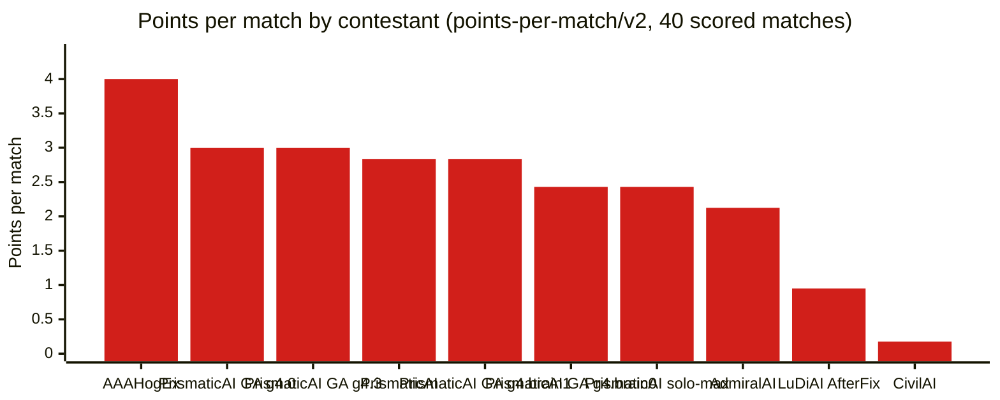
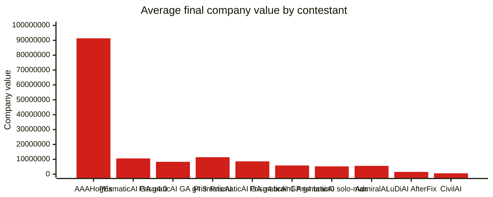
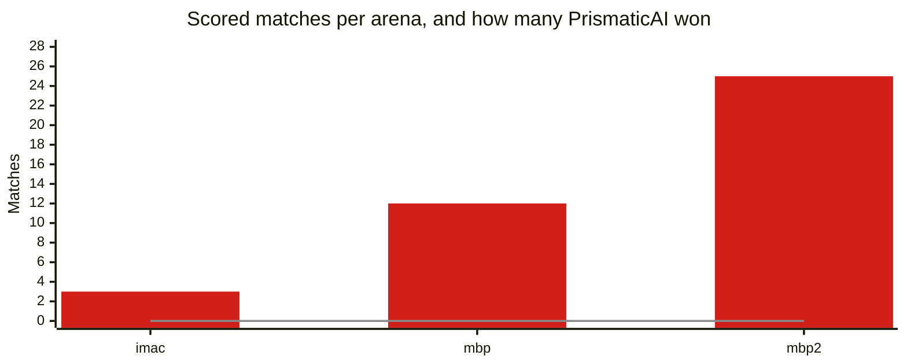

# battle-20261119T074324-1e514c9e

Derived from `battle-20261119T074324-1e514c9e.json` by `tools/research/ai-battle/battle.py report`; do not edit.

- Edition `1e514c9e149e745e`: PrismaticAI and referee at `f26a6f7f02cc784419e6c7b01b9c560c9517113e`, base set `opengfx-8.0.tar`
- 20-year free-for-all from 1960, map 256x256 temperate, breakdowns 1
- 40 scored match(es) on `imac` (20261119-master-gdf1e05e7d8), `mbp` (20261119-master-m6bc33a2f17), `mbp2` (20261119-master-gdf1e05e7d8)
- Replays: 0 of 0 identical to their original on another arena

| # | Contestant | Played | Wins | Points | Points/match | Avg rank | Avg final value | Squirrel errors | Matches with anomalies |
|---|---|---|---|---|---|---|---|---|---|
| 1 | AAAHogEx | 40 | 40 | 160 | 4.0 | 1.0 | 91.3 M | 0 | 0 |
| 2 | PrismaticAI GA g4.0 | 7 | 0 | 21 | 3.0 | 2.0 | 10.6 M | 0 | 0 |
| 3 | PrismaticAI GA g4.3 | 7 | 0 | 21 | 3.0 | 2.0 | 8.3 M | 0 | 0 |
| 4 | PrismaticAI | 6 | 0 | 17 | 2.833 | 2.17 | 11.4 M | 0 | 0 |
| 5 | PrismaticAI GA g4.brain1 | 6 | 0 | 17 | 2.833 | 2.17 | 8.6 M | 0 | 0 |
| 6 | PrismaticAI GA g4.brain0 | 7 | 0 | 17 | 2.429 | 2.57 | 5.8 M | 0 | 1 |
| 7 | PrismaticAI solo-max | 7 | 0 | 17 | 2.429 | 2.57 | 5.3 M | 0 | 7 |
| 8 | AdmiralAI | 40 | 0 | 85 | 2.125 | 2.88 | 5.6 M | 57 | 3 |
| 9 | LuDiAI AfterFix | 40 | 0 | 38 | 0.95 | 4.05 | 1.5 M | 0 | 4 |
| 10 | CivilAI | 40 | 0 | 7 | 0.175 | 4.83 | 587.0 k | 7640 | 13 |

```mermaid
---
config:
  xyChart:
    width: 900
    height: 360
  themeVariables:
    xyChart:
      plotColorPalette: "#d11f1a, #8a8a8a, #0b0b0b, #ece4d6"
---
xychart-beta
    title "Final company value per scored match: winner vs best PrismaticAI"
    x-axis ["m-0001", "m-0002", "m-0003", "m-0010", "m-0011", "m-0012", "m-0013", "m-0014", "m-0015", "m-0016", "m-0017", "m-0018", "m-0019", "m-0020", "m-0021", "m-0022", "m-0023", "m-0024", "m-0025", "m-0026", "m-0027", "m-0028", "m-0036", "m-0037", "m-0038", "m-0039", "m-0041", "m-0042", "m-0043", "m-0044", "m-0045", "m-0046", "m-0047", "m-0049", "m-0050", "m-0051", "m-0053", "m-0058", "m-0059", "m-0060"]
    %% series: Winner | Best PrismaticAI
    %% links: battle-20261119T074324-1e514c9e.md?col=Match&filter=m-0001 | battle-20261119T074324-1e514c9e.md?col=Match&filter=m-0002 | battle-20261119T074324-1e514c9e.md?col=Match&filter=m-0003 | battle-20261119T074324-1e514c9e.md?col=Match&filter=m-0010 | battle-20261119T074324-1e514c9e.md?col=Match&filter=m-0011 | battle-20261119T074324-1e514c9e.md?col=Match&filter=m-0012 | battle-20261119T074324-1e514c9e.md?col=Match&filter=m-0013 | battle-20261119T074324-1e514c9e.md?col=Match&filter=m-0014 | battle-20261119T074324-1e514c9e.md?col=Match&filter=m-0015 | battle-20261119T074324-1e514c9e.md?col=Match&filter=m-0016 | battle-20261119T074324-1e514c9e.md?col=Match&filter=m-0017 | battle-20261119T074324-1e514c9e.md?col=Match&filter=m-0018 | battle-20261119T074324-1e514c9e.md?col=Match&filter=m-0019 | battle-20261119T074324-1e514c9e.md?col=Match&filter=m-0020 | battle-20261119T074324-1e514c9e.md?col=Match&filter=m-0021 | battle-20261119T074324-1e514c9e.md?col=Match&filter=m-0022 | battle-20261119T074324-1e514c9e.md?col=Match&filter=m-0023 | battle-20261119T074324-1e514c9e.md?col=Match&filter=m-0024 | battle-20261119T074324-1e514c9e.md?col=Match&filter=m-0025 | battle-20261119T074324-1e514c9e.md?col=Match&filter=m-0026 | battle-20261119T074324-1e514c9e.md?col=Match&filter=m-0027 | battle-20261119T074324-1e514c9e.md?col=Match&filter=m-0028 | battle-20261119T074324-1e514c9e.md?col=Match&filter=m-0036 | battle-20261119T074324-1e514c9e.md?col=Match&filter=m-0037 | battle-20261119T074324-1e514c9e.md?col=Match&filter=m-0038 | battle-20261119T074324-1e514c9e.md?col=Match&filter=m-0039 | battle-20261119T074324-1e514c9e.md?col=Match&filter=m-0041 | battle-20261119T074324-1e514c9e.md?col=Match&filter=m-0042 | battle-20261119T074324-1e514c9e.md?col=Match&filter=m-0043 | battle-20261119T074324-1e514c9e.md?col=Match&filter=m-0044 | battle-20261119T074324-1e514c9e.md?col=Match&filter=m-0045 | battle-20261119T074324-1e514c9e.md?col=Match&filter=m-0046 | battle-20261119T074324-1e514c9e.md?col=Match&filter=m-0047 | battle-20261119T074324-1e514c9e.md?col=Match&filter=m-0049 | battle-20261119T074324-1e514c9e.md?col=Match&filter=m-0050 | battle-20261119T074324-1e514c9e.md?col=Match&filter=m-0051 | battle-20261119T074324-1e514c9e.md?col=Match&filter=m-0053 | battle-20261119T074324-1e514c9e.md?col=Match&filter=m-0058 | battle-20261119T074324-1e514c9e.md?col=Match&filter=m-0059 | battle-20261119T074324-1e514c9e.md?col=Match&filter=m-0060
    y-axis "Company value" 0 --> 172000000
    bar [138380025, 117600550, 156678604, 139245808, 113614231, 71181880, 76491144, 71709668, 73441989, 74373401, 70556115, 69346448, 68410509, 66786193, 64541137, 68441654, 66521041, 102289595, 127482560, 126580207, 84946408, 90049827, 63967438, 64044462, 46328559, 71905855, 45284399, 136288684, 139787927, 112752757, 116502195, 112659986, 109603225, 72978799, 77499980, 66993715, 84069167, 116872221, 108560515, 68215396]
    line [5991647, 14154777, 6511116, 7035658, 9991963, 6611167, 5954572, 10844257, 4648674, 7612311, 8367499, 9615890, 2802055, 11614939, 7863442, 6105403, 7647859, 14706340, 5637672, 8961248, 6323167, 10226770, 8947074, 5938659, 13660700, 346157, 9230260, 10519261, 5758790, 8151892, 8561111, 8993239, 9605606, 4731167, 6684413, 6646600, 4666604, 11706179, 8684747, 17963251]
```

<!-- battle-charts:begin -->
<!-- derived from battle-20261119T074324-1e514c9e.json by `battle.py render`; `battle.py check` fails when it is stale -->

<!-- battle-charts:end -->

| Match | Arena | Seed | Winner | Value | Last | Anomalies |
|---|---|---|---|---|---|---|
| m-0001 | mbp | 1237256277 | AAAHogEx | 138.4 M | CivilAI | PrismaticAI solo-max: fleet_drop:54->22 |
| m-0002 | mbp | 1237256277 | AAAHogEx | 117.6 M | CivilAI | AdmiralAI: fleet_drop:166->104 |
| m-0003 | mbp | 1237256277 | AAAHogEx | 156.7 M | CivilAI | - |
| m-0004 | mbp | 1237256277 | AAAHogEx | 59.3 M | CivilAI | - |
| m-0005 | mbp | 1237256277 | AAAHogEx | 50.2 M | CivilAI | - |
| m-0006 | mbp | 1251879686 | AAAHogEx | 63.5 M | CivilAI | - |
| m-0007 | mbp | 1251879686 | AAAHogEx | 74.4 M | LuDiAI AfterFix | PrismaticAI solo-max: fleet_drop:42->20 |
| m-0008 | mbp | 1251879686 | AAAHogEx | 40.3 M | LuDiAI AfterFix | - |
| m-0009 | mbp | 1251879686 | AAAHogEx | 54.2 M | CivilAI | PrismaticAI GA g4.brain0: fleet_drop:27->18 |
| m-0010 | imac | 1251879686 | AAAHogEx | 139.2 M | CivilAI | - |
| m-0011 | imac | 1251879686 | AAAHogEx | 113.6 M | CivilAI | CivilAI: squirrel_errors:3835 |
| m-0012 | imac | 930967890 | AAAHogEx | 71.2 M | CivilAI | CivilAI: squirrel_errors:3805 |
| m-0013 | mbp2 | 930967890 | AAAHogEx | 76.5 M | CivilAI | PrismaticAI solo-max: fleet_drop:36->16; CivilAI: fleet_drop:45->30 |
| m-0014 | mbp2 | 930967890 | AAAHogEx | 71.7 M | LuDiAI AfterFix | LuDiAI AfterFix: fleet_drop:61->42 |
| m-0015 | mbp2 | 930967890 | AAAHogEx | 73.4 M | CivilAI | CivilAI: fleet_drop:37->8 |
| m-0016 | mbp2 | 930967890 | AAAHogEx | 74.4 M | LuDiAI AfterFix | LuDiAI AfterFix: fleet_drop:56->8 |
| m-0017 | mbp2 | 930967890 | AAAHogEx | 70.6 M | CivilAI | - |
| m-0018 | mbp2 | 1814625749 | AAAHogEx | 69.3 M | CivilAI | - |
| m-0019 | mbp2 | 1814625749 | AAAHogEx | 68.4 M | CivilAI | PrismaticAI solo-max: fleet_drop:38->17 |
| m-0020 | mbp2 | 1814625749 | AAAHogEx | 66.8 M | CivilAI | - |
| m-0021 | mbp2 | 1814625749 | AAAHogEx | 64.5 M | CivilAI | AdmiralAI: fleet_drop:279->169; CivilAI: fleet_drop:18->8 |
| m-0022 | mbp2 | 1814625749 | AAAHogEx | 68.4 M | CivilAI | - |
| m-0023 | mbp2 | 1814625749 | AAAHogEx | 66.5 M | CivilAI | - |
| m-0024 | mbp2 | 397755790 | AAAHogEx | 102.3 M | LuDiAI AfterFix | - |
| m-0025 | mbp2 | 397755790 | AAAHogEx | 127.5 M | CivilAI | PrismaticAI solo-max: fleet_drop:41->22; CivilAI: fleet_drop:11->7 |
| m-0026 | mbp2 | 397755790 | AAAHogEx | 126.6 M | LuDiAI AfterFix | - |
| m-0027 | mbp2 | 397755790 | AAAHogEx | 84.9 M | CivilAI | LuDiAI AfterFix: fleet_drop:38->5; CivilAI: fleet_drop:67->30 |
| m-0028 | mbp2 | 397755790 | AAAHogEx | 90.0 M | CivilAI | AdmiralAI: squirrel_errors:57, fleet_drop:285->131; CivilAI: fleet_drop:13->9 |
| m-0036 | mbp | 622201523 | AAAHogEx | 64.0 M | CivilAI | LuDiAI AfterFix: fleet_drop:49->34; CivilAI: fleet_drop:65->29 |
| m-0037 | mbp | 622201523 | AAAHogEx | 64.0 M | CivilAI | PrismaticAI solo-max: fleet_drop:40->14 |
| m-0038 | mbp | 622201523 | AAAHogEx | 46.3 M | CivilAI | - |
| m-0039 | mbp2 | 622201523 | AAAHogEx | 71.9 M | CivilAI | PrismaticAI GA g4.brain0: fleet_drop:24->12; CivilAI: no_vehicles |
| m-0041 | mbp2 | 622201523 | AAAHogEx | 45.3 M | CivilAI | CivilAI: fleet_drop:16->9 |
| m-0042 | mbp | 1791605593 | AAAHogEx | 136.3 M | CivilAI | - |
| m-0043 | mbp | 1791605593 | AAAHogEx | 139.8 M | CivilAI | PrismaticAI solo-max: fleet_drop:38->14 |
| m-0044 | mbp2 | 1791605593 | AAAHogEx | 112.8 M | CivilAI | - |
| m-0045 | mbp2 | 1791605593 | AAAHogEx | 116.5 M | AdmiralAI | CivilAI: fleet_drop:70->42 |
| m-0046 | mbp2 | 1791605593 | AAAHogEx | 112.7 M | CivilAI | - |
| m-0047 | mbp2 | 1791605593 | AAAHogEx | 109.6 M | CivilAI | - |
| m-0049 | mbp2 | 1016335253 | AAAHogEx | 73.0 M | CivilAI | PrismaticAI solo-max: fleet_drop:33->13 |
| m-0050 | mbp2 | 1016335253 | AAAHogEx | 77.5 M | CivilAI | - |
| m-0051 | mbp | 1016335253 | AAAHogEx | 67.0 M | LuDiAI AfterFix | CivilAI: fleet_drop:93->44 |
| m-0053 | mbp2 | 1016335253 | AAAHogEx | 84.1 M | CivilAI | - |
| m-0058 | mbp | 1182050720 | AAAHogEx | 116.9 M | CivilAI | - |
| m-0059 | mbp | 1182050720 | AAAHogEx | 108.6 M | CivilAI | - |
| m-0060 | mbp | 644316239 | AAAHogEx | 68.2 M | CivilAI | - |
