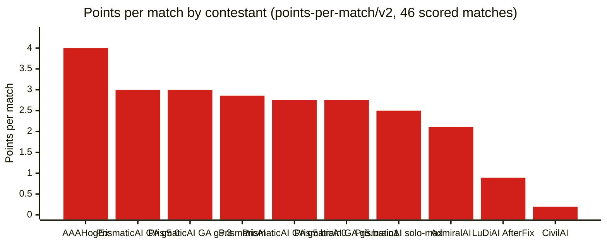
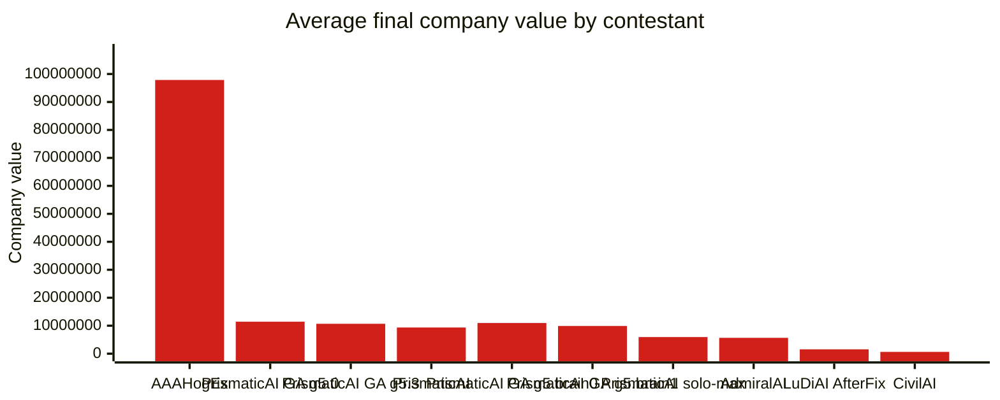
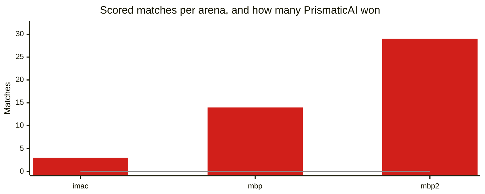

# battle-20261119T075554-e50badb2

Derived from `battle-20261119T075554-e50badb2.json` by `tools/research/ai-battle/battle.py report`; do not edit.

- Edition `e50badb221ef06d2`: PrismaticAI and referee at `f26a6f7f02cc784419e6c7b01b9c560c9517113e`, base set `opengfx-8.0.tar`
- 20-year free-for-all from 1960, map 256x256 temperate, breakdowns 1
- 46 scored match(es) on `imac` (20261119-master-gdf1e05e7d8), `mbp` (20261119-master-m6bc33a2f17), `mbp2` (20261119-master-gdf1e05e7d8)
- Replays: 0 of 0 identical to their original on another arena

| # | Contestant | Played | Wins | Points | Points/match | Avg rank | Avg final value | Squirrel errors | Matches with anomalies |
|---|---|---|---|---|---|---|---|---|---|
| 1 | AAAHogEx | 46 | 46 | 184 | 4.0 | 1.0 | 97.9 M | 0 | 0 |
| 2 | PrismaticAI GA g5.0 | 8 | 0 | 24 | 3.0 | 2.0 | 11.4 M | 0 | 0 |
| 3 | PrismaticAI GA g5.3 | 7 | 0 | 21 | 3.0 | 2.0 | 10.7 M | 0 | 0 |
| 4 | PrismaticAI | 7 | 0 | 20 | 2.857 | 2.14 | 9.3 M | 0 | 1 |
| 5 | PrismaticAI GA g5.brain0 | 8 | 0 | 22 | 2.75 | 2.25 | 11.0 M | 0 | 6 |
| 6 | PrismaticAI GA g5.brain1 | 8 | 0 | 22 | 2.75 | 2.25 | 9.9 M | 0 | 0 |
| 7 | PrismaticAI solo-max | 8 | 0 | 20 | 2.5 | 2.5 | 5.9 M | 0 | 8 |
| 8 | AdmiralAI | 46 | 0 | 97 | 2.109 | 2.89 | 5.7 M | 0 | 6 |
| 9 | LuDiAI AfterFix | 46 | 0 | 41 | 0.891 | 4.11 | 1.5 M | 0 | 5 |
| 10 | CivilAI | 46 | 0 | 9 | 0.196 | 4.8 | 638.8 k | 0 | 7 |

```mermaid
---
config:
  xyChart:
    width: 900
    height: 360
  themeVariables:
    xyChart:
      plotColorPalette: "#d11f1a, #8a8a8a, #0b0b0b, #ece4d6"
---
xychart-beta
    title "Final company value per scored match: winner vs best PrismaticAI"
    x-axis ["m-0001", "m-0002", "m-0003", "m-0004", "m-0005", "m-0006", "m-0007", "m-0008", "m-0009", "m-0010", "m-0011", "m-0012", "m-0013", "m-0014", "m-0015", "m-0016", "m-0017", "m-0018", "m-0019", "m-0020", "m-0021", "m-0022", "m-0030", "m-0031", "m-0032", "m-0033", "m-0034", "m-0035", "m-0036", "m-0037", "m-0038", "m-0039", "m-0041", "m-0042", "m-0043", "m-0044", "m-0045", "m-0046", "m-0047", "m-0050", "m-0051", "m-0052", "m-0054", "m-0055", "m-0058", "m-0059"]
    %% series: Winner | Best PrismaticAI
    %% links: battle-20261119T075554-e50badb2.md?col=Match&filter=m-0001 | battle-20261119T075554-e50badb2.md?col=Match&filter=m-0002 | battle-20261119T075554-e50badb2.md?col=Match&filter=m-0003 | battle-20261119T075554-e50badb2.md?col=Match&filter=m-0004 | battle-20261119T075554-e50badb2.md?col=Match&filter=m-0005 | battle-20261119T075554-e50badb2.md?col=Match&filter=m-0006 | battle-20261119T075554-e50badb2.md?col=Match&filter=m-0007 | battle-20261119T075554-e50badb2.md?col=Match&filter=m-0008 | battle-20261119T075554-e50badb2.md?col=Match&filter=m-0009 | battle-20261119T075554-e50badb2.md?col=Match&filter=m-0010 | battle-20261119T075554-e50badb2.md?col=Match&filter=m-0011 | battle-20261119T075554-e50badb2.md?col=Match&filter=m-0012 | battle-20261119T075554-e50badb2.md?col=Match&filter=m-0013 | battle-20261119T075554-e50badb2.md?col=Match&filter=m-0014 | battle-20261119T075554-e50badb2.md?col=Match&filter=m-0015 | battle-20261119T075554-e50badb2.md?col=Match&filter=m-0016 | battle-20261119T075554-e50badb2.md?col=Match&filter=m-0017 | battle-20261119T075554-e50badb2.md?col=Match&filter=m-0018 | battle-20261119T075554-e50badb2.md?col=Match&filter=m-0019 | battle-20261119T075554-e50badb2.md?col=Match&filter=m-0020 | battle-20261119T075554-e50badb2.md?col=Match&filter=m-0021 | battle-20261119T075554-e50badb2.md?col=Match&filter=m-0022 | battle-20261119T075554-e50badb2.md?col=Match&filter=m-0030 | battle-20261119T075554-e50badb2.md?col=Match&filter=m-0031 | battle-20261119T075554-e50badb2.md?col=Match&filter=m-0032 | battle-20261119T075554-e50badb2.md?col=Match&filter=m-0033 | battle-20261119T075554-e50badb2.md?col=Match&filter=m-0034 | battle-20261119T075554-e50badb2.md?col=Match&filter=m-0035 | battle-20261119T075554-e50badb2.md?col=Match&filter=m-0036 | battle-20261119T075554-e50badb2.md?col=Match&filter=m-0037 | battle-20261119T075554-e50badb2.md?col=Match&filter=m-0038 | battle-20261119T075554-e50badb2.md?col=Match&filter=m-0039 | battle-20261119T075554-e50badb2.md?col=Match&filter=m-0041 | battle-20261119T075554-e50badb2.md?col=Match&filter=m-0042 | battle-20261119T075554-e50badb2.md?col=Match&filter=m-0043 | battle-20261119T075554-e50badb2.md?col=Match&filter=m-0044 | battle-20261119T075554-e50badb2.md?col=Match&filter=m-0045 | battle-20261119T075554-e50badb2.md?col=Match&filter=m-0046 | battle-20261119T075554-e50badb2.md?col=Match&filter=m-0047 | battle-20261119T075554-e50badb2.md?col=Match&filter=m-0050 | battle-20261119T075554-e50badb2.md?col=Match&filter=m-0051 | battle-20261119T075554-e50badb2.md?col=Match&filter=m-0052 | battle-20261119T075554-e50badb2.md?col=Match&filter=m-0054 | battle-20261119T075554-e50badb2.md?col=Match&filter=m-0055 | battle-20261119T075554-e50badb2.md?col=Match&filter=m-0058 | battle-20261119T075554-e50badb2.md?col=Match&filter=m-0059
    y-axis "Company value" 0 --> 206000000
    bar [138380025, 117600550, 127653910, 133543852, 119741835, 124951658, 133760496, 93591983, 94695572, 83904034, 99371356, 75652175, 76491144, 71709668, 80260112, 59789770, 71982355, 69346448, 68410509, 66786193, 78229162, 69740169, 92757129, 106588341, 118442993, 88042409, 120344741, 81765908, 63967438, 64044462, 46328559, 59512136, 62383405, 136288684, 139787927, 112752757, 139642531, 102103916, 99805630, 77499980, 78447823, 68923842, 135234197, 187340807, 110178479, 153716638]
    line [5991647, 14154777, 14947008, 13097550, 11168188, 8074993, 6311268, 12710389, 6966066, 10110509, 8311258, 6024687, 5954572, 10844257, 8884028, 7027089, 9359177, 9615890, 2802055, 11614939, 7404553, 3059509, 13508004, 8164611, 13606617, 16341032, 10487512, 14234699, 8947074, 5938659, 13660700, 8548237, 9106863, 10519261, 5758790, 8151892, 13820844, 12769992, 14028513, 6684413, 10796375, 2540666, 8748643, 6560557, 20164726, 8606869]
```

<!-- battle-charts:begin -->
<!-- derived from battle-20261119T075554-e50badb2.json by `battle.py render`; `battle.py check` fails when it is stale -->

<!-- battle-charts:end -->

| Match | Arena | Seed | Winner | Value | Last | Anomalies |
|---|---|---|---|---|---|---|
| m-0001 | mbp | 1237256277 | AAAHogEx | 138.4 M | CivilAI | PrismaticAI solo-max: fleet_drop:54->22 |
| m-0002 | mbp | 1237256277 | AAAHogEx | 117.6 M | CivilAI | AdmiralAI: fleet_drop:166->104 |
| m-0003 | mbp | 1237256277 | AAAHogEx | 127.7 M | CivilAI | AdmiralAI: fleet_drop:305->190 |
| m-0004 | imac | 1237256277 | AAAHogEx | 133.5 M | CivilAI | - |
| m-0005 | imac | 1237256277 | AAAHogEx | 119.7 M | CivilAI | - |
| m-0006 | imac | 1251879686 | AAAHogEx | 125.0 M | CivilAI | - |
| m-0007 | mbp2 | 1251879686 | AAAHogEx | 133.8 M | LuDiAI AfterFix | PrismaticAI solo-max: fleet_drop:42->20 |
| m-0008 | mbp2 | 1251879686 | AAAHogEx | 93.6 M | LuDiAI AfterFix | AdmiralAI: fleet_drop:259->160 |
| m-0009 | mbp2 | 1251879686 | AAAHogEx | 94.7 M | CivilAI | PrismaticAI GA g5.brain0: fleet_drop:137->60; CivilAI: fleet_drop:60->23 |
| m-0010 | mbp2 | 1251879686 | AAAHogEx | 83.9 M | LuDiAI AfterFix | - |
| m-0011 | mbp2 | 1251879686 | AAAHogEx | 99.4 M | CivilAI | - |
| m-0012 | mbp2 | 930967890 | AAAHogEx | 75.7 M | LuDiAI AfterFix | PrismaticAI: fleet_drop:61->39 |
| m-0013 | mbp2 | 930967890 | AAAHogEx | 76.5 M | CivilAI | PrismaticAI solo-max: fleet_drop:36->16; CivilAI: fleet_drop:45->30 |
| m-0014 | mbp2 | 930967890 | AAAHogEx | 71.7 M | LuDiAI AfterFix | LuDiAI AfterFix: fleet_drop:61->42 |
| m-0015 | mbp2 | 930967890 | AAAHogEx | 80.3 M | CivilAI | - |
| m-0016 | mbp2 | 930967890 | AAAHogEx | 59.8 M | CivilAI | - |
| m-0017 | mbp2 | 930967890 | AAAHogEx | 72.0 M | LuDiAI AfterFix | CivilAI: fleet_drop:33->20; LuDiAI AfterFix: fleet_drop:64->24 |
| m-0018 | mbp2 | 1814625749 | AAAHogEx | 69.3 M | CivilAI | - |
| m-0019 | mbp2 | 1814625749 | AAAHogEx | 68.4 M | CivilAI | PrismaticAI solo-max: fleet_drop:38->17 |
| m-0020 | mbp2 | 1814625749 | AAAHogEx | 66.8 M | CivilAI | - |
| m-0021 | mbp2 | 1814625749 | AAAHogEx | 78.2 M | CivilAI | PrismaticAI GA g5.brain0: fleet_drop:130->80 |
| m-0022 | mbp2 | 1814625749 | AAAHogEx | 69.7 M | CivilAI | - |
| m-0030 | mbp | 852521374 | AAAHogEx | 92.8 M | LuDiAI AfterFix | LuDiAI AfterFix: fleet_drop:60->31 |
| m-0031 | mbp | 852521374 | AAAHogEx | 106.6 M | CivilAI | PrismaticAI solo-max: fleet_drop:53->17; AdmiralAI: fleet_drop:509->306; CivilAI: fleet_drop:32->18 |
| m-0032 | mbp | 852521374 | AAAHogEx | 118.4 M | LuDiAI AfterFix | - |
| m-0033 | mbp | 852521374 | AAAHogEx | 88.0 M | CivilAI | PrismaticAI GA g5.brain0: fleet_drop:68->41 |
| m-0034 | mbp2 | 852521374 | AAAHogEx | 120.3 M | CivilAI | - |
| m-0035 | mbp2 | 852521374 | AAAHogEx | 81.8 M | LuDiAI AfterFix | AdmiralAI: fleet_drop:112->77; LuDiAI AfterFix: fleet_drop:64->39 |
| m-0036 | mbp2 | 622201523 | AAAHogEx | 64.0 M | CivilAI | LuDiAI AfterFix: fleet_drop:49->34; CivilAI: fleet_drop:65->29 |
| m-0037 | mbp | 622201523 | AAAHogEx | 64.0 M | CivilAI | PrismaticAI solo-max: fleet_drop:40->14 |
| m-0038 | mbp | 622201523 | AAAHogEx | 46.3 M | CivilAI | - |
| m-0039 | mbp2 | 622201523 | AAAHogEx | 59.5 M | CivilAI | PrismaticAI GA g5.brain0: fleet_drop:104->39 |
| m-0041 | mbp2 | 622201523 | AAAHogEx | 62.4 M | CivilAI | AdmiralAI: fleet_drop:75->33 |
| m-0042 | mbp2 | 1791605593 | AAAHogEx | 136.3 M | CivilAI | - |
| m-0043 | mbp2 | 1791605593 | AAAHogEx | 139.8 M | CivilAI | PrismaticAI solo-max: fleet_drop:38->14 |
| m-0044 | mbp2 | 1791605593 | AAAHogEx | 112.8 M | CivilAI | - |
| m-0045 | mbp2 | 1791605593 | AAAHogEx | 139.6 M | CivilAI | PrismaticAI GA g5.brain0: fleet_drop:190->120 |
| m-0046 | mbp2 | 1791605593 | AAAHogEx | 102.1 M | CivilAI | - |
| m-0047 | mbp2 | 1791605593 | AAAHogEx | 99.8 M | CivilAI | CivilAI: fleet_drop:88->51 |
| m-0050 | mbp2 | 1016335253 | AAAHogEx | 77.5 M | CivilAI | - |
| m-0051 | mbp2 | 1016335253 | AAAHogEx | 78.4 M | CivilAI | PrismaticAI GA g5.brain0: fleet_drop:153->70 |
| m-0052 | mbp | 1016335253 | AAAHogEx | 68.9 M | CivilAI | CivilAI: fleet_drop:114->78 |
| m-0054 | mbp | 1182050720 | AAAHogEx | 135.2 M | CivilAI | - |
| m-0055 | mbp | 1182050720 | AAAHogEx | 187.3 M | CivilAI | PrismaticAI solo-max: fleet_drop:47->25 |
| m-0058 | mbp | 1182050720 | AAAHogEx | 110.2 M | CivilAI | - |
| m-0059 | mbp | 1182050720 | AAAHogEx | 153.7 M | CivilAI | - |
