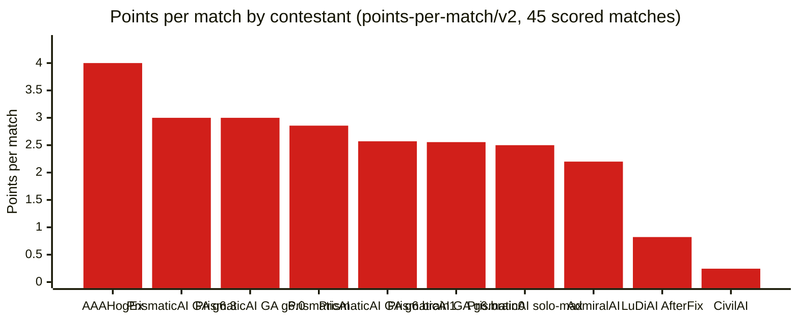
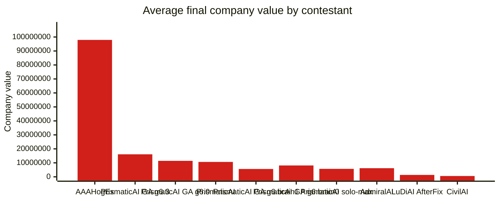
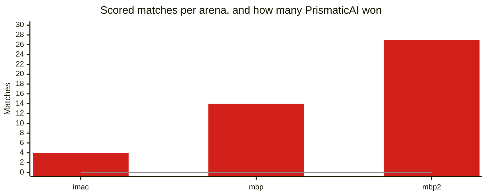

# battle-20261119T080954-8b438c7d

Derived from `battle-20261119T080954-8b438c7d.json` by `tools/research/ai-battle/battle.py report`; do not edit.

- Edition `8b438c7d49a4f661`: PrismaticAI and referee at `f26a6f7f02cc784419e6c7b01b9c560c9517113e`, base set `opengfx-8.0.tar`
- 20-year free-for-all from 1960, map 256x256 temperate, breakdowns 1
- 45 scored match(es) on `imac` (20261119-master-gdf1e05e7d8), `mbp` (20261119-master-m6bc33a2f17, 20261119-master-mf26a6f7f02), `mbp2` (20261119-master-gdf1e05e7d8)
- Replays: 0 of 1 identical to their original on another arena

| # | Contestant | Played | Wins | Points | Points/match | Avg rank | Avg final value | Squirrel errors | Matches with anomalies |
|---|---|---|---|---|---|---|---|---|---|
| 1 | AAAHogEx | 45 | 45 | 180 | 4.0 | 1.0 | 97.9 M | 0 | 0 |
| 2 | PrismaticAI GA g6.3 | 6 | 0 | 18 | 3.0 | 2.0 | 16.1 M | 0 | 1 |
| 3 | PrismaticAI GA g6.0 | 8 | 0 | 24 | 3.0 | 2.0 | 11.4 M | 0 | 0 |
| 4 | PrismaticAI | 7 | 0 | 20 | 2.857 | 2.14 | 10.7 M | 0 | 2 |
| 5 | PrismaticAI GA g6.brain1 | 7 | 0 | 18 | 2.571 | 2.43 | 5.6 M | 0 | 2 |
| 6 | PrismaticAI GA g6.brain0 | 9 | 0 | 23 | 2.556 | 2.44 | 8.1 M | 0 | 4 |
| 7 | PrismaticAI solo-max | 8 | 0 | 20 | 2.5 | 2.5 | 5.7 M | 0 | 8 |
| 8 | AdmiralAI | 45 | 0 | 99 | 2.2 | 2.8 | 6.2 M | 0 | 4 |
| 9 | LuDiAI AfterFix | 45 | 0 | 37 | 0.822 | 4.18 | 1.4 M | 0 | 4 |
| 10 | CivilAI | 45 | 0 | 11 | 0.244 | 4.76 | 585.8 k | 0 | 6 |

```mermaid
---
config:
  xyChart:
    width: 900
    height: 360
  themeVariables:
    xyChart:
      plotColorPalette: "#d11f1a, #8a8a8a, #0b0b0b, #ece4d6"
---
xychart-beta
    title "Final company value per scored match: winner vs best PrismaticAI"
    x-axis ["m-0001", "m-0002", "m-0003", "m-0004", "m-0005", "m-0006", "m-0007", "m-0008", "m-0009", "m-0010", "m-0011", "m-0012", "m-0013", "m-0014", "m-0015", "m-0016", "m-0017", "m-0018", "m-0019", "m-0020", "m-0021", "m-0022", "m-0030", "m-0031", "m-0032", "m-0033", "m-0034", "m-0035", "m-0036", "m-0037", "m-0038", "m-0039", "m-0041", "m-0042", "m-0043", "m-0044", "m-0045", "m-0046", "m-0049", "m-0050", "m-0051", "m-0052", "m-0057", "m-0059", "m-0060"]
    %% series: Winner | Best PrismaticAI
    %% links: battle-20261119T080954-8b438c7d.md?col=Match&filter=m-0001 | battle-20261119T080954-8b438c7d.md?col=Match&filter=m-0002 | battle-20261119T080954-8b438c7d.md?col=Match&filter=m-0003 | battle-20261119T080954-8b438c7d.md?col=Match&filter=m-0004 | battle-20261119T080954-8b438c7d.md?col=Match&filter=m-0005 | battle-20261119T080954-8b438c7d.md?col=Match&filter=m-0006 | battle-20261119T080954-8b438c7d.md?col=Match&filter=m-0007 | battle-20261119T080954-8b438c7d.md?col=Match&filter=m-0008 | battle-20261119T080954-8b438c7d.md?col=Match&filter=m-0009 | battle-20261119T080954-8b438c7d.md?col=Match&filter=m-0010 | battle-20261119T080954-8b438c7d.md?col=Match&filter=m-0011 | battle-20261119T080954-8b438c7d.md?col=Match&filter=m-0012 | battle-20261119T080954-8b438c7d.md?col=Match&filter=m-0013 | battle-20261119T080954-8b438c7d.md?col=Match&filter=m-0014 | battle-20261119T080954-8b438c7d.md?col=Match&filter=m-0015 | battle-20261119T080954-8b438c7d.md?col=Match&filter=m-0016 | battle-20261119T080954-8b438c7d.md?col=Match&filter=m-0017 | battle-20261119T080954-8b438c7d.md?col=Match&filter=m-0018 | battle-20261119T080954-8b438c7d.md?col=Match&filter=m-0019 | battle-20261119T080954-8b438c7d.md?col=Match&filter=m-0020 | battle-20261119T080954-8b438c7d.md?col=Match&filter=m-0021 | battle-20261119T080954-8b438c7d.md?col=Match&filter=m-0022 | battle-20261119T080954-8b438c7d.md?col=Match&filter=m-0030 | battle-20261119T080954-8b438c7d.md?col=Match&filter=m-0031 | battle-20261119T080954-8b438c7d.md?col=Match&filter=m-0032 | battle-20261119T080954-8b438c7d.md?col=Match&filter=m-0033 | battle-20261119T080954-8b438c7d.md?col=Match&filter=m-0034 | battle-20261119T080954-8b438c7d.md?col=Match&filter=m-0035 | battle-20261119T080954-8b438c7d.md?col=Match&filter=m-0036 | battle-20261119T080954-8b438c7d.md?col=Match&filter=m-0037 | battle-20261119T080954-8b438c7d.md?col=Match&filter=m-0038 | battle-20261119T080954-8b438c7d.md?col=Match&filter=m-0039 | battle-20261119T080954-8b438c7d.md?col=Match&filter=m-0041 | battle-20261119T080954-8b438c7d.md?col=Match&filter=m-0042 | battle-20261119T080954-8b438c7d.md?col=Match&filter=m-0043 | battle-20261119T080954-8b438c7d.md?col=Match&filter=m-0044 | battle-20261119T080954-8b438c7d.md?col=Match&filter=m-0045 | battle-20261119T080954-8b438c7d.md?col=Match&filter=m-0046 | battle-20261119T080954-8b438c7d.md?col=Match&filter=m-0049 | battle-20261119T080954-8b438c7d.md?col=Match&filter=m-0050 | battle-20261119T080954-8b438c7d.md?col=Match&filter=m-0051 | battle-20261119T080954-8b438c7d.md?col=Match&filter=m-0052 | battle-20261119T080954-8b438c7d.md?col=Match&filter=m-0057 | battle-20261119T080954-8b438c7d.md?col=Match&filter=m-0059 | battle-20261119T080954-8b438c7d.md?col=Match&filter=m-0060
    y-axis "Company value" 0 --> 169000000
    bar [138380025, 117600550, 153263929, 153900709, 148416555, 131026065, 133760496, 93591983, 101547014, 140890376, 119211498, 75652175, 76491144, 71709668, 68432000, 61348135, 66208799, 69346448, 68410509, 66786193, 83055676, 55070171, 92757129, 106588341, 118442993, 77388083, 102734795, 75947225, 63967438, 64044462, 46328559, 54954063, 74168938, 136288684, 139787927, 112752757, 153258244, 119402704, 72978799, 77499980, 98648969, 77056970, 126764697, 151870826, 68215396]
    line [5991647, 14154777, 5734576, 3763801, 19147603, 8019117, 6311268, 12710389, 11408474, 4071575, 13823152, 6024687, 5954572, 10844257, 1721329, 5600870, 12438709, 9615890, 2802055, 11614939, 4218101, 3605634, 13508004, 8164611, 13606617, 14045560, 10195018, 19530172, 8947074, 5938659, 13660700, 6485066, 15001215, 10519261, 5758790, 8151892, 7089664, 7789391, 4731167, 6684413, 6666369, 4307714, 15781038, 16716957, 17963251]
```

<!-- battle-charts:begin -->
<!-- derived from battle-20261119T080954-8b438c7d.json by `battle.py render`; `battle.py check` fails when it is stale -->

<!-- battle-charts:end -->

| Seed | Original | Replay | Arenas | Identical |
|---|---|---|---|---|
| 1251879686 | m-0006 | m-0040 | imac / mbp | NO |

| Match | Arena | Seed | Winner | Value | Last | Anomalies |
|---|---|---|---|---|---|---|
| m-0001 | mbp | 1237256277 | AAAHogEx | 138.4 M | CivilAI | PrismaticAI solo-max: fleet_drop:54->22 |
| m-0002 | mbp | 1237256277 | AAAHogEx | 117.6 M | CivilAI | AdmiralAI: fleet_drop:166->104 |
| m-0003 | mbp | 1237256277 | AAAHogEx | 153.3 M | CivilAI | - |
| m-0004 | imac | 1237256277 | AAAHogEx | 153.9 M | CivilAI | - |
| m-0005 | imac | 1237256277 | AAAHogEx | 148.4 M | CivilAI | - |
| m-0006 | imac | 1251879686 | AAAHogEx | 131.0 M | LuDiAI AfterFix | PrismaticAI: fleet_drop:72->49; CivilAI: fleet_drop:86->53 |
| m-0007 | mbp2 | 1251879686 | AAAHogEx | 133.8 M | LuDiAI AfterFix | PrismaticAI solo-max: fleet_drop:42->20 |
| m-0008 | mbp2 | 1251879686 | AAAHogEx | 93.6 M | LuDiAI AfterFix | AdmiralAI: fleet_drop:259->160 |
| m-0009 | mbp2 | 1251879686 | AAAHogEx | 101.5 M | CivilAI | PrismaticAI GA g6.brain0: fleet_drop:168->66; CivilAI: fleet_drop:87->48 |
| m-0010 | mbp2 | 1251879686 | AAAHogEx | 140.9 M | LuDiAI AfterFix | - |
| m-0011 | mbp2 | 1251879686 | AAAHogEx | 119.2 M | LuDiAI AfterFix | PrismaticAI GA g6.3: fleet_drop:66->38 |
| m-0012 | mbp2 | 930967890 | AAAHogEx | 75.7 M | LuDiAI AfterFix | PrismaticAI: fleet_drop:61->39 |
| m-0013 | mbp2 | 930967890 | AAAHogEx | 76.5 M | CivilAI | PrismaticAI solo-max: fleet_drop:36->16; CivilAI: fleet_drop:45->30 |
| m-0014 | mbp2 | 930967890 | AAAHogEx | 71.7 M | LuDiAI AfterFix | LuDiAI AfterFix: fleet_drop:61->42 |
| m-0015 | mbp2 | 930967890 | AAAHogEx | 68.4 M | CivilAI | - |
| m-0016 | mbp2 | 930967890 | AAAHogEx | 61.3 M | CivilAI | PrismaticAI GA g6.brain1: fleet_drop:215->50 |
| m-0017 | mbp2 | 930967890 | AAAHogEx | 66.2 M | CivilAI | - |
| m-0018 | mbp2 | 1814625749 | AAAHogEx | 69.3 M | CivilAI | - |
| m-0019 | mbp2 | 1814625749 | AAAHogEx | 68.4 M | CivilAI | PrismaticAI solo-max: fleet_drop:38->17 |
| m-0020 | mbp2 | 1814625749 | AAAHogEx | 66.8 M | CivilAI | - |
| m-0021 | mbp2 | 1814625749 | AAAHogEx | 83.1 M | CivilAI | - |
| m-0022 | mbp2 | 1814625749 | AAAHogEx | 55.1 M | CivilAI | - |
| m-0030 | mbp | 852521374 | AAAHogEx | 92.8 M | LuDiAI AfterFix | LuDiAI AfterFix: fleet_drop:60->31 |
| m-0031 | mbp | 852521374 | AAAHogEx | 106.6 M | CivilAI | PrismaticAI solo-max: fleet_drop:53->17; AdmiralAI: fleet_drop:509->306; CivilAI: fleet_drop:32->18 |
| m-0032 | mbp | 852521374 | AAAHogEx | 118.4 M | LuDiAI AfterFix | - |
| m-0033 | mbp | 852521374 | AAAHogEx | 77.4 M | CivilAI | PrismaticAI GA g6.brain0: fleet_drop:188->108 |
| m-0034 | mbp | 852521374 | AAAHogEx | 102.7 M | CivilAI | PrismaticAI GA g6.brain1: fleet_drop:229->69 |
| m-0035 | mbp | 852521374 | AAAHogEx | 75.9 M | CivilAI | - |
| m-0036 | mbp2 | 622201523 | AAAHogEx | 64.0 M | CivilAI | LuDiAI AfterFix: fleet_drop:49->34; CivilAI: fleet_drop:65->29 |
| m-0037 | mbp2 | 622201523 | AAAHogEx | 64.0 M | CivilAI | PrismaticAI solo-max: fleet_drop:40->14 |
| m-0038 | mbp2 | 622201523 | AAAHogEx | 46.3 M | CivilAI | - |
| m-0039 | mbp2 | 622201523 | AAAHogEx | 55.0 M | CivilAI | PrismaticAI GA g6.brain0: fleet_drop:96->57 |
| m-0040 (replay) | mbp | 1251879686 | AAAHogEx | 121.2 M | LuDiAI AfterFix | LuDiAI AfterFix: fleet_drop:49->32 |
| m-0041 | imac | 622201523 | AAAHogEx | 74.2 M | CivilAI | LuDiAI AfterFix: fleet_drop:116->67; CivilAI: fleet_drop:21->12 |
| m-0042 | mbp2 | 1791605593 | AAAHogEx | 136.3 M | CivilAI | - |
| m-0043 | mbp2 | 1791605593 | AAAHogEx | 139.8 M | CivilAI | PrismaticAI solo-max: fleet_drop:38->14 |
| m-0044 | mbp2 | 1791605593 | AAAHogEx | 112.8 M | CivilAI | - |
| m-0045 | mbp2 | 1791605593 | AAAHogEx | 153.3 M | AdmiralAI | - |
| m-0046 | mbp2 | 1791605593 | AAAHogEx | 119.4 M | CivilAI | - |
| m-0049 | mbp2 | 1016335253 | AAAHogEx | 73.0 M | CivilAI | PrismaticAI solo-max: fleet_drop:33->13 |
| m-0050 | mbp2 | 1016335253 | AAAHogEx | 77.5 M | CivilAI | - |
| m-0051 | mbp | 1016335253 | AAAHogEx | 98.6 M | CivilAI | - |
| m-0052 | mbp | 1016335253 | AAAHogEx | 77.1 M | CivilAI | - |
| m-0057 | mbp | 1182050720 | AAAHogEx | 126.8 M | CivilAI | PrismaticAI GA g6.brain0: fleet_drop:125->67; AdmiralAI: fleet_drop:187->122 |
| m-0059 | mbp | 1182050720 | AAAHogEx | 151.9 M | CivilAI | - |
| m-0060 | mbp | 644316239 | AAAHogEx | 68.2 M | CivilAI | - |
