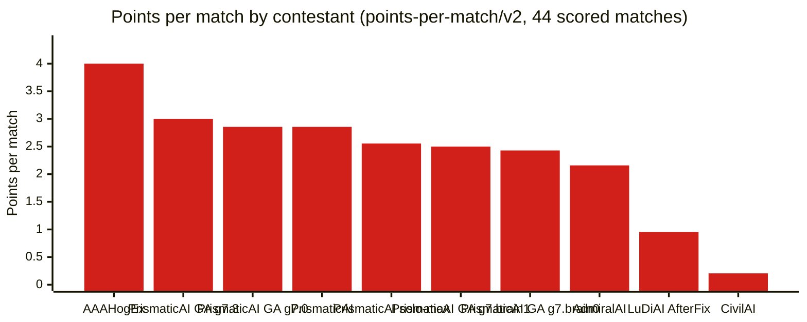
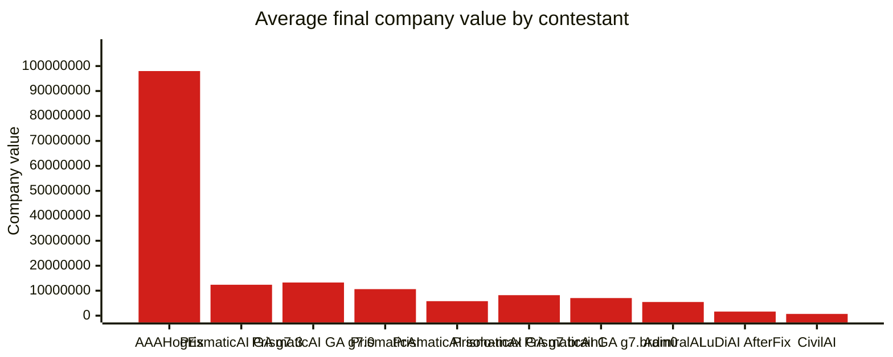
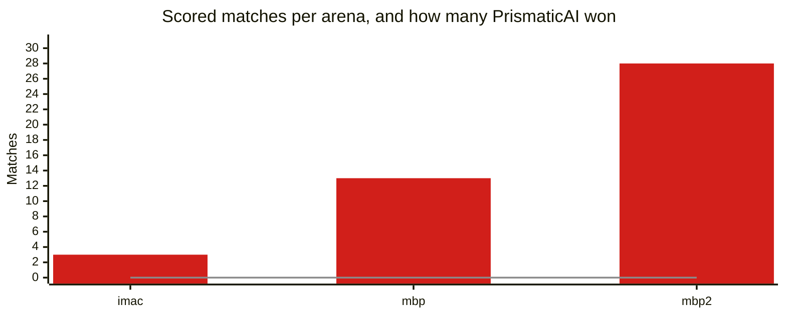

# battle-20261119T082306-6b1771b3

Derived from `battle-20261119T082306-6b1771b3.json` by `tools/research/ai-battle/battle.py report`; do not edit.

- Edition `6b1771b32cabeeba`: PrismaticAI and referee at `f26a6f7f02cc784419e6c7b01b9c560c9517113e`, base set `opengfx-8.0.tar`
- 20-year free-for-all from 1960, map 256x256 temperate, breakdowns 1
- 44 scored match(es) on `imac` (20261119-master-gdf1e05e7d8), `mbp` (20261119-master-mf26a6f7f02), `mbp2` (20261119-master-gdf1e05e7d8)
- Replays: 0 of 1 identical to their original on another arena

| # | Contestant | Played | Wins | Points | Points/match | Avg rank | Avg final value | Squirrel errors | Matches with anomalies |
|---|---|---|---|---|---|---|---|---|---|
| 1 | AAAHogEx | 44 | 44 | 176 | 4.0 | 1.0 | 98.0 M | 0 | 0 |
| 2 | PrismaticAI GA g7.3 | 6 | 0 | 18 | 3.0 | 2.0 | 12.4 M | 0 | 0 |
| 3 | PrismaticAI GA g7.0 | 7 | 0 | 20 | 2.857 | 2.14 | 13.3 M | 0 | 0 |
| 4 | PrismaticAI | 7 | 0 | 20 | 2.857 | 2.14 | 10.6 M | 0 | 1 |
| 5 | PrismaticAI solo-max | 9 | 0 | 23 | 2.556 | 2.44 | 5.8 M | 0 | 9 |
| 6 | PrismaticAI GA g7.brain1 | 8 | 0 | 20 | 2.5 | 2.5 | 8.2 M | 0 | 1 |
| 7 | PrismaticAI GA g7.brain0 | 7 | 0 | 17 | 2.429 | 2.57 | 7.0 M | 0 | 6 |
| 8 | AdmiralAI | 44 | 0 | 95 | 2.159 | 2.84 | 5.5 M | 0 | 3 |
| 9 | LuDiAI AfterFix | 44 | 0 | 42 | 0.955 | 4.05 | 1.6 M | 0 | 4 |
| 10 | CivilAI | 44 | 0 | 9 | 0.205 | 4.8 | 688.9 k | 3640 | 10 |

```mermaid
---
config:
  xyChart:
    width: 900
    height: 360
  themeVariables:
    xyChart:
      plotColorPalette: "#d11f1a, #8a8a8a, #0b0b0b, #ece4d6"
---
xychart-beta
    title "Final company value per scored match: winner vs best PrismaticAI"
    x-axis ["m-0001", "m-0002", "m-0003", "m-0004", "m-0005", "m-0006", "m-0007", "m-0008", "m-0009", "m-0010", "m-0011", "m-0012", "m-0013", "m-0014", "m-0015", "m-0016", "m-0017", "m-0018", "m-0019", "m-0020", "m-0021", "m-0022", "m-0030", "m-0031", "m-0032", "m-0033", "m-0034", "m-0035", "m-0036", "m-0037", "m-0038", "m-0039", "m-0041", "m-0042", "m-0043", "m-0044", "m-0045", "m-0046", "m-0047", "m-0049", "m-0052", "m-0055", "m-0058", "m-0060"]
    %% series: Winner | Best PrismaticAI
    %% links: battle-20261119T082306-6b1771b3.md?col=Match&filter=m-0001 | battle-20261119T082306-6b1771b3.md?col=Match&filter=m-0002 | battle-20261119T082306-6b1771b3.md?col=Match&filter=m-0003 | battle-20261119T082306-6b1771b3.md?col=Match&filter=m-0004 | battle-20261119T082306-6b1771b3.md?col=Match&filter=m-0005 | battle-20261119T082306-6b1771b3.md?col=Match&filter=m-0006 | battle-20261119T082306-6b1771b3.md?col=Match&filter=m-0007 | battle-20261119T082306-6b1771b3.md?col=Match&filter=m-0008 | battle-20261119T082306-6b1771b3.md?col=Match&filter=m-0009 | battle-20261119T082306-6b1771b3.md?col=Match&filter=m-0010 | battle-20261119T082306-6b1771b3.md?col=Match&filter=m-0011 | battle-20261119T082306-6b1771b3.md?col=Match&filter=m-0012 | battle-20261119T082306-6b1771b3.md?col=Match&filter=m-0013 | battle-20261119T082306-6b1771b3.md?col=Match&filter=m-0014 | battle-20261119T082306-6b1771b3.md?col=Match&filter=m-0015 | battle-20261119T082306-6b1771b3.md?col=Match&filter=m-0016 | battle-20261119T082306-6b1771b3.md?col=Match&filter=m-0017 | battle-20261119T082306-6b1771b3.md?col=Match&filter=m-0018 | battle-20261119T082306-6b1771b3.md?col=Match&filter=m-0019 | battle-20261119T082306-6b1771b3.md?col=Match&filter=m-0020 | battle-20261119T082306-6b1771b3.md?col=Match&filter=m-0021 | battle-20261119T082306-6b1771b3.md?col=Match&filter=m-0022 | battle-20261119T082306-6b1771b3.md?col=Match&filter=m-0030 | battle-20261119T082306-6b1771b3.md?col=Match&filter=m-0031 | battle-20261119T082306-6b1771b3.md?col=Match&filter=m-0032 | battle-20261119T082306-6b1771b3.md?col=Match&filter=m-0033 | battle-20261119T082306-6b1771b3.md?col=Match&filter=m-0034 | battle-20261119T082306-6b1771b3.md?col=Match&filter=m-0035 | battle-20261119T082306-6b1771b3.md?col=Match&filter=m-0036 | battle-20261119T082306-6b1771b3.md?col=Match&filter=m-0037 | battle-20261119T082306-6b1771b3.md?col=Match&filter=m-0038 | battle-20261119T082306-6b1771b3.md?col=Match&filter=m-0039 | battle-20261119T082306-6b1771b3.md?col=Match&filter=m-0041 | battle-20261119T082306-6b1771b3.md?col=Match&filter=m-0042 | battle-20261119T082306-6b1771b3.md?col=Match&filter=m-0043 | battle-20261119T082306-6b1771b3.md?col=Match&filter=m-0044 | battle-20261119T082306-6b1771b3.md?col=Match&filter=m-0045 | battle-20261119T082306-6b1771b3.md?col=Match&filter=m-0046 | battle-20261119T082306-6b1771b3.md?col=Match&filter=m-0047 | battle-20261119T082306-6b1771b3.md?col=Match&filter=m-0049 | battle-20261119T082306-6b1771b3.md?col=Match&filter=m-0052 | battle-20261119T082306-6b1771b3.md?col=Match&filter=m-0055 | battle-20261119T082306-6b1771b3.md?col=Match&filter=m-0058 | battle-20261119T082306-6b1771b3.md?col=Match&filter=m-0060
    y-axis "Company value" 0 --> 206000000
    bar [138380025, 142030291, 149753127, 134998717, 108454571, 124492976, 133760496, 97299380, 90711121, 102985277, 111035327, 75652175, 76491144, 59617894, 81494675, 76886903, 74432036, 69346448, 68410509, 69698453, 64026667, 54569412, 92757129, 106588341, 91962251, 110656884, 109068022, 119725859, 63967438, 64044462, 58339482, 39192215, 57006055, 136288684, 139787927, 120418257, 111823250, 121189960, 113899454, 72978799, 91543445, 187340807, 130212834, 68215396]
    line [5991647, 16384926, 11171774, 8565658, 17185415, 7785927, 6311268, 16295493, 7917036, 10323765, 9891416, 6024687, 5954572, 9302280, 3254186, 8452352, 12034282, 9615890, 2802055, 11391621, 2786475, 5731779, 13508004, 8164611, 17254256, 8637418, 6312508, 12579431, 8947074, 5938659, 11898706, 7021049, 11307286, 10519261, 5758790, 10406897, 8531485, 8203274, 11284103, 4731167, 1678235, 6560557, 16362108, 17963251]
```

<!-- battle-charts:begin -->
<!-- derived from battle-20261119T082306-6b1771b3.json by `battle.py render`; `battle.py check` fails when it is stale -->

<!-- battle-charts:end -->

| Seed | Original | Replay | Arenas | Identical |
|---|---|---|---|---|
| 1237256277 | m-0004 | m-0056 | imac / mbp | NO |

| Match | Arena | Seed | Winner | Value | Last | Anomalies |
|---|---|---|---|---|---|---|
| m-0001 | mbp | 1237256277 | AAAHogEx | 138.4 M | CivilAI | PrismaticAI solo-max: fleet_drop:54->22 |
| m-0002 | mbp | 1237256277 | AAAHogEx | 142.0 M | CivilAI | - |
| m-0003 | mbp | 1237256277 | AAAHogEx | 149.8 M | CivilAI | PrismaticAI GA g7.brain0: fleet_drop:176->118 |
| m-0004 | imac | 1237256277 | AAAHogEx | 135.0 M | CivilAI | - |
| m-0005 | imac | 1237256277 | AAAHogEx | 108.5 M | CivilAI | CivilAI: fleet_drop:65->26 |
| m-0006 | imac | 1251879686 | AAAHogEx | 124.5 M | CivilAI | - |
| m-0007 | mbp2 | 1251879686 | AAAHogEx | 133.8 M | LuDiAI AfterFix | PrismaticAI solo-max: fleet_drop:42->20 |
| m-0008 | mbp2 | 1251879686 | AAAHogEx | 97.3 M | LuDiAI AfterFix | - |
| m-0009 | mbp2 | 1251879686 | AAAHogEx | 90.7 M | CivilAI | PrismaticAI GA g7.brain0: fleet_drop:156->76; CivilAI: fleet_drop:63->31 |
| m-0010 | mbp2 | 1251879686 | AAAHogEx | 103.0 M | LuDiAI AfterFix | - |
| m-0011 | mbp2 | 1251879686 | AAAHogEx | 111.0 M | CivilAI | - |
| m-0012 | mbp2 | 930967890 | AAAHogEx | 75.7 M | LuDiAI AfterFix | PrismaticAI: fleet_drop:61->39 |
| m-0013 | mbp2 | 930967890 | AAAHogEx | 76.5 M | CivilAI | PrismaticAI solo-max: fleet_drop:36->16; CivilAI: fleet_drop:45->30 |
| m-0014 | mbp2 | 930967890 | AAAHogEx | 59.6 M | CivilAI | - |
| m-0015 | mbp2 | 930967890 | AAAHogEx | 81.5 M | CivilAI | PrismaticAI GA g7.brain0: fleet_drop:117->47; CivilAI: fleet_drop:41->21 |
| m-0016 | mbp2 | 930967890 | AAAHogEx | 76.9 M | CivilAI | - |
| m-0017 | mbp2 | 930967890 | AAAHogEx | 74.4 M | CivilAI | CivilAI: fleet_drop:58->17 |
| m-0018 | mbp2 | 1814625749 | AAAHogEx | 69.3 M | CivilAI | - |
| m-0019 | mbp2 | 1814625749 | AAAHogEx | 68.4 M | CivilAI | PrismaticAI solo-max: fleet_drop:38->17 |
| m-0020 | mbp2 | 1814625749 | AAAHogEx | 69.7 M | LuDiAI AfterFix | CivilAI: fleet_drop:54->37 |
| m-0021 | mbp2 | 1814625749 | AAAHogEx | 64.0 M | CivilAI | PrismaticAI GA g7.brain0: fleet_drop:146->78 |
| m-0022 | mbp2 | 1814625749 | AAAHogEx | 54.6 M | CivilAI | - |
| m-0030 | mbp | 852521374 | AAAHogEx | 92.8 M | LuDiAI AfterFix | LuDiAI AfterFix: fleet_drop:60->31 |
| m-0031 | mbp | 852521374 | AAAHogEx | 106.6 M | CivilAI | PrismaticAI solo-max: fleet_drop:53->17; AdmiralAI: fleet_drop:509->306; CivilAI: fleet_drop:32->18 |
| m-0032 | mbp | 852521374 | AAAHogEx | 92.0 M | CivilAI | CivilAI: squirrel_errors:3640 |
| m-0033 | mbp | 852521374 | AAAHogEx | 110.7 M | LuDiAI AfterFix | PrismaticAI GA g7.brain0: fleet_drop:143->71; LuDiAI AfterFix: fleet_drop:19->4 |
| m-0034 | mbp2 | 852521374 | AAAHogEx | 109.1 M | CivilAI | PrismaticAI GA g7.brain1: fleet_drop:75->41 |
| m-0035 | mbp2 | 852521374 | AAAHogEx | 119.7 M | CivilAI | - |
| m-0036 | mbp2 | 622201523 | AAAHogEx | 64.0 M | CivilAI | LuDiAI AfterFix: fleet_drop:49->34; CivilAI: fleet_drop:65->29 |
| m-0037 | mbp | 622201523 | AAAHogEx | 64.0 M | CivilAI | PrismaticAI solo-max: fleet_drop:40->14 |
| m-0038 | mbp | 622201523 | AAAHogEx | 58.3 M | CivilAI | - |
| m-0039 | mbp2 | 622201523 | AAAHogEx | 39.2 M | CivilAI | - |
| m-0041 | mbp2 | 622201523 | AAAHogEx | 57.0 M | CivilAI | - |
| m-0042 | mbp2 | 1791605593 | AAAHogEx | 136.3 M | CivilAI | - |
| m-0043 | mbp2 | 1791605593 | AAAHogEx | 139.8 M | CivilAI | PrismaticAI solo-max: fleet_drop:38->14 |
| m-0044 | mbp2 | 1791605593 | AAAHogEx | 120.4 M | CivilAI | AdmiralAI: fleet_drop:155->37 |
| m-0045 | mbp2 | 1791605593 | AAAHogEx | 111.8 M | AdmiralAI | PrismaticAI GA g7.brain0: fleet_drop:163->97; LuDiAI AfterFix: fleet_drop:91->63 |
| m-0046 | mbp2 | 1791605593 | AAAHogEx | 121.2 M | CivilAI | - |
| m-0047 | mbp2 | 1791605593 | AAAHogEx | 113.9 M | CivilAI | AdmiralAI: fleet_drop:102->48 |
| m-0049 | mbp2 | 1016335253 | AAAHogEx | 73.0 M | CivilAI | PrismaticAI solo-max: fleet_drop:33->13 |
| m-0052 | mbp | 1016335253 | AAAHogEx | 91.5 M | CivilAI | CivilAI: fleet_drop:101->59 |
| m-0055 | mbp | 1182050720 | AAAHogEx | 187.3 M | CivilAI | PrismaticAI solo-max: fleet_drop:47->25 |
| m-0056 (replay) | mbp | 1237256277 | AAAHogEx | 137.1 M | CivilAI | - |
| m-0058 | mbp | 1182050720 | AAAHogEx | 130.2 M | CivilAI | - |
| m-0060 | mbp | 644316239 | AAAHogEx | 68.2 M | CivilAI | - |
