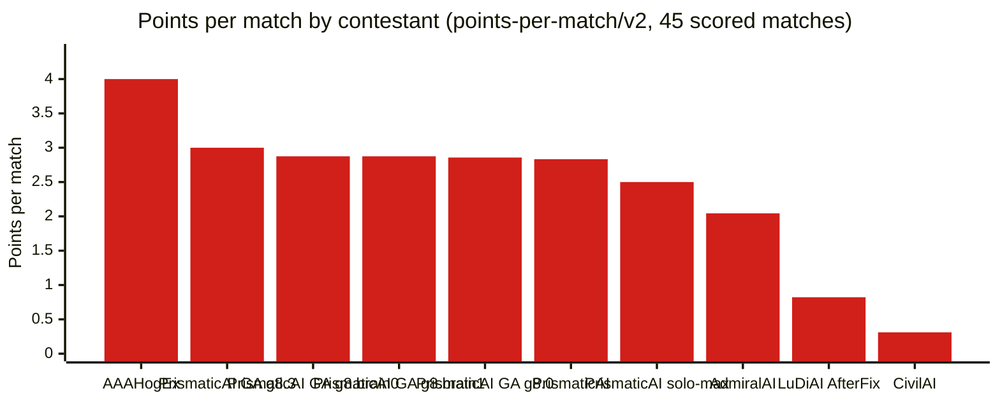
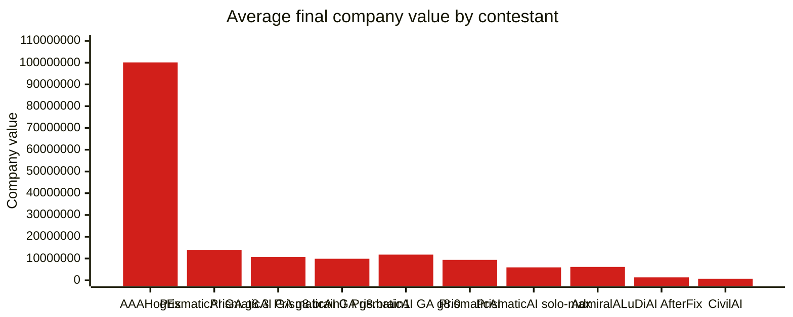
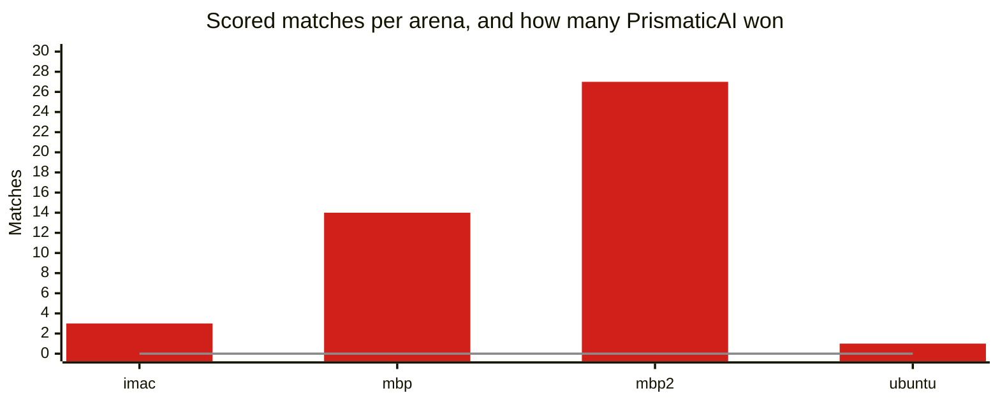

# battle-20261119T083528-fb2ff9b1

Derived from `battle-20261119T083528-fb2ff9b1.json` by `tools/research/ai-battle/battle.py report`; do not edit.

- Edition `fb2ff9b1ad1d6dce`: PrismaticAI and referee at `f26a6f7f02cc784419e6c7b01b9c560c9517113e`, base set `opengfx-8.0.tar`
- 20-year free-for-all from 1960, map 256x256 temperate, breakdowns 1
- 45 scored match(es) on `imac` (20261119-master-gdf1e05e7d8), `mbp` (20261119-master-mf26a6f7f02), `mbp2` (20261119-master-gdf1e05e7d8), `ubuntu` (20261119-master-gdf1e05e7d8)
- Replays: 0 of 0 identical to their original on another arena

| # | Contestant | Played | Wins | Points | Points/match | Avg rank | Avg final value | Squirrel errors | Matches with anomalies |
|---|---|---|---|---|---|---|---|---|---|
| 1 | AAAHogEx | 45 | 45 | 180 | 4.0 | 1.0 | 100.1 M | 0 | 0 |
| 2 | PrismaticAI GA g8.3 | 8 | 0 | 24 | 3.0 | 2.0 | 14.0 M | 0 | 0 |
| 3 | PrismaticAI GA g8.brain0 | 8 | 0 | 23 | 2.875 | 2.12 | 10.7 M | 0 | 0 |
| 4 | PrismaticAI GA g8.brain1 | 8 | 0 | 23 | 2.875 | 2.12 | 9.9 M | 0 | 0 |
| 5 | PrismaticAI GA g8.0 | 7 | 0 | 20 | 2.857 | 2.14 | 11.8 M | 0 | 3 |
| 6 | PrismaticAI | 6 | 0 | 17 | 2.833 | 2.17 | 9.4 M | 0 | 1 |
| 7 | PrismaticAI solo-max | 8 | 0 | 20 | 2.5 | 2.5 | 5.9 M | 0 | 8 |
| 8 | AdmiralAI | 45 | 0 | 92 | 2.044 | 2.96 | 6.1 M | 0 | 2 |
| 9 | LuDiAI AfterFix | 45 | 0 | 37 | 0.822 | 4.18 | 1.4 M | 0 | 3 |
| 10 | CivilAI | 45 | 0 | 14 | 0.311 | 4.69 | 670.2 k | 33 | 6 |

```mermaid
---
config:
  xyChart:
    width: 900
    height: 360
  themeVariables:
    xyChart:
      plotColorPalette: "#d11f1a, #8a8a8a, #0b0b0b, #ece4d6"
---
xychart-beta
    title "Final company value per scored match: winner vs best PrismaticAI"
    x-axis ["m-0001", "m-0002", "m-0003", "m-0004", "m-0005", "m-0006", "m-0007", "m-0008", "m-0009", "m-0010", "m-0011", "m-0012", "m-0013", "m-0014", "m-0015", "m-0016", "m-0017", "m-0018", "m-0019", "m-0020", "m-0021", "m-0022", "m-0023", "m-0030", "m-0031", "m-0032", "m-0033", "m-0034", "m-0035", "m-0036", "m-0037", "m-0038", "m-0039", "m-0041", "m-0042", "m-0043", "m-0044", "m-0045", "m-0046", "m-0047", "m-0051", "m-0052", "m-0055", "m-0058", "m-0059"]
    %% series: Winner | Best PrismaticAI
    %% links: battle-20261119T083528-fb2ff9b1.md?col=Match&filter=m-0001 | battle-20261119T083528-fb2ff9b1.md?col=Match&filter=m-0002 | battle-20261119T083528-fb2ff9b1.md?col=Match&filter=m-0003 | battle-20261119T083528-fb2ff9b1.md?col=Match&filter=m-0004 | battle-20261119T083528-fb2ff9b1.md?col=Match&filter=m-0005 | battle-20261119T083528-fb2ff9b1.md?col=Match&filter=m-0006 | battle-20261119T083528-fb2ff9b1.md?col=Match&filter=m-0007 | battle-20261119T083528-fb2ff9b1.md?col=Match&filter=m-0008 | battle-20261119T083528-fb2ff9b1.md?col=Match&filter=m-0009 | battle-20261119T083528-fb2ff9b1.md?col=Match&filter=m-0010 | battle-20261119T083528-fb2ff9b1.md?col=Match&filter=m-0011 | battle-20261119T083528-fb2ff9b1.md?col=Match&filter=m-0012 | battle-20261119T083528-fb2ff9b1.md?col=Match&filter=m-0013 | battle-20261119T083528-fb2ff9b1.md?col=Match&filter=m-0014 | battle-20261119T083528-fb2ff9b1.md?col=Match&filter=m-0015 | battle-20261119T083528-fb2ff9b1.md?col=Match&filter=m-0016 | battle-20261119T083528-fb2ff9b1.md?col=Match&filter=m-0017 | battle-20261119T083528-fb2ff9b1.md?col=Match&filter=m-0018 | battle-20261119T083528-fb2ff9b1.md?col=Match&filter=m-0019 | battle-20261119T083528-fb2ff9b1.md?col=Match&filter=m-0020 | battle-20261119T083528-fb2ff9b1.md?col=Match&filter=m-0021 | battle-20261119T083528-fb2ff9b1.md?col=Match&filter=m-0022 | battle-20261119T083528-fb2ff9b1.md?col=Match&filter=m-0023 | battle-20261119T083528-fb2ff9b1.md?col=Match&filter=m-0030 | battle-20261119T083528-fb2ff9b1.md?col=Match&filter=m-0031 | battle-20261119T083528-fb2ff9b1.md?col=Match&filter=m-0032 | battle-20261119T083528-fb2ff9b1.md?col=Match&filter=m-0033 | battle-20261119T083528-fb2ff9b1.md?col=Match&filter=m-0034 | battle-20261119T083528-fb2ff9b1.md?col=Match&filter=m-0035 | battle-20261119T083528-fb2ff9b1.md?col=Match&filter=m-0036 | battle-20261119T083528-fb2ff9b1.md?col=Match&filter=m-0037 | battle-20261119T083528-fb2ff9b1.md?col=Match&filter=m-0038 | battle-20261119T083528-fb2ff9b1.md?col=Match&filter=m-0039 | battle-20261119T083528-fb2ff9b1.md?col=Match&filter=m-0041 | battle-20261119T083528-fb2ff9b1.md?col=Match&filter=m-0042 | battle-20261119T083528-fb2ff9b1.md?col=Match&filter=m-0043 | battle-20261119T083528-fb2ff9b1.md?col=Match&filter=m-0044 | battle-20261119T083528-fb2ff9b1.md?col=Match&filter=m-0045 | battle-20261119T083528-fb2ff9b1.md?col=Match&filter=m-0046 | battle-20261119T083528-fb2ff9b1.md?col=Match&filter=m-0047 | battle-20261119T083528-fb2ff9b1.md?col=Match&filter=m-0051 | battle-20261119T083528-fb2ff9b1.md?col=Match&filter=m-0052 | battle-20261119T083528-fb2ff9b1.md?col=Match&filter=m-0055 | battle-20261119T083528-fb2ff9b1.md?col=Match&filter=m-0058 | battle-20261119T083528-fb2ff9b1.md?col=Match&filter=m-0059
    y-axis "Company value" 0 --> 206000000
    bar [138380025, 140664456, 131177039, 155126441, 129086625, 120736039, 133760496, 122052962, 104218195, 132436354, 103362303, 75652175, 76491144, 80330806, 63317770, 69994540, 69236086, 69346448, 68410509, 80768001, 69427026, 33841189, 65491917, 92757129, 106588341, 102842301, 104115040, 98844919, 92463236, 63967438, 64044462, 44929744, 58273035, 48385923, 136288684, 139787927, 113032624, 123581744, 128497077, 114904647, 91421679, 82542006, 187340807, 151097478, 126712135]
    line [5991647, 15718391, 13885638, 13406720, 16437355, 7724504, 6311268, 11783600, 9403360, 9256534, 9893022, 6024687, 5954572, 11283869, 10374302, 10691162, 11675423, 9615890, 2802055, 11317010, 10441120, 7012479, 10490533, 13508004, 8164611, 13158147, 14266849, 9036912, 15335143, 8947074, 5938659, 9459379, 10863342, 16299565, 10519261, 5758790, 9797960, 10020999, 8500397, 12946473, 6664536, 8782853, 6560557, 12459947, 18587625]
```

<!-- battle-charts:begin -->
<!-- derived from battle-20261119T083528-fb2ff9b1.json by `battle.py render`; `battle.py check` fails when it is stale -->

<!-- battle-charts:end -->

| Match | Arena | Seed | Winner | Value | Last | Anomalies |
|---|---|---|---|---|---|---|
| m-0001 | mbp | 1237256277 | AAAHogEx | 138.4 M | CivilAI | PrismaticAI solo-max: fleet_drop:54->22 |
| m-0002 | mbp | 1237256277 | AAAHogEx | 140.7 M | CivilAI | - |
| m-0003 | mbp | 1237256277 | AAAHogEx | 131.2 M | CivilAI | - |
| m-0004 | imac | 1237256277 | AAAHogEx | 155.1 M | CivilAI | - |
| m-0005 | imac | 1237256277 | AAAHogEx | 129.1 M | CivilAI | - |
| m-0006 | imac | 1251879686 | AAAHogEx | 120.7 M | LuDiAI AfterFix | LuDiAI AfterFix: fleet_drop:49->29 |
| m-0007 | mbp2 | 1251879686 | AAAHogEx | 133.8 M | LuDiAI AfterFix | PrismaticAI solo-max: fleet_drop:42->20 |
| m-0008 | mbp2 | 1251879686 | AAAHogEx | 122.1 M | LuDiAI AfterFix | PrismaticAI GA g8.0: fleet_drop:54->33 |
| m-0009 | mbp2 | 1251879686 | AAAHogEx | 104.2 M | CivilAI | CivilAI: squirrel_errors:33 |
| m-0010 | mbp2 | 1251879686 | AAAHogEx | 132.4 M | LuDiAI AfterFix | - |
| m-0011 | mbp2 | 1251879686 | AAAHogEx | 103.4 M | LuDiAI AfterFix | - |
| m-0012 | mbp2 | 930967890 | AAAHogEx | 75.7 M | LuDiAI AfterFix | PrismaticAI: fleet_drop:61->39 |
| m-0013 | mbp2 | 930967890 | AAAHogEx | 76.5 M | CivilAI | PrismaticAI solo-max: fleet_drop:36->16; CivilAI: fleet_drop:45->30 |
| m-0014 | mbp2 | 930967890 | AAAHogEx | 80.3 M | LuDiAI AfterFix | - |
| m-0015 | mbp2 | 930967890 | AAAHogEx | 63.3 M | CivilAI | AdmiralAI: fleet_drop:181->97 |
| m-0016 | mbp2 | 930967890 | AAAHogEx | 70.0 M | CivilAI | - |
| m-0017 | mbp2 | 930967890 | AAAHogEx | 69.2 M | CivilAI | CivilAI: fleet_drop:42->27 |
| m-0018 | mbp2 | 1814625749 | AAAHogEx | 69.3 M | CivilAI | - |
| m-0019 | mbp2 | 1814625749 | AAAHogEx | 68.4 M | CivilAI | PrismaticAI solo-max: fleet_drop:38->17 |
| m-0020 | mbp2 | 1814625749 | AAAHogEx | 80.8 M | LuDiAI AfterFix | - |
| m-0021 | mbp2 | 1814625749 | AAAHogEx | 69.4 M | CivilAI | - |
| m-0022 | mbp2 | 1814625749 | AAAHogEx | 33.8 M | CivilAI | - |
| m-0023 | ubuntu | 1814625749 | AAAHogEx | 65.5 M | CivilAI | - |
| m-0030 | mbp | 852521374 | AAAHogEx | 92.8 M | LuDiAI AfterFix | LuDiAI AfterFix: fleet_drop:60->31 |
| m-0031 | mbp | 852521374 | AAAHogEx | 106.6 M | CivilAI | PrismaticAI solo-max: fleet_drop:53->17; AdmiralAI: fleet_drop:509->306; CivilAI: fleet_drop:32->18 |
| m-0032 | mbp | 852521374 | AAAHogEx | 102.8 M | LuDiAI AfterFix | PrismaticAI GA g8.0: fleet_drop:56->33; CivilAI: fleet_drop:50->34 |
| m-0033 | mbp | 852521374 | AAAHogEx | 104.1 M | LuDiAI AfterFix | - |
| m-0034 | mbp | 852521374 | AAAHogEx | 98.8 M | CivilAI | - |
| m-0035 | mbp | 852521374 | AAAHogEx | 92.5 M | LuDiAI AfterFix | - |
| m-0036 | mbp2 | 622201523 | AAAHogEx | 64.0 M | CivilAI | LuDiAI AfterFix: fleet_drop:49->34; CivilAI: fleet_drop:65->29 |
| m-0037 | mbp2 | 622201523 | AAAHogEx | 64.0 M | CivilAI | PrismaticAI solo-max: fleet_drop:40->14 |
| m-0038 | mbp2 | 622201523 | AAAHogEx | 44.9 M | CivilAI | PrismaticAI GA g8.0: fleet_drop:44->27 |
| m-0039 | mbp2 | 622201523 | AAAHogEx | 58.3 M | CivilAI | - |
| m-0041 | mbp2 | 622201523 | AAAHogEx | 48.4 M | CivilAI | - |
| m-0042 | mbp2 | 1791605593 | AAAHogEx | 136.3 M | CivilAI | - |
| m-0043 | mbp2 | 1791605593 | AAAHogEx | 139.8 M | CivilAI | PrismaticAI solo-max: fleet_drop:38->14 |
| m-0044 | mbp2 | 1791605593 | AAAHogEx | 113.0 M | CivilAI | - |
| m-0045 | mbp2 | 1791605593 | AAAHogEx | 123.6 M | AdmiralAI | - |
| m-0046 | mbp2 | 1791605593 | AAAHogEx | 128.5 M | CivilAI | - |
| m-0047 | mbp2 | 1791605593 | AAAHogEx | 114.9 M | CivilAI | - |
| m-0051 | mbp | 1016335253 | AAAHogEx | 91.4 M | LuDiAI AfterFix | - |
| m-0052 | mbp | 1016335253 | AAAHogEx | 82.5 M | CivilAI | - |
| m-0055 | mbp | 1182050720 | AAAHogEx | 187.3 M | CivilAI | PrismaticAI solo-max: fleet_drop:47->25 |
| m-0058 | mbp | 1182050720 | AAAHogEx | 151.1 M | CivilAI | - |
| m-0059 | mbp | 1182050720 | AAAHogEx | 126.7 M | CivilAI | - |
