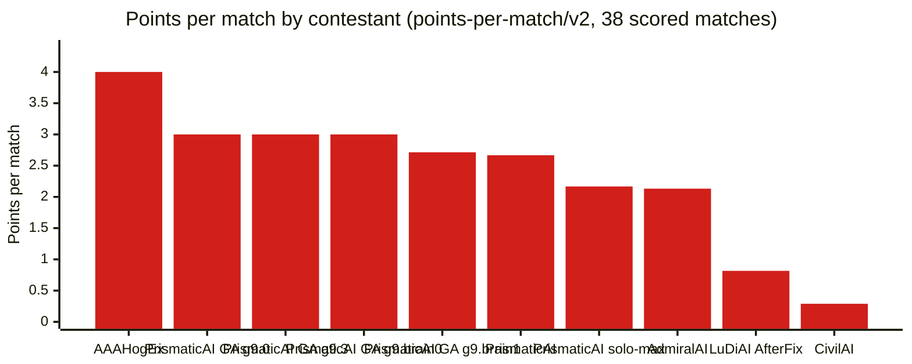
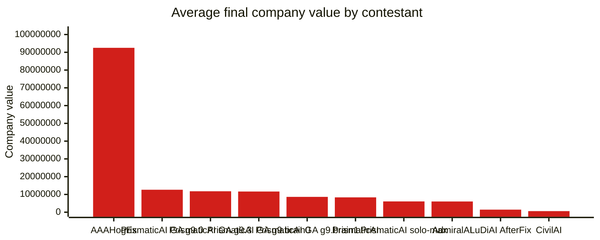
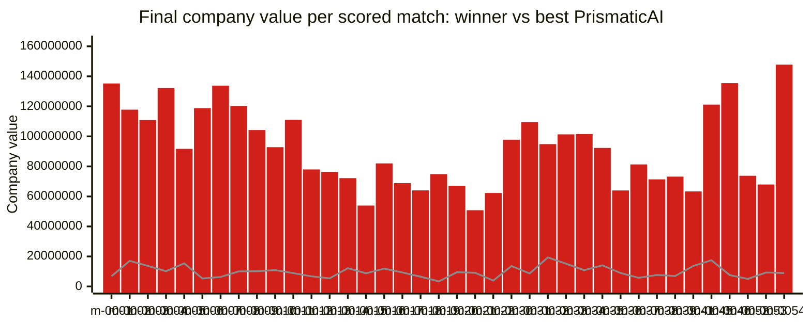
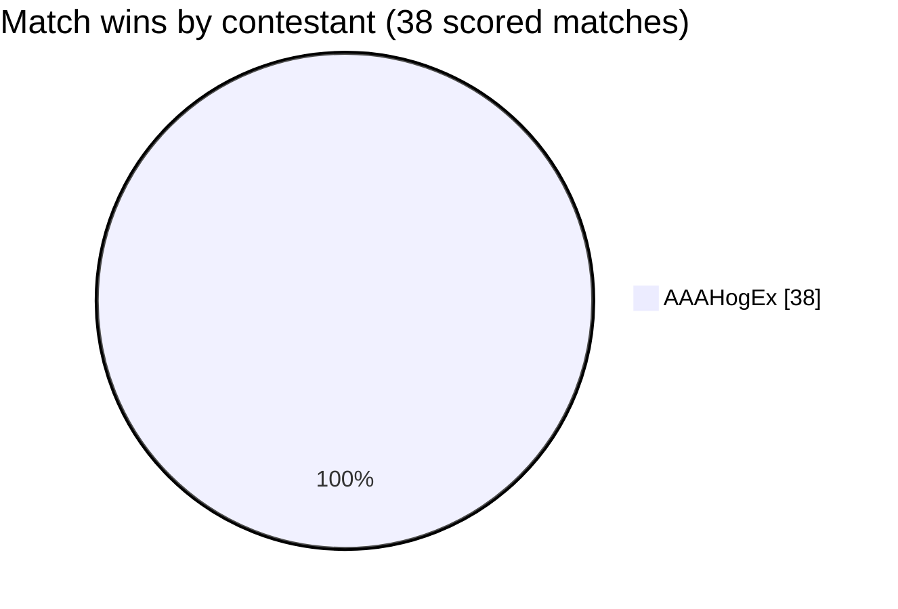
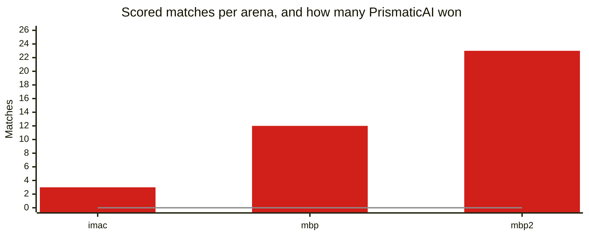

# battle-20261119T085213-10293148

Derived from `battle-20261119T085213-10293148.json` by `tools/research/ai-battle/battle.py report`; do not edit.

- Edition `1029314815784200`: PrismaticAI and referee at `6ddb95d60a488573a495daa98810141fd277c68f`, base set `opengfx-8.0.tar`
- 20-year free-for-all from 1960, map 256x256 temperate, breakdowns 1
- 38 scored match(es) on `imac` (20261119-master-gdf1e05e7d8), `mbp` (20261119-master-m1626720d25), `mbp2` (20261119-master-gdf1e05e7d8)
- Replays: 0 of 0 identical to their original on another arena

| # | Contestant | Played | Wins | Points | Points/match | Avg rank | Avg final value | Squirrel errors | Matches with anomalies |
|---|---|---|---|---|---|---|---|---|---|
| 1 | AAAHogEx | 38 | 38 | 152 | 4.0 | 1.0 | 92.5 M | 0 | 0 |
| 2 | PrismaticAI GA g9.0 | 6 | 0 | 18 | 3.0 | 2.0 | 12.6 M | 0 | 1 |
| 3 | PrismaticAI GA g9.3 | 6 | 0 | 18 | 3.0 | 2.0 | 11.8 M | 0 | 1 |
| 4 | PrismaticAI GA g9.brain0 | 7 | 0 | 21 | 3.0 | 2.0 | 11.6 M | 0 | 0 |
| 5 | PrismaticAI GA g9.brain1 | 7 | 0 | 19 | 2.714 | 2.29 | 8.6 M | 0 | 0 |
| 6 | PrismaticAI | 6 | 0 | 16 | 2.667 | 2.33 | 8.3 M | 0 | 0 |
| 7 | PrismaticAI solo-max | 6 | 0 | 13 | 2.167 | 2.83 | 6.1 M | 0 | 6 |
| 8 | AdmiralAI | 38 | 0 | 81 | 2.132 | 2.87 | 6.0 M | 0 | 4 |
| 9 | LuDiAI AfterFix | 38 | 0 | 31 | 0.816 | 4.18 | 1.4 M | 0 | 3 |
| 10 | CivilAI | 38 | 0 | 11 | 0.289 | 4.71 | 608.3 k | 3730 | 8 |

<!-- battle-charts:begin -->
<!-- derived from battle-20261119T085213-10293148.json by `battle.py render`; `battle.py check` fails when it is stale -->

<!-- battle-charts:end -->

| Match | Arena | Seed | Winner | Value | Last | Anomalies |
|---|---|---|---|---|---|---|
| m-0001 | mbp | 1237256277 | AAAHogEx | 135.3 M | CivilAI | PrismaticAI solo-max: fleet_drop:55->21 |
| m-0002 | mbp | 1237256277 | AAAHogEx | 117.8 M | CivilAI | CivilAI: fleet_drop:19->12 |
| m-0003 | mbp | 1237256277 | AAAHogEx | 110.9 M | CivilAI | CivilAI: no_vehicles |
| m-0004 | imac | 1237256277 | AAAHogEx | 132.2 M | CivilAI | - |
| m-0005 | imac | 1237256277 | AAAHogEx | 91.7 M | CivilAI | - |
| m-0006 | imac | 1251879686 | AAAHogEx | 118.8 M | LuDiAI AfterFix | - |
| m-0007 | mbp2 | 1251879686 | AAAHogEx | 133.8 M | LuDiAI AfterFix | PrismaticAI solo-max: fleet_drop:42->20 |
| m-0008 | mbp2 | 1251879686 | AAAHogEx | 120.2 M | LuDiAI AfterFix | - |
| m-0009 | mbp2 | 1251879686 | AAAHogEx | 104.2 M | LuDiAI AfterFix | - |
| m-0010 | mbp2 | 1251879686 | AAAHogEx | 92.8 M | CivilAI | AdmiralAI: fleet_drop:224->156 |
| m-0011 | mbp2 | 1251879686 | AAAHogEx | 111.1 M | CivilAI | - |
| m-0012 | mbp2 | 930967890 | AAAHogEx | 78.0 M | CivilAI | CivilAI: fleet_drop:27->15 |
| m-0013 | mbp2 | 930967890 | AAAHogEx | 76.4 M | CivilAI | PrismaticAI solo-max: fleet_drop:37->14 |
| m-0014 | mbp2 | 930967890 | AAAHogEx | 72.2 M | CivilAI | - |
| m-0015 | mbp2 | 930967890 | AAAHogEx | 53.9 M | LuDiAI AfterFix | - |
| m-0016 | mbp2 | 930967890 | AAAHogEx | 82.0 M | CivilAI | CivilAI: fleet_drop:34->13 |
| m-0017 | mbp2 | 930967890 | AAAHogEx | 68.9 M | CivilAI | PrismaticAI GA g9.3: fleet_drop:46->32 |
| m-0018 | mbp2 | 1814625749 | AAAHogEx | 64.0 M | CivilAI | - |
| m-0019 | mbp2 | 1814625749 | AAAHogEx | 74.9 M | CivilAI | PrismaticAI solo-max: fleet_drop:39->23 |
| m-0020 | mbp2 | 1814625749 | AAAHogEx | 67.1 M | CivilAI | - |
| m-0021 | mbp2 | 1814625749 | AAAHogEx | 50.8 M | CivilAI | - |
| m-0022 | mbp2 | 1814625749 | AAAHogEx | 62.3 M | CivilAI | - |
| m-0030 | mbp | 852521374 | AAAHogEx | 97.8 M | CivilAI | - |
| m-0031 | mbp | 852521374 | AAAHogEx | 109.5 M | CivilAI | PrismaticAI solo-max: fleet_drop:53->15 |
| m-0032 | mbp | 852521374 | AAAHogEx | 94.8 M | LuDiAI AfterFix | - |
| m-0033 | mbp | 852521374 | AAAHogEx | 101.3 M | CivilAI | CivilAI: squirrel_errors:3730 |
| m-0034 | mbp2 | 852521374 | AAAHogEx | 101.5 M | LuDiAI AfterFix | AdmiralAI: fleet_drop:135->76; LuDiAI AfterFix: fleet_drop:79->13 |
| m-0035 | mbp2 | 852521374 | AAAHogEx | 92.3 M | CivilAI | AdmiralAI: fleet_drop:248->140 |
| m-0036 | mbp2 | 622201523 | AAAHogEx | 64.0 M | CivilAI | LuDiAI AfterFix: fleet_drop:49->34; CivilAI: fleet_drop:65->29 |
| m-0037 | mbp | 622201523 | AAAHogEx | 81.3 M | CivilAI | PrismaticAI solo-max: fleet_drop:41->14 |
| m-0038 | mbp | 622201523 | AAAHogEx | 71.4 M | CivilAI | PrismaticAI GA g9.0: fleet_drop:37->24; AdmiralAI: fleet_drop:300->184; CivilAI: fleet_drop:30->11 |
| m-0039 | mbp2 | 622201523 | AAAHogEx | 73.2 M | AdmiralAI | - |
| m-0041 | mbp2 | 622201523 | AAAHogEx | 63.3 M | CivilAI | - |
| m-0045 | mbp2 | 1791605593 | AAAHogEx | 121.2 M | LuDiAI AfterFix | - |
| m-0046 | mbp2 | 1791605593 | AAAHogEx | 135.5 M | CivilAI | - |
| m-0052 | mbp | 1016335253 | AAAHogEx | 73.8 M | LuDiAI AfterFix | - |
| m-0053 | mbp | 1016335253 | AAAHogEx | 67.9 M | CivilAI | - |
| m-0054 | mbp | 1182050720 | AAAHogEx | 147.8 M | CivilAI | LuDiAI AfterFix: fleet_drop:187->109; CivilAI: fleet_drop:11->7 |
