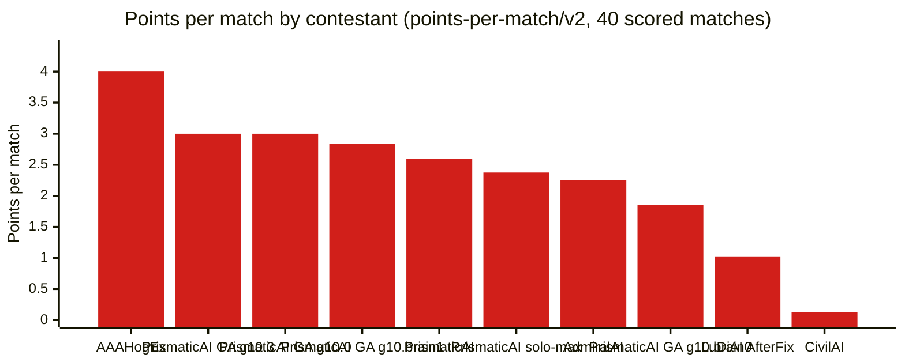
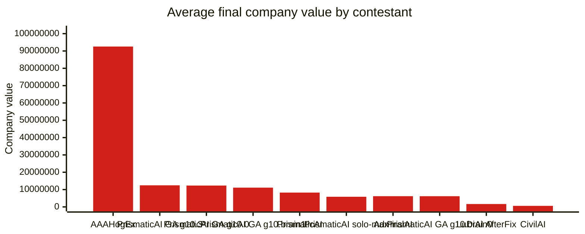
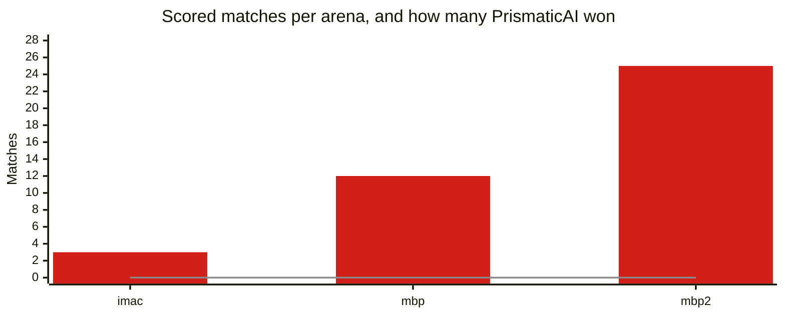

# battle-20261119T090423-508356ae

Derived from `battle-20261119T090423-508356ae.json` by `tools/research/ai-battle/battle.py report`; do not edit.

- Edition `508356ae5768d0af`: PrismaticAI and referee at `6ddb95d60a488573a495daa98810141fd277c68f`, base set `opengfx-8.0.tar`
- 20-year free-for-all from 1960, map 256x256 temperate, breakdowns 1
- 40 scored match(es) on `imac` (20261119-master-gdf1e05e7d8), `mbp` (20261119-master-m1626720d25), `mbp2` (20261119-master-gdf1e05e7d8)
- Replays: 0 of 0 identical to their original on another arena

| # | Contestant | Played | Wins | Points | Points/match | Avg rank | Avg final value | Squirrel errors | Matches with anomalies |
|---|---|---|---|---|---|---|---|---|---|
| 1 | AAAHogEx | 40 | 40 | 160 | 4.0 | 1.0 | 92.6 M | 0 | 0 |
| 2 | PrismaticAI GA g10.3 | 6 | 0 | 18 | 3.0 | 2.0 | 12.5 M | 0 | 0 |
| 3 | PrismaticAI GA g10.0 | 8 | 0 | 24 | 3.0 | 2.0 | 12.3 M | 0 | 1 |
| 4 | PrismaticAI GA g10.brain1 | 6 | 0 | 17 | 2.833 | 2.17 | 11.1 M | 0 | 1 |
| 5 | PrismaticAI | 5 | 0 | 13 | 2.6 | 2.4 | 8.3 M | 0 | 0 |
| 6 | PrismaticAI solo-max | 8 | 0 | 19 | 2.375 | 2.62 | 5.9 M | 0 | 8 |
| 7 | AdmiralAI | 40 | 0 | 90 | 2.25 | 2.75 | 6.2 M | 0 | 1 |
| 8 | PrismaticAI GA g10.brain0 | 7 | 0 | 13 | 1.857 | 3.14 | 6.2 M | 0 | 1 |
| 9 | LuDiAI AfterFix | 40 | 0 | 41 | 1.025 | 3.98 | 1.7 M | 0 | 1 |
| 10 | CivilAI | 40 | 0 | 5 | 0.125 | 4.88 | 601.3 k | 0 | 12 |

```mermaid
---
config:
  xyChart:
    width: 900
    height: 360
  themeVariables:
    xyChart:
      plotColorPalette: "#d11f1a, #8a8a8a, #0b0b0b, #ece4d6"
---
xychart-beta
    title "Final company value per scored match: winner vs best PrismaticAI"
    x-axis ["m-0001", "m-0002", "m-0003", "m-0004", "m-0005", "m-0006", "m-0007", "m-0008", "m-0009", "m-0010", "m-0011", "m-0012", "m-0013", "m-0014", "m-0015", "m-0016", "m-0017", "m-0018", "m-0019", "m-0020", "m-0021", "m-0022", "m-0030", "m-0031", "m-0032", "m-0033", "m-0034", "m-0035", "m-0036", "m-0037", "m-0038", "m-0039", "m-0041", "m-0043", "m-0044", "m-0049", "m-0050", "m-0051", "m-0052", "m-0053"]
    %% series: Winner | Best PrismaticAI
    %% links: battle-20261119T090423-508356ae.md?col=Match&filter=m-0001 | battle-20261119T090423-508356ae.md?col=Match&filter=m-0002 | battle-20261119T090423-508356ae.md?col=Match&filter=m-0003 | battle-20261119T090423-508356ae.md?col=Match&filter=m-0004 | battle-20261119T090423-508356ae.md?col=Match&filter=m-0005 | battle-20261119T090423-508356ae.md?col=Match&filter=m-0006 | battle-20261119T090423-508356ae.md?col=Match&filter=m-0007 | battle-20261119T090423-508356ae.md?col=Match&filter=m-0008 | battle-20261119T090423-508356ae.md?col=Match&filter=m-0009 | battle-20261119T090423-508356ae.md?col=Match&filter=m-0010 | battle-20261119T090423-508356ae.md?col=Match&filter=m-0011 | battle-20261119T090423-508356ae.md?col=Match&filter=m-0012 | battle-20261119T090423-508356ae.md?col=Match&filter=m-0013 | battle-20261119T090423-508356ae.md?col=Match&filter=m-0014 | battle-20261119T090423-508356ae.md?col=Match&filter=m-0015 | battle-20261119T090423-508356ae.md?col=Match&filter=m-0016 | battle-20261119T090423-508356ae.md?col=Match&filter=m-0017 | battle-20261119T090423-508356ae.md?col=Match&filter=m-0018 | battle-20261119T090423-508356ae.md?col=Match&filter=m-0019 | battle-20261119T090423-508356ae.md?col=Match&filter=m-0020 | battle-20261119T090423-508356ae.md?col=Match&filter=m-0021 | battle-20261119T090423-508356ae.md?col=Match&filter=m-0022 | battle-20261119T090423-508356ae.md?col=Match&filter=m-0030 | battle-20261119T090423-508356ae.md?col=Match&filter=m-0031 | battle-20261119T090423-508356ae.md?col=Match&filter=m-0032 | battle-20261119T090423-508356ae.md?col=Match&filter=m-0033 | battle-20261119T090423-508356ae.md?col=Match&filter=m-0034 | battle-20261119T090423-508356ae.md?col=Match&filter=m-0035 | battle-20261119T090423-508356ae.md?col=Match&filter=m-0036 | battle-20261119T090423-508356ae.md?col=Match&filter=m-0037 | battle-20261119T090423-508356ae.md?col=Match&filter=m-0038 | battle-20261119T090423-508356ae.md?col=Match&filter=m-0039 | battle-20261119T090423-508356ae.md?col=Match&filter=m-0041 | battle-20261119T090423-508356ae.md?col=Match&filter=m-0043 | battle-20261119T090423-508356ae.md?col=Match&filter=m-0044 | battle-20261119T090423-508356ae.md?col=Match&filter=m-0049 | battle-20261119T090423-508356ae.md?col=Match&filter=m-0050 | battle-20261119T090423-508356ae.md?col=Match&filter=m-0051 | battle-20261119T090423-508356ae.md?col=Match&filter=m-0052 | battle-20261119T090423-508356ae.md?col=Match&filter=m-0053
    y-axis "Company value" 0 --> 171000000
    bar [135251372, 155825775, 117250329, 137890152, 134511424, 126423381, 133760496, 115391977, 111065795, 112698578, 123874535, 77962981, 76399364, 59978451, 63525086, 74731474, 61266895, 64016165, 74865427, 69006045, 64529488, 61342819, 97777581, 109503965, 77836214, 121051506, 76001885, 92309373, 63967438, 81313627, 64875529, 76822833, 49631000, 138432078, 114211134, 72978799, 57921048, 98730975, 95946484, 61810650]
    line [6841745, 14352688, 12717659, 16483275, 18306113, 5462524, 6311268, 10065674, 8495077, 12552401, 8384651, 6748932, 5452296, 12471788, 2514372, 8479345, 12227418, 6530053, 3365791, 9732545, 5448569, 7779399, 13604493, 8688364, 19562284, 12605367, 13799302, 14647293, 8947074, 5735903, 9102229, 1, 12523757, 5705347, 14445290, 4731167, 8794902, 1400305, 7582807, 8621234]
```

<!-- battle-charts:begin -->
<!-- derived from battle-20261119T090423-508356ae.json by `battle.py render`; `battle.py check` fails when it is stale -->

<!-- battle-charts:end -->

| Match | Arena | Seed | Winner | Value | Last | Anomalies |
|---|---|---|---|---|---|---|
| m-0001 | mbp | 1237256277 | AAAHogEx | 135.3 M | CivilAI | PrismaticAI solo-max: fleet_drop:55->21 |
| m-0002 | mbp | 1237256277 | AAAHogEx | 155.8 M | CivilAI | - |
| m-0003 | mbp | 1237256277 | AAAHogEx | 117.3 M | CivilAI | - |
| m-0004 | imac | 1237256277 | AAAHogEx | 137.9 M | CivilAI | - |
| m-0005 | imac | 1237256277 | AAAHogEx | 134.5 M | CivilAI | CivilAI: fleet_drop:48->25 |
| m-0006 | imac | 1251879686 | AAAHogEx | 126.4 M | CivilAI | CivilAI: fleet_drop:110->17 |
| m-0007 | mbp2 | 1251879686 | AAAHogEx | 133.8 M | LuDiAI AfterFix | PrismaticAI solo-max: fleet_drop:42->20 |
| m-0008 | mbp2 | 1251879686 | AAAHogEx | 115.4 M | LuDiAI AfterFix | - |
| m-0009 | mbp2 | 1251879686 | AAAHogEx | 111.1 M | CivilAI | CivilAI: fleet_drop:62->40 |
| m-0010 | mbp2 | 1251879686 | AAAHogEx | 112.7 M | CivilAI | CivilAI: fleet_drop:76->52 |
| m-0011 | mbp2 | 1251879686 | AAAHogEx | 123.9 M | CivilAI | CivilAI: fleet_drop:36->11 |
| m-0012 | mbp2 | 930967890 | AAAHogEx | 78.0 M | CivilAI | CivilAI: fleet_drop:27->15 |
| m-0013 | mbp2 | 930967890 | AAAHogEx | 76.4 M | CivilAI | PrismaticAI solo-max: fleet_drop:37->14 |
| m-0014 | mbp2 | 930967890 | AAAHogEx | 60.0 M | CivilAI | - |
| m-0015 | mbp2 | 930967890 | AAAHogEx | 63.5 M | CivilAI | - |
| m-0016 | mbp2 | 930967890 | AAAHogEx | 74.7 M | CivilAI | - |
| m-0017 | mbp2 | 930967890 | AAAHogEx | 61.3 M | CivilAI | CivilAI: fleet_drop:73->31 |
| m-0018 | mbp2 | 1814625749 | AAAHogEx | 64.0 M | CivilAI | - |
| m-0019 | mbp2 | 1814625749 | AAAHogEx | 74.9 M | CivilAI | PrismaticAI solo-max: fleet_drop:39->23 |
| m-0020 | mbp2 | 1814625749 | AAAHogEx | 69.0 M | CivilAI | CivilAI: fleet_drop:29->10 |
| m-0021 | mbp2 | 1814625749 | AAAHogEx | 64.5 M | CivilAI | - |
| m-0022 | mbp2 | 1814625749 | AAAHogEx | 61.3 M | CivilAI | CivilAI: fleet_drop:69->17 |
| m-0030 | mbp | 852521374 | AAAHogEx | 97.8 M | CivilAI | - |
| m-0031 | mbp | 852521374 | AAAHogEx | 109.5 M | CivilAI | PrismaticAI solo-max: fleet_drop:53->15 |
| m-0032 | mbp | 852521374 | AAAHogEx | 77.8 M | CivilAI | - |
| m-0033 | mbp2 | 852521374 | AAAHogEx | 121.1 M | CivilAI | - |
| m-0034 | mbp | 852521374 | AAAHogEx | 76.0 M | CivilAI | CivilAI: fleet_drop:16->9 |
| m-0035 | mbp2 | 852521374 | AAAHogEx | 92.3 M | CivilAI | AdmiralAI: fleet_drop:272->120 |
| m-0036 | mbp2 | 622201523 | AAAHogEx | 64.0 M | CivilAI | LuDiAI AfterFix: fleet_drop:49->34; CivilAI: fleet_drop:65->29 |
| m-0037 | mbp | 622201523 | AAAHogEx | 81.3 M | CivilAI | PrismaticAI solo-max: fleet_drop:41->14 |
| m-0038 | mbp | 622201523 | AAAHogEx | 64.9 M | LuDiAI AfterFix | PrismaticAI GA g10.0: fleet_drop:47->28; CivilAI: fleet_drop:25->17 |
| m-0039 | mbp2 | 622201523 | AAAHogEx | 76.8 M | PrismaticAI GA g10.brain0 | PrismaticAI GA g10.brain0: fleet_drop:25->6 |
| m-0041 | mbp2 | 622201523 | AAAHogEx | 49.6 M | CivilAI | - |
| m-0043 | mbp2 | 1791605593 | AAAHogEx | 138.4 M | CivilAI | PrismaticAI solo-max: fleet_drop:38->13 |
| m-0044 | mbp2 | 1791605593 | AAAHogEx | 114.2 M | CivilAI | - |
| m-0049 | mbp2 | 1016335253 | AAAHogEx | 73.0 M | CivilAI | PrismaticAI solo-max: fleet_drop:33->13 |
| m-0050 | mbp2 | 1016335253 | AAAHogEx | 57.9 M | CivilAI | - |
| m-0051 | mbp | 1016335253 | AAAHogEx | 98.7 M | CivilAI | - |
| m-0052 | mbp | 1016335253 | AAAHogEx | 95.9 M | CivilAI | PrismaticAI GA g10.brain1: fleet_drop:35->18 |
| m-0053 | mbp | 1016335253 | AAAHogEx | 61.8 M | LuDiAI AfterFix | - |
