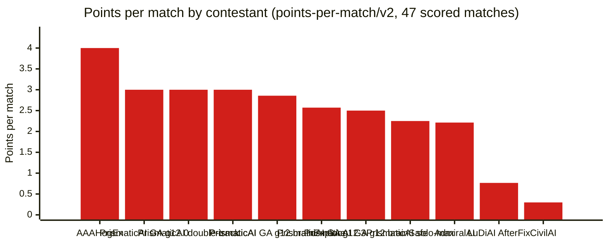
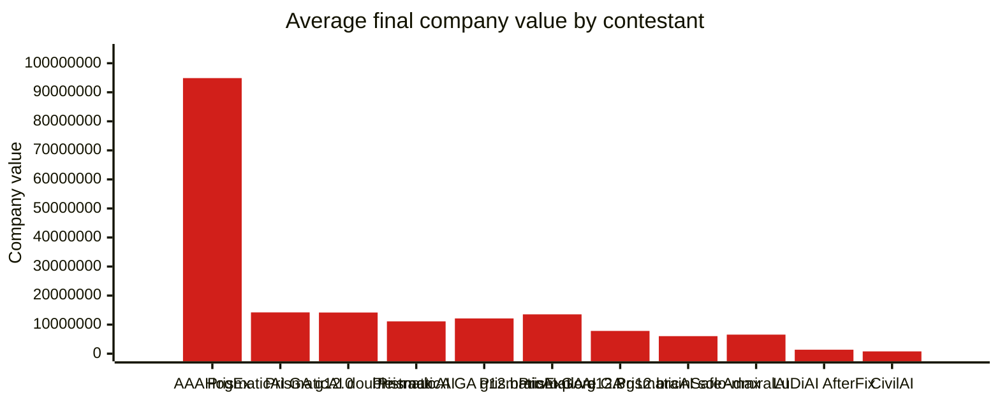
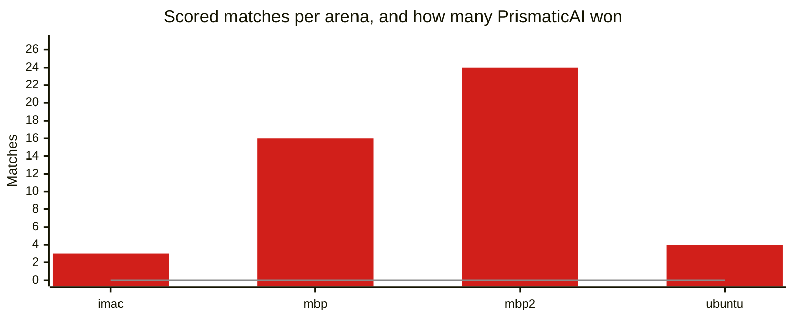

# battle-20261119T095746-b9fe95ad

Derived from `battle-20261119T095746-b9fe95ad.json` by `tools/research/ai-battle/battle.py report`; do not edit.

- Edition `b9fe95addbfd6803`: PrismaticAI and referee at `a23cbe0df43781fab4185354556e3c6df595c915`, base set `opengfx-8.0.tar`
- 20-year free-for-all from 1960, map 256x256 temperate, breakdowns 1
- 47 scored match(es) on `imac` (20261119-master-gdf1e05e7d8), `mbp` (20261119-master-m26d86c75f5), `mbp2` (20261119-master-gdf1e05e7d8), `ubuntu` (20261119-master-gdf1e05e7d8)
- Replays: 0 of 0 identical to their original on another arena

| # | Contestant | Played | Wins | Points | Points/match | Avg rank | Avg final value | Squirrel errors | Matches with anomalies |
|---|---|---|---|---|---|---|---|---|---|
| 1 | AAAHogEx | 47 | 47 | 188 | 4.0 | 1.0 | 94.9 M | 0 | 0 |
| 2 | PrismaticAI GA g12.0 | 7 | 0 | 21 | 3.0 | 2.0 | 14.2 M | 0 | 0 |
| 3 | PrismaticAI double-track | 7 | 0 | 21 | 3.0 | 2.0 | 14.2 M | 0 | 0 |
| 4 | PrismaticAI | 5 | 0 | 15 | 3.0 | 2.0 | 11.1 M | 0 | 2 |
| 5 | PrismaticAI GA g12.brainExplore | 7 | 0 | 20 | 2.857 | 2.14 | 12.1 M | 0 | 0 |
| 6 | PrismaticAI GA g12.3 | 7 | 0 | 18 | 2.571 | 2.43 | 13.5 M | 0 | 1 |
| 7 | PrismaticAI GA g12.brainSafe | 6 | 0 | 15 | 2.5 | 2.5 | 7.8 M | 0 | 0 |
| 8 | PrismaticAI solo-max | 8 | 0 | 18 | 2.25 | 2.75 | 6.0 M | 0 | 7 |
| 9 | AdmiralAI | 47 | 0 | 104 | 2.213 | 2.79 | 6.6 M | 0 | 4 |
| 10 | LuDiAI AfterFix | 47 | 0 | 36 | 0.766 | 4.23 | 1.4 M | 0 | 1 |
| 11 | CivilAI | 47 | 0 | 14 | 0.298 | 4.7 | 785.1 k | 3695 | 8 |

```mermaid
---
config:
  xyChart:
    width: 900
    height: 360
  themeVariables:
    xyChart:
      plotColorPalette: "#d11f1a, #8a8a8a, #0b0b0b, #ece4d6"
---
xychart-beta
    title "Final company value per scored match: winner vs best PrismaticAI"
    x-axis ["m-0001", "m-0002", "m-0003", "m-0004", "m-0005", "m-0006", "m-0007", "m-0008", "m-0009", "m-0010", "m-0011", "m-0012", "m-0013", "m-0014", "m-0015", "m-0016", "m-0017", "m-0018", "m-0019", "m-0020", "m-0021", "m-0022", "m-0023", "m-0025", "m-0026", "m-0027", "m-0030", "m-0031", "m-0032", "m-0033", "m-0034", "m-0035", "m-0036", "m-0037", "m-0038", "m-0041", "m-0042", "m-0043", "m-0044", "m-0045", "m-0047", "m-0050", "m-0055", "m-0057", "m-0059", "m-0060", "m-0061"]
    %% series: Winner | Best PrismaticAI
    %% links: battle-20261119T095746-b9fe95ad.md?col=Match&filter=m-0001 | battle-20261119T095746-b9fe95ad.md?col=Match&filter=m-0002 | battle-20261119T095746-b9fe95ad.md?col=Match&filter=m-0003 | battle-20261119T095746-b9fe95ad.md?col=Match&filter=m-0004 | battle-20261119T095746-b9fe95ad.md?col=Match&filter=m-0005 | battle-20261119T095746-b9fe95ad.md?col=Match&filter=m-0006 | battle-20261119T095746-b9fe95ad.md?col=Match&filter=m-0007 | battle-20261119T095746-b9fe95ad.md?col=Match&filter=m-0008 | battle-20261119T095746-b9fe95ad.md?col=Match&filter=m-0009 | battle-20261119T095746-b9fe95ad.md?col=Match&filter=m-0010 | battle-20261119T095746-b9fe95ad.md?col=Match&filter=m-0011 | battle-20261119T095746-b9fe95ad.md?col=Match&filter=m-0012 | battle-20261119T095746-b9fe95ad.md?col=Match&filter=m-0013 | battle-20261119T095746-b9fe95ad.md?col=Match&filter=m-0014 | battle-20261119T095746-b9fe95ad.md?col=Match&filter=m-0015 | battle-20261119T095746-b9fe95ad.md?col=Match&filter=m-0016 | battle-20261119T095746-b9fe95ad.md?col=Match&filter=m-0017 | battle-20261119T095746-b9fe95ad.md?col=Match&filter=m-0018 | battle-20261119T095746-b9fe95ad.md?col=Match&filter=m-0019 | battle-20261119T095746-b9fe95ad.md?col=Match&filter=m-0020 | battle-20261119T095746-b9fe95ad.md?col=Match&filter=m-0021 | battle-20261119T095746-b9fe95ad.md?col=Match&filter=m-0022 | battle-20261119T095746-b9fe95ad.md?col=Match&filter=m-0023 | battle-20261119T095746-b9fe95ad.md?col=Match&filter=m-0025 | battle-20261119T095746-b9fe95ad.md?col=Match&filter=m-0026 | battle-20261119T095746-b9fe95ad.md?col=Match&filter=m-0027 | battle-20261119T095746-b9fe95ad.md?col=Match&filter=m-0030 | battle-20261119T095746-b9fe95ad.md?col=Match&filter=m-0031 | battle-20261119T095746-b9fe95ad.md?col=Match&filter=m-0032 | battle-20261119T095746-b9fe95ad.md?col=Match&filter=m-0033 | battle-20261119T095746-b9fe95ad.md?col=Match&filter=m-0034 | battle-20261119T095746-b9fe95ad.md?col=Match&filter=m-0035 | battle-20261119T095746-b9fe95ad.md?col=Match&filter=m-0036 | battle-20261119T095746-b9fe95ad.md?col=Match&filter=m-0037 | battle-20261119T095746-b9fe95ad.md?col=Match&filter=m-0038 | battle-20261119T095746-b9fe95ad.md?col=Match&filter=m-0041 | battle-20261119T095746-b9fe95ad.md?col=Match&filter=m-0042 | battle-20261119T095746-b9fe95ad.md?col=Match&filter=m-0043 | battle-20261119T095746-b9fe95ad.md?col=Match&filter=m-0044 | battle-20261119T095746-b9fe95ad.md?col=Match&filter=m-0045 | battle-20261119T095746-b9fe95ad.md?col=Match&filter=m-0047 | battle-20261119T095746-b9fe95ad.md?col=Match&filter=m-0050 | battle-20261119T095746-b9fe95ad.md?col=Match&filter=m-0055 | battle-20261119T095746-b9fe95ad.md?col=Match&filter=m-0057 | battle-20261119T095746-b9fe95ad.md?col=Match&filter=m-0059 | battle-20261119T095746-b9fe95ad.md?col=Match&filter=m-0060 | battle-20261119T095746-b9fe95ad.md?col=Match&filter=m-0061
    y-axis "Company value" 0 --> 154000000
    bar [135251372, 91368801, 140208193, 128140681, 118408690, 117401313, 118372687, 124775752, 105244002, 131100750, 132049506, 116883047, 101879687, 69580205, 83609496, 72702488, 64765770, 71673663, 57872474, 72269296, 64244109, 61351926, 66696524, 75677253, 76355903, 78390748, 103341315, 126625386, 116418796, 100816259, 106979674, 92327724, 109503965, 107723711, 104152490, 100099395, 65699257, 58119394, 59999106, 53965451, 53888012, 140317447, 122881122, 107601935, 89218011, 77386178, 86078985]
    line [6841745, 23350704, 16592525, 10918259, 19410106, 17640780, 10287285, 4185216, 11868938, 17678513, 5438968, 14181356, 14149017, 13732392, 7005207, 5275809, 15446783, 8526864, 7830247, 1851752, 8893350, 3782674, 9989124, 7732075, 8509209, 6915001, 15183183, 12479252, 11742494, 16120822, 18785164, 12482280, 8688364, 17073610, 18784437, 19425391, 10223666, 5200267, 16439814, 9794557, 10778441, 7079766, 16023267, 5487831, 8718673, 2640251, 8076410]
```

<!-- battle-charts:begin -->
<!-- derived from battle-20261119T095746-b9fe95ad.json by `battle.py render`; `battle.py check` fails when it is stale -->

<!-- battle-charts:end -->

| Match | Arena | Seed | Winner | Value | Last | Anomalies |
|---|---|---|---|---|---|---|
| m-0001 | mbp | 1237256277 | AAAHogEx | 135.3 M | CivilAI | PrismaticAI solo-max: fleet_drop:55->21 |
| m-0002 | mbp | 1237256277 | AAAHogEx | 91.4 M | CivilAI | - |
| m-0003 | mbp | 1237256277 | AAAHogEx | 140.2 M | CivilAI | - |
| m-0004 | imac | 1237256277 | AAAHogEx | 128.1 M | LuDiAI AfterFix | - |
| m-0005 | imac | 1237256277 | AAAHogEx | 118.4 M | CivilAI | - |
| m-0006 | imac | 1237256277 | AAAHogEx | 117.4 M | CivilAI | - |
| m-0007 | mbp2 | 1251879686 | AAAHogEx | 118.4 M | CivilAI | PrismaticAI: fleet_drop:84->52 |
| m-0008 | mbp2 | 1251879686 | AAAHogEx | 124.8 M | CivilAI | PrismaticAI solo-max: fleet_drop:37->17; CivilAI: fleet_drop:13->9 |
| m-0009 | mbp2 | 1251879686 | AAAHogEx | 105.2 M | LuDiAI AfterFix | AdmiralAI: fleet_drop:201->135 |
| m-0010 | mbp2 | 1251879686 | AAAHogEx | 131.1 M | CivilAI | - |
| m-0011 | mbp2 | 1251879686 | AAAHogEx | 132.0 M | CivilAI | - |
| m-0012 | mbp2 | 1251879686 | AAAHogEx | 116.9 M | LuDiAI AfterFix | CivilAI: fleet_drop:40->21 |
| m-0013 | mbp2 | 1251879686 | AAAHogEx | 101.9 M | CivilAI | - |
| m-0014 | mbp2 | 930967890 | AAAHogEx | 69.6 M | CivilAI | - |
| m-0015 | mbp2 | 930967890 | AAAHogEx | 83.6 M | CivilAI | PrismaticAI solo-max: fleet_drop:37->13; CivilAI: fleet_drop:33->22 |
| m-0016 | mbp2 | 930967890 | AAAHogEx | 72.7 M | CivilAI | - |
| m-0017 | mbp2 | 930967890 | AAAHogEx | 64.8 M | LuDiAI AfterFix | - |
| m-0018 | mbp2 | 930967890 | AAAHogEx | 71.7 M | CivilAI | LuDiAI AfterFix: fleet_drop:215->132 |
| m-0019 | mbp2 | 930967890 | AAAHogEx | 57.9 M | CivilAI | - |
| m-0020 | mbp2 | 930967890 | AAAHogEx | 72.3 M | CivilAI | PrismaticAI GA g12.3: fleet_drop:38->20 |
| m-0021 | mbp2 | 1814625749 | AAAHogEx | 64.2 M | CivilAI | CivilAI: fleet_drop:16->11 |
| m-0022 | mbp2 | 1814625749 | AAAHogEx | 61.4 M | CivilAI | PrismaticAI solo-max: fleet_drop:41->15; CivilAI: fleet_drop:23->8 |
| m-0023 | ubuntu | 1814625749 | AAAHogEx | 66.7 M | LuDiAI AfterFix | - |
| m-0025 | ubuntu | 1814625749 | AAAHogEx | 75.7 M | CivilAI | AdmiralAI: fleet_drop:244->166 |
| m-0026 | ubuntu | 1814625749 | AAAHogEx | 76.4 M | CivilAI | - |
| m-0027 | ubuntu | 1814625749 | AAAHogEx | 78.4 M | CivilAI | - |
| m-0030 | mbp | 397755790 | AAAHogEx | 103.3 M | CivilAI | - |
| m-0031 | mbp | 397755790 | AAAHogEx | 126.6 M | LuDiAI AfterFix | CivilAI: squirrel_errors:3695 |
| m-0032 | mbp | 397755790 | AAAHogEx | 116.4 M | LuDiAI AfterFix | - |
| m-0033 | mbp | 397755790 | AAAHogEx | 100.8 M | LuDiAI AfterFix | - |
| m-0034 | mbp | 397755790 | AAAHogEx | 107.0 M | LuDiAI AfterFix | - |
| m-0035 | mbp | 852521374 | AAAHogEx | 92.3 M | LuDiAI AfterFix | PrismaticAI: fleet_drop:95->64 |
| m-0036 | mbp2 | 852521374 | AAAHogEx | 109.5 M | CivilAI | PrismaticAI solo-max: fleet_drop:53->15 |
| m-0037 | mbp2 | 852521374 | AAAHogEx | 107.7 M | CivilAI | - |
| m-0038 | mbp2 | 852521374 | AAAHogEx | 104.2 M | CivilAI | - |
| m-0041 | mbp2 | 852521374 | AAAHogEx | 100.1 M | CivilAI | AdmiralAI: fleet_drop:107->40 |
| m-0042 | mbp2 | 622201523 | AAAHogEx | 65.7 M | LuDiAI AfterFix | - |
| m-0043 | mbp2 | 622201523 | AAAHogEx | 58.1 M | CivilAI | PrismaticAI solo-max: fleet_drop:39->11 |
| m-0044 | mbp | 622201523 | AAAHogEx | 60.0 M | CivilAI | CivilAI: fleet_drop:14->8 |
| m-0045 | mbp2 | 622201523 | AAAHogEx | 54.0 M | CivilAI | CivilAI: fleet_drop:11->7 |
| m-0047 | mbp2 | 622201523 | AAAHogEx | 53.9 M | LuDiAI AfterFix | - |
| m-0050 | mbp | 1791605593 | AAAHogEx | 140.3 M | CivilAI | AdmiralAI: fleet_drop:281->151; PrismaticAI solo-max: fleet_drop:51->20 |
| m-0055 | mbp | 1791605593 | AAAHogEx | 122.9 M | CivilAI | - |
| m-0057 | mbp | 1016335253 | AAAHogEx | 107.6 M | CivilAI | - |
| m-0059 | mbp | 1016335253 | AAAHogEx | 89.2 M | CivilAI | - |
| m-0060 | mbp | 1016335253 | AAAHogEx | 77.4 M | LuDiAI AfterFix | - |
| m-0061 | mbp | 1016335253 | AAAHogEx | 86.1 M | LuDiAI AfterFix | - |
