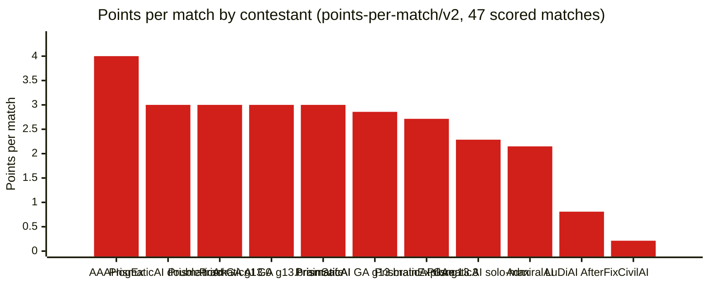
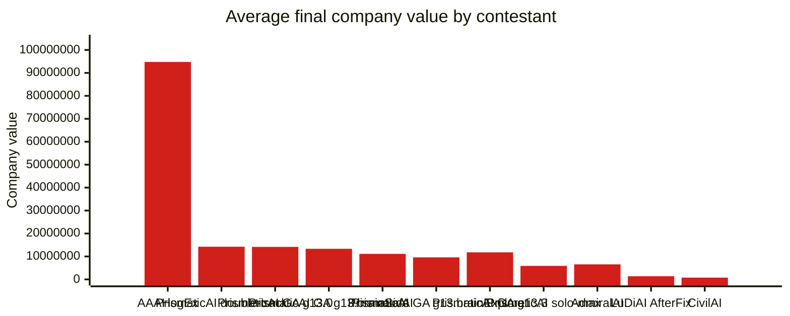
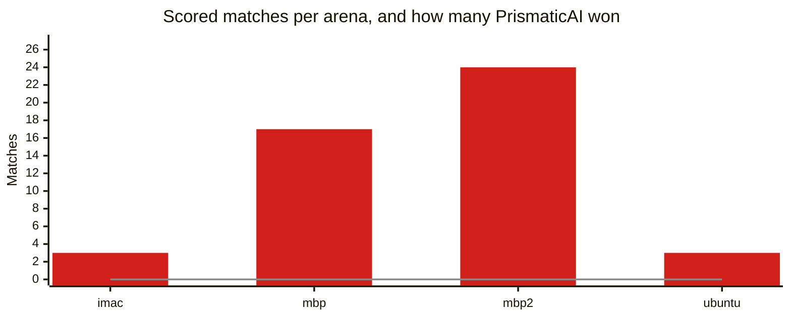

# battle-20261119T101219-5133bfd2

Derived from `battle-20261119T101219-5133bfd2.json` by `tools/research/ai-battle/battle.py report`; do not edit.

- Edition `5133bfd2cc505f66`: PrismaticAI and referee at `a23cbe0df43781fab4185354556e3c6df595c915`, base set `opengfx-8.0.tar`
- 20-year free-for-all from 1960, map 256x256 temperate, breakdowns 1
- 47 scored match(es) on `imac` (20261119-master-gdf1e05e7d8), `mbp` (20261119-master-m26d86c75f5), `mbp2` (20261119-master-gdf1e05e7d8), `ubuntu` (20261119-master-gdf1e05e7d8)
- Replays: 0 of 0 identical to their original on another arena

| # | Contestant | Played | Wins | Points | Points/match | Avg rank | Avg final value | Squirrel errors | Matches with anomalies |
|---|---|---|---|---|---|---|---|---|---|
| 1 | AAAHogEx | 47 | 47 | 188 | 4.0 | 1.0 | 94.8 M | 0 | 0 |
| 2 | PrismaticAI double-track | 7 | 0 | 21 | 3.0 | 2.0 | 14.2 M | 0 | 0 |
| 3 | PrismaticAI GA g13.0 | 8 | 0 | 24 | 3.0 | 2.0 | 14.2 M | 0 | 0 |
| 4 | PrismaticAI GA g13.brainSafe | 6 | 0 | 18 | 3.0 | 2.0 | 13.3 M | 0 | 0 |
| 5 | PrismaticAI | 5 | 0 | 15 | 3.0 | 2.0 | 11.1 M | 0 | 2 |
| 6 | PrismaticAI GA g13.brainExplore | 7 | 0 | 20 | 2.857 | 2.14 | 9.6 M | 0 | 5 |
| 7 | PrismaticAI GA g13.3 | 7 | 0 | 19 | 2.714 | 2.29 | 11.8 M | 0 | 0 |
| 8 | PrismaticAI solo-max | 7 | 0 | 16 | 2.286 | 2.71 | 5.9 M | 0 | 6 |
| 9 | AdmiralAI | 47 | 0 | 101 | 2.149 | 2.85 | 6.5 M | 0 | 2 |
| 10 | LuDiAI AfterFix | 47 | 0 | 38 | 0.809 | 4.19 | 1.4 M | 0 | 2 |
| 11 | CivilAI | 47 | 0 | 10 | 0.213 | 4.79 | 766.8 k | 3695 | 11 |

```mermaid
---
config:
  xyChart:
    width: 900
    height: 360
  themeVariables:
    xyChart:
      plotColorPalette: "#d11f1a, #8a8a8a, #0b0b0b, #ece4d6"
---
xychart-beta
    title "Final company value per scored match: winner vs best PrismaticAI"
    x-axis ["m-0001", "m-0002", "m-0003", "m-0004", "m-0005", "m-0006", "m-0007", "m-0008", "m-0009", "m-0010", "m-0011", "m-0012", "m-0013", "m-0014", "m-0015", "m-0016", "m-0017", "m-0018", "m-0019", "m-0020", "m-0021", "m-0022", "m-0025", "m-0026", "m-0027", "m-0030", "m-0031", "m-0032", "m-0033", "m-0034", "m-0035", "m-0036", "m-0037", "m-0038", "m-0041", "m-0042", "m-0043", "m-0044", "m-0045", "m-0046", "m-0047", "m-0052", "m-0057", "m-0058", "m-0059", "m-0061", "m-0062"]
    %% series: Winner | Best PrismaticAI
    %% links: battle-20261119T101219-5133bfd2.md?col=Match&filter=m-0001 | battle-20261119T101219-5133bfd2.md?col=Match&filter=m-0002 | battle-20261119T101219-5133bfd2.md?col=Match&filter=m-0003 | battle-20261119T101219-5133bfd2.md?col=Match&filter=m-0004 | battle-20261119T101219-5133bfd2.md?col=Match&filter=m-0005 | battle-20261119T101219-5133bfd2.md?col=Match&filter=m-0006 | battle-20261119T101219-5133bfd2.md?col=Match&filter=m-0007 | battle-20261119T101219-5133bfd2.md?col=Match&filter=m-0008 | battle-20261119T101219-5133bfd2.md?col=Match&filter=m-0009 | battle-20261119T101219-5133bfd2.md?col=Match&filter=m-0010 | battle-20261119T101219-5133bfd2.md?col=Match&filter=m-0011 | battle-20261119T101219-5133bfd2.md?col=Match&filter=m-0012 | battle-20261119T101219-5133bfd2.md?col=Match&filter=m-0013 | battle-20261119T101219-5133bfd2.md?col=Match&filter=m-0014 | battle-20261119T101219-5133bfd2.md?col=Match&filter=m-0015 | battle-20261119T101219-5133bfd2.md?col=Match&filter=m-0016 | battle-20261119T101219-5133bfd2.md?col=Match&filter=m-0017 | battle-20261119T101219-5133bfd2.md?col=Match&filter=m-0018 | battle-20261119T101219-5133bfd2.md?col=Match&filter=m-0019 | battle-20261119T101219-5133bfd2.md?col=Match&filter=m-0020 | battle-20261119T101219-5133bfd2.md?col=Match&filter=m-0021 | battle-20261119T101219-5133bfd2.md?col=Match&filter=m-0022 | battle-20261119T101219-5133bfd2.md?col=Match&filter=m-0025 | battle-20261119T101219-5133bfd2.md?col=Match&filter=m-0026 | battle-20261119T101219-5133bfd2.md?col=Match&filter=m-0027 | battle-20261119T101219-5133bfd2.md?col=Match&filter=m-0030 | battle-20261119T101219-5133bfd2.md?col=Match&filter=m-0031 | battle-20261119T101219-5133bfd2.md?col=Match&filter=m-0032 | battle-20261119T101219-5133bfd2.md?col=Match&filter=m-0033 | battle-20261119T101219-5133bfd2.md?col=Match&filter=m-0034 | battle-20261119T101219-5133bfd2.md?col=Match&filter=m-0035 | battle-20261119T101219-5133bfd2.md?col=Match&filter=m-0036 | battle-20261119T101219-5133bfd2.md?col=Match&filter=m-0037 | battle-20261119T101219-5133bfd2.md?col=Match&filter=m-0038 | battle-20261119T101219-5133bfd2.md?col=Match&filter=m-0041 | battle-20261119T101219-5133bfd2.md?col=Match&filter=m-0042 | battle-20261119T101219-5133bfd2.md?col=Match&filter=m-0043 | battle-20261119T101219-5133bfd2.md?col=Match&filter=m-0044 | battle-20261119T101219-5133bfd2.md?col=Match&filter=m-0045 | battle-20261119T101219-5133bfd2.md?col=Match&filter=m-0046 | battle-20261119T101219-5133bfd2.md?col=Match&filter=m-0047 | battle-20261119T101219-5133bfd2.md?col=Match&filter=m-0052 | battle-20261119T101219-5133bfd2.md?col=Match&filter=m-0057 | battle-20261119T101219-5133bfd2.md?col=Match&filter=m-0058 | battle-20261119T101219-5133bfd2.md?col=Match&filter=m-0059 | battle-20261119T101219-5133bfd2.md?col=Match&filter=m-0061 | battle-20261119T101219-5133bfd2.md?col=Match&filter=m-0062
    y-axis "Company value" 0 --> 168000000
    bar [135251372, 91368801, 140208193, 152892486, 118576120, 133398276, 118372687, 124775752, 105244002, 131100750, 120815461, 113481276, 84291609, 69580205, 83609496, 72702488, 64765770, 80581029, 62947103, 92607004, 64244109, 61351926, 70600790, 68050618, 60146388, 103341315, 126625386, 94127469, 114523251, 123323611, 92327724, 109503965, 107723711, 104152490, 109580377, 65699257, 58119394, 59999106, 53965451, 57806913, 61027294, 134920512, 107601935, 88931270, 89218011, 85121134, 85634815]
    line [6841745, 23350704, 16592525, 14497726, 14064828, 14710287, 10287285, 4185216, 11868938, 17678513, 15641669, 7621169, 13254617, 13732392, 7005207, 5275809, 15446783, 8881091, 11175335, 5166289, 8893350, 3782674, 9332783, 5556531, 11813412, 15183183, 12479252, 18030326, 8593979, 14844301, 12482280, 8688364, 17073610, 18784437, 15737239, 10223666, 5200267, 16439814, 9794557, 13624512, 10124225, 13827136, 5487831, 10493877, 8718673, 10092887, 7107354]
```

<!-- battle-charts:begin -->
<!-- derived from battle-20261119T101219-5133bfd2.json by `battle.py render`; `battle.py check` fails when it is stale -->

<!-- battle-charts:end -->

| Match | Arena | Seed | Winner | Value | Last | Anomalies |
|---|---|---|---|---|---|---|
| m-0001 | mbp | 1237256277 | AAAHogEx | 135.3 M | CivilAI | PrismaticAI solo-max: fleet_drop:55->21 |
| m-0002 | mbp | 1237256277 | AAAHogEx | 91.4 M | CivilAI | - |
| m-0003 | mbp | 1237256277 | AAAHogEx | 140.2 M | CivilAI | - |
| m-0004 | imac | 1237256277 | AAAHogEx | 152.9 M | CivilAI | - |
| m-0005 | imac | 1237256277 | AAAHogEx | 118.6 M | LuDiAI AfterFix | PrismaticAI GA g13.brainExplore: fleet_drop:162->107; LuDiAI AfterFix: fleet_drop:179->113 |
| m-0006 | imac | 1237256277 | AAAHogEx | 133.4 M | CivilAI | - |
| m-0007 | mbp2 | 1251879686 | AAAHogEx | 118.4 M | CivilAI | PrismaticAI: fleet_drop:84->52 |
| m-0008 | mbp2 | 1251879686 | AAAHogEx | 124.8 M | CivilAI | PrismaticAI solo-max: fleet_drop:37->17; CivilAI: fleet_drop:13->9 |
| m-0009 | mbp2 | 1251879686 | AAAHogEx | 105.2 M | LuDiAI AfterFix | AdmiralAI: fleet_drop:201->135 |
| m-0010 | mbp2 | 1251879686 | AAAHogEx | 131.1 M | CivilAI | - |
| m-0011 | mbp2 | 1251879686 | AAAHogEx | 120.8 M | CivilAI | - |
| m-0012 | mbp2 | 1251879686 | AAAHogEx | 113.5 M | LuDiAI AfterFix | PrismaticAI GA g13.brainExplore: fleet_drop:148->47 |
| m-0013 | mbp2 | 1251879686 | AAAHogEx | 84.3 M | CivilAI | - |
| m-0014 | mbp2 | 930967890 | AAAHogEx | 69.6 M | CivilAI | - |
| m-0015 | mbp2 | 930967890 | AAAHogEx | 83.6 M | CivilAI | PrismaticAI solo-max: fleet_drop:37->13; CivilAI: fleet_drop:33->22 |
| m-0016 | mbp2 | 930967890 | AAAHogEx | 72.7 M | CivilAI | - |
| m-0017 | mbp2 | 930967890 | AAAHogEx | 64.8 M | LuDiAI AfterFix | - |
| m-0018 | mbp2 | 930967890 | AAAHogEx | 80.6 M | CivilAI | - |
| m-0019 | mbp2 | 930967890 | AAAHogEx | 62.9 M | CivilAI | - |
| m-0020 | mbp2 | 930967890 | AAAHogEx | 92.6 M | CivilAI | - |
| m-0021 | mbp2 | 1814625749 | AAAHogEx | 64.2 M | CivilAI | CivilAI: fleet_drop:16->11 |
| m-0022 | mbp2 | 1814625749 | AAAHogEx | 61.4 M | CivilAI | PrismaticAI solo-max: fleet_drop:41->15; CivilAI: fleet_drop:23->8 |
| m-0025 | ubuntu | 1814625749 | AAAHogEx | 70.6 M | CivilAI | LuDiAI AfterFix: fleet_drop:19->9; CivilAI: fleet_drop:21->5 |
| m-0026 | ubuntu | 1814625749 | AAAHogEx | 68.1 M | CivilAI | PrismaticAI GA g13.brainExplore: fleet_drop:137->58 |
| m-0027 | ubuntu | 1814625749 | AAAHogEx | 60.1 M | CivilAI | - |
| m-0030 | mbp | 397755790 | AAAHogEx | 103.3 M | CivilAI | - |
| m-0031 | mbp | 397755790 | AAAHogEx | 126.6 M | LuDiAI AfterFix | CivilAI: squirrel_errors:3695 |
| m-0032 | mbp | 397755790 | AAAHogEx | 94.1 M | CivilAI | - |
| m-0033 | mbp | 397755790 | AAAHogEx | 114.5 M | CivilAI | PrismaticAI GA g13.brainExplore: fleet_drop:119->39 |
| m-0034 | mbp | 397755790 | AAAHogEx | 123.3 M | CivilAI | AdmiralAI: fleet_drop:388->260 |
| m-0035 | mbp | 852521374 | AAAHogEx | 92.3 M | LuDiAI AfterFix | PrismaticAI: fleet_drop:95->64 |
| m-0036 | mbp2 | 852521374 | AAAHogEx | 109.5 M | CivilAI | PrismaticAI solo-max: fleet_drop:53->15 |
| m-0037 | mbp | 852521374 | AAAHogEx | 107.7 M | CivilAI | - |
| m-0038 | mbp2 | 852521374 | AAAHogEx | 104.2 M | CivilAI | - |
| m-0041 | mbp2 | 852521374 | AAAHogEx | 109.6 M | CivilAI | - |
| m-0042 | mbp | 622201523 | AAAHogEx | 65.7 M | LuDiAI AfterFix | - |
| m-0043 | mbp | 622201523 | AAAHogEx | 58.1 M | CivilAI | PrismaticAI solo-max: fleet_drop:39->11 |
| m-0044 | mbp2 | 622201523 | AAAHogEx | 60.0 M | CivilAI | CivilAI: fleet_drop:14->8 |
| m-0045 | mbp2 | 622201523 | AAAHogEx | 54.0 M | CivilAI | CivilAI: fleet_drop:11->7 |
| m-0046 | mbp2 | 622201523 | AAAHogEx | 57.8 M | CivilAI | CivilAI: fleet_drop:16->11 |
| m-0047 | mbp2 | 622201523 | AAAHogEx | 61.0 M | LuDiAI AfterFix | PrismaticAI GA g13.brainExplore: fleet_drop:64->23; CivilAI: fleet_drop:58->26 |
| m-0052 | mbp2 | 1791605593 | AAAHogEx | 134.9 M | CivilAI | - |
| m-0057 | mbp | 1016335253 | AAAHogEx | 107.6 M | CivilAI | - |
| m-0058 | mbp | 1016335253 | AAAHogEx | 88.9 M | LuDiAI AfterFix | - |
| m-0059 | mbp | 1016335253 | AAAHogEx | 89.2 M | CivilAI | - |
| m-0061 | mbp | 1016335253 | AAAHogEx | 85.1 M | CivilAI | CivilAI: fleet_drop:11->4 |
| m-0062 | mbp | 1016335253 | AAAHogEx | 85.6 M | LuDiAI AfterFix | - |
