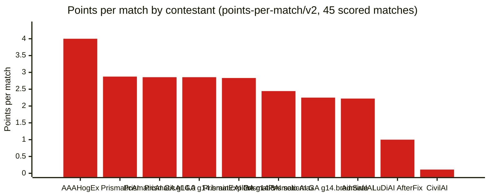
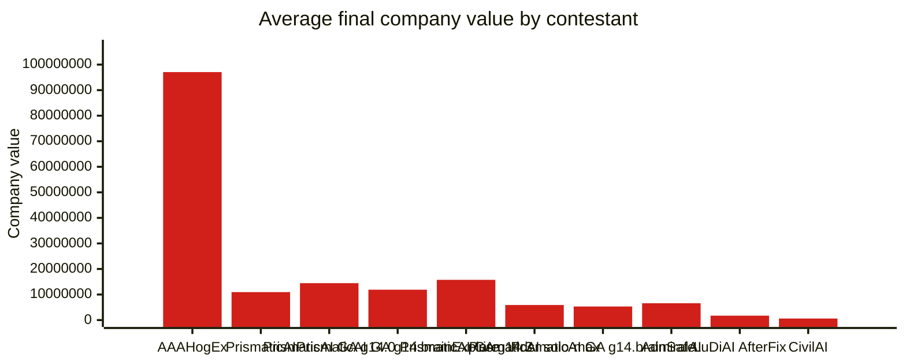
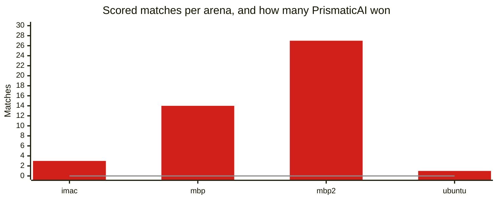

# battle-20261119T103020-8cd07833

Derived from `battle-20261119T103020-8cd07833.json` by `tools/research/ai-battle/battle.py report`; do not edit.

- Edition `8cd07833af6cddb4`: PrismaticAI and referee at `0d9c59bb9099897fd7cc68c6e3bd016b79292874`, base set `opengfx-8.0.tar`
- 20-year free-for-all from 1960, map 256x256 temperate, breakdowns 1
- 45 scored match(es) on `imac` (20261119-master-gdf1e05e7d8), `mbp` (20261119-master-ma23cbe0df4), `mbp2` (20261119-master-gdf1e05e7d8), `ubuntu` (20261119-master-gdf1e05e7d8)
- Replays: 2 of 2 identical to their original on another arena

| # | Contestant | Played | Wins | Points | Points/match | Avg rank | Avg final value | Squirrel errors | Matches with anomalies |
|---|---|---|---|---|---|---|---|---|---|
| 1 | AAAHogEx | 45 | 45 | 180 | 4.0 | 1.0 | 97.1 M | 0 | 0 |
| 2 | PrismaticAI | 8 | 0 | 23 | 2.875 | 2.12 | 10.9 M | 0 | 0 |
| 3 | PrismaticAI GA g14.0 | 7 | 0 | 20 | 2.857 | 2.14 | 14.4 M | 0 | 0 |
| 4 | PrismaticAI GA g14.brainExplore | 7 | 0 | 20 | 2.857 | 2.14 | 11.9 M | 0 | 0 |
| 5 | PrismaticAI GA g14.3 | 6 | 0 | 17 | 2.833 | 2.17 | 15.7 M | 0 | 0 |
| 6 | PrismaticAI solo-max | 9 | 0 | 22 | 2.444 | 2.56 | 5.9 M | 0 | 9 |
| 7 | PrismaticAI GA g14.brainSafe | 8 | 0 | 18 | 2.25 | 2.75 | 5.3 M | 0 | 0 |
| 8 | AdmiralAI | 45 | 0 | 100 | 2.222 | 2.78 | 6.6 M | 47 | 1 |
| 9 | LuDiAI AfterFix | 45 | 0 | 45 | 1.0 | 4.0 | 1.7 M | 0 | 0 |
| 10 | CivilAI | 45 | 0 | 5 | 0.111 | 4.89 | 600.0 k | 3650 | 4 |

```mermaid
---
config:
  xyChart:
    width: 900
    height: 360
  themeVariables:
    xyChart:
      plotColorPalette: "#d11f1a, #8a8a8a, #0b0b0b, #ece4d6"
---
xychart-beta
    title "Final company value per scored match: winner vs best PrismaticAI"
    x-axis ["m-0001", "m-0002", "m-0003", "m-0004", "m-0005", "m-0006", "m-0007", "m-0008", "m-0009", "m-0010", "m-0011", "m-0012", "m-0013", "m-0014", "m-0015", "m-0016", "m-0017", "m-0018", "m-0019", "m-0020", "m-0021", "m-0022", "m-0023", "m-0030", "m-0031", "m-0032", "m-0033", "m-0034", "m-0035", "m-0036", "m-0037", "m-0038", "m-0039", "m-0041", "m-0042", "m-0043", "m-0045", "m-0046", "m-0049", "m-0050", "m-0051", "m-0054", "m-0055", "m-0058", "m-0060"]
    %% series: Winner | Best PrismaticAI
    %% links: battle-20261119T103020-8cd07833.md?col=Match&filter=m-0001 | battle-20261119T103020-8cd07833.md?col=Match&filter=m-0002 | battle-20261119T103020-8cd07833.md?col=Match&filter=m-0003 | battle-20261119T103020-8cd07833.md?col=Match&filter=m-0004 | battle-20261119T103020-8cd07833.md?col=Match&filter=m-0005 | battle-20261119T103020-8cd07833.md?col=Match&filter=m-0006 | battle-20261119T103020-8cd07833.md?col=Match&filter=m-0007 | battle-20261119T103020-8cd07833.md?col=Match&filter=m-0008 | battle-20261119T103020-8cd07833.md?col=Match&filter=m-0009 | battle-20261119T103020-8cd07833.md?col=Match&filter=m-0010 | battle-20261119T103020-8cd07833.md?col=Match&filter=m-0011 | battle-20261119T103020-8cd07833.md?col=Match&filter=m-0012 | battle-20261119T103020-8cd07833.md?col=Match&filter=m-0013 | battle-20261119T103020-8cd07833.md?col=Match&filter=m-0014 | battle-20261119T103020-8cd07833.md?col=Match&filter=m-0015 | battle-20261119T103020-8cd07833.md?col=Match&filter=m-0016 | battle-20261119T103020-8cd07833.md?col=Match&filter=m-0017 | battle-20261119T103020-8cd07833.md?col=Match&filter=m-0018 | battle-20261119T103020-8cd07833.md?col=Match&filter=m-0019 | battle-20261119T103020-8cd07833.md?col=Match&filter=m-0020 | battle-20261119T103020-8cd07833.md?col=Match&filter=m-0021 | battle-20261119T103020-8cd07833.md?col=Match&filter=m-0022 | battle-20261119T103020-8cd07833.md?col=Match&filter=m-0023 | battle-20261119T103020-8cd07833.md?col=Match&filter=m-0030 | battle-20261119T103020-8cd07833.md?col=Match&filter=m-0031 | battle-20261119T103020-8cd07833.md?col=Match&filter=m-0032 | battle-20261119T103020-8cd07833.md?col=Match&filter=m-0033 | battle-20261119T103020-8cd07833.md?col=Match&filter=m-0034 | battle-20261119T103020-8cd07833.md?col=Match&filter=m-0035 | battle-20261119T103020-8cd07833.md?col=Match&filter=m-0036 | battle-20261119T103020-8cd07833.md?col=Match&filter=m-0037 | battle-20261119T103020-8cd07833.md?col=Match&filter=m-0038 | battle-20261119T103020-8cd07833.md?col=Match&filter=m-0039 | battle-20261119T103020-8cd07833.md?col=Match&filter=m-0041 | battle-20261119T103020-8cd07833.md?col=Match&filter=m-0042 | battle-20261119T103020-8cd07833.md?col=Match&filter=m-0043 | battle-20261119T103020-8cd07833.md?col=Match&filter=m-0045 | battle-20261119T103020-8cd07833.md?col=Match&filter=m-0046 | battle-20261119T103020-8cd07833.md?col=Match&filter=m-0049 | battle-20261119T103020-8cd07833.md?col=Match&filter=m-0050 | battle-20261119T103020-8cd07833.md?col=Match&filter=m-0051 | battle-20261119T103020-8cd07833.md?col=Match&filter=m-0054 | battle-20261119T103020-8cd07833.md?col=Match&filter=m-0055 | battle-20261119T103020-8cd07833.md?col=Match&filter=m-0058 | battle-20261119T103020-8cd07833.md?col=Match&filter=m-0060
    y-axis "Company value" 0 --> 190000000
    bar [135251372, 114432024, 156493196, 115947594, 113767890, 125159571, 133760496, 91820507, 105675525, 119013890, 121033378, 66427273, 76399364, 49630360, 81958716, 52924320, 57752027, 60640875, 74865427, 90128658, 76395912, 62349327, 61710206, 129264263, 109503965, 105391477, 113971310, 90826018, 91882706, 55878859, 81313627, 68061168, 63251118, 62082802, 119470903, 138432078, 120674539, 133989716, 72978799, 63065391, 89733342, 142948161, 172939339, 124009004, 74736102]
    line [6841745, 22566247, 5691994, 18468360, 28676916, 10565522, 6311268, 17107346, 6775626, 11578588, 15366356, 8614951, 5452296, 13904163, 3486067, 7879173, 11807575, 6784981, 3365791, 6974748, 1213160, 5072433, 11881988, 14120740, 8688364, 18131964, 9279131, 17362746, 13700858, 12888856, 5735903, 13547193, 2239817, 13020462, 10555251, 5705347, 5794395, 5453565, 4731167, 8893153, 7999718, 13560360, 6210114, 17407430, 10452494]
```

<!-- battle-charts:begin -->
<!-- derived from battle-20261119T103020-8cd07833.json by `battle.py render`; `battle.py check` fails when it is stale -->

<!-- battle-charts:end -->

| Seed | Original | Replay | Arenas | Identical |
|---|---|---|---|---|
| 1237256277 | m-0001 | m-0040 | mbp / mbp2 | yes |
| 1237256277 | m-0002 | m-0048 | mbp / mbp2 | yes |

| Match | Arena | Seed | Winner | Value | Last | Anomalies |
|---|---|---|---|---|---|---|
| m-0001 | mbp | 1237256277 | AAAHogEx | 135.3 M | CivilAI | PrismaticAI solo-max: fleet_drop:55->21 |
| m-0002 | mbp | 1237256277 | AAAHogEx | 114.4 M | CivilAI | - |
| m-0003 | mbp | 1237256277 | AAAHogEx | 156.5 M | CivilAI | CivilAI: no_vehicles |
| m-0004 | imac | 1237256277 | AAAHogEx | 115.9 M | CivilAI | - |
| m-0005 | imac | 1237256277 | AAAHogEx | 113.8 M | CivilAI | - |
| m-0006 | imac | 1251879686 | AAAHogEx | 125.2 M | LuDiAI AfterFix | - |
| m-0007 | mbp2 | 1251879686 | AAAHogEx | 133.8 M | LuDiAI AfterFix | PrismaticAI solo-max: fleet_drop:42->20 |
| m-0008 | mbp2 | 1251879686 | AAAHogEx | 91.8 M | LuDiAI AfterFix | AdmiralAI: squirrel_errors:47 |
| m-0009 | mbp2 | 1251879686 | AAAHogEx | 105.7 M | CivilAI | - |
| m-0010 | mbp2 | 1251879686 | AAAHogEx | 119.0 M | CivilAI | - |
| m-0011 | mbp2 | 1251879686 | AAAHogEx | 121.0 M | LuDiAI AfterFix | - |
| m-0012 | mbp2 | 930967890 | AAAHogEx | 66.4 M | CivilAI | - |
| m-0013 | mbp2 | 930967890 | AAAHogEx | 76.4 M | CivilAI | PrismaticAI solo-max: fleet_drop:37->14 |
| m-0014 | mbp2 | 930967890 | AAAHogEx | 49.6 M | CivilAI | - |
| m-0015 | mbp2 | 930967890 | AAAHogEx | 82.0 M | CivilAI | CivilAI: squirrel_errors:3650 |
| m-0016 | mbp2 | 930967890 | AAAHogEx | 52.9 M | CivilAI | - |
| m-0017 | mbp2 | 930967890 | AAAHogEx | 57.8 M | CivilAI | - |
| m-0018 | mbp2 | 1814625749 | AAAHogEx | 60.6 M | CivilAI | - |
| m-0019 | mbp2 | 1814625749 | AAAHogEx | 74.9 M | CivilAI | PrismaticAI solo-max: fleet_drop:39->23 |
| m-0020 | mbp2 | 1814625749 | AAAHogEx | 90.1 M | CivilAI | - |
| m-0021 | mbp2 | 1814625749 | AAAHogEx | 76.4 M | CivilAI | - |
| m-0022 | mbp2 | 1814625749 | AAAHogEx | 62.3 M | CivilAI | - |
| m-0023 | ubuntu | 1814625749 | AAAHogEx | 61.7 M | CivilAI | - |
| m-0030 | mbp | 852521374 | AAAHogEx | 129.3 M | LuDiAI AfterFix | - |
| m-0031 | mbp | 852521374 | AAAHogEx | 109.5 M | CivilAI | PrismaticAI solo-max: fleet_drop:53->15 |
| m-0032 | mbp | 852521374 | AAAHogEx | 105.4 M | CivilAI | - |
| m-0033 | mbp | 852521374 | AAAHogEx | 114.0 M | CivilAI | - |
| m-0034 | mbp | 852521374 | AAAHogEx | 90.8 M | CivilAI | - |
| m-0035 | mbp | 852521374 | AAAHogEx | 91.9 M | CivilAI | - |
| m-0036 | mbp2 | 622201523 | AAAHogEx | 55.9 M | CivilAI | - |
| m-0037 | mbp2 | 622201523 | AAAHogEx | 81.3 M | CivilAI | PrismaticAI solo-max: fleet_drop:41->14 |
| m-0038 | mbp2 | 622201523 | AAAHogEx | 68.1 M | CivilAI | - |
| m-0039 | mbp2 | 622201523 | AAAHogEx | 63.3 M | CivilAI | CivilAI: no_vehicles |
| m-0040 (replay) | mbp2 | 1237256277 | AAAHogEx | 135.3 M | CivilAI | PrismaticAI solo-max: fleet_drop:55->21 |
| m-0041 | mbp2 | 622201523 | AAAHogEx | 62.1 M | CivilAI | - |
| m-0042 | mbp2 | 1791605593 | AAAHogEx | 119.5 M | CivilAI | - |
| m-0043 | mbp2 | 1791605593 | AAAHogEx | 138.4 M | CivilAI | PrismaticAI solo-max: fleet_drop:38->13 |
| m-0045 | mbp2 | 1791605593 | AAAHogEx | 120.7 M | CivilAI | - |
| m-0046 | mbp2 | 1791605593 | AAAHogEx | 134.0 M | CivilAI | - |
| m-0048 (replay) | mbp2 | 1237256277 | AAAHogEx | 114.4 M | CivilAI | - |
| m-0049 | mbp2 | 1016335253 | AAAHogEx | 73.0 M | CivilAI | PrismaticAI solo-max: fleet_drop:33->13 |
| m-0050 | mbp2 | 1016335253 | AAAHogEx | 63.1 M | CivilAI | - |
| m-0051 | mbp | 1016335253 | AAAHogEx | 89.7 M | CivilAI | - |
| m-0054 | mbp | 1182050720 | AAAHogEx | 142.9 M | CivilAI | - |
| m-0055 | mbp | 1182050720 | AAAHogEx | 172.9 M | CivilAI | PrismaticAI solo-max: fleet_drop:47->25 |
| m-0058 | mbp | 1182050720 | AAAHogEx | 124.0 M | CivilAI | - |
| m-0060 | mbp | 644316239 | AAAHogEx | 74.7 M | CivilAI | CivilAI: fleet_drop:55->32 |
