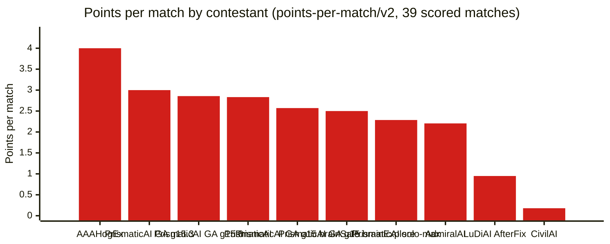
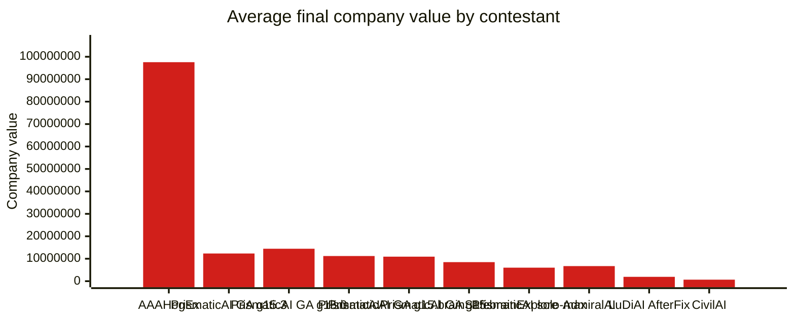
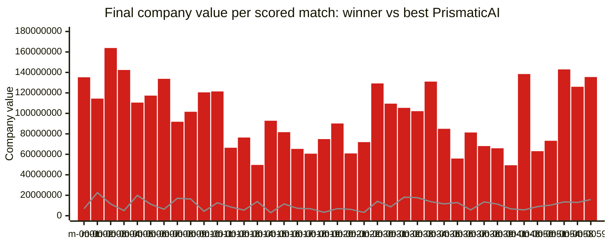
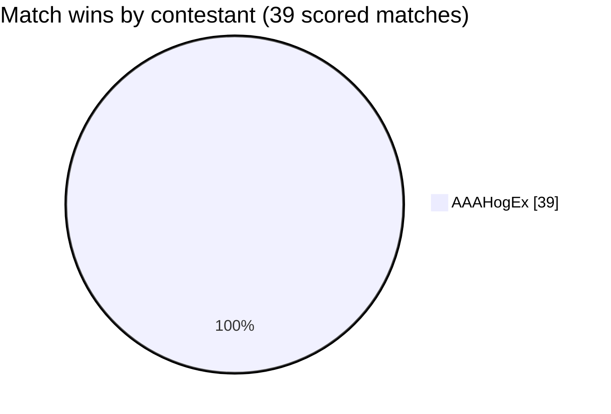
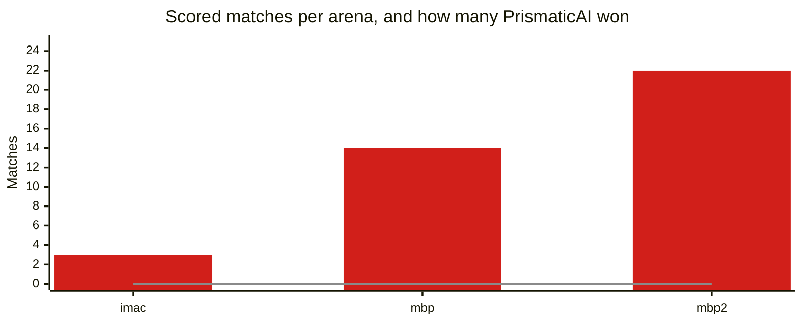

# battle-20261119T104404-126e4e25

Derived from `battle-20261119T104404-126e4e25.json` by `tools/research/ai-battle/battle.py report`; do not edit.

- Edition `126e4e259ee34db8`: PrismaticAI and referee at `0d9c59bb9099897fd7cc68c6e3bd016b79292874`, base set `opengfx-8.0.tar`
- 20-year free-for-all from 1960, map 256x256 temperate, breakdowns 1
- 39 scored match(es) on `imac` (20261119-master-gdf1e05e7d8), `mbp` (20261119-master-ma23cbe0df4), `mbp2` (20261119-master-gdf1e05e7d8)
- Replays: 0 of 0 identical to their original on another arena

| # | Contestant | Played | Wins | Points | Points/match | Avg rank | Avg final value | Squirrel errors | Matches with anomalies |
|---|---|---|---|---|---|---|---|---|---|
| 1 | AAAHogEx | 39 | 39 | 156 | 4.0 | 1.0 | 97.6 M | 0 | 0 |
| 2 | PrismaticAI GA g15.3 | 6 | 0 | 18 | 3.0 | 2.0 | 12.3 M | 0 | 0 |
| 3 | PrismaticAI GA g15.0 | 7 | 0 | 20 | 2.857 | 2.14 | 14.4 M | 0 | 0 |
| 4 | PrismaticAI | 6 | 0 | 17 | 2.833 | 2.17 | 11.2 M | 0 | 0 |
| 5 | PrismaticAI GA g15.brainSafe | 7 | 0 | 18 | 2.571 | 2.43 | 10.9 M | 0 | 5 |
| 6 | PrismaticAI GA g15.brainExplore | 6 | 0 | 15 | 2.5 | 2.5 | 8.5 M | 0 | 1 |
| 7 | PrismaticAI solo-max | 7 | 0 | 16 | 2.286 | 2.71 | 6.0 M | 0 | 7 |
| 8 | AdmiralAI | 39 | 0 | 86 | 2.205 | 2.79 | 6.7 M | 47 | 1 |
| 9 | LuDiAI AfterFix | 39 | 0 | 37 | 0.949 | 4.05 | 1.9 M | 0 | 0 |
| 10 | CivilAI | 39 | 0 | 7 | 0.179 | 4.82 | 668.2 k | 0 | 5 |

<!-- battle-charts:begin -->
<!-- derived from battle-20261119T104404-126e4e25.json by `battle.py render`; `battle.py check` fails when it is stale -->

<!-- battle-charts:end -->

| Match | Arena | Seed | Winner | Value | Last | Anomalies |
|---|---|---|---|---|---|---|
| m-0001 | mbp | 1237256277 | AAAHogEx | 135.3 M | CivilAI | PrismaticAI solo-max: fleet_drop:55->21 |
| m-0002 | mbp | 1237256277 | AAAHogEx | 114.4 M | CivilAI | - |
| m-0003 | mbp | 1237256277 | AAAHogEx | 163.9 M | CivilAI | PrismaticAI GA g15.brainSafe: fleet_drop:214->72 |
| m-0004 | imac | 1237256277 | AAAHogEx | 142.4 M | CivilAI | PrismaticAI GA g15.brainExplore: fleet_drop:41->26 |
| m-0005 | imac | 1237256277 | AAAHogEx | 110.5 M | CivilAI | - |
| m-0006 | imac | 1251879686 | AAAHogEx | 117.3 M | LuDiAI AfterFix | - |
| m-0007 | mbp2 | 1251879686 | AAAHogEx | 133.8 M | LuDiAI AfterFix | PrismaticAI solo-max: fleet_drop:42->20 |
| m-0008 | mbp2 | 1251879686 | AAAHogEx | 91.8 M | LuDiAI AfterFix | AdmiralAI: squirrel_errors:47 |
| m-0009 | mbp2 | 1251879686 | AAAHogEx | 101.6 M | CivilAI | PrismaticAI GA g15.brainSafe: fleet_drop:124->84; CivilAI: fleet_drop:47->22 |
| m-0010 | mbp2 | 1251879686 | AAAHogEx | 120.5 M | CivilAI | - |
| m-0011 | mbp2 | 1251879686 | AAAHogEx | 121.4 M | CivilAI | - |
| m-0012 | mbp2 | 930967890 | AAAHogEx | 66.4 M | CivilAI | - |
| m-0013 | mbp2 | 930967890 | AAAHogEx | 76.4 M | CivilAI | PrismaticAI solo-max: fleet_drop:37->14 |
| m-0014 | mbp2 | 930967890 | AAAHogEx | 49.6 M | CivilAI | - |
| m-0015 | mbp2 | 930967890 | AAAHogEx | 92.8 M | CivilAI | CivilAI: no_vehicles |
| m-0016 | mbp2 | 930967890 | AAAHogEx | 81.6 M | CivilAI | CivilAI: fleet_drop:39->24 |
| m-0017 | mbp2 | 930967890 | AAAHogEx | 65.3 M | LuDiAI AfterFix | CivilAI: fleet_drop:49->32 |
| m-0018 | mbp2 | 1814625749 | AAAHogEx | 60.6 M | CivilAI | - |
| m-0019 | mbp2 | 1814625749 | AAAHogEx | 74.9 M | CivilAI | PrismaticAI solo-max: fleet_drop:39->23 |
| m-0020 | mbp2 | 1814625749 | AAAHogEx | 90.1 M | CivilAI | - |
| m-0021 | mbp2 | 1814625749 | AAAHogEx | 60.9 M | CivilAI | PrismaticAI GA g15.brainSafe: fleet_drop:142->72; CivilAI: fleet_drop:26->9 |
| m-0022 | mbp2 | 1814625749 | AAAHogEx | 71.9 M | LuDiAI AfterFix | - |
| m-0030 | mbp | 852521374 | AAAHogEx | 129.3 M | LuDiAI AfterFix | - |
| m-0031 | mbp | 852521374 | AAAHogEx | 109.5 M | CivilAI | PrismaticAI solo-max: fleet_drop:53->15 |
| m-0032 | mbp | 852521374 | AAAHogEx | 105.4 M | CivilAI | - |
| m-0033 | mbp | 852521374 | AAAHogEx | 102.1 M | CivilAI | PrismaticAI GA g15.brainSafe: fleet_drop:155->61 |
| m-0034 | mbp | 852521374 | AAAHogEx | 131.0 M | CivilAI | - |
| m-0035 | mbp | 852521374 | AAAHogEx | 84.9 M | CivilAI | - |
| m-0036 | mbp2 | 622201523 | AAAHogEx | 55.9 M | CivilAI | - |
| m-0037 | mbp2 | 622201523 | AAAHogEx | 81.3 M | CivilAI | PrismaticAI solo-max: fleet_drop:41->14 |
| m-0038 | mbp2 | 622201523 | AAAHogEx | 68.1 M | CivilAI | - |
| m-0039 | mbp2 | 622201523 | AAAHogEx | 65.9 M | CivilAI | PrismaticAI GA g15.brainSafe: fleet_drop:120->40 |
| m-0041 | mbp2 | 622201523 | AAAHogEx | 49.3 M | CivilAI | - |
| m-0043 | mbp2 | 1791605593 | AAAHogEx | 138.4 M | CivilAI | PrismaticAI solo-max: fleet_drop:38->13 |
| m-0050 | mbp | 1016335253 | AAAHogEx | 63.1 M | CivilAI | - |
| m-0051 | mbp | 1016335253 | AAAHogEx | 73.2 M | LuDiAI AfterFix | - |
| m-0054 | mbp | 1182050720 | AAAHogEx | 142.9 M | CivilAI | - |
| m-0058 | mbp | 1182050720 | AAAHogEx | 126.0 M | CivilAI | - |
| m-0059 | mbp | 1182050720 | AAAHogEx | 135.5 M | CivilAI | - |
