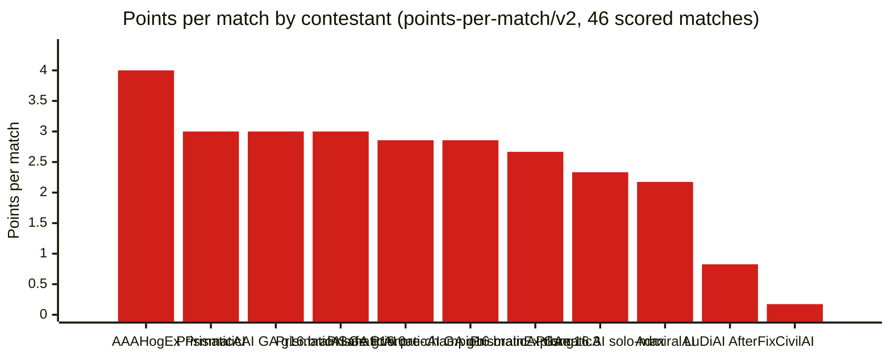
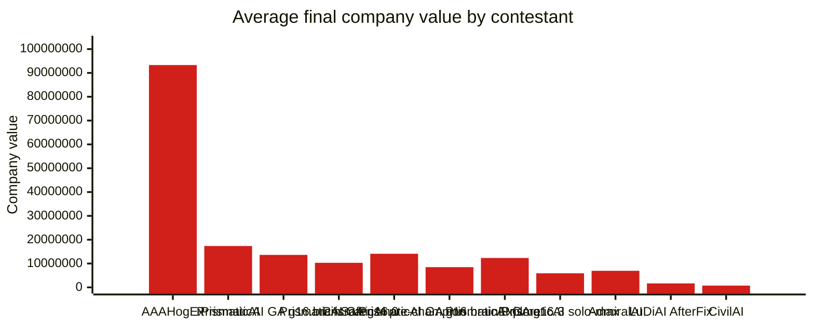
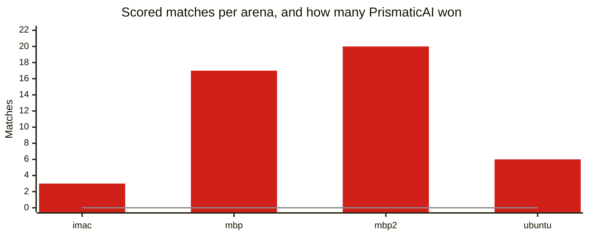

# battle-20261119T110859-f063413c

Derived from `battle-20261119T110859-f063413c.json` by `tools/research/ai-battle/battle.py report`; do not edit.

- Edition `f063413cd336e1fe`: PrismaticAI and referee at `1f3400b85de084fcb4bb1230b95817962e917176`, base set `opengfx-8.0.tar`
- 20-year free-for-all from 1960, map 256x256 temperate, breakdowns 1
- 46 scored match(es) on `imac` (20261119-master-gdf1e05e7d8), `mbp` (20261119-master-mec42cfe720), `mbp2` (20261119-master-gdf1e05e7d8), `ubuntu` (20261119-master-gdf1e05e7d8)
- Replays: 0 of 1 identical to their original on another arena

| # | Contestant | Played | Wins | Points | Points/match | Avg rank | Avg final value | Squirrel errors | Matches with anomalies |
|---|---|---|---|---|---|---|---|---|---|
| 1 | AAAHogEx | 46 | 46 | 184 | 4.0 | 1.0 | 93.3 M | 0 | 0 |
| 2 | PrismaticAI | 7 | 0 | 21 | 3.0 | 2.0 | 17.3 M | 0 | 0 |
| 3 | PrismaticAI GA g16.brainSafe | 6 | 0 | 18 | 3.0 | 2.0 | 13.6 M | 0 | 5 |
| 4 | PrismaticAI GA g16.0 | 7 | 0 | 21 | 3.0 | 2.0 | 10.3 M | 0 | 0 |
| 5 | PrismaticAI pre-champion | 7 | 0 | 20 | 2.857 | 2.14 | 14.1 M | 0 | 0 |
| 6 | PrismaticAI GA g16.brainExplore | 7 | 0 | 20 | 2.857 | 2.14 | 8.5 M | 0 | 2 |
| 7 | PrismaticAI GA g16.3 | 6 | 0 | 16 | 2.667 | 2.33 | 12.3 M | 0 | 0 |
| 8 | PrismaticAI solo-max | 6 | 0 | 14 | 2.333 | 2.67 | 5.9 M | 0 | 6 |
| 9 | AdmiralAI | 46 | 0 | 100 | 2.174 | 2.83 | 6.9 M | 59 | 2 |
| 10 | LuDiAI AfterFix | 46 | 0 | 38 | 0.826 | 4.17 | 1.7 M | 0 | 2 |
| 11 | CivilAI | 46 | 0 | 8 | 0.174 | 4.83 | 735.3 k | 0 | 10 |

```mermaid
---
config:
  xyChart:
    width: 900
    height: 360
  themeVariables:
    xyChart:
      plotColorPalette: "#d11f1a, #8a8a8a, #0b0b0b, #ece4d6"
---
xychart-beta
    title "Final company value per scored match: winner vs best PrismaticAI"
    x-axis ["m-0001", "m-0002", "m-0003", "m-0004", "m-0005", "m-0006", "m-0007", "m-0008", "m-0009", "m-0010", "m-0011", "m-0012", "m-0013", "m-0014", "m-0015", "m-0016", "m-0017", "m-0018", "m-0019", "m-0020", "m-0021", "m-0022", "m-0023", "m-0024", "m-0025", "m-0026", "m-0027", "m-0028", "m-0030", "m-0031", "m-0032", "m-0033", "m-0034", "m-0035", "m-0036", "m-0037", "m-0038", "m-0043", "m-0044", "m-0045", "m-0046", "m-0047", "m-0049", "m-0061", "m-0062", "m-0063"]
    %% series: Winner | Best PrismaticAI
    %% links: battle-20261119T110859-f063413c.md?col=Match&filter=m-0001 | battle-20261119T110859-f063413c.md?col=Match&filter=m-0002 | battle-20261119T110859-f063413c.md?col=Match&filter=m-0003 | battle-20261119T110859-f063413c.md?col=Match&filter=m-0004 | battle-20261119T110859-f063413c.md?col=Match&filter=m-0005 | battle-20261119T110859-f063413c.md?col=Match&filter=m-0006 | battle-20261119T110859-f063413c.md?col=Match&filter=m-0007 | battle-20261119T110859-f063413c.md?col=Match&filter=m-0008 | battle-20261119T110859-f063413c.md?col=Match&filter=m-0009 | battle-20261119T110859-f063413c.md?col=Match&filter=m-0010 | battle-20261119T110859-f063413c.md?col=Match&filter=m-0011 | battle-20261119T110859-f063413c.md?col=Match&filter=m-0012 | battle-20261119T110859-f063413c.md?col=Match&filter=m-0013 | battle-20261119T110859-f063413c.md?col=Match&filter=m-0014 | battle-20261119T110859-f063413c.md?col=Match&filter=m-0015 | battle-20261119T110859-f063413c.md?col=Match&filter=m-0016 | battle-20261119T110859-f063413c.md?col=Match&filter=m-0017 | battle-20261119T110859-f063413c.md?col=Match&filter=m-0018 | battle-20261119T110859-f063413c.md?col=Match&filter=m-0019 | battle-20261119T110859-f063413c.md?col=Match&filter=m-0020 | battle-20261119T110859-f063413c.md?col=Match&filter=m-0021 | battle-20261119T110859-f063413c.md?col=Match&filter=m-0022 | battle-20261119T110859-f063413c.md?col=Match&filter=m-0023 | battle-20261119T110859-f063413c.md?col=Match&filter=m-0024 | battle-20261119T110859-f063413c.md?col=Match&filter=m-0025 | battle-20261119T110859-f063413c.md?col=Match&filter=m-0026 | battle-20261119T110859-f063413c.md?col=Match&filter=m-0027 | battle-20261119T110859-f063413c.md?col=Match&filter=m-0028 | battle-20261119T110859-f063413c.md?col=Match&filter=m-0030 | battle-20261119T110859-f063413c.md?col=Match&filter=m-0031 | battle-20261119T110859-f063413c.md?col=Match&filter=m-0032 | battle-20261119T110859-f063413c.md?col=Match&filter=m-0033 | battle-20261119T110859-f063413c.md?col=Match&filter=m-0034 | battle-20261119T110859-f063413c.md?col=Match&filter=m-0035 | battle-20261119T110859-f063413c.md?col=Match&filter=m-0036 | battle-20261119T110859-f063413c.md?col=Match&filter=m-0037 | battle-20261119T110859-f063413c.md?col=Match&filter=m-0038 | battle-20261119T110859-f063413c.md?col=Match&filter=m-0043 | battle-20261119T110859-f063413c.md?col=Match&filter=m-0044 | battle-20261119T110859-f063413c.md?col=Match&filter=m-0045 | battle-20261119T110859-f063413c.md?col=Match&filter=m-0046 | battle-20261119T110859-f063413c.md?col=Match&filter=m-0047 | battle-20261119T110859-f063413c.md?col=Match&filter=m-0049 | battle-20261119T110859-f063413c.md?col=Match&filter=m-0061 | battle-20261119T110859-f063413c.md?col=Match&filter=m-0062 | battle-20261119T110859-f063413c.md?col=Match&filter=m-0063
    y-axis "Company value" 0 --> 158000000
    bar [143733776, 91368801, 128368408, 134690709, 113470791, 111909176, 110188795, 124775752, 105244002, 126699061, 100073925, 127408642, 88371732, 58100938, 83609496, 77858986, 65298676, 59991106, 58414423, 76197351, 90128658, 68445975, 81986611, 74067727, 83372678, 63341435, 85175691, 125441654, 103341315, 131190429, 92671397, 86724859, 100808458, 98543917, 109503965, 107723711, 91158873, 58119394, 59999106, 49914960, 56115295, 61882387, 124432324, 101250363, 71098802, 129661618]
    line [5683707, 23350704, 14420180, 22377933, 4510450, 21994451, 16397834, 4185216, 11868938, 13247868, 14077001, 8088768, 18601938, 15252662, 7005207, 4073001, 7282232, 7867746, 6315232, 3450075, 6974748, 4599444, 10693645, 9019871, 8017922, 7152078, 4873760, 28714208, 15183183, 12458044, 17934694, 16980036, 17113372, 20229013, 8688364, 17073610, 7797983, 5200267, 16439814, 7897605, 11469130, 7227113, 14997003, 9076029, 7916127, 18881613]
```

<!-- battle-charts:begin -->
<!-- derived from battle-20261119T110859-f063413c.json by `battle.py render`; `battle.py check` fails when it is stale -->

<!-- battle-charts:end -->

| Seed | Original | Replay | Arenas | Identical |
|---|---|---|---|---|
| 1237256277 | m-0004 | m-0048 | imac / mbp | NO |

| Match | Arena | Seed | Winner | Value | Last | Anomalies |
|---|---|---|---|---|---|---|
| m-0001 | mbp | 1237256277 | AAAHogEx | 143.7 M | CivilAI | PrismaticAI solo-max: fleet_drop:56->21 |
| m-0002 | mbp | 1237256277 | AAAHogEx | 91.4 M | CivilAI | - |
| m-0003 | mbp | 1237256277 | AAAHogEx | 128.4 M | CivilAI | CivilAI: no_vehicles |
| m-0004 | imac | 1237256277 | AAAHogEx | 134.7 M | CivilAI | PrismaticAI GA g16.brainSafe: fleet_drop:228->60 |
| m-0005 | imac | 1237256277 | AAAHogEx | 113.5 M | CivilAI | PrismaticAI GA g16.brainExplore: fleet_drop:40->23 |
| m-0006 | imac | 1237256277 | AAAHogEx | 111.9 M | CivilAI | - |
| m-0007 | mbp2 | 1251879686 | AAAHogEx | 110.2 M | CivilAI | - |
| m-0008 | mbp2 | 1251879686 | AAAHogEx | 124.8 M | CivilAI | PrismaticAI solo-max: fleet_drop:37->17; CivilAI: fleet_drop:13->9 |
| m-0009 | mbp2 | 1251879686 | AAAHogEx | 105.2 M | LuDiAI AfterFix | AdmiralAI: fleet_drop:201->135 |
| m-0010 | mbp2 | 1251879686 | AAAHogEx | 126.7 M | CivilAI | - |
| m-0011 | mbp2 | 1251879686 | AAAHogEx | 100.1 M | CivilAI | PrismaticAI GA g16.brainSafe: fleet_drop:169->43 |
| m-0012 | mbp2 | 1251879686 | AAAHogEx | 127.4 M | CivilAI | AdmiralAI: squirrel_errors:59 |
| m-0013 | mbp2 | 1251879686 | AAAHogEx | 88.4 M | LuDiAI AfterFix | LuDiAI AfterFix: fleet_drop:32->21 |
| m-0014 | mbp2 | 930967890 | AAAHogEx | 58.1 M | CivilAI | - |
| m-0015 | mbp2 | 930967890 | AAAHogEx | 83.6 M | CivilAI | PrismaticAI solo-max: fleet_drop:37->13; CivilAI: fleet_drop:33->22 |
| m-0016 | mbp2 | 930967890 | AAAHogEx | 77.9 M | CivilAI | - |
| m-0017 | mbp2 | 930967890 | AAAHogEx | 65.3 M | LuDiAI AfterFix | CivilAI: fleet_drop:49->32 |
| m-0018 | mbp2 | 930967890 | AAAHogEx | 60.0 M | CivilAI | - |
| m-0019 | mbp2 | 930967890 | AAAHogEx | 58.4 M | CivilAI | - |
| m-0020 | mbp2 | 930967890 | AAAHogEx | 76.2 M | CivilAI | - |
| m-0021 | mbp2 | 1814625749 | AAAHogEx | 90.1 M | CivilAI | - |
| m-0022 | mbp2 | 1814625749 | AAAHogEx | 68.4 M | CivilAI | PrismaticAI solo-max: fleet_drop:42->16 |
| m-0023 | ubuntu | 1814625749 | AAAHogEx | 82.0 M | CivilAI | - |
| m-0024 | ubuntu | 1814625749 | AAAHogEx | 74.1 M | CivilAI | CivilAI: fleet_drop:82->47 |
| m-0025 | ubuntu | 1814625749 | AAAHogEx | 83.4 M | CivilAI | PrismaticAI GA g16.brainSafe: fleet_drop:129->82 |
| m-0026 | ubuntu | 1814625749 | AAAHogEx | 63.3 M | CivilAI | - |
| m-0027 | ubuntu | 1814625749 | AAAHogEx | 85.2 M | CivilAI | - |
| m-0028 | ubuntu | 397755790 | AAAHogEx | 125.4 M | CivilAI | - |
| m-0030 | mbp | 397755790 | AAAHogEx | 103.3 M | CivilAI | - |
| m-0031 | mbp | 397755790 | AAAHogEx | 131.2 M | LuDiAI AfterFix | - |
| m-0032 | mbp | 397755790 | AAAHogEx | 92.7 M | LuDiAI AfterFix | PrismaticAI GA g16.brainSafe: fleet_drop:142->58 |
| m-0033 | mbp | 397755790 | AAAHogEx | 86.7 M | LuDiAI AfterFix | - |
| m-0034 | mbp | 397755790 | AAAHogEx | 100.8 M | CivilAI | CivilAI: fleet_drop:39->8 |
| m-0035 | mbp | 852521374 | AAAHogEx | 98.5 M | LuDiAI AfterFix | CivilAI: fleet_drop:38->24; LuDiAI AfterFix: fleet_drop:103->69 |
| m-0036 | mbp | 852521374 | AAAHogEx | 109.5 M | CivilAI | PrismaticAI solo-max: fleet_drop:53->15 |
| m-0037 | mbp | 852521374 | AAAHogEx | 107.7 M | CivilAI | - |
| m-0038 | mbp | 852521374 | AAAHogEx | 91.2 M | CivilAI | - |
| m-0043 | mbp2 | 622201523 | AAAHogEx | 58.1 M | CivilAI | PrismaticAI solo-max: fleet_drop:39->11 |
| m-0044 | mbp2 | 622201523 | AAAHogEx | 60.0 M | CivilAI | CivilAI: fleet_drop:14->8 |
| m-0045 | mbp2 | 622201523 | AAAHogEx | 49.9 M | CivilAI | CivilAI: fleet_drop:53->37 |
| m-0046 | mbp2 | 622201523 | AAAHogEx | 56.1 M | CivilAI | PrismaticAI GA g16.brainSafe: fleet_drop:92->37 |
| m-0047 | mbp | 622201523 | AAAHogEx | 61.9 M | CivilAI | PrismaticAI GA g16.brainExplore: fleet_drop:35->23 |
| m-0048 (replay) | mbp | 1237256277 | AAAHogEx | 133.6 M | CivilAI | PrismaticAI GA g16.brainSafe: fleet_drop:227->100 |
| m-0049 | mbp | 1791605593 | AAAHogEx | 124.4 M | CivilAI | - |
| m-0061 | mbp | 1016335253 | AAAHogEx | 101.3 M | LuDiAI AfterFix | CivilAI: fleet_drop:67->39 |
| m-0062 | mbp | 1016335253 | AAAHogEx | 71.1 M | CivilAI | - |
| m-0063 | mbp | 1182050720 | AAAHogEx | 129.7 M | CivilAI | - |
