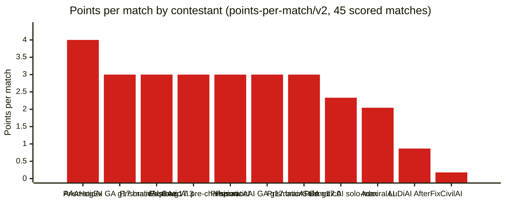
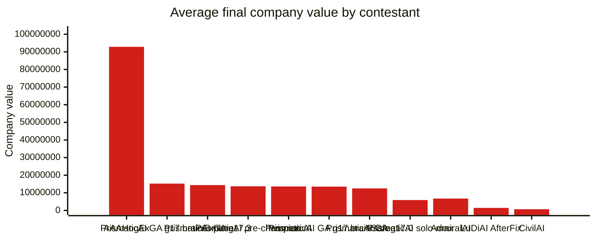
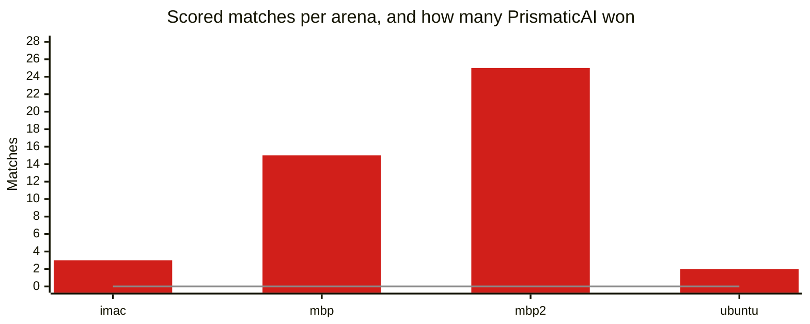

# battle-20261119T112339-4b413eae

Derived from `battle-20261119T112339-4b413eae.json` by `tools/research/ai-battle/battle.py report`; do not edit.

- Edition `4b413eae591dd46a`: PrismaticAI and referee at `1f3400b85de084fcb4bb1230b95817962e917176`, base set `opengfx-8.0.tar`
- 20-year free-for-all from 1960, map 256x256 temperate, breakdowns 1
- 45 scored match(es) on `imac` (20261119-master-gdf1e05e7d8), `mbp` (20261119-master-mec42cfe720), `mbp2` (20261119-master-gdf1e05e7d8), `ubuntu` (20261119-master-gdf1e05e7d8)
- Replays: 0 of 0 identical to their original on another arena

| # | Contestant | Played | Wins | Points | Points/match | Avg rank | Avg final value | Squirrel errors | Matches with anomalies |
|---|---|---|---|---|---|---|---|---|---|
| 1 | AAAHogEx | 45 | 45 | 180 | 4.0 | 1.0 | 92.8 M | 0 | 0 |
| 2 | PrismaticAI GA g17.brainExplore | 6 | 0 | 18 | 3.0 | 2.0 | 15.2 M | 0 | 6 |
| 3 | PrismaticAI GA g17.3 | 6 | 0 | 18 | 3.0 | 2.0 | 14.4 M | 0 | 1 |
| 4 | PrismaticAI pre-champion | 8 | 0 | 24 | 3.0 | 2.0 | 13.7 M | 0 | 0 |
| 5 | PrismaticAI | 5 | 0 | 15 | 3.0 | 2.0 | 13.6 M | 0 | 0 |
| 6 | PrismaticAI GA g17.brainSafe | 7 | 0 | 21 | 3.0 | 2.0 | 13.5 M | 0 | 0 |
| 7 | PrismaticAI GA g17.0 | 7 | 0 | 21 | 3.0 | 2.0 | 12.5 M | 0 | 4 |
| 8 | PrismaticAI solo-max | 6 | 0 | 14 | 2.333 | 2.67 | 5.9 M | 0 | 6 |
| 9 | AdmiralAI | 45 | 0 | 92 | 2.044 | 2.96 | 6.7 M | 0 | 2 |
| 10 | LuDiAI AfterFix | 45 | 0 | 39 | 0.867 | 4.13 | 1.4 M | 0 | 2 |
| 11 | CivilAI | 45 | 0 | 8 | 0.178 | 4.82 | 683.2 k | 3665 | 6 |

```mermaid
---
config:
  xyChart:
    width: 900
    height: 360
  themeVariables:
    xyChart:
      plotColorPalette: "#d11f1a, #8a8a8a, #0b0b0b, #ece4d6"
---
xychart-beta
    title "Final company value per scored match: winner vs best PrismaticAI"
    x-axis ["m-0001", "m-0002", "m-0003", "m-0004", "m-0005", "m-0006", "m-0007", "m-0008", "m-0009", "m-0010", "m-0011", "m-0012", "m-0013", "m-0014", "m-0015", "m-0016", "m-0017", "m-0018", "m-0019", "m-0020", "m-0021", "m-0022", "m-0025", "m-0027", "m-0030", "m-0031", "m-0032", "m-0033", "m-0034", "m-0035", "m-0036", "m-0037", "m-0041", "m-0042", "m-0043", "m-0044", "m-0045", "m-0046", "m-0047", "m-0051", "m-0052", "m-0054", "m-0058", "m-0059", "m-0060"]
    %% series: Winner | Best PrismaticAI
    %% links: battle-20261119T112339-4b413eae.md?col=Match&filter=m-0001 | battle-20261119T112339-4b413eae.md?col=Match&filter=m-0002 | battle-20261119T112339-4b413eae.md?col=Match&filter=m-0003 | battle-20261119T112339-4b413eae.md?col=Match&filter=m-0004 | battle-20261119T112339-4b413eae.md?col=Match&filter=m-0005 | battle-20261119T112339-4b413eae.md?col=Match&filter=m-0006 | battle-20261119T112339-4b413eae.md?col=Match&filter=m-0007 | battle-20261119T112339-4b413eae.md?col=Match&filter=m-0008 | battle-20261119T112339-4b413eae.md?col=Match&filter=m-0009 | battle-20261119T112339-4b413eae.md?col=Match&filter=m-0010 | battle-20261119T112339-4b413eae.md?col=Match&filter=m-0011 | battle-20261119T112339-4b413eae.md?col=Match&filter=m-0012 | battle-20261119T112339-4b413eae.md?col=Match&filter=m-0013 | battle-20261119T112339-4b413eae.md?col=Match&filter=m-0014 | battle-20261119T112339-4b413eae.md?col=Match&filter=m-0015 | battle-20261119T112339-4b413eae.md?col=Match&filter=m-0016 | battle-20261119T112339-4b413eae.md?col=Match&filter=m-0017 | battle-20261119T112339-4b413eae.md?col=Match&filter=m-0018 | battle-20261119T112339-4b413eae.md?col=Match&filter=m-0019 | battle-20261119T112339-4b413eae.md?col=Match&filter=m-0020 | battle-20261119T112339-4b413eae.md?col=Match&filter=m-0021 | battle-20261119T112339-4b413eae.md?col=Match&filter=m-0022 | battle-20261119T112339-4b413eae.md?col=Match&filter=m-0025 | battle-20261119T112339-4b413eae.md?col=Match&filter=m-0027 | battle-20261119T112339-4b413eae.md?col=Match&filter=m-0030 | battle-20261119T112339-4b413eae.md?col=Match&filter=m-0031 | battle-20261119T112339-4b413eae.md?col=Match&filter=m-0032 | battle-20261119T112339-4b413eae.md?col=Match&filter=m-0033 | battle-20261119T112339-4b413eae.md?col=Match&filter=m-0034 | battle-20261119T112339-4b413eae.md?col=Match&filter=m-0035 | battle-20261119T112339-4b413eae.md?col=Match&filter=m-0036 | battle-20261119T112339-4b413eae.md?col=Match&filter=m-0037 | battle-20261119T112339-4b413eae.md?col=Match&filter=m-0041 | battle-20261119T112339-4b413eae.md?col=Match&filter=m-0042 | battle-20261119T112339-4b413eae.md?col=Match&filter=m-0043 | battle-20261119T112339-4b413eae.md?col=Match&filter=m-0044 | battle-20261119T112339-4b413eae.md?col=Match&filter=m-0045 | battle-20261119T112339-4b413eae.md?col=Match&filter=m-0046 | battle-20261119T112339-4b413eae.md?col=Match&filter=m-0047 | battle-20261119T112339-4b413eae.md?col=Match&filter=m-0051 | battle-20261119T112339-4b413eae.md?col=Match&filter=m-0052 | battle-20261119T112339-4b413eae.md?col=Match&filter=m-0054 | battle-20261119T112339-4b413eae.md?col=Match&filter=m-0058 | battle-20261119T112339-4b413eae.md?col=Match&filter=m-0059 | battle-20261119T112339-4b413eae.md?col=Match&filter=m-0060
    y-axis "Company value" 0 --> 180000000
    bar [143733776, 91368801, 163865845, 145939903, 95457066, 106040755, 110188795, 124775752, 105244002, 106796843, 101024906, 117618716, 94422952, 58100938, 83609496, 77858986, 73026616, 49830067, 57129722, 71570966, 90128658, 68445975, 78436522, 60367887, 103341315, 112620004, 92001493, 112691083, 115728753, 98543917, 109503965, 107723711, 90664677, 67143101, 58119394, 59999106, 52217597, 58707377, 68054205, 124024971, 110844579, 112843126, 88931270, 83540411, 75999445]
    line [5683707, 23350704, 11497941, 16513416, 24357035, 15719405, 16397834, 4185216, 11868938, 15164225, 14741314, 14464624, 11776086, 15252662, 7005207, 4073001, 8712384, 7510803, 14280222, 7111233, 6974748, 4599444, 9139825, 10839272, 15183183, 13844653, 19026853, 14434829, 16228857, 20229013, 8688364, 17073610, 24623156, 9150278, 5200267, 16439814, 17245095, 13333817, 13177036, 11119512, 10589332, 10593129, 10493877, 10401133, 14309244]
```

<!-- battle-charts:begin -->
<!-- derived from battle-20261119T112339-4b413eae.json by `battle.py render`; `battle.py check` fails when it is stale -->

<!-- battle-charts:end -->

| Match | Arena | Seed | Winner | Value | Last | Anomalies |
|---|---|---|---|---|---|---|
| m-0001 | mbp | 1237256277 | AAAHogEx | 143.7 M | CivilAI | PrismaticAI solo-max: fleet_drop:56->21 |
| m-0002 | mbp | 1237256277 | AAAHogEx | 91.4 M | CivilAI | - |
| m-0003 | mbp | 1237256277 | AAAHogEx | 163.9 M | CivilAI | PrismaticAI GA g17.0: fleet_drop:214->72 |
| m-0004 | imac | 1237256277 | AAAHogEx | 145.9 M | CivilAI | - |
| m-0005 | imac | 1237256277 | AAAHogEx | 95.5 M | CivilAI | PrismaticAI GA g17.brainExplore: fleet_drop:158->105 |
| m-0006 | imac | 1237256277 | AAAHogEx | 106.0 M | CivilAI | PrismaticAI GA g17.3: fleet_drop:163->93 |
| m-0007 | mbp2 | 1251879686 | AAAHogEx | 110.2 M | CivilAI | - |
| m-0008 | mbp2 | 1251879686 | AAAHogEx | 124.8 M | CivilAI | PrismaticAI solo-max: fleet_drop:37->17; CivilAI: fleet_drop:13->9 |
| m-0009 | mbp2 | 1251879686 | AAAHogEx | 105.2 M | LuDiAI AfterFix | AdmiralAI: fleet_drop:201->135 |
| m-0010 | mbp2 | 1251879686 | AAAHogEx | 106.8 M | LuDiAI AfterFix | PrismaticAI GA g17.0: fleet_drop:87->55 |
| m-0011 | mbp2 | 1251879686 | AAAHogEx | 101.0 M | CivilAI | - |
| m-0012 | mbp2 | 1251879686 | AAAHogEx | 117.6 M | LuDiAI AfterFix | PrismaticAI GA g17.brainExplore: fleet_drop:108->43 |
| m-0013 | mbp2 | 1251879686 | AAAHogEx | 94.4 M | LuDiAI AfterFix | - |
| m-0014 | mbp2 | 930967890 | AAAHogEx | 58.1 M | CivilAI | - |
| m-0015 | mbp2 | 930967890 | AAAHogEx | 83.6 M | CivilAI | PrismaticAI solo-max: fleet_drop:37->13; CivilAI: fleet_drop:33->22 |
| m-0016 | mbp2 | 930967890 | AAAHogEx | 77.9 M | CivilAI | - |
| m-0017 | mbp2 | 930967890 | AAAHogEx | 73.0 M | CivilAI | - |
| m-0018 | mbp2 | 930967890 | AAAHogEx | 49.8 M | CivilAI | - |
| m-0019 | mbp2 | 930967890 | AAAHogEx | 57.1 M | CivilAI | PrismaticAI GA g17.brainExplore: fleet_drop:93->65 |
| m-0020 | mbp2 | 930967890 | AAAHogEx | 71.6 M | CivilAI | CivilAI: squirrel_errors:3665 |
| m-0021 | mbp2 | 1814625749 | AAAHogEx | 90.1 M | CivilAI | - |
| m-0022 | mbp2 | 1814625749 | AAAHogEx | 68.4 M | CivilAI | PrismaticAI solo-max: fleet_drop:42->16 |
| m-0025 | ubuntu | 1814625749 | AAAHogEx | 78.4 M | CivilAI | - |
| m-0027 | ubuntu | 1814625749 | AAAHogEx | 60.4 M | CivilAI | - |
| m-0030 | mbp | 397755790 | AAAHogEx | 103.3 M | CivilAI | - |
| m-0031 | mbp | 397755790 | AAAHogEx | 112.6 M | CivilAI | PrismaticAI GA g17.0: fleet_drop:202->46 |
| m-0032 | mbp | 397755790 | AAAHogEx | 92.0 M | LuDiAI AfterFix | - |
| m-0033 | mbp | 397755790 | AAAHogEx | 112.7 M | CivilAI | PrismaticAI GA g17.brainExplore: fleet_drop:140->40 |
| m-0034 | mbp | 397755790 | AAAHogEx | 115.7 M | CivilAI | - |
| m-0035 | mbp | 852521374 | AAAHogEx | 98.5 M | LuDiAI AfterFix | CivilAI: fleet_drop:38->24; LuDiAI AfterFix: fleet_drop:103->69 |
| m-0036 | mbp2 | 852521374 | AAAHogEx | 109.5 M | CivilAI | PrismaticAI solo-max: fleet_drop:53->15 |
| m-0037 | mbp2 | 852521374 | AAAHogEx | 107.7 M | CivilAI | - |
| m-0041 | mbp2 | 852521374 | AAAHogEx | 90.7 M | CivilAI | - |
| m-0042 | mbp2 | 622201523 | AAAHogEx | 67.1 M | LuDiAI AfterFix | - |
| m-0043 | mbp2 | 622201523 | AAAHogEx | 58.1 M | CivilAI | PrismaticAI solo-max: fleet_drop:39->11 |
| m-0044 | mbp2 | 622201523 | AAAHogEx | 60.0 M | CivilAI | CivilAI: fleet_drop:14->8 |
| m-0045 | mbp2 | 622201523 | AAAHogEx | 52.2 M | CivilAI | PrismaticAI GA g17.0: fleet_drop:76->51; CivilAI: fleet_drop:57->36 |
| m-0046 | mbp2 | 622201523 | AAAHogEx | 58.7 M | CivilAI | LuDiAI AfterFix: fleet_drop:63->34 |
| m-0047 | mbp2 | 622201523 | AAAHogEx | 68.1 M | CivilAI | PrismaticAI GA g17.brainExplore: fleet_drop:79->25 |
| m-0051 | mbp | 1791605593 | AAAHogEx | 124.0 M | CivilAI | - |
| m-0052 | mbp | 1791605593 | AAAHogEx | 110.8 M | CivilAI | - |
| m-0054 | mbp | 1791605593 | AAAHogEx | 112.8 M | CivilAI | PrismaticAI GA g17.brainExplore: fleet_drop:153->69; AdmiralAI: fleet_drop:335->218 |
| m-0058 | mbp | 1016335253 | AAAHogEx | 88.9 M | LuDiAI AfterFix | - |
| m-0059 | mbp | 1016335253 | AAAHogEx | 83.5 M | CivilAI | - |
| m-0060 | mbp | 1016335253 | AAAHogEx | 76.0 M | CivilAI | - |
