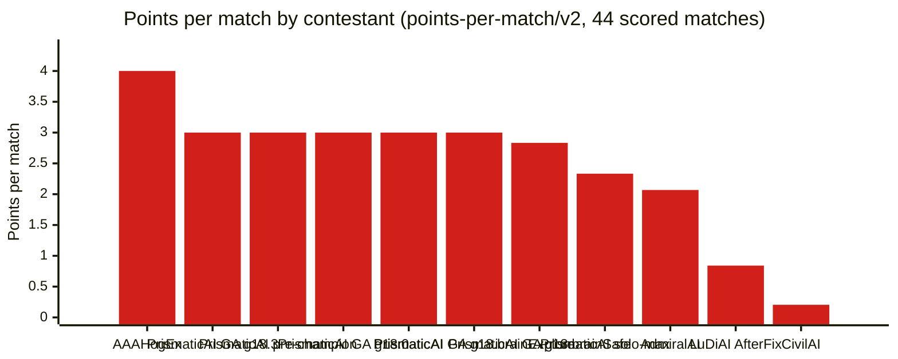
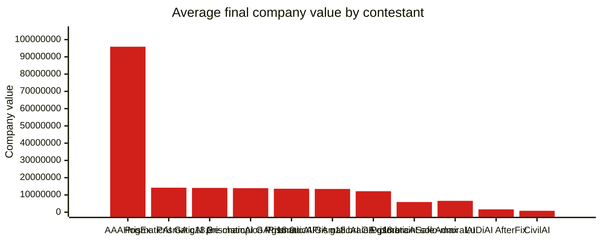
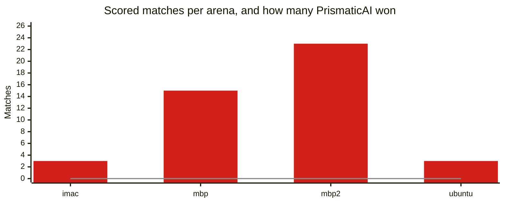

# battle-20261119T113936-ed17b8ed

Derived from `battle-20261119T113936-ed17b8ed.json` by `tools/research/ai-battle/battle.py report`; do not edit.

- Edition `ed17b8edc2f39371`: PrismaticAI and referee at `1f3400b85de084fcb4bb1230b95817962e917176`, base set `opengfx-8.0.tar`
- 20-year free-for-all from 1960, map 256x256 temperate, breakdowns 1
- 44 scored match(es) on `imac` (20261119-master-gdf1e05e7d8), `mbp` (20261119-master-mec42cfe720), `mbp2` (20261119-master-gdf1e05e7d8), `ubuntu` (20261119-master-gdf1e05e7d8)
- Replays: 1 of 2 identical to their original on another arena

| # | Contestant | Played | Wins | Points | Points/match | Avg rank | Avg final value | Squirrel errors | Matches with anomalies |
|---|---|---|---|---|---|---|---|---|---|
| 1 | AAAHogEx | 44 | 44 | 176 | 4.0 | 1.0 | 95.9 M | 0 | 0 |
| 2 | PrismaticAI GA g18.3 | 7 | 0 | 21 | 3.0 | 2.0 | 14.2 M | 0 | 5 |
| 3 | PrismaticAI pre-champion | 7 | 0 | 21 | 3.0 | 2.0 | 14.1 M | 0 | 0 |
| 4 | PrismaticAI GA g18.0 | 7 | 0 | 21 | 3.0 | 2.0 | 13.9 M | 0 | 5 |
| 5 | PrismaticAI | 5 | 0 | 15 | 3.0 | 2.0 | 13.6 M | 0 | 0 |
| 6 | PrismaticAI GA g18.brainExplore | 6 | 0 | 18 | 3.0 | 2.0 | 13.5 M | 0 | 2 |
| 7 | PrismaticAI GA g18.brainSafe | 6 | 0 | 17 | 2.833 | 2.17 | 12.1 M | 0 | 3 |
| 8 | PrismaticAI solo-max | 6 | 0 | 14 | 2.333 | 2.67 | 5.9 M | 0 | 6 |
| 9 | AdmiralAI | 44 | 0 | 91 | 2.068 | 2.93 | 6.6 M | 0 | 2 |
| 10 | LuDiAI AfterFix | 44 | 0 | 37 | 0.841 | 4.16 | 1.6 M | 0 | 1 |
| 11 | CivilAI | 44 | 0 | 9 | 0.205 | 4.8 | 817.1 k | 0 | 8 |

```mermaid
---
config:
  xyChart:
    width: 900
    height: 360
  themeVariables:
    xyChart:
      plotColorPalette: "#d11f1a, #8a8a8a, #0b0b0b, #ece4d6"
---
xychart-beta
    title "Final company value per scored match: winner vs best PrismaticAI"
    x-axis ["m-0001", "m-0002", "m-0003", "m-0004", "m-0005", "m-0006", "m-0007", "m-0008", "m-0009", "m-0010", "m-0011", "m-0012", "m-0013", "m-0014", "m-0015", "m-0016", "m-0017", "m-0018", "m-0019", "m-0020", "m-0021", "m-0022", "m-0024", "m-0025", "m-0026", "m-0030", "m-0031", "m-0032", "m-0033", "m-0034", "m-0035", "m-0036", "m-0037", "m-0038", "m-0041", "m-0042", "m-0043", "m-0044", "m-0045", "m-0046", "m-0055", "m-0058", "m-0061", "m-0062"]
    %% series: Winner | Best PrismaticAI
    %% links: battle-20261119T113936-ed17b8ed.md?col=Match&filter=m-0001 | battle-20261119T113936-ed17b8ed.md?col=Match&filter=m-0002 | battle-20261119T113936-ed17b8ed.md?col=Match&filter=m-0003 | battle-20261119T113936-ed17b8ed.md?col=Match&filter=m-0004 | battle-20261119T113936-ed17b8ed.md?col=Match&filter=m-0005 | battle-20261119T113936-ed17b8ed.md?col=Match&filter=m-0006 | battle-20261119T113936-ed17b8ed.md?col=Match&filter=m-0007 | battle-20261119T113936-ed17b8ed.md?col=Match&filter=m-0008 | battle-20261119T113936-ed17b8ed.md?col=Match&filter=m-0009 | battle-20261119T113936-ed17b8ed.md?col=Match&filter=m-0010 | battle-20261119T113936-ed17b8ed.md?col=Match&filter=m-0011 | battle-20261119T113936-ed17b8ed.md?col=Match&filter=m-0012 | battle-20261119T113936-ed17b8ed.md?col=Match&filter=m-0013 | battle-20261119T113936-ed17b8ed.md?col=Match&filter=m-0014 | battle-20261119T113936-ed17b8ed.md?col=Match&filter=m-0015 | battle-20261119T113936-ed17b8ed.md?col=Match&filter=m-0016 | battle-20261119T113936-ed17b8ed.md?col=Match&filter=m-0017 | battle-20261119T113936-ed17b8ed.md?col=Match&filter=m-0018 | battle-20261119T113936-ed17b8ed.md?col=Match&filter=m-0019 | battle-20261119T113936-ed17b8ed.md?col=Match&filter=m-0020 | battle-20261119T113936-ed17b8ed.md?col=Match&filter=m-0021 | battle-20261119T113936-ed17b8ed.md?col=Match&filter=m-0022 | battle-20261119T113936-ed17b8ed.md?col=Match&filter=m-0024 | battle-20261119T113936-ed17b8ed.md?col=Match&filter=m-0025 | battle-20261119T113936-ed17b8ed.md?col=Match&filter=m-0026 | battle-20261119T113936-ed17b8ed.md?col=Match&filter=m-0030 | battle-20261119T113936-ed17b8ed.md?col=Match&filter=m-0031 | battle-20261119T113936-ed17b8ed.md?col=Match&filter=m-0032 | battle-20261119T113936-ed17b8ed.md?col=Match&filter=m-0033 | battle-20261119T113936-ed17b8ed.md?col=Match&filter=m-0034 | battle-20261119T113936-ed17b8ed.md?col=Match&filter=m-0035 | battle-20261119T113936-ed17b8ed.md?col=Match&filter=m-0036 | battle-20261119T113936-ed17b8ed.md?col=Match&filter=m-0037 | battle-20261119T113936-ed17b8ed.md?col=Match&filter=m-0038 | battle-20261119T113936-ed17b8ed.md?col=Match&filter=m-0041 | battle-20261119T113936-ed17b8ed.md?col=Match&filter=m-0042 | battle-20261119T113936-ed17b8ed.md?col=Match&filter=m-0043 | battle-20261119T113936-ed17b8ed.md?col=Match&filter=m-0044 | battle-20261119T113936-ed17b8ed.md?col=Match&filter=m-0045 | battle-20261119T113936-ed17b8ed.md?col=Match&filter=m-0046 | battle-20261119T113936-ed17b8ed.md?col=Match&filter=m-0055 | battle-20261119T113936-ed17b8ed.md?col=Match&filter=m-0058 | battle-20261119T113936-ed17b8ed.md?col=Match&filter=m-0061 | battle-20261119T113936-ed17b8ed.md?col=Match&filter=m-0062
    y-axis "Company value" 0 --> 165000000
    bar [143733776, 91368801, 145135101, 121666885, 99377593, 137697385, 110188795, 124775752, 105244002, 119574084, 105491058, 124906912, 111291172, 58100938, 83609496, 77858986, 74723560, 65088455, 60917408, 89019630, 90128658, 68445975, 69631352, 73138839, 76065571, 103341315, 126436608, 116491649, 115072595, 114859925, 98543917, 109503965, 107723711, 110628010, 104769407, 67143101, 58119394, 59999106, 63247385, 58436856, 149698255, 88931270, 75697024, 62692536]
    line [5683707, 23350704, 22542411, 15467331, 20351089, 17340324, 16397834, 4185216, 11868938, 12910725, 15123426, 12737756, 11109192, 15252662, 7005207, 4073001, 11843312, 14584033, 17355668, 7490356, 6974748, 4599444, 9498740, 5259188, 11329950, 15183183, 12742417, 12865969, 12044157, 18820710, 20229013, 8688364, 17073610, 17615610, 17243169, 9150278, 5200267, 16439814, 10304549, 9597652, 15375635, 10493877, 6976122, 11972869]
```

<!-- battle-charts:begin -->
<!-- derived from battle-20261119T113936-ed17b8ed.json by `battle.py render`; `battle.py check` fails when it is stale -->

<!-- battle-charts:end -->

| Seed | Original | Replay | Arenas | Identical |
|---|---|---|---|---|
| 1251879686 | m-0007 | m-0048 | mbp2 / mbp | yes |
| 1237256277 | m-0005 | m-0056 | imac / mbp | NO |

| Match | Arena | Seed | Winner | Value | Last | Anomalies |
|---|---|---|---|---|---|---|
| m-0001 | mbp | 1237256277 | AAAHogEx | 143.7 M | CivilAI | PrismaticAI solo-max: fleet_drop:56->21 |
| m-0002 | mbp | 1237256277 | AAAHogEx | 91.4 M | CivilAI | - |
| m-0003 | mbp | 1237256277 | AAAHogEx | 145.1 M | CivilAI | - |
| m-0004 | imac | 1237256277 | AAAHogEx | 121.7 M | CivilAI | - |
| m-0005 | imac | 1237256277 | AAAHogEx | 99.4 M | CivilAI | - |
| m-0006 | imac | 1237256277 | AAAHogEx | 137.7 M | CivilAI | PrismaticAI GA g18.3: fleet_drop:200->125 |
| m-0007 | mbp2 | 1251879686 | AAAHogEx | 110.2 M | CivilAI | - |
| m-0008 | mbp2 | 1251879686 | AAAHogEx | 124.8 M | CivilAI | PrismaticAI solo-max: fleet_drop:37->17; CivilAI: fleet_drop:13->9 |
| m-0009 | mbp2 | 1251879686 | AAAHogEx | 105.2 M | LuDiAI AfterFix | AdmiralAI: fleet_drop:201->135 |
| m-0010 | mbp2 | 1251879686 | AAAHogEx | 119.6 M | CivilAI | PrismaticAI GA g18.0: fleet_drop:59->38 |
| m-0011 | mbp2 | 1251879686 | AAAHogEx | 105.5 M | CivilAI | PrismaticAI GA g18.brainSafe: fleet_drop:100->64 |
| m-0012 | mbp2 | 1251879686 | AAAHogEx | 124.9 M | CivilAI | PrismaticAI GA g18.brainExplore: fleet_drop:110->41 |
| m-0013 | mbp2 | 1251879686 | AAAHogEx | 111.3 M | AdmiralAI | PrismaticAI GA g18.3: fleet_drop:73->49 |
| m-0014 | mbp2 | 930967890 | AAAHogEx | 58.1 M | CivilAI | - |
| m-0015 | mbp2 | 930967890 | AAAHogEx | 83.6 M | CivilAI | PrismaticAI solo-max: fleet_drop:37->13; CivilAI: fleet_drop:33->22 |
| m-0016 | mbp2 | 930967890 | AAAHogEx | 77.9 M | CivilAI | - |
| m-0017 | mbp2 | 930967890 | AAAHogEx | 74.7 M | CivilAI | PrismaticAI GA g18.0: fleet_drop:96->37; CivilAI: fleet_drop:41->26 |
| m-0018 | mbp2 | 930967890 | AAAHogEx | 65.1 M | CivilAI | - |
| m-0019 | mbp2 | 930967890 | AAAHogEx | 60.9 M | CivilAI | - |
| m-0020 | mbp2 | 930967890 | AAAHogEx | 89.0 M | CivilAI | - |
| m-0021 | mbp2 | 1814625749 | AAAHogEx | 90.1 M | CivilAI | - |
| m-0022 | mbp2 | 1814625749 | AAAHogEx | 68.4 M | CivilAI | PrismaticAI solo-max: fleet_drop:42->16 |
| m-0024 | ubuntu | 1814625749 | AAAHogEx | 69.6 M | CivilAI | PrismaticAI GA g18.0: fleet_drop:94->60 |
| m-0025 | ubuntu | 1814625749 | AAAHogEx | 73.1 M | CivilAI | CivilAI: fleet_drop:14->5 |
| m-0026 | ubuntu | 1814625749 | AAAHogEx | 76.1 M | CivilAI | - |
| m-0030 | mbp | 397755790 | AAAHogEx | 103.3 M | CivilAI | - |
| m-0031 | mbp | 397755790 | AAAHogEx | 126.4 M | LuDiAI AfterFix | - |
| m-0032 | mbp | 397755790 | AAAHogEx | 116.5 M | LuDiAI AfterFix | PrismaticAI GA g18.brainSafe: fleet_drop:137->54 |
| m-0033 | mbp | 397755790 | AAAHogEx | 115.1 M | LuDiAI AfterFix | PrismaticAI GA g18.brainExplore: fleet_drop:80->41 |
| m-0034 | mbp | 397755790 | AAAHogEx | 114.9 M | LuDiAI AfterFix | PrismaticAI GA g18.3: fleet_drop:93->56 |
| m-0035 | mbp | 852521374 | AAAHogEx | 98.5 M | LuDiAI AfterFix | CivilAI: fleet_drop:38->24; LuDiAI AfterFix: fleet_drop:103->69 |
| m-0036 | mbp2 | 852521374 | AAAHogEx | 109.5 M | CivilAI | PrismaticAI solo-max: fleet_drop:53->15 |
| m-0037 | mbp2 | 852521374 | AAAHogEx | 107.7 M | CivilAI | - |
| m-0038 | mbp2 | 852521374 | AAAHogEx | 110.6 M | CivilAI | PrismaticAI GA g18.0: fleet_drop:82->56 |
| m-0041 | mbp2 | 852521374 | AAAHogEx | 104.8 M | CivilAI | PrismaticAI GA g18.3: fleet_drop:121->66; AdmiralAI: fleet_drop:215->146 |
| m-0042 | mbp | 622201523 | AAAHogEx | 67.1 M | LuDiAI AfterFix | - |
| m-0043 | mbp | 622201523 | AAAHogEx | 58.1 M | CivilAI | PrismaticAI solo-max: fleet_drop:39->11 |
| m-0044 | mbp2 | 622201523 | AAAHogEx | 60.0 M | CivilAI | CivilAI: fleet_drop:14->8 |
| m-0045 | mbp2 | 622201523 | AAAHogEx | 63.2 M | CivilAI | PrismaticAI GA g18.0: fleet_drop:45->22 |
| m-0046 | mbp2 | 622201523 | AAAHogEx | 58.4 M | CivilAI | PrismaticAI GA g18.brainSafe: fleet_drop:52->36; CivilAI: fleet_drop:42->28 |
| m-0048 (replay) | mbp | 1251879686 | AAAHogEx | 110.2 M | CivilAI | - |
| m-0055 | mbp | 1791605593 | AAAHogEx | 149.7 M | CivilAI | PrismaticAI GA g18.3: fleet_drop:186->120 |
| m-0056 (replay) | mbp | 1237256277 | AAAHogEx | 100.5 M | CivilAI | PrismaticAI GA g18.brainExplore: fleet_drop:184->95 |
| m-0058 | mbp | 1016335253 | AAAHogEx | 88.9 M | LuDiAI AfterFix | - |
| m-0061 | mbp | 1016335253 | AAAHogEx | 75.7 M | CivilAI | - |
| m-0062 | mbp | 1016335253 | AAAHogEx | 62.7 M | CivilAI | CivilAI: fleet_drop:68->29 |
