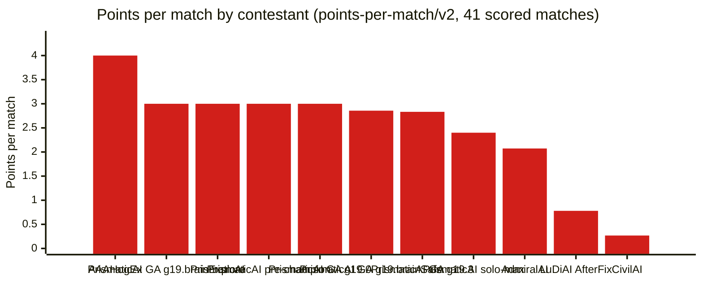
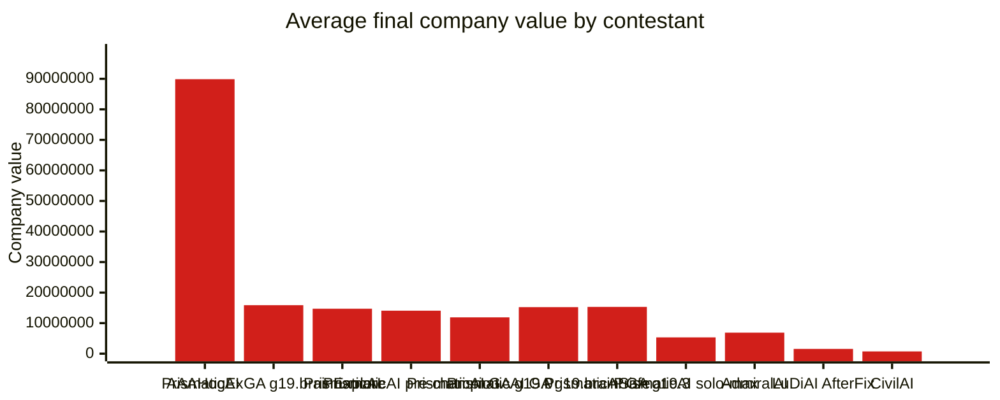
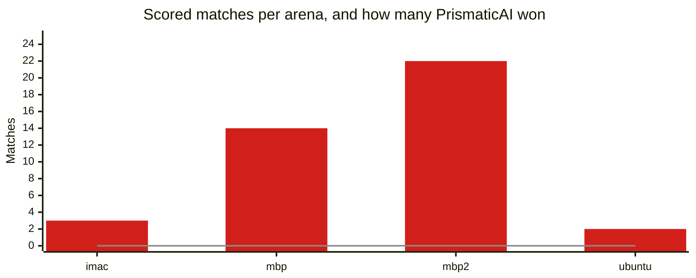

# battle-20261119T115424-5240c368

Derived from `battle-20261119T115424-5240c368.json` by `tools/research/ai-battle/battle.py report`; do not edit.

- Edition `5240c368db4cff47`: PrismaticAI and referee at `1f3400b85de084fcb4bb1230b95817962e917176`, base set `opengfx-8.0.tar`
- 20-year free-for-all from 1960, map 256x256 temperate, breakdowns 1
- 41 scored match(es) on `imac` (20261119-master-gdf1e05e7d8), `mbp` (20261119-master-mec42cfe720), `mbp2` (20261119-master-gdf1e05e7d8), `ubuntu` (20261119-master-gdf1e05e7d8)
- Replays: 2 of 2 identical to their original on another arena

| # | Contestant | Played | Wins | Points | Points/match | Avg rank | Avg final value | Squirrel errors | Matches with anomalies |
|---|---|---|---|---|---|---|---|---|---|
| 1 | AAAHogEx | 41 | 41 | 164 | 4.0 | 1.0 | 89.9 M | 0 | 0 |
| 2 | PrismaticAI GA g19.brainExplore | 6 | 0 | 18 | 3.0 | 2.0 | 15.9 M | 0 | 3 |
| 3 | PrismaticAI | 4 | 0 | 12 | 3.0 | 2.0 | 14.7 M | 0 | 0 |
| 4 | PrismaticAI pre-champion | 7 | 0 | 21 | 3.0 | 2.0 | 14.1 M | 0 | 0 |
| 5 | PrismaticAI GA g19.0 | 6 | 0 | 18 | 3.0 | 2.0 | 11.9 M | 0 | 2 |
| 6 | PrismaticAI GA g19.brainSafe | 7 | 0 | 20 | 2.857 | 2.14 | 15.2 M | 0 | 1 |
| 7 | PrismaticAI GA g19.3 | 6 | 0 | 17 | 2.833 | 2.17 | 15.3 M | 0 | 4 |
| 8 | PrismaticAI solo-max | 5 | 0 | 12 | 2.4 | 2.6 | 5.3 M | 0 | 5 |
| 9 | AdmiralAI | 41 | 0 | 85 | 2.073 | 2.93 | 6.9 M | 0 | 1 |
| 10 | LuDiAI AfterFix | 41 | 0 | 32 | 0.78 | 4.22 | 1.6 M | 0 | 4 |
| 11 | CivilAI | 41 | 0 | 11 | 0.268 | 4.73 | 737.6 k | 0 | 7 |

```mermaid
---
config:
  xyChart:
    width: 900
    height: 360
  themeVariables:
    xyChart:
      plotColorPalette: "#d11f1a, #8a8a8a, #0b0b0b, #ece4d6"
---
xychart-beta
    title "Final company value per scored match: winner vs best PrismaticAI"
    x-axis ["m-0001", "m-0002", "m-0003", "m-0004", "m-0005", "m-0006", "m-0007", "m-0008", "m-0009", "m-0010", "m-0011", "m-0012", "m-0013", "m-0014", "m-0015", "m-0016", "m-0017", "m-0018", "m-0019", "m-0020", "m-0021", "m-0022", "m-0025", "m-0027", "m-0030", "m-0031", "m-0032", "m-0033", "m-0034", "m-0035", "m-0037", "m-0041", "m-0043", "m-0044", "m-0045", "m-0046", "m-0047", "m-0058", "m-0059", "m-0060", "m-0061"]
    %% series: Winner | Best PrismaticAI
    %% links: battle-20261119T115424-5240c368.md?col=Match&filter=m-0001 | battle-20261119T115424-5240c368.md?col=Match&filter=m-0002 | battle-20261119T115424-5240c368.md?col=Match&filter=m-0003 | battle-20261119T115424-5240c368.md?col=Match&filter=m-0004 | battle-20261119T115424-5240c368.md?col=Match&filter=m-0005 | battle-20261119T115424-5240c368.md?col=Match&filter=m-0006 | battle-20261119T115424-5240c368.md?col=Match&filter=m-0007 | battle-20261119T115424-5240c368.md?col=Match&filter=m-0008 | battle-20261119T115424-5240c368.md?col=Match&filter=m-0009 | battle-20261119T115424-5240c368.md?col=Match&filter=m-0010 | battle-20261119T115424-5240c368.md?col=Match&filter=m-0011 | battle-20261119T115424-5240c368.md?col=Match&filter=m-0012 | battle-20261119T115424-5240c368.md?col=Match&filter=m-0013 | battle-20261119T115424-5240c368.md?col=Match&filter=m-0014 | battle-20261119T115424-5240c368.md?col=Match&filter=m-0015 | battle-20261119T115424-5240c368.md?col=Match&filter=m-0016 | battle-20261119T115424-5240c368.md?col=Match&filter=m-0017 | battle-20261119T115424-5240c368.md?col=Match&filter=m-0018 | battle-20261119T115424-5240c368.md?col=Match&filter=m-0019 | battle-20261119T115424-5240c368.md?col=Match&filter=m-0020 | battle-20261119T115424-5240c368.md?col=Match&filter=m-0021 | battle-20261119T115424-5240c368.md?col=Match&filter=m-0022 | battle-20261119T115424-5240c368.md?col=Match&filter=m-0025 | battle-20261119T115424-5240c368.md?col=Match&filter=m-0027 | battle-20261119T115424-5240c368.md?col=Match&filter=m-0030 | battle-20261119T115424-5240c368.md?col=Match&filter=m-0031 | battle-20261119T115424-5240c368.md?col=Match&filter=m-0032 | battle-20261119T115424-5240c368.md?col=Match&filter=m-0033 | battle-20261119T115424-5240c368.md?col=Match&filter=m-0034 | battle-20261119T115424-5240c368.md?col=Match&filter=m-0035 | battle-20261119T115424-5240c368.md?col=Match&filter=m-0037 | battle-20261119T115424-5240c368.md?col=Match&filter=m-0041 | battle-20261119T115424-5240c368.md?col=Match&filter=m-0043 | battle-20261119T115424-5240c368.md?col=Match&filter=m-0044 | battle-20261119T115424-5240c368.md?col=Match&filter=m-0045 | battle-20261119T115424-5240c368.md?col=Match&filter=m-0046 | battle-20261119T115424-5240c368.md?col=Match&filter=m-0047 | battle-20261119T115424-5240c368.md?col=Match&filter=m-0058 | battle-20261119T115424-5240c368.md?col=Match&filter=m-0059 | battle-20261119T115424-5240c368.md?col=Match&filter=m-0060 | battle-20261119T115424-5240c368.md?col=Match&filter=m-0061
    y-axis "Company value" 0 --> 158000000
    bar [143733776, 91368801, 121610055, 134160049, 110417535, 111192784, 110188795, 124775752, 105244002, 98716516, 111217906, 126378480, 101951448, 58100938, 83609496, 77858986, 68830239, 54321655, 50076230, 68826130, 90128658, 68445975, 72001340, 65267205, 103341315, 122864697, 88531968, 105339833, 105371817, 98543917, 107723711, 114164923, 58119394, 59999106, 56409352, 44622948, 51756182, 88931270, 96280984, 49787242, 84578033]
    line [5683707, 23350704, 20552203, 29296344, 22600108, 22670106, 16397834, 4185216, 11868938, 11279504, 15407378, 10457460, 12591579, 15252662, 7005207, 4073001, 7205648, 11718647, 16762220, 10339001, 6974748, 4599444, 7433904, 9226599, 15183183, 9387259, 20571938, 16526417, 19677580, 20229013, 17073610, 17372134, 5200267, 16439814, 12400045, 14152161, 13196030, 10493877, 10521206, 8051005, 15698535]
```

<!-- battle-charts:begin -->
<!-- derived from battle-20261119T115424-5240c368.json by `battle.py render`; `battle.py check` fails when it is stale -->

<!-- battle-charts:end -->

| Seed | Original | Replay | Arenas | Identical |
|---|---|---|---|---|
| 1251879686 | m-0008 | m-0040 | mbp2 / mbp | yes |
| 1251879686 | m-0007 | m-0048 | mbp2 / mbp | yes |

| Match | Arena | Seed | Winner | Value | Last | Anomalies |
|---|---|---|---|---|---|---|
| m-0001 | mbp | 1237256277 | AAAHogEx | 143.7 M | CivilAI | PrismaticAI solo-max: fleet_drop:56->21 |
| m-0002 | mbp | 1237256277 | AAAHogEx | 91.4 M | CivilAI | - |
| m-0003 | mbp | 1237256277 | AAAHogEx | 121.6 M | CivilAI | - |
| m-0004 | imac | 1237256277 | AAAHogEx | 134.2 M | CivilAI | CivilAI: fleet_drop:47->29 |
| m-0005 | imac | 1237256277 | AAAHogEx | 110.4 M | CivilAI | - |
| m-0006 | imac | 1237256277 | AAAHogEx | 111.2 M | CivilAI | PrismaticAI GA g19.3: fleet_drop:168->117; CivilAI: fleet_drop:83->54 |
| m-0007 | mbp2 | 1251879686 | AAAHogEx | 110.2 M | CivilAI | - |
| m-0008 | mbp2 | 1251879686 | AAAHogEx | 124.8 M | CivilAI | PrismaticAI solo-max: fleet_drop:37->17; CivilAI: fleet_drop:13->9 |
| m-0009 | mbp2 | 1251879686 | AAAHogEx | 105.2 M | LuDiAI AfterFix | AdmiralAI: fleet_drop:201->135 |
| m-0010 | mbp2 | 1251879686 | AAAHogEx | 98.7 M | CivilAI | - |
| m-0011 | mbp2 | 1251879686 | AAAHogEx | 111.2 M | CivilAI | CivilAI: fleet_drop:31->12 |
| m-0012 | mbp2 | 1251879686 | AAAHogEx | 126.4 M | LuDiAI AfterFix | PrismaticAI GA g19.brainExplore: fleet_drop:93->51 |
| m-0013 | mbp2 | 1251879686 | AAAHogEx | 102.0 M | AdmiralAI | - |
| m-0014 | mbp2 | 930967890 | AAAHogEx | 58.1 M | CivilAI | - |
| m-0015 | mbp2 | 930967890 | AAAHogEx | 83.6 M | CivilAI | PrismaticAI solo-max: fleet_drop:37->13; CivilAI: fleet_drop:33->22 |
| m-0016 | mbp2 | 930967890 | AAAHogEx | 77.9 M | CivilAI | - |
| m-0017 | mbp2 | 930967890 | AAAHogEx | 68.8 M | CivilAI | - |
| m-0018 | mbp2 | 930967890 | AAAHogEx | 54.3 M | CivilAI | PrismaticAI GA g19.brainSafe: fleet_drop:63->44 |
| m-0019 | mbp2 | 930967890 | AAAHogEx | 50.1 M | LuDiAI AfterFix | - |
| m-0020 | mbp2 | 930967890 | AAAHogEx | 68.8 M | CivilAI | PrismaticAI GA g19.3: fleet_drop:74->47 |
| m-0021 | mbp2 | 1814625749 | AAAHogEx | 90.1 M | CivilAI | - |
| m-0022 | mbp2 | 1814625749 | AAAHogEx | 68.4 M | CivilAI | PrismaticAI solo-max: fleet_drop:42->16 |
| m-0025 | ubuntu | 1814625749 | AAAHogEx | 72.0 M | CivilAI | LuDiAI AfterFix: fleet_drop:54->31 |
| m-0027 | ubuntu | 1814625749 | AAAHogEx | 65.3 M | CivilAI | - |
| m-0030 | mbp | 397755790 | AAAHogEx | 103.3 M | CivilAI | - |
| m-0031 | mbp | 397755790 | AAAHogEx | 122.9 M | LuDiAI AfterFix | PrismaticAI GA g19.0: fleet_drop:150->52 |
| m-0032 | mbp | 397755790 | AAAHogEx | 88.5 M | LuDiAI AfterFix | LuDiAI AfterFix: fleet_drop:44->29 |
| m-0033 | mbp | 397755790 | AAAHogEx | 105.3 M | LuDiAI AfterFix | PrismaticAI GA g19.brainExplore: fleet_drop:125->65 |
| m-0034 | mbp | 397755790 | AAAHogEx | 105.4 M | CivilAI | PrismaticAI GA g19.3: fleet_drop:112->56 |
| m-0035 | mbp | 852521374 | AAAHogEx | 98.5 M | LuDiAI AfterFix | CivilAI: fleet_drop:38->24; LuDiAI AfterFix: fleet_drop:103->69 |
| m-0037 | mbp2 | 852521374 | AAAHogEx | 107.7 M | CivilAI | - |
| m-0040 (replay) | mbp | 1251879686 | AAAHogEx | 124.8 M | CivilAI | PrismaticAI solo-max: fleet_drop:37->17; CivilAI: fleet_drop:13->9 |
| m-0041 | mbp | 852521374 | AAAHogEx | 114.2 M | CivilAI | PrismaticAI GA g19.3: fleet_drop:168->51 |
| m-0043 | mbp2 | 622201523 | AAAHogEx | 58.1 M | CivilAI | PrismaticAI solo-max: fleet_drop:39->11 |
| m-0044 | mbp2 | 622201523 | AAAHogEx | 60.0 M | CivilAI | CivilAI: fleet_drop:14->8 |
| m-0045 | mbp2 | 622201523 | AAAHogEx | 56.4 M | CivilAI | PrismaticAI GA g19.0: fleet_drop:75->46 |
| m-0046 | mbp2 | 622201523 | AAAHogEx | 44.6 M | CivilAI | - |
| m-0047 | mbp2 | 622201523 | AAAHogEx | 51.8 M | CivilAI | PrismaticAI GA g19.brainExplore: fleet_drop:65->41 |
| m-0048 (replay) | mbp | 1251879686 | AAAHogEx | 110.2 M | CivilAI | - |
| m-0058 | mbp | 1016335253 | AAAHogEx | 88.9 M | LuDiAI AfterFix | - |
| m-0059 | mbp | 1016335253 | AAAHogEx | 96.3 M | CivilAI | - |
| m-0060 | mbp | 1016335253 | AAAHogEx | 49.8 M | CivilAI | - |
| m-0061 | mbp | 1016335253 | AAAHogEx | 84.6 M | LuDiAI AfterFix | LuDiAI AfterFix: fleet_drop:65->43 |
