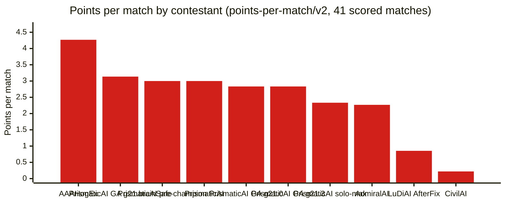
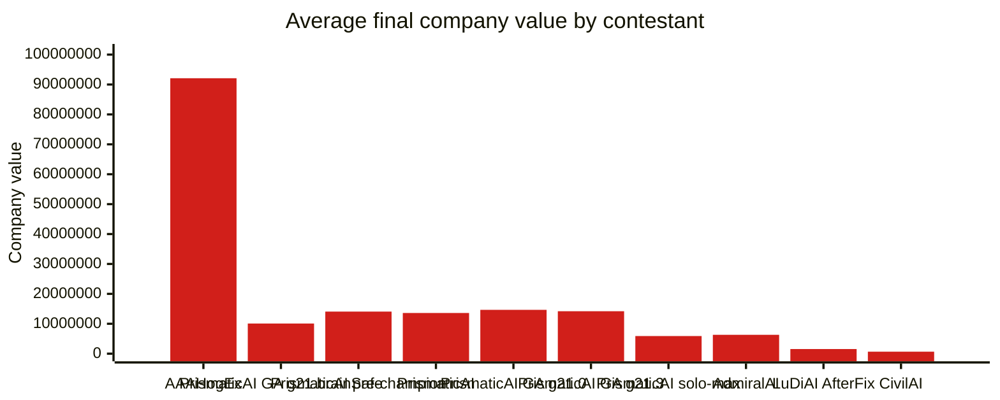
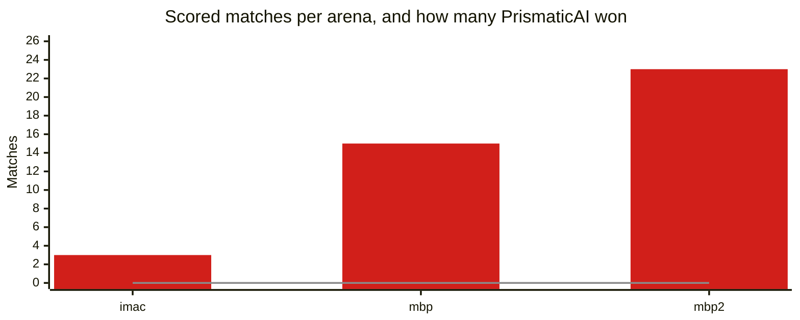

# battle-20261119T122110-b9be7069

Derived from `battle-20261119T122110-b9be7069.json` by `tools/research/ai-battle/battle.py report`; do not edit.

- Edition `b9be7069f1694171`: PrismaticAI and referee at `1f3400b85de084fcb4bb1230b95817962e917176`, base set `opengfx-8.0.tar`
- 20-year free-for-all from 1960, map 256x256 temperate, breakdowns 1
- 41 scored match(es) on `imac` (20261119-master-gdf1e05e7d8), `mbp` (20261119-master-m7bd897c759), `mbp2` (20261119-master-gdf1e05e7d8)
- Replays: 0 of 0 identical to their original on another arena

| # | Contestant | Played | Wins | Points | Points/match | Avg rank | Avg final value | Squirrel errors | Matches with anomalies |
|---|---|---|---|---|---|---|---|---|---|
| 1 | AAAHogEx | 41 | 41 | 175 | 4.268 | 1.0 | 92.1 M | 0 | 0 |
| 2 | PrismaticAI GA g21.brainSafe | 22 | 0 | 69 | 3.136 | 2.86 | 10.1 M | 0 | 10 |
| 3 | PrismaticAI pre-champion | 7 | 0 | 21 | 3.0 | 2.0 | 14.1 M | 0 | 0 |
| 4 | PrismaticAI | 5 | 0 | 15 | 3.0 | 2.0 | 13.6 M | 0 | 0 |
| 5 | PrismaticAI GA g21.0 | 6 | 0 | 17 | 2.833 | 2.17 | 14.7 M | 0 | 0 |
| 6 | PrismaticAI GA g21.3 | 6 | 0 | 17 | 2.833 | 2.17 | 14.2 M | 0 | 4 |
| 7 | PrismaticAI solo-max | 6 | 0 | 14 | 2.333 | 2.67 | 5.9 M | 0 | 6 |
| 8 | AdmiralAI | 41 | 0 | 93 | 2.268 | 3.0 | 6.3 M | 0 | 2 |
| 9 | LuDiAI AfterFix | 41 | 0 | 35 | 0.854 | 4.41 | 1.5 M | 0 | 2 |
| 10 | CivilAI | 41 | 0 | 9 | 0.22 | 5.05 | 662.7 k | 3598 | 7 |

```mermaid
---
config:
  xyChart:
    width: 900
    height: 360
  themeVariables:
    xyChart:
      plotColorPalette: "#d11f1a, #8a8a8a, #0b0b0b, #ece4d6"
---
xychart-beta
    title "Final company value per scored match: winner vs best PrismaticAI"
    x-axis ["m-0001", "m-0002", "m-0003", "m-0004", "m-0005", "m-0006", "m-0007", "m-0008", "m-0009", "m-0010", "m-0011", "m-0012", "m-0013", "m-0014", "m-0015", "m-0016", "m-0017", "m-0018", "m-0019", "m-0020", "m-0021", "m-0022", "m-0030", "m-0031", "m-0032", "m-0033", "m-0034", "m-0035", "m-0036", "m-0037", "m-0039", "m-0041", "m-0042", "m-0043", "m-0044", "m-0045", "m-0046", "m-0047", "m-0055", "m-0058", "m-0059"]
    %% series: Winner | Best PrismaticAI
    %% links: battle-20261119T122110-b9be7069.md?col=Match&filter=m-0001 | battle-20261119T122110-b9be7069.md?col=Match&filter=m-0002 | battle-20261119T122110-b9be7069.md?col=Match&filter=m-0003 | battle-20261119T122110-b9be7069.md?col=Match&filter=m-0004 | battle-20261119T122110-b9be7069.md?col=Match&filter=m-0005 | battle-20261119T122110-b9be7069.md?col=Match&filter=m-0006 | battle-20261119T122110-b9be7069.md?col=Match&filter=m-0007 | battle-20261119T122110-b9be7069.md?col=Match&filter=m-0008 | battle-20261119T122110-b9be7069.md?col=Match&filter=m-0009 | battle-20261119T122110-b9be7069.md?col=Match&filter=m-0010 | battle-20261119T122110-b9be7069.md?col=Match&filter=m-0011 | battle-20261119T122110-b9be7069.md?col=Match&filter=m-0012 | battle-20261119T122110-b9be7069.md?col=Match&filter=m-0013 | battle-20261119T122110-b9be7069.md?col=Match&filter=m-0014 | battle-20261119T122110-b9be7069.md?col=Match&filter=m-0015 | battle-20261119T122110-b9be7069.md?col=Match&filter=m-0016 | battle-20261119T122110-b9be7069.md?col=Match&filter=m-0017 | battle-20261119T122110-b9be7069.md?col=Match&filter=m-0018 | battle-20261119T122110-b9be7069.md?col=Match&filter=m-0019 | battle-20261119T122110-b9be7069.md?col=Match&filter=m-0020 | battle-20261119T122110-b9be7069.md?col=Match&filter=m-0021 | battle-20261119T122110-b9be7069.md?col=Match&filter=m-0022 | battle-20261119T122110-b9be7069.md?col=Match&filter=m-0030 | battle-20261119T122110-b9be7069.md?col=Match&filter=m-0031 | battle-20261119T122110-b9be7069.md?col=Match&filter=m-0032 | battle-20261119T122110-b9be7069.md?col=Match&filter=m-0033 | battle-20261119T122110-b9be7069.md?col=Match&filter=m-0034 | battle-20261119T122110-b9be7069.md?col=Match&filter=m-0035 | battle-20261119T122110-b9be7069.md?col=Match&filter=m-0036 | battle-20261119T122110-b9be7069.md?col=Match&filter=m-0037 | battle-20261119T122110-b9be7069.md?col=Match&filter=m-0039 | battle-20261119T122110-b9be7069.md?col=Match&filter=m-0041 | battle-20261119T122110-b9be7069.md?col=Match&filter=m-0042 | battle-20261119T122110-b9be7069.md?col=Match&filter=m-0043 | battle-20261119T122110-b9be7069.md?col=Match&filter=m-0044 | battle-20261119T122110-b9be7069.md?col=Match&filter=m-0045 | battle-20261119T122110-b9be7069.md?col=Match&filter=m-0046 | battle-20261119T122110-b9be7069.md?col=Match&filter=m-0047 | battle-20261119T122110-b9be7069.md?col=Match&filter=m-0055 | battle-20261119T122110-b9be7069.md?col=Match&filter=m-0058 | battle-20261119T122110-b9be7069.md?col=Match&filter=m-0059
    y-axis "Company value" 0 --> 158000000
    bar [143733776, 91368801, 136868045, 97783963, 99848046, 100498675, 110188795, 124775752, 105244002, 105458235, 83849870, 109216132, 119788940, 58100938, 83609496, 77858986, 63139803, 89689417, 63804342, 88668521, 90128658, 68445975, 103341315, 113724858, 89466697, 94250678, 104853630, 98543917, 109503965, 107723711, 82537940, 87691826, 67143101, 58119394, 59999106, 59623616, 61379927, 66957916, 128102631, 88931270, 82142125]
    line [5683707, 23350704, 30401457, 23745929, 7864535, 24087843, 16397834, 4185216, 11868938, 13277055, 8790088, 7682298, 11320125, 15252662, 7005207, 4073001, 10372375, 743568, 9256446, 6541180, 6974748, 4599444, 15183183, 17555319, 17243995, 14474805, 13714122, 20229013, 8688364, 17073610, 12949178, 20108816, 9150278, 5200267, 16439814, 4412832, 6537253, 1566821, 9371222, 10493877, 11902009]
```

<!-- battle-charts:begin -->
<!-- derived from battle-20261119T122110-b9be7069.json by `battle.py render`; `battle.py check` fails when it is stale -->

<!-- battle-charts:end -->

| Match | Arena | Seed | Winner | Value | Last | Anomalies |
|---|---|---|---|---|---|---|
| m-0001 | mbp | 1237256277 | AAAHogEx | 143.7 M | CivilAI | PrismaticAI solo-max: fleet_drop:56->21 |
| m-0002 | mbp | 1237256277 | AAAHogEx | 91.4 M | CivilAI | - |
| m-0003 | mbp | 1237256277 | AAAHogEx | 136.9 M | CivilAI | - |
| m-0004 | imac | 1237256277 | AAAHogEx | 97.8 M | CivilAI | - |
| m-0005 | imac | 1237256277 | AAAHogEx | 99.8 M | CivilAI | PrismaticAI GA g21.brainSafe: fleet_drop:151->94; PrismaticAI GA g21.brainSafe: fleet_drop:151->94 |
| m-0006 | imac | 1237256277 | AAAHogEx | 100.5 M | CivilAI | PrismaticAI GA g21.3: fleet_drop:234->120 |
| m-0007 | mbp2 | 1251879686 | AAAHogEx | 110.2 M | CivilAI | - |
| m-0008 | mbp2 | 1251879686 | AAAHogEx | 124.8 M | CivilAI | PrismaticAI solo-max: fleet_drop:37->17; CivilAI: fleet_drop:13->9 |
| m-0009 | mbp2 | 1251879686 | AAAHogEx | 105.2 M | LuDiAI AfterFix | AdmiralAI: fleet_drop:201->135 |
| m-0010 | mbp2 | 1251879686 | AAAHogEx | 105.5 M | CivilAI | - |
| m-0011 | mbp2 | 1251879686 | AAAHogEx | 83.8 M | LuDiAI AfterFix | CivilAI: fleet_drop:77->35 |
| m-0012 | mbp2 | 1251879686 | AAAHogEx | 109.2 M | CivilAI | PrismaticAI GA g21.brainSafe: fleet_drop:73->44; PrismaticAI GA g21.brainSafe: fleet_drop:73->44 |
| m-0013 | mbp2 | 1251879686 | AAAHogEx | 119.8 M | LuDiAI AfterFix | - |
| m-0014 | mbp2 | 930967890 | AAAHogEx | 58.1 M | CivilAI | - |
| m-0015 | mbp2 | 930967890 | AAAHogEx | 83.6 M | CivilAI | PrismaticAI solo-max: fleet_drop:37->13; CivilAI: fleet_drop:33->22 |
| m-0016 | mbp2 | 930967890 | AAAHogEx | 77.9 M | CivilAI | - |
| m-0017 | mbp2 | 930967890 | AAAHogEx | 63.1 M | LuDiAI AfterFix | AdmiralAI: fleet_drop:159->104 |
| m-0018 | mbp2 | 930967890 | AAAHogEx | 89.7 M | CivilAI | - |
| m-0019 | mbp2 | 930967890 | AAAHogEx | 63.8 M | CivilAI | PrismaticAI GA g21.brainSafe: fleet_drop:40->26; PrismaticAI GA g21.brainSafe: fleet_drop:40->26 |
| m-0020 | mbp2 | 930967890 | AAAHogEx | 88.7 M | CivilAI | PrismaticAI GA g21.3: fleet_drop:99->53 |
| m-0021 | mbp2 | 1814625749 | AAAHogEx | 90.1 M | CivilAI | - |
| m-0022 | mbp2 | 1814625749 | AAAHogEx | 68.4 M | CivilAI | PrismaticAI solo-max: fleet_drop:42->16 |
| m-0030 | mbp | 397755790 | AAAHogEx | 103.3 M | CivilAI | - |
| m-0031 | mbp | 397755790 | AAAHogEx | 113.7 M | LuDiAI AfterFix | LuDiAI AfterFix: fleet_drop:32->22 |
| m-0032 | mbp | 397755790 | AAAHogEx | 89.5 M | LuDiAI AfterFix | - |
| m-0033 | mbp | 397755790 | AAAHogEx | 94.3 M | CivilAI | PrismaticAI GA g21.brainSafe: fleet_drop:72->47; PrismaticAI GA g21.brainSafe: fleet_drop:72->47 |
| m-0034 | mbp | 397755790 | AAAHogEx | 104.9 M | CivilAI | PrismaticAI GA g21.3: fleet_drop:175->66 |
| m-0035 | mbp | 852521374 | AAAHogEx | 98.5 M | LuDiAI AfterFix | CivilAI: fleet_drop:38->24; LuDiAI AfterFix: fleet_drop:103->69 |
| m-0036 | mbp2 | 852521374 | AAAHogEx | 109.5 M | CivilAI | PrismaticAI solo-max: fleet_drop:53->15 |
| m-0037 | mbp | 852521374 | AAAHogEx | 107.7 M | CivilAI | - |
| m-0039 | mbp2 | 852521374 | AAAHogEx | 82.5 M | CivilAI | - |
| m-0041 | mbp2 | 852521374 | AAAHogEx | 87.7 M | CivilAI | PrismaticAI GA g21.3: fleet_drop:108->62 |
| m-0042 | mbp2 | 622201523 | AAAHogEx | 67.1 M | LuDiAI AfterFix | - |
| m-0043 | mbp2 | 622201523 | AAAHogEx | 58.1 M | CivilAI | PrismaticAI solo-max: fleet_drop:39->11 |
| m-0044 | mbp2 | 622201523 | AAAHogEx | 60.0 M | CivilAI | CivilAI: fleet_drop:14->8 |
| m-0045 | mbp2 | 622201523 | AAAHogEx | 59.6 M | CivilAI | CivilAI: fleet_drop:53->25 |
| m-0046 | mbp | 622201523 | AAAHogEx | 61.4 M | CivilAI | - |
| m-0047 | mbp | 622201523 | AAAHogEx | 67.0 M | CivilAI | PrismaticAI GA g21.brainSafe: fleet_drop:47->19; PrismaticAI GA g21.brainSafe: fleet_drop:47->19; CivilAI: squirrel_errors:3598 |
| m-0055 | mbp | 1791605593 | AAAHogEx | 128.1 M | CivilAI | - |
| m-0058 | mbp | 1016335253 | AAAHogEx | 88.9 M | LuDiAI AfterFix | - |
| m-0059 | mbp | 1016335253 | AAAHogEx | 82.1 M | CivilAI | - |
