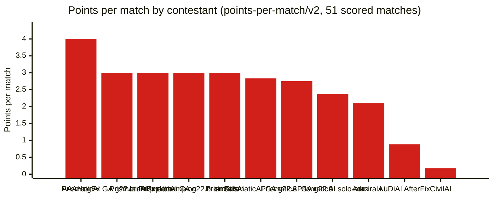
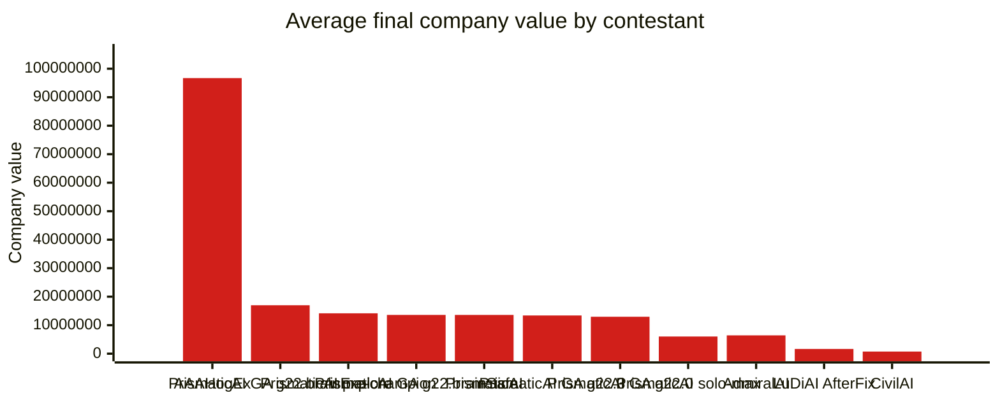
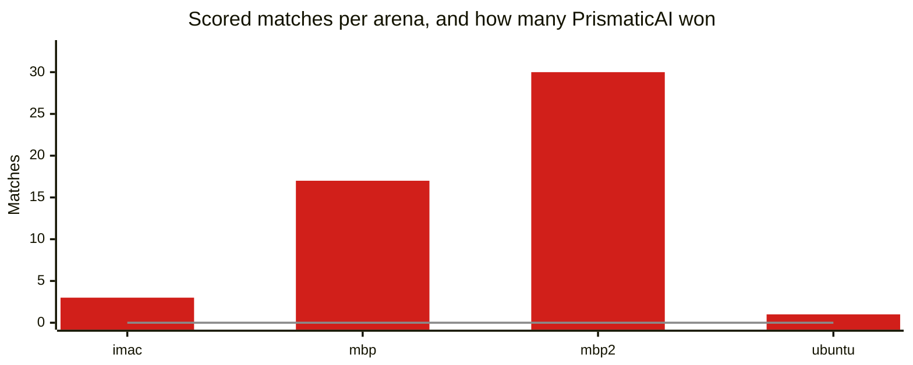

# battle-20261119T123548-d376e80f

Derived from `battle-20261119T123548-d376e80f.json` by `tools/research/ai-battle/battle.py report`; do not edit.

- Edition `d376e80fcf225666`: PrismaticAI and referee at `1f3400b85de084fcb4bb1230b95817962e917176`, base set `opengfx-8.0.tar`
- 20-year free-for-all from 1960, map 256x256 temperate, breakdowns 1
- 51 scored match(es) on `imac` (20261119-master-gdf1e05e7d8), `mbp` (20261119-master-m324b7da345, 20261119-master-m7bd897c759), `mbp2` (20261119-master-gdf1e05e7d8), `ubuntu` (20261119-master-gdf1e05e7d8)
- Replays: 2 of 2 identical to their original on another arena

| # | Contestant | Played | Wins | Points | Points/match | Avg rank | Avg final value | Squirrel errors | Matches with anomalies |
|---|---|---|---|---|---|---|---|---|---|
| 1 | AAAHogEx | 51 | 51 | 204 | 4.0 | 1.0 | 96.7 M | 0 | 0 |
| 2 | PrismaticAI GA g22.brainExplore | 7 | 0 | 21 | 3.0 | 2.0 | 17.0 M | 0 | 4 |
| 3 | PrismaticAI pre-champion | 7 | 0 | 21 | 3.0 | 2.0 | 14.2 M | 0 | 0 |
| 4 | PrismaticAI GA g22.brainSafe | 8 | 0 | 24 | 3.0 | 2.0 | 13.6 M | 0 | 7 |
| 5 | PrismaticAI | 7 | 0 | 21 | 3.0 | 2.0 | 13.6 M | 0 | 0 |
| 6 | PrismaticAI GA g22.3 | 6 | 0 | 17 | 2.833 | 2.17 | 13.4 M | 0 | 1 |
| 7 | PrismaticAI GA g22.0 | 8 | 0 | 22 | 2.75 | 2.25 | 13.0 M | 0 | 0 |
| 8 | PrismaticAI solo-max | 8 | 0 | 19 | 2.375 | 2.62 | 6.0 M | 0 | 8 |
| 9 | AdmiralAI | 51 | 0 | 107 | 2.098 | 2.9 | 6.4 M | 44 | 6 |
| 10 | LuDiAI AfterFix | 51 | 0 | 45 | 0.882 | 4.12 | 1.7 M | 0 | 2 |
| 11 | CivilAI | 51 | 0 | 9 | 0.176 | 4.82 | 743.2 k | 0 | 7 |

```mermaid
---
config:
  xyChart:
    width: 900
    height: 360
  themeVariables:
    xyChart:
      plotColorPalette: "#d11f1a, #8a8a8a, #0b0b0b, #ece4d6"
---
xychart-beta
    title "Final company value per scored match: winner vs best PrismaticAI"
    x-axis ["m-0001", "m-0002", "m-0003", "m-0004", "m-0005", "m-0006", "m-0007", "m-0008", "m-0009", "m-0010", "m-0011", "m-0012", "m-0013", "m-0014", "m-0015", "m-0016", "m-0017", "m-0018", "m-0019", "m-0020", "m-0021", "m-0022", "m-0027", "m-0030", "m-0031", "m-0032", "m-0033", "m-0034", "m-0035", "m-0036", "m-0037", "m-0038", "m-0039", "m-0041", "m-0042", "m-0043", "m-0044", "m-0045", "m-0046", "m-0047", "m-0049", "m-0050", "m-0051", "m-0052", "m-0053", "m-0054", "m-0057", "m-0059", "m-0060", "m-0063", "m-0068"]
    %% series: Winner | Best PrismaticAI
    %% links: battle-20261119T123548-d376e80f.md?col=Match&filter=m-0001 | battle-20261119T123548-d376e80f.md?col=Match&filter=m-0002 | battle-20261119T123548-d376e80f.md?col=Match&filter=m-0003 | battle-20261119T123548-d376e80f.md?col=Match&filter=m-0004 | battle-20261119T123548-d376e80f.md?col=Match&filter=m-0005 | battle-20261119T123548-d376e80f.md?col=Match&filter=m-0006 | battle-20261119T123548-d376e80f.md?col=Match&filter=m-0007 | battle-20261119T123548-d376e80f.md?col=Match&filter=m-0008 | battle-20261119T123548-d376e80f.md?col=Match&filter=m-0009 | battle-20261119T123548-d376e80f.md?col=Match&filter=m-0010 | battle-20261119T123548-d376e80f.md?col=Match&filter=m-0011 | battle-20261119T123548-d376e80f.md?col=Match&filter=m-0012 | battle-20261119T123548-d376e80f.md?col=Match&filter=m-0013 | battle-20261119T123548-d376e80f.md?col=Match&filter=m-0014 | battle-20261119T123548-d376e80f.md?col=Match&filter=m-0015 | battle-20261119T123548-d376e80f.md?col=Match&filter=m-0016 | battle-20261119T123548-d376e80f.md?col=Match&filter=m-0017 | battle-20261119T123548-d376e80f.md?col=Match&filter=m-0018 | battle-20261119T123548-d376e80f.md?col=Match&filter=m-0019 | battle-20261119T123548-d376e80f.md?col=Match&filter=m-0020 | battle-20261119T123548-d376e80f.md?col=Match&filter=m-0021 | battle-20261119T123548-d376e80f.md?col=Match&filter=m-0022 | battle-20261119T123548-d376e80f.md?col=Match&filter=m-0027 | battle-20261119T123548-d376e80f.md?col=Match&filter=m-0030 | battle-20261119T123548-d376e80f.md?col=Match&filter=m-0031 | battle-20261119T123548-d376e80f.md?col=Match&filter=m-0032 | battle-20261119T123548-d376e80f.md?col=Match&filter=m-0033 | battle-20261119T123548-d376e80f.md?col=Match&filter=m-0034 | battle-20261119T123548-d376e80f.md?col=Match&filter=m-0035 | battle-20261119T123548-d376e80f.md?col=Match&filter=m-0036 | battle-20261119T123548-d376e80f.md?col=Match&filter=m-0037 | battle-20261119T123548-d376e80f.md?col=Match&filter=m-0038 | battle-20261119T123548-d376e80f.md?col=Match&filter=m-0039 | battle-20261119T123548-d376e80f.md?col=Match&filter=m-0041 | battle-20261119T123548-d376e80f.md?col=Match&filter=m-0042 | battle-20261119T123548-d376e80f.md?col=Match&filter=m-0043 | battle-20261119T123548-d376e80f.md?col=Match&filter=m-0044 | battle-20261119T123548-d376e80f.md?col=Match&filter=m-0045 | battle-20261119T123548-d376e80f.md?col=Match&filter=m-0046 | battle-20261119T123548-d376e80f.md?col=Match&filter=m-0047 | battle-20261119T123548-d376e80f.md?col=Match&filter=m-0049 | battle-20261119T123548-d376e80f.md?col=Match&filter=m-0050 | battle-20261119T123548-d376e80f.md?col=Match&filter=m-0051 | battle-20261119T123548-d376e80f.md?col=Match&filter=m-0052 | battle-20261119T123548-d376e80f.md?col=Match&filter=m-0053 | battle-20261119T123548-d376e80f.md?col=Match&filter=m-0054 | battle-20261119T123548-d376e80f.md?col=Match&filter=m-0057 | battle-20261119T123548-d376e80f.md?col=Match&filter=m-0059 | battle-20261119T123548-d376e80f.md?col=Match&filter=m-0060 | battle-20261119T123548-d376e80f.md?col=Match&filter=m-0063 | battle-20261119T123548-d376e80f.md?col=Match&filter=m-0068
    y-axis "Company value" 0 --> 158000000
    bar [143733776, 91368801, 136868045, 115768480, 108077165, 108679048, 110188795, 124775752, 105244002, 105458235, 103022073, 108620016, 91988869, 58100938, 83609496, 77858986, 63139803, 64022700, 68882601, 79020551, 90128658, 68445975, 83125703, 103341315, 113724858, 112431814, 90490052, 101450781, 98543917, 109503965, 107723711, 108679797, 124778100, 101075449, 67143101, 58119394, 59999106, 59623616, 75501296, 61056092, 124432324, 134690399, 124024971, 115380243, 121130370, 117254634, 89704383, 90974953, 89256268, 89705245, 92089006]
    line [5683707, 23350704, 30401457, 21645535, 33079841, 22194849, 16397834, 4185216, 11868938, 13277055, 11032619, 18465541, 5866801, 15252662, 7005207, 4073001, 10372375, 9581179, 16729124, 3824190, 6974748, 4599444, 7612489, 15183183, 17555319, 19486626, 13934716, 23450370, 20229013, 8688364, 17073610, 9561309, 11420767, 17473464, 9150278, 5200267, 16439814, 4412832, 11326635, 8358318, 14997003, 8176765, 11119512, 7561455, 10569565, 14782766, 4615522, 10530782, 13740489, 12185846, 13596178]
```

<!-- battle-charts:begin -->
<!-- derived from battle-20261119T123548-d376e80f.json by `battle.py render`; `battle.py check` fails when it is stale -->

<!-- battle-charts:end -->

| Seed | Original | Replay | Arenas | Identical |
|---|---|---|---|---|
| 1237256277 | m-0001 | m-0040 | mbp / mbp2 | yes |
| 1237256277 | m-0002 | m-0048 | mbp / mbp2 | yes |

| Match | Arena | Seed | Winner | Value | Last | Anomalies |
|---|---|---|---|---|---|---|
| m-0001 | mbp | 1237256277 | AAAHogEx | 143.7 M | CivilAI | PrismaticAI solo-max: fleet_drop:56->21 |
| m-0002 | mbp | 1237256277 | AAAHogEx | 91.4 M | CivilAI | - |
| m-0003 | mbp | 1237256277 | AAAHogEx | 136.9 M | CivilAI | - |
| m-0004 | imac | 1237256277 | AAAHogEx | 115.8 M | CivilAI | PrismaticAI GA g22.brainSafe: fleet_drop:209->142; AdmiralAI: squirrel_errors:44 |
| m-0005 | imac | 1237256277 | AAAHogEx | 108.1 M | CivilAI | PrismaticAI GA g22.brainExplore: fleet_drop:219->104; CivilAI: fleet_drop:55->33 |
| m-0006 | imac | 1237256277 | AAAHogEx | 108.7 M | CivilAI | PrismaticAI GA g22.3: fleet_drop:144->98 |
| m-0007 | mbp2 | 1251879686 | AAAHogEx | 110.2 M | CivilAI | - |
| m-0008 | mbp2 | 1251879686 | AAAHogEx | 124.8 M | CivilAI | PrismaticAI solo-max: fleet_drop:37->17; CivilAI: fleet_drop:13->9 |
| m-0009 | mbp2 | 1251879686 | AAAHogEx | 105.2 M | LuDiAI AfterFix | AdmiralAI: fleet_drop:201->135 |
| m-0010 | mbp2 | 1251879686 | AAAHogEx | 105.5 M | CivilAI | - |
| m-0011 | mbp2 | 1251879686 | AAAHogEx | 103.0 M | CivilAI | PrismaticAI GA g22.brainSafe: fleet_drop:116->58 |
| m-0012 | mbp2 | 1251879686 | AAAHogEx | 108.6 M | LuDiAI AfterFix | PrismaticAI GA g22.brainExplore: fleet_drop:129->74 |
| m-0013 | mbp2 | 1251879686 | AAAHogEx | 92.0 M | LuDiAI AfterFix | - |
| m-0014 | mbp2 | 930967890 | AAAHogEx | 58.1 M | CivilAI | - |
| m-0015 | mbp2 | 930967890 | AAAHogEx | 83.6 M | CivilAI | PrismaticAI solo-max: fleet_drop:37->13; CivilAI: fleet_drop:33->22 |
| m-0016 | mbp2 | 930967890 | AAAHogEx | 77.9 M | CivilAI | - |
| m-0017 | mbp2 | 930967890 | AAAHogEx | 63.1 M | LuDiAI AfterFix | AdmiralAI: fleet_drop:159->104 |
| m-0018 | mbp2 | 930967890 | AAAHogEx | 64.0 M | CivilAI | PrismaticAI GA g22.brainSafe: fleet_drop:87->55 |
| m-0019 | mbp2 | 930967890 | AAAHogEx | 68.9 M | CivilAI | - |
| m-0020 | mbp2 | 930967890 | AAAHogEx | 79.0 M | CivilAI | AdmiralAI: fleet_drop:136->92 |
| m-0021 | mbp2 | 1814625749 | AAAHogEx | 90.1 M | CivilAI | - |
| m-0022 | mbp2 | 1814625749 | AAAHogEx | 68.4 M | CivilAI | PrismaticAI solo-max: fleet_drop:42->16 |
| m-0027 | ubuntu | 1814625749 | AAAHogEx | 83.1 M | CivilAI | - |
| m-0030 | mbp | 397755790 | AAAHogEx | 103.3 M | CivilAI | - |
| m-0031 | mbp | 397755790 | AAAHogEx | 113.7 M | LuDiAI AfterFix | LuDiAI AfterFix: fleet_drop:32->22 |
| m-0032 | mbp | 397755790 | AAAHogEx | 112.4 M | CivilAI | PrismaticAI GA g22.brainSafe: fleet_drop:193->58 |
| m-0033 | mbp | 397755790 | AAAHogEx | 90.5 M | LuDiAI AfterFix | PrismaticAI GA g22.brainExplore: fleet_drop:149->68 |
| m-0034 | mbp | 397755790 | AAAHogEx | 101.5 M | CivilAI | - |
| m-0035 | mbp | 852521374 | AAAHogEx | 98.5 M | LuDiAI AfterFix | CivilAI: fleet_drop:38->24; LuDiAI AfterFix: fleet_drop:103->69 |
| m-0036 | mbp2 | 852521374 | AAAHogEx | 109.5 M | CivilAI | PrismaticAI solo-max: fleet_drop:53->15 |
| m-0037 | mbp2 | 852521374 | AAAHogEx | 107.7 M | CivilAI | - |
| m-0038 | mbp2 | 852521374 | AAAHogEx | 108.7 M | CivilAI | - |
| m-0039 | mbp2 | 852521374 | AAAHogEx | 124.8 M | CivilAI | PrismaticAI GA g22.brainSafe: fleet_drop:120->42 |
| m-0040 (replay) | mbp2 | 1237256277 | AAAHogEx | 143.7 M | CivilAI | PrismaticAI solo-max: fleet_drop:56->21 |
| m-0041 | mbp2 | 852521374 | AAAHogEx | 101.1 M | CivilAI | - |
| m-0042 | mbp2 | 622201523 | AAAHogEx | 67.1 M | LuDiAI AfterFix | - |
| m-0043 | mbp2 | 622201523 | AAAHogEx | 58.1 M | CivilAI | PrismaticAI solo-max: fleet_drop:39->11 |
| m-0044 | mbp2 | 622201523 | AAAHogEx | 60.0 M | CivilAI | CivilAI: fleet_drop:14->8 |
| m-0045 | mbp2 | 622201523 | AAAHogEx | 59.6 M | CivilAI | CivilAI: fleet_drop:53->25 |
| m-0046 | mbp2 | 622201523 | AAAHogEx | 75.5 M | LuDiAI AfterFix | PrismaticAI GA g22.brainSafe: fleet_drop:88->37 |
| m-0047 | mbp2 | 622201523 | AAAHogEx | 61.1 M | CivilAI | PrismaticAI GA g22.brainExplore: fleet_drop:85->30 |
| m-0048 (replay) | mbp2 | 1237256277 | AAAHogEx | 91.4 M | CivilAI | - |
| m-0049 | mbp2 | 1791605593 | AAAHogEx | 124.4 M | CivilAI | - |
| m-0050 | mbp2 | 1791605593 | AAAHogEx | 134.7 M | CivilAI | PrismaticAI solo-max: fleet_drop:54->28 |
| m-0051 | mbp | 1791605593 | AAAHogEx | 124.0 M | CivilAI | - |
| m-0052 | mbp | 1791605593 | AAAHogEx | 115.4 M | CivilAI | - |
| m-0053 | mbp2 | 1791605593 | AAAHogEx | 121.1 M | CivilAI | PrismaticAI GA g22.brainSafe: fleet_drop:149->101 |
| m-0054 | mbp | 1791605593 | AAAHogEx | 117.3 M | CivilAI | AdmiralAI: fleet_drop:356->167 |
| m-0057 | mbp | 662709564 | AAAHogEx | 89.7 M | CivilAI | PrismaticAI solo-max: fleet_drop:31->12; CivilAI: fleet_drop:14->9 |
| m-0059 | mbp | 662709564 | AAAHogEx | 91.0 M | CivilAI | AdmiralAI: fleet_drop:87->56 |
| m-0060 | mbp | 662709564 | AAAHogEx | 89.3 M | CivilAI | - |
| m-0063 | mbp | 285172370 | AAAHogEx | 89.7 M | CivilAI | - |
| m-0068 | mbp | 285172370 | AAAHogEx | 92.1 M | CivilAI | - |
