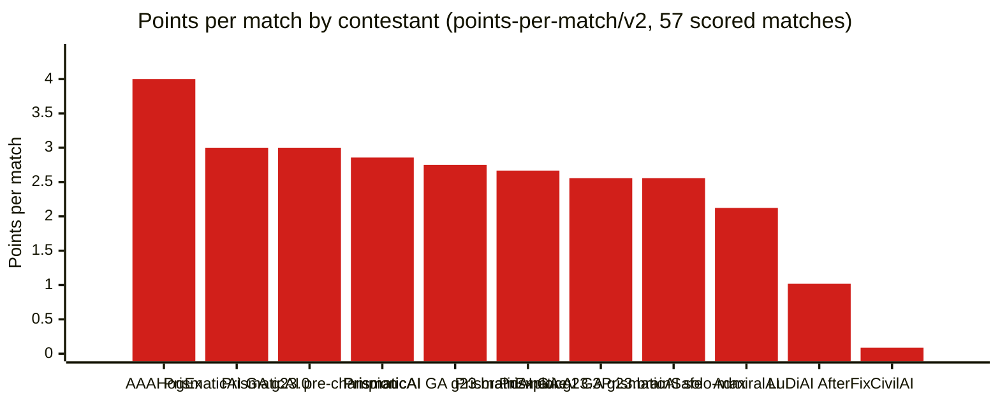
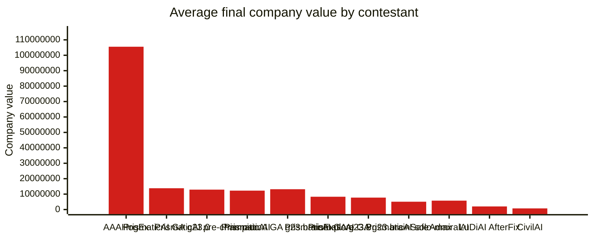
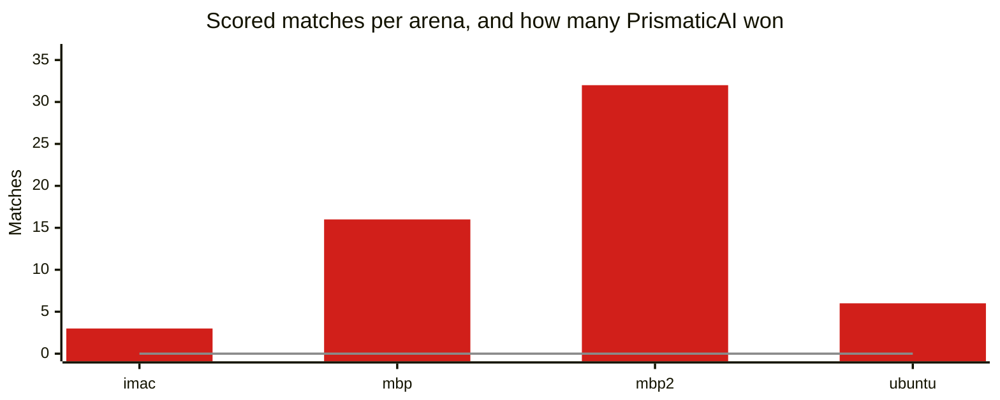

# battle-20261119T125311-346438a9

Derived from `battle-20261119T125311-346438a9.json` by `tools/research/ai-battle/battle.py report`; do not edit.

- Edition `346438a98b418fea`: PrismaticAI and referee at `1f3400b85de084fcb4bb1230b95817962e917176`, base set `opengfx-8.0.tar`
- 20-year free-for-all from 1960, map 256x256 temperate, breakdowns 1
- 57 scored match(es) on `imac` (20261119-master-gdf1e05e7d8), `mbp` (20261119-master-m324b7da345), `mbp2` (20261119-master-gdf1e05e7d8), `ubuntu` (20261119-master-gdf1e05e7d8)
- Replays: 2 of 4 identical to their original on another arena

| # | Contestant | Played | Wins | Points | Points/match | Avg rank | Avg final value | Squirrel errors | Matches with anomalies |
|---|---|---|---|---|---|---|---|---|---|
| 1 | AAAHogEx | 57 | 57 | 228 | 4.0 | 1.0 | 105.5 M | 0 | 0 |
| 2 | PrismaticAI GA g23.0 | 8 | 0 | 24 | 3.0 | 2.0 | 13.8 M | 0 | 3 |
| 3 | PrismaticAI pre-champion | 10 | 0 | 30 | 3.0 | 2.0 | 12.9 M | 0 | 1 |
| 4 | PrismaticAI | 7 | 0 | 20 | 2.857 | 2.14 | 12.3 M | 0 | 0 |
| 5 | PrismaticAI GA g23.brainExplore | 8 | 0 | 22 | 2.75 | 2.25 | 13.2 M | 0 | 2 |
| 6 | PrismaticAI GA g23.3 | 6 | 0 | 16 | 2.667 | 2.33 | 8.3 M | 0 | 2 |
| 7 | PrismaticAI GA g23.brainSafe | 9 | 0 | 23 | 2.556 | 2.44 | 7.7 M | 0 | 5 |
| 8 | PrismaticAI solo-max | 9 | 0 | 23 | 2.556 | 2.44 | 5.1 M | 0 | 9 |
| 9 | AdmiralAI | 57 | 0 | 121 | 2.123 | 2.88 | 5.8 M | 32 | 4 |
| 10 | LuDiAI AfterFix | 57 | 0 | 58 | 1.018 | 3.98 | 2.0 M | 0 | 1 |
| 11 | CivilAI | 57 | 0 | 5 | 0.088 | 4.91 | 738.6 k | 3670 | 9 |

```mermaid
---
config:
  xyChart:
    width: 900
    height: 360
  themeVariables:
    xyChart:
      plotColorPalette: "#d11f1a, #8a8a8a, #0b0b0b, #ece4d6"
---
xychart-beta
    title "Final company value per scored match: winner vs best PrismaticAI"
    x-axis ["m-0001", "m-0002", "m-0003", "m-0004", "m-0005", "m-0006", "m-0007", "m-0008", "m-0009", "m-0010", "m-0011", "m-0012", "m-0013", "m-0014", "m-0015", "m-0016", "m-0017", "m-0018", "m-0019", "m-0020", "m-0021", "m-0022", "m-0023", "m-0024", "m-0025", "m-0026", "m-0027", "m-0029", "m-0030", "m-0031", "m-0032", "m-0033", "m-0034", "m-0035", "m-0036", "m-0037", "m-0038", "m-0039", "m-0041", "m-0042", "m-0043", "m-0044", "m-0045", "m-0046", "m-0047", "m-0049", "m-0050", "m-0051", "m-0052", "m-0053", "m-0054", "m-0057", "m-0058", "m-0060", "m-0065", "m-0070", "m-0075"]
    %% series: Winner | Best PrismaticAI
    %% links: battle-20261119T125311-346438a9.md?col=Match&filter=m-0001 | battle-20261119T125311-346438a9.md?col=Match&filter=m-0002 | battle-20261119T125311-346438a9.md?col=Match&filter=m-0003 | battle-20261119T125311-346438a9.md?col=Match&filter=m-0004 | battle-20261119T125311-346438a9.md?col=Match&filter=m-0005 | battle-20261119T125311-346438a9.md?col=Match&filter=m-0006 | battle-20261119T125311-346438a9.md?col=Match&filter=m-0007 | battle-20261119T125311-346438a9.md?col=Match&filter=m-0008 | battle-20261119T125311-346438a9.md?col=Match&filter=m-0009 | battle-20261119T125311-346438a9.md?col=Match&filter=m-0010 | battle-20261119T125311-346438a9.md?col=Match&filter=m-0011 | battle-20261119T125311-346438a9.md?col=Match&filter=m-0012 | battle-20261119T125311-346438a9.md?col=Match&filter=m-0013 | battle-20261119T125311-346438a9.md?col=Match&filter=m-0014 | battle-20261119T125311-346438a9.md?col=Match&filter=m-0015 | battle-20261119T125311-346438a9.md?col=Match&filter=m-0016 | battle-20261119T125311-346438a9.md?col=Match&filter=m-0017 | battle-20261119T125311-346438a9.md?col=Match&filter=m-0018 | battle-20261119T125311-346438a9.md?col=Match&filter=m-0019 | battle-20261119T125311-346438a9.md?col=Match&filter=m-0020 | battle-20261119T125311-346438a9.md?col=Match&filter=m-0021 | battle-20261119T125311-346438a9.md?col=Match&filter=m-0022 | battle-20261119T125311-346438a9.md?col=Match&filter=m-0023 | battle-20261119T125311-346438a9.md?col=Match&filter=m-0024 | battle-20261119T125311-346438a9.md?col=Match&filter=m-0025 | battle-20261119T125311-346438a9.md?col=Match&filter=m-0026 | battle-20261119T125311-346438a9.md?col=Match&filter=m-0027 | battle-20261119T125311-346438a9.md?col=Match&filter=m-0029 | battle-20261119T125311-346438a9.md?col=Match&filter=m-0030 | battle-20261119T125311-346438a9.md?col=Match&filter=m-0031 | battle-20261119T125311-346438a9.md?col=Match&filter=m-0032 | battle-20261119T125311-346438a9.md?col=Match&filter=m-0033 | battle-20261119T125311-346438a9.md?col=Match&filter=m-0034 | battle-20261119T125311-346438a9.md?col=Match&filter=m-0035 | battle-20261119T125311-346438a9.md?col=Match&filter=m-0036 | battle-20261119T125311-346438a9.md?col=Match&filter=m-0037 | battle-20261119T125311-346438a9.md?col=Match&filter=m-0038 | battle-20261119T125311-346438a9.md?col=Match&filter=m-0039 | battle-20261119T125311-346438a9.md?col=Match&filter=m-0041 | battle-20261119T125311-346438a9.md?col=Match&filter=m-0042 | battle-20261119T125311-346438a9.md?col=Match&filter=m-0043 | battle-20261119T125311-346438a9.md?col=Match&filter=m-0044 | battle-20261119T125311-346438a9.md?col=Match&filter=m-0045 | battle-20261119T125311-346438a9.md?col=Match&filter=m-0046 | battle-20261119T125311-346438a9.md?col=Match&filter=m-0047 | battle-20261119T125311-346438a9.md?col=Match&filter=m-0049 | battle-20261119T125311-346438a9.md?col=Match&filter=m-0050 | battle-20261119T125311-346438a9.md?col=Match&filter=m-0051 | battle-20261119T125311-346438a9.md?col=Match&filter=m-0052 | battle-20261119T125311-346438a9.md?col=Match&filter=m-0053 | battle-20261119T125311-346438a9.md?col=Match&filter=m-0054 | battle-20261119T125311-346438a9.md?col=Match&filter=m-0057 | battle-20261119T125311-346438a9.md?col=Match&filter=m-0058 | battle-20261119T125311-346438a9.md?col=Match&filter=m-0060 | battle-20261119T125311-346438a9.md?col=Match&filter=m-0065 | battle-20261119T125311-346438a9.md?col=Match&filter=m-0070 | battle-20261119T125311-346438a9.md?col=Match&filter=m-0075
    y-axis "Company value" 0 --> 199000000
    bar [111912469, 81657753, 98837108, 74052612, 72836781, 78957379, 87584605, 106395513, 96817150, 82518398, 87958595, 98890995, 77613983, 134800027, 158288773, 129990388, 140747527, 131835645, 150165577, 145256606, 90082381, 95251699, 119058861, 106265801, 119747480, 106713558, 124269429, 181061681, 151991572, 108134361, 161748675, 142893439, 130970122, 67089843, 74028673, 76078403, 53955161, 68857598, 76201442, 103087541, 121573060, 131221229, 102908856, 106410373, 101192102, 90302465, 98902682, 97772673, 81441504, 90886460, 81614772, 106295083, 103349949, 104597073, 87659574, 103151472, 101737499]
    line [6080046, 18639454, 14749019, 10535176, 17209992, 3037479, 6671409, 6765979, 9039279, 15145155, 7702343, 13227268, 12112855, 9157279, 6510133, 6263988, 9860183, 13038254, 3089084, 9285476, 8986845, 1935471, 16561167, 19002755, 8627425, 16309320, 12261673, 4081364, 14393336, 16405088, 3412833, 12329719, 9108220, 5133368, 5939559, 8088690, 8588370, 4624242, 4004446, 19184260, 3009485, 14761665, 15132304, 8445076, 21338772, 15516786, 5385777, 15254413, 11646556, 9944738, 1263955, 6016588, 13633229, 3301694, 12471536, 21142470, 20651041]
```

<!-- battle-charts:begin -->
<!-- derived from battle-20261119T125311-346438a9.json by `battle.py render`; `battle.py check` fails when it is stale -->

<!-- battle-charts:end -->

| Seed | Original | Replay | Arenas | Identical |
|---|---|---|---|---|
| 1535362987 | m-0008 | m-0040 | mbp2 / mbp | yes |
| 1535362987 | m-0007 | m-0048 | mbp2 / mbp | yes |
| 1459166423 | m-0001 | m-0056 | mbp / imac | NO |
| 1459166423 | m-0004 | m-0064 | imac / mbp | NO |

| Match | Arena | Seed | Winner | Value | Last | Anomalies |
|---|---|---|---|---|---|---|
| m-0001 | mbp | 1459166423 | AAAHogEx | 111.9 M | CivilAI | PrismaticAI solo-max: fleet_drop:51->28 |
| m-0002 | mbp | 1459166423 | AAAHogEx | 81.7 M | CivilAI | - |
| m-0003 | mbp | 1459166423 | AAAHogEx | 98.8 M | CivilAI | PrismaticAI GA g23.0: fleet_drop:274->179 |
| m-0004 | imac | 1459166423 | AAAHogEx | 74.1 M | CivilAI | CivilAI: fleet_drop:66->30 |
| m-0005 | imac | 1459166423 | AAAHogEx | 72.8 M | CivilAI | - |
| m-0006 | imac | 1459166423 | AAAHogEx | 79.0 M | CivilAI | AdmiralAI: fleet_drop:384->258; CivilAI: fleet_drop:62->42 |
| m-0007 | mbp2 | 1535362987 | AAAHogEx | 87.6 M | CivilAI | - |
| m-0008 | mbp2 | 1535362987 | AAAHogEx | 106.4 M | CivilAI | PrismaticAI solo-max: fleet_drop:41->18 |
| m-0009 | mbp2 | 1535362987 | AAAHogEx | 96.8 M | CivilAI | - |
| m-0010 | mbp2 | 1535362987 | AAAHogEx | 82.5 M | CivilAI | PrismaticAI GA g23.0: fleet_drop:114->75 |
| m-0011 | mbp2 | 1535362987 | AAAHogEx | 88.0 M | CivilAI | PrismaticAI GA g23.brainSafe: fleet_drop:75->52 |
| m-0012 | mbp2 | 1535362987 | AAAHogEx | 98.9 M | CivilAI | - |
| m-0013 | mbp2 | 1535362987 | AAAHogEx | 77.6 M | CivilAI | - |
| m-0014 | mbp2 | 7005316 | AAAHogEx | 134.8 M | CivilAI | - |
| m-0015 | mbp2 | 7005316 | AAAHogEx | 158.3 M | CivilAI | PrismaticAI solo-max: fleet_drop:44->21 |
| m-0016 | mbp2 | 7005316 | AAAHogEx | 130.0 M | CivilAI | - |
| m-0017 | mbp2 | 7005316 | AAAHogEx | 140.7 M | CivilAI | PrismaticAI GA g23.0: fleet_drop:101->53 |
| m-0018 | mbp2 | 7005316 | AAAHogEx | 131.8 M | CivilAI | PrismaticAI GA g23.brainSafe: fleet_drop:82->34 |
| m-0019 | mbp2 | 7005316 | AAAHogEx | 150.2 M | CivilAI | PrismaticAI GA g23.brainExplore: fleet_drop:100->62; CivilAI: squirrel_errors:3670 |
| m-0020 | mbp2 | 7005316 | AAAHogEx | 145.3 M | LuDiAI AfterFix | - |
| m-0021 | mbp2 | 496632888 | AAAHogEx | 90.1 M | LuDiAI AfterFix | - |
| m-0022 | mbp2 | 496632888 | AAAHogEx | 95.3 M | CivilAI | PrismaticAI solo-max: fleet_drop:38->17 |
| m-0023 | ubuntu | 496632888 | AAAHogEx | 119.1 M | CivilAI | - |
| m-0024 | ubuntu | 496632888 | AAAHogEx | 106.3 M | CivilAI | - |
| m-0025 | ubuntu | 496632888 | AAAHogEx | 119.7 M | CivilAI | - |
| m-0026 | ubuntu | 496632888 | AAAHogEx | 106.7 M | CivilAI | - |
| m-0027 | ubuntu | 496632888 | AAAHogEx | 124.3 M | CivilAI | PrismaticAI GA g23.3: fleet_drop:144->72; CivilAI: fleet_drop:34->6 |
| m-0029 | ubuntu | 1465986603 | AAAHogEx | 181.1 M | CivilAI | PrismaticAI solo-max: fleet_drop:41->26 |
| m-0030 | mbp | 1465986603 | AAAHogEx | 152.0 M | CivilAI | - |
| m-0031 | mbp | 1465986603 | AAAHogEx | 108.1 M | CivilAI | - |
| m-0032 | mbp | 1465986603 | AAAHogEx | 161.7 M | CivilAI | PrismaticAI GA g23.brainSafe: fleet_drop:173->78 |
| m-0033 | mbp | 1465986603 | AAAHogEx | 142.9 M | CivilAI | AdmiralAI: squirrel_errors:32 |
| m-0034 | mbp2 | 1465986603 | AAAHogEx | 131.0 M | LuDiAI AfterFix | PrismaticAI GA g23.3: fleet_drop:224->120 |
| m-0035 | mbp2 | 82454744 | AAAHogEx | 67.1 M | CivilAI | - |
| m-0036 | mbp | 82454744 | AAAHogEx | 74.0 M | CivilAI | PrismaticAI solo-max: fleet_drop:36->16 |
| m-0037 | mbp2 | 82454744 | AAAHogEx | 76.1 M | CivilAI | - |
| m-0038 | mbp2 | 82454744 | AAAHogEx | 54.0 M | CivilAI | - |
| m-0039 | mbp2 | 82454744 | AAAHogEx | 68.9 M | CivilAI | PrismaticAI GA g23.brainSafe: fleet_drop:64->44; CivilAI: fleet_drop:44->21 |
| m-0040 (replay) | mbp | 1535362987 | AAAHogEx | 106.4 M | CivilAI | PrismaticAI solo-max: fleet_drop:41->18 |
| m-0041 | mbp2 | 82454744 | AAAHogEx | 76.2 M | CivilAI | - |
| m-0042 | mbp2 | 1568204316 | AAAHogEx | 103.1 M | CivilAI | - |
| m-0043 | mbp2 | 1568204316 | AAAHogEx | 121.6 M | CivilAI | PrismaticAI solo-max: fleet_drop:40->23 |
| m-0044 | mbp2 | 1568204316 | AAAHogEx | 131.2 M | CivilAI | PrismaticAI pre-champion: fleet_drop:63->39 |
| m-0045 | mbp2 | 1568204316 | AAAHogEx | 102.9 M | LuDiAI AfterFix | CivilAI: fleet_drop:12->8 |
| m-0046 | mbp2 | 1568204316 | AAAHogEx | 106.4 M | CivilAI | PrismaticAI GA g23.brainSafe: fleet_drop:178->76 |
| m-0047 | mbp2 | 1568204316 | AAAHogEx | 101.2 M | CivilAI | PrismaticAI GA g23.brainExplore: fleet_drop:224->69; CivilAI: fleet_drop:37->9 |
| m-0048 (replay) | mbp | 1535362987 | AAAHogEx | 87.6 M | CivilAI | - |
| m-0049 | mbp | 119790134 | AAAHogEx | 90.3 M | CivilAI | - |
| m-0050 | mbp2 | 119790134 | AAAHogEx | 98.9 M | CivilAI | PrismaticAI solo-max: fleet_drop:39->21; AdmiralAI: fleet_drop:247->137 |
| m-0051 | mbp2 | 119790134 | AAAHogEx | 97.8 M | CivilAI | - |
| m-0052 | mbp2 | 119790134 | AAAHogEx | 81.4 M | CivilAI | CivilAI: fleet_drop:66->28 |
| m-0053 | mbp2 | 119790134 | AAAHogEx | 90.9 M | CivilAI | - |
| m-0054 | mbp | 119790134 | AAAHogEx | 81.6 M | LuDiAI AfterFix | - |
| m-0056 (replay) | imac | 1459166423 | AAAHogEx | 100.5 M | CivilAI | PrismaticAI solo-max: fleet_drop:51->26 |
| m-0057 | mbp | 1104131912 | AAAHogEx | 106.3 M | CivilAI | PrismaticAI solo-max: fleet_drop:34->13; LuDiAI AfterFix: fleet_drop:107->63 |
| m-0058 | mbp | 1104131912 | AAAHogEx | 103.3 M | CivilAI | CivilAI: fleet_drop:72->50 |
| m-0060 | mbp | 1104131912 | AAAHogEx | 104.6 M | CivilAI | - |
| m-0064 (replay) | mbp | 1459166423 | AAAHogEx | 93.1 M | CivilAI | - |
| m-0065 | mbp | 1941752218 | AAAHogEx | 87.7 M | CivilAI | - |
| m-0070 | mbp | 1039328191 | AAAHogEx | 103.2 M | CivilAI | - |
| m-0075 | mbp | 1039328191 | AAAHogEx | 101.7 M | CivilAI | AdmiralAI: fleet_drop:217->143 |
