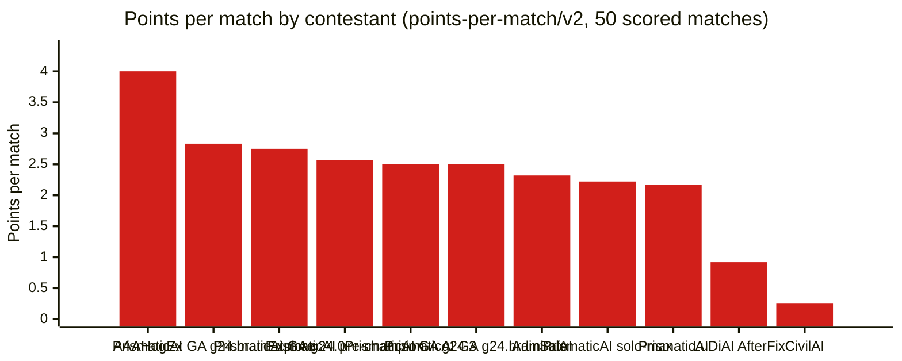
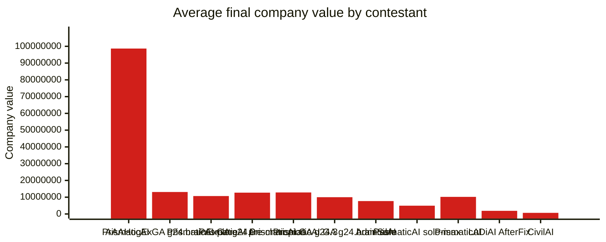
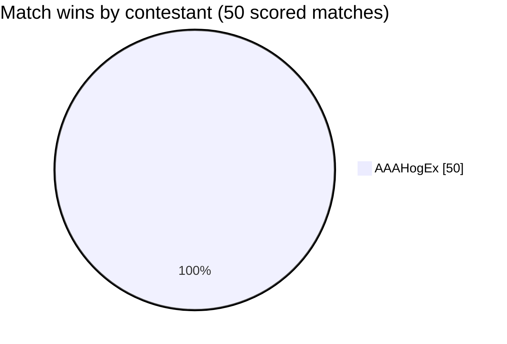
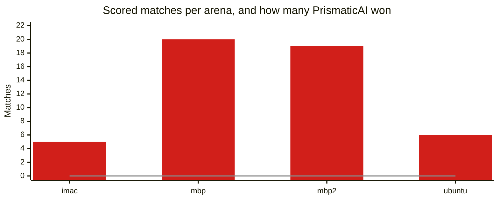

# battle-20261119T131040-a872adde

Derived from `battle-20261119T131040-a872adde.json` by `tools/research/ai-battle/battle.py report`; do not edit.

- Edition `a872added50ca1d8`: PrismaticAI and referee at `1f3400b85de084fcb4bb1230b95817962e917176`, base set `opengfx-8.0.tar`
- 20-year free-for-all from 1960, map 256x256 temperate, breakdowns 1
- 50 scored match(es) on `imac` (20261119-master-gdf1e05e7d8), `mbp` (20261119-master-m324b7da345), `mbp2` (20261119-master-gdf1e05e7d8), `ubuntu` (20261119-master-gdf1e05e7d8)
- Replays: 1 of 2 identical to their original on another arena

| # | Contestant | Played | Wins | Points | Points/match | Avg rank | Avg final value | Squirrel errors | Matches with anomalies |
|---|---|---|---|---|---|---|---|---|---|
| 1 | AAAHogEx | 50 | 50 | 200 | 4.0 | 1.0 | 98.7 M | 0 | 0 |
| 2 | PrismaticAI GA g24.brainExplore | 6 | 0 | 17 | 2.833 | 2.17 | 13.1 M | 0 | 1 |
| 3 | PrismaticAI GA g24.0 | 8 | 0 | 22 | 2.75 | 2.25 | 10.7 M | 0 | 3 |
| 4 | PrismaticAI pre-champion | 7 | 0 | 18 | 2.571 | 2.43 | 12.7 M | 0 | 0 |
| 5 | PrismaticAI GA g24.3 | 6 | 0 | 15 | 2.5 | 2.5 | 12.8 M | 0 | 3 |
| 6 | PrismaticAI GA g24.brainSafe | 8 | 0 | 20 | 2.5 | 2.5 | 10.0 M | 0 | 4 |
| 7 | AdmiralAI | 50 | 0 | 116 | 2.32 | 2.68 | 7.7 M | 62 | 3 |
| 8 | PrismaticAI solo-max | 9 | 0 | 20 | 2.222 | 2.78 | 4.9 M | 0 | 9 |
| 9 | PrismaticAI | 6 | 0 | 13 | 2.167 | 2.83 | 10.2 M | 0 | 1 |
| 10 | LuDiAI AfterFix | 50 | 0 | 46 | 0.92 | 4.08 | 1.9 M | 0 | 1 |
| 11 | CivilAI | 50 | 0 | 13 | 0.26 | 4.74 | 663.1 k | 0 | 7 |

```mermaid
---
config:
  xyChart:
    width: 900
    height: 360
  themeVariables:
    xyChart:
      plotColorPalette: "#d11f1a, #8a8a8a, #0b0b0b, #ece4d6"
---
xychart-beta
    title "Final company value per scored match: winner vs best PrismaticAI"
    x-axis ["m-0001", "m-0002", "m-0003", "m-0004", "m-0005", "m-0006", "m-0007", "m-0008", "m-0009", "m-0010", "m-0011", "m-0012", "m-0013", "m-0014", "m-0015", "m-0016", "m-0017", "m-0018", "m-0019", "m-0020", "m-0021", "m-0022", "m-0023", "m-0024", "m-0025", "m-0027", "m-0028", "m-0029", "m-0030", "m-0031", "m-0032", "m-0033", "m-0034", "m-0035", "m-0036", "m-0037", "m-0038", "m-0039", "m-0041", "m-0043", "m-0044", "m-0046", "m-0050", "m-0052", "m-0057", "m-0060", "m-0061", "m-0063", "m-0066", "m-0068"]
    %% series: Winner | Best PrismaticAI
    %% links: battle-20261119T131040-a872adde.md?col=Match&filter=m-0001 | battle-20261119T131040-a872adde.md?col=Match&filter=m-0002 | battle-20261119T131040-a872adde.md?col=Match&filter=m-0003 | battle-20261119T131040-a872adde.md?col=Match&filter=m-0004 | battle-20261119T131040-a872adde.md?col=Match&filter=m-0005 | battle-20261119T131040-a872adde.md?col=Match&filter=m-0006 | battle-20261119T131040-a872adde.md?col=Match&filter=m-0007 | battle-20261119T131040-a872adde.md?col=Match&filter=m-0008 | battle-20261119T131040-a872adde.md?col=Match&filter=m-0009 | battle-20261119T131040-a872adde.md?col=Match&filter=m-0010 | battle-20261119T131040-a872adde.md?col=Match&filter=m-0011 | battle-20261119T131040-a872adde.md?col=Match&filter=m-0012 | battle-20261119T131040-a872adde.md?col=Match&filter=m-0013 | battle-20261119T131040-a872adde.md?col=Match&filter=m-0014 | battle-20261119T131040-a872adde.md?col=Match&filter=m-0015 | battle-20261119T131040-a872adde.md?col=Match&filter=m-0016 | battle-20261119T131040-a872adde.md?col=Match&filter=m-0017 | battle-20261119T131040-a872adde.md?col=Match&filter=m-0018 | battle-20261119T131040-a872adde.md?col=Match&filter=m-0019 | battle-20261119T131040-a872adde.md?col=Match&filter=m-0020 | battle-20261119T131040-a872adde.md?col=Match&filter=m-0021 | battle-20261119T131040-a872adde.md?col=Match&filter=m-0022 | battle-20261119T131040-a872adde.md?col=Match&filter=m-0023 | battle-20261119T131040-a872adde.md?col=Match&filter=m-0024 | battle-20261119T131040-a872adde.md?col=Match&filter=m-0025 | battle-20261119T131040-a872adde.md?col=Match&filter=m-0027 | battle-20261119T131040-a872adde.md?col=Match&filter=m-0028 | battle-20261119T131040-a872adde.md?col=Match&filter=m-0029 | battle-20261119T131040-a872adde.md?col=Match&filter=m-0030 | battle-20261119T131040-a872adde.md?col=Match&filter=m-0031 | battle-20261119T131040-a872adde.md?col=Match&filter=m-0032 | battle-20261119T131040-a872adde.md?col=Match&filter=m-0033 | battle-20261119T131040-a872adde.md?col=Match&filter=m-0034 | battle-20261119T131040-a872adde.md?col=Match&filter=m-0035 | battle-20261119T131040-a872adde.md?col=Match&filter=m-0036 | battle-20261119T131040-a872adde.md?col=Match&filter=m-0037 | battle-20261119T131040-a872adde.md?col=Match&filter=m-0038 | battle-20261119T131040-a872adde.md?col=Match&filter=m-0039 | battle-20261119T131040-a872adde.md?col=Match&filter=m-0041 | battle-20261119T131040-a872adde.md?col=Match&filter=m-0043 | battle-20261119T131040-a872adde.md?col=Match&filter=m-0044 | battle-20261119T131040-a872adde.md?col=Match&filter=m-0046 | battle-20261119T131040-a872adde.md?col=Match&filter=m-0050 | battle-20261119T131040-a872adde.md?col=Match&filter=m-0052 | battle-20261119T131040-a872adde.md?col=Match&filter=m-0057 | battle-20261119T131040-a872adde.md?col=Match&filter=m-0060 | battle-20261119T131040-a872adde.md?col=Match&filter=m-0061 | battle-20261119T131040-a872adde.md?col=Match&filter=m-0063 | battle-20261119T131040-a872adde.md?col=Match&filter=m-0066 | battle-20261119T131040-a872adde.md?col=Match&filter=m-0068
    y-axis "Company value" 0 --> 167000000
    bar [114228680, 119084535, 104900919, 98570919, 102613950, 96576518, 116702418, 102680393, 87815968, 116549704, 120517791, 74623905, 128502984, 105591254, 151649918, 114876099, 111046150, 130591239, 118246071, 102351435, 71646756, 56448568, 114675589, 99727725, 101559403, 127396072, 98904170, 94354710, 60174781, 70189561, 63250885, 73095760, 64575278, 70390413, 88804868, 84269611, 80340717, 77252773, 72205421, 133951330, 137379878, 114937621, 78366689, 52513777, 112978170, 110618968, 101569980, 77395435, 109850071, 116878673]
    line [5507168, 12600753, 9795397, 8568119, 9252681, 13424298, 1, 5984879, 2930750, 2382966, 645220, 9623831, 1, 19533125, 2551694, 17031744, 21701182, 14660535, 15729101, 18527827, 5843190, 1907049, 20996177, 20733654, 22404958, 15390973, 15766464, 7704341, 10391981, 6761788, 5684412, 13199364, 11154672, 6617596, 3637596, 7135751, 4177044, 2690777, 18473923, 6497934, 17884348, 14041742, 5753571, 6527493, 4895426, 11358277, 17572461, 13429778, 13450437, 13255433]
```

<!-- battle-charts:begin -->
<!-- derived from battle-20261119T131040-a872adde.json by `battle.py render`; `battle.py check` fails when it is stale -->

<!-- battle-charts:end -->

| Seed | Original | Replay | Arenas | Identical |
|---|---|---|---|---|
| 766172400 | m-0001 | m-0040 | mbp / mbp2 | yes |
| 766172400 | m-0004 | m-0064 | imac / mbp | NO |

| Match | Arena | Seed | Winner | Value | Last | Anomalies |
|---|---|---|---|---|---|---|
| m-0001 | mbp | 766172400 | AAAHogEx | 114.2 M | CivilAI | PrismaticAI solo-max: fleet_drop:48->17 |
| m-0002 | mbp | 766172400 | AAAHogEx | 119.1 M | CivilAI | - |
| m-0003 | mbp | 766172400 | AAAHogEx | 104.9 M | CivilAI | PrismaticAI GA g24.0: fleet_drop:171->73 |
| m-0004 | imac | 766172400 | AAAHogEx | 98.6 M | CivilAI | PrismaticAI GA g24.brainSafe: fleet_drop:128->48; CivilAI: fleet_drop:42->29 |
| m-0005 | imac | 766172400 | AAAHogEx | 102.6 M | CivilAI | - |
| m-0006 | imac | 766172400 | AAAHogEx | 96.6 M | CivilAI | PrismaticAI GA g24.3: fleet_drop:261->111; AdmiralAI: fleet_drop:351->242 |
| m-0007 | mbp2 | 1807087905 | AAAHogEx | 116.7 M | PrismaticAI | PrismaticAI: fleet_drop:15->8 |
| m-0008 | mbp2 | 1807087905 | AAAHogEx | 102.7 M | LuDiAI AfterFix | PrismaticAI solo-max: fleet_drop:51->22 |
| m-0009 | mbp2 | 1807087905 | AAAHogEx | 87.8 M | CivilAI | - |
| m-0010 | mbp2 | 1807087905 | AAAHogEx | 116.5 M | CivilAI | - |
| m-0011 | mbp2 | 1807087905 | AAAHogEx | 120.5 M | CivilAI | - |
| m-0012 | mbp2 | 1807087905 | AAAHogEx | 74.6 M | LuDiAI AfterFix | - |
| m-0013 | mbp2 | 1807087905 | AAAHogEx | 128.5 M | PrismaticAI GA g24.3 | - |
| m-0014 | mbp2 | 1609313107 | AAAHogEx | 105.6 M | CivilAI | - |
| m-0015 | mbp2 | 1609313107 | AAAHogEx | 151.6 M | CivilAI | PrismaticAI solo-max: fleet_drop:44->11 |
| m-0016 | mbp2 | 1609313107 | AAAHogEx | 114.9 M | CivilAI | - |
| m-0017 | mbp2 | 1609313107 | AAAHogEx | 111.0 M | CivilAI | PrismaticAI GA g24.0: fleet_drop:218->64 |
| m-0018 | mbp2 | 1609313107 | AAAHogEx | 130.6 M | CivilAI | PrismaticAI GA g24.brainSafe: fleet_drop:156->43 |
| m-0019 | mbp2 | 1609313107 | AAAHogEx | 118.2 M | CivilAI | PrismaticAI GA g24.brainExplore: fleet_drop:92->61 |
| m-0020 | mbp2 | 1609313107 | AAAHogEx | 102.4 M | CivilAI | PrismaticAI GA g24.3: fleet_drop:235->80 |
| m-0021 | mbp2 | 234969011 | AAAHogEx | 71.6 M | LuDiAI AfterFix | - |
| m-0022 | mbp2 | 234969011 | AAAHogEx | 56.4 M | LuDiAI AfterFix | PrismaticAI solo-max: fleet_drop:35->16 |
| m-0023 | ubuntu | 234969011 | AAAHogEx | 114.7 M | LuDiAI AfterFix | - |
| m-0024 | ubuntu | 234969011 | AAAHogEx | 99.7 M | CivilAI | - |
| m-0025 | ubuntu | 234969011 | AAAHogEx | 101.6 M | CivilAI | - |
| m-0027 | ubuntu | 234969011 | AAAHogEx | 127.4 M | LuDiAI AfterFix | CivilAI: fleet_drop:48->27; LuDiAI AfterFix: fleet_drop:31->17 |
| m-0028 | ubuntu | 266076295 | AAAHogEx | 98.9 M | CivilAI | AdmiralAI: fleet_drop:249->169 |
| m-0029 | ubuntu | 266076295 | AAAHogEx | 94.4 M | CivilAI | PrismaticAI solo-max: fleet_drop:41->24 |
| m-0030 | mbp | 266076295 | AAAHogEx | 60.2 M | CivilAI | - |
| m-0031 | mbp | 266076295 | AAAHogEx | 70.2 M | CivilAI | - |
| m-0032 | mbp | 266076295 | AAAHogEx | 63.3 M | CivilAI | CivilAI: fleet_drop:15->8 |
| m-0033 | mbp | 266076295 | AAAHogEx | 73.1 M | CivilAI | AdmiralAI: squirrel_errors:62; CivilAI: no_vehicles |
| m-0034 | mbp | 266076295 | AAAHogEx | 64.6 M | CivilAI | PrismaticAI GA g24.3: fleet_drop:120->81 |
| m-0035 | mbp | 1098158778 | AAAHogEx | 70.4 M | CivilAI | - |
| m-0036 | mbp | 1098158778 | AAAHogEx | 88.8 M | CivilAI | PrismaticAI solo-max: fleet_drop:26->16 |
| m-0037 | mbp | 1098158778 | AAAHogEx | 84.3 M | CivilAI | - |
| m-0038 | imac | 1098158778 | AAAHogEx | 80.3 M | LuDiAI AfterFix | PrismaticAI GA g24.0: fleet_drop:84->52 |
| m-0039 | mbp2 | 1098158778 | AAAHogEx | 77.3 M | CivilAI | - |
| m-0040 (replay) | mbp2 | 766172400 | AAAHogEx | 114.2 M | CivilAI | PrismaticAI solo-max: fleet_drop:48->17 |
| m-0041 | mbp | 1098158778 | AAAHogEx | 72.2 M | CivilAI | - |
| m-0043 | mbp | 1133655983 | AAAHogEx | 134.0 M | CivilAI | PrismaticAI solo-max: fleet_drop:54->23 |
| m-0044 | imac | 1133655983 | AAAHogEx | 137.4 M | CivilAI | - |
| m-0046 | mbp | 1133655983 | AAAHogEx | 114.9 M | CivilAI | PrismaticAI GA g24.brainSafe: fleet_drop:163->95; CivilAI: fleet_drop:59->31 |
| m-0050 | mbp2 | 868303681 | AAAHogEx | 78.4 M | CivilAI | PrismaticAI solo-max: fleet_drop:35->18 |
| m-0052 | mbp | 868303681 | AAAHogEx | 52.5 M | CivilAI | - |
| m-0057 | mbp2 | 1500035289 | AAAHogEx | 113.0 M | CivilAI | PrismaticAI solo-max: fleet_drop:31->10 |
| m-0060 | mbp | 1500035289 | AAAHogEx | 110.6 M | CivilAI | PrismaticAI GA g24.brainSafe: fleet_drop:108->52; CivilAI: fleet_drop:32->21 |
| m-0061 | mbp | 1500035289 | AAAHogEx | 101.6 M | CivilAI | - |
| m-0063 | mbp | 979034022 | AAAHogEx | 77.4 M | LuDiAI AfterFix | - |
| m-0064 (replay) | mbp | 766172400 | AAAHogEx | 94.9 M | CivilAI | PrismaticAI GA g24.brainSafe: fleet_drop:104->55 |
| m-0066 | mbp | 979034022 | AAAHogEx | 109.9 M | LuDiAI AfterFix | - |
| m-0068 | mbp | 979034022 | AAAHogEx | 116.9 M | LuDiAI AfterFix | CivilAI: fleet_drop:14->8 |
