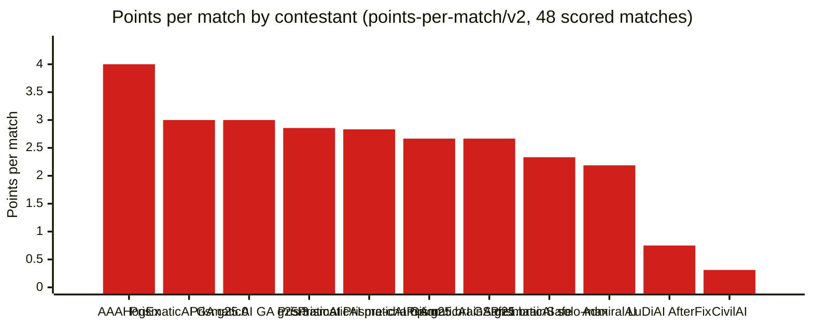
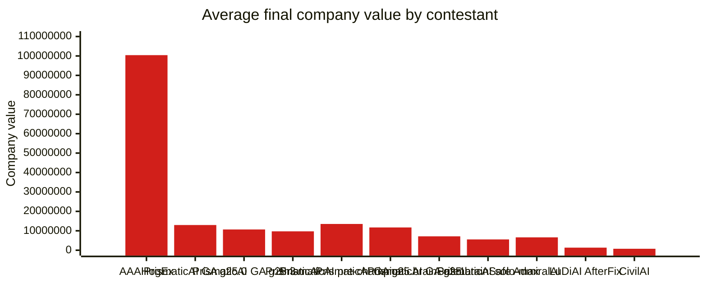
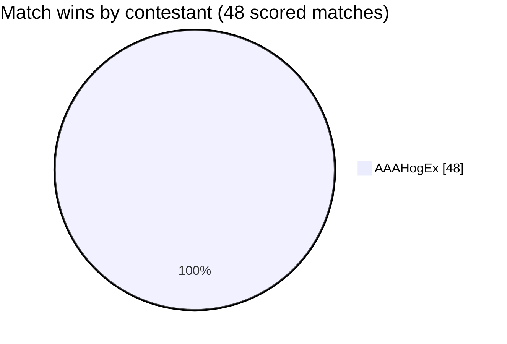
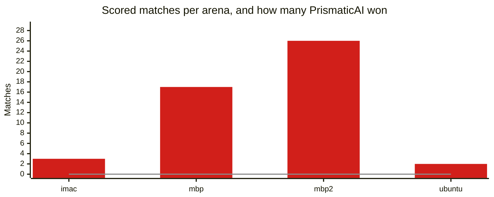

# battle-20261119T132720-53cceeed

Derived from `battle-20261119T132720-53cceeed.json` by `tools/research/ai-battle/battle.py report`; do not edit.

- Edition `53cceeed4000a1af`: PrismaticAI and referee at `0587d5c533a6fa9232f4f60b98ffa3e49f0c4d3c`, base set `opengfx-8.0.tar`
- 20-year free-for-all from 1960, map 256x256 temperate, breakdowns 1
- 48 scored match(es) on `imac` (20261119-master-gdf1e05e7d8), `mbp` (20261119-master-m038450434f), `mbp2` (20261119-master-gdf1e05e7d8), `ubuntu` (20261119-master-gdf1e05e7d8)
- Replays: 1 of 1 identical to their original on another arena

| # | Contestant | Played | Wins | Points | Points/match | Avg rank | Avg final value | Squirrel errors | Matches with anomalies |
|---|---|---|---|---|---|---|---|---|---|
| 1 | AAAHogEx | 48 | 48 | 192 | 4.0 | 1.0 | 100.4 M | 0 | 0 |
| 2 | PrismaticAI GA g25.0 | 7 | 0 | 21 | 3.0 | 2.0 | 13.0 M | 0 | 0 |
| 3 | PrismaticAI GA g25.3 | 7 | 0 | 21 | 3.0 | 2.0 | 10.7 M | 0 | 0 |
| 4 | PrismaticAI | 7 | 0 | 20 | 2.857 | 2.14 | 9.7 M | 0 | 0 |
| 5 | PrismaticAI pre-champion | 6 | 0 | 17 | 2.833 | 2.17 | 13.5 M | 0 | 1 |
| 6 | PrismaticAI GA g25.brainSafe1 | 6 | 0 | 16 | 2.667 | 2.33 | 11.7 M | 0 | 1 |
| 7 | PrismaticAI GA g25.brainSafe | 6 | 0 | 16 | 2.667 | 2.33 | 7.2 M | 0 | 0 |
| 8 | PrismaticAI solo-max | 9 | 0 | 21 | 2.333 | 2.67 | 5.6 M | 0 | 9 |
| 9 | AdmiralAI | 48 | 0 | 105 | 2.188 | 2.81 | 6.6 M | 0 | 1 |
| 10 | LuDiAI AfterFix | 48 | 0 | 36 | 0.75 | 4.25 | 1.3 M | 0 | 1 |
| 11 | CivilAI | 48 | 0 | 15 | 0.312 | 4.69 | 749.6 k | 0 | 7 |

```mermaid
---
config:
  xyChart:
    width: 900
    height: 360
  themeVariables:
    xyChart:
      plotColorPalette: "#d11f1a, #8a8a8a, #0b0b0b, #ece4d6"
---
xychart-beta
    title "Final company value per scored match: winner vs best PrismaticAI"
    x-axis ["m-0001", "m-0002", "m-0003", "m-0004", "m-0005", "m-0006", "m-0007", "m-0008", "m-0009", "m-0010", "m-0011", "m-0012", "m-0013", "m-0014", "m-0015", "m-0016", "m-0017", "m-0018", "m-0019", "m-0020", "m-0021", "m-0022", "m-0028", "m-0029", "m-0030", "m-0031", "m-0032", "m-0033", "m-0034", "m-0035", "m-0036", "m-0037", "m-0038", "m-0039", "m-0041", "m-0042", "m-0043", "m-0045", "m-0050", "m-0051", "m-0054", "m-0055", "m-0057", "m-0059", "m-0060", "m-0061", "m-0062", "m-0063"]
    %% series: Winner | Best PrismaticAI
    %% links: battle-20261119T132720-53cceeed.md?col=Match&filter=m-0001 | battle-20261119T132720-53cceeed.md?col=Match&filter=m-0002 | battle-20261119T132720-53cceeed.md?col=Match&filter=m-0003 | battle-20261119T132720-53cceeed.md?col=Match&filter=m-0004 | battle-20261119T132720-53cceeed.md?col=Match&filter=m-0005 | battle-20261119T132720-53cceeed.md?col=Match&filter=m-0006 | battle-20261119T132720-53cceeed.md?col=Match&filter=m-0007 | battle-20261119T132720-53cceeed.md?col=Match&filter=m-0008 | battle-20261119T132720-53cceeed.md?col=Match&filter=m-0009 | battle-20261119T132720-53cceeed.md?col=Match&filter=m-0010 | battle-20261119T132720-53cceeed.md?col=Match&filter=m-0011 | battle-20261119T132720-53cceeed.md?col=Match&filter=m-0012 | battle-20261119T132720-53cceeed.md?col=Match&filter=m-0013 | battle-20261119T132720-53cceeed.md?col=Match&filter=m-0014 | battle-20261119T132720-53cceeed.md?col=Match&filter=m-0015 | battle-20261119T132720-53cceeed.md?col=Match&filter=m-0016 | battle-20261119T132720-53cceeed.md?col=Match&filter=m-0017 | battle-20261119T132720-53cceeed.md?col=Match&filter=m-0018 | battle-20261119T132720-53cceeed.md?col=Match&filter=m-0019 | battle-20261119T132720-53cceeed.md?col=Match&filter=m-0020 | battle-20261119T132720-53cceeed.md?col=Match&filter=m-0021 | battle-20261119T132720-53cceeed.md?col=Match&filter=m-0022 | battle-20261119T132720-53cceeed.md?col=Match&filter=m-0028 | battle-20261119T132720-53cceeed.md?col=Match&filter=m-0029 | battle-20261119T132720-53cceeed.md?col=Match&filter=m-0030 | battle-20261119T132720-53cceeed.md?col=Match&filter=m-0031 | battle-20261119T132720-53cceeed.md?col=Match&filter=m-0032 | battle-20261119T132720-53cceeed.md?col=Match&filter=m-0033 | battle-20261119T132720-53cceeed.md?col=Match&filter=m-0034 | battle-20261119T132720-53cceeed.md?col=Match&filter=m-0035 | battle-20261119T132720-53cceeed.md?col=Match&filter=m-0036 | battle-20261119T132720-53cceeed.md?col=Match&filter=m-0037 | battle-20261119T132720-53cceeed.md?col=Match&filter=m-0038 | battle-20261119T132720-53cceeed.md?col=Match&filter=m-0039 | battle-20261119T132720-53cceeed.md?col=Match&filter=m-0041 | battle-20261119T132720-53cceeed.md?col=Match&filter=m-0042 | battle-20261119T132720-53cceeed.md?col=Match&filter=m-0043 | battle-20261119T132720-53cceeed.md?col=Match&filter=m-0045 | battle-20261119T132720-53cceeed.md?col=Match&filter=m-0050 | battle-20261119T132720-53cceeed.md?col=Match&filter=m-0051 | battle-20261119T132720-53cceeed.md?col=Match&filter=m-0054 | battle-20261119T132720-53cceeed.md?col=Match&filter=m-0055 | battle-20261119T132720-53cceeed.md?col=Match&filter=m-0057 | battle-20261119T132720-53cceeed.md?col=Match&filter=m-0059 | battle-20261119T132720-53cceeed.md?col=Match&filter=m-0060 | battle-20261119T132720-53cceeed.md?col=Match&filter=m-0061 | battle-20261119T132720-53cceeed.md?col=Match&filter=m-0062 | battle-20261119T132720-53cceeed.md?col=Match&filter=m-0063
    y-axis "Company value" 0 --> 187000000
    bar [169869219, 133402743, 128073511, 150600631, 115173140, 147056191, 143433661, 155553005, 144215009, 132472077, 169237270, 152063678, 145207575, 88315885, 96043322, 86306638, 104211779, 82550853, 99397537, 83462074, 82407793, 88940505, 74847826, 74071414, 68509098, 70984317, 60828070, 70237000, 76851300, 118870740, 103332228, 99114014, 86730122, 99315436, 79040362, 102767171, 107641452, 82078928, 100697715, 99338116, 114562383, 85843768, 54305414, 53835770, 67359327, 47388698, 63926734, 59352708]
    line [4267760, 19213487, 17415594, 9046597, 15063975, 8503194, 20571037, 5635296, 13761890, 18893421, 10888873, 15391832, 16764941, 8666510, 5385617, 6766416, 10549417, 6865866, 5468978, 11358318, 13294477, 7167432, 4611540, 3719745, 11459244, 8919142, 8352681, 11876071, 3795639, 8712421, 10118012, 17026483, 13548458, 1973728, 14608149, 4171104, 4063822, 12242669, 4643916, 12864255, 12363324, 13676256, 4991804, 9186691, 5775560, 10157098, 6030230, 7997533]
```

<!-- battle-charts:begin -->
<!-- derived from battle-20261119T132720-53cceeed.json by `battle.py render`; `battle.py check` fails when it is stale -->

<!-- battle-charts:end -->

| Seed | Original | Replay | Arenas | Identical |
|---|---|---|---|---|
| 1297029967 | m-0007 | m-0040 | mbp2 / mbp | yes |

| Match | Arena | Seed | Winner | Value | Last | Anomalies |
|---|---|---|---|---|---|---|
| m-0001 | mbp | 910444814 | AAAHogEx | 169.9 M | CivilAI | PrismaticAI solo-max: fleet_drop:42->22 |
| m-0002 | mbp | 910444814 | AAAHogEx | 133.4 M | CivilAI | - |
| m-0003 | mbp | 910444814 | AAAHogEx | 128.1 M | LuDiAI AfterFix | CivilAI: fleet_drop:57->21 |
| m-0004 | imac | 910444814 | AAAHogEx | 150.6 M | CivilAI | - |
| m-0005 | imac | 910444814 | AAAHogEx | 115.2 M | CivilAI | - |
| m-0006 | imac | 910444814 | AAAHogEx | 147.1 M | LuDiAI AfterFix | - |
| m-0007 | mbp2 | 1297029967 | AAAHogEx | 143.4 M | LuDiAI AfterFix | - |
| m-0008 | mbp2 | 1297029967 | AAAHogEx | 155.6 M | LuDiAI AfterFix | PrismaticAI solo-max: fleet_drop:47->22 |
| m-0009 | mbp2 | 1297029967 | AAAHogEx | 144.2 M | CivilAI | - |
| m-0010 | mbp2 | 1297029967 | AAAHogEx | 132.5 M | LuDiAI AfterFix | - |
| m-0011 | mbp2 | 1297029967 | AAAHogEx | 169.2 M | LuDiAI AfterFix | - |
| m-0012 | mbp2 | 1297029967 | AAAHogEx | 152.1 M | CivilAI | PrismaticAI GA g25.brainSafe1: fleet_drop:86->51; AdmiralAI: fleet_drop:422->257 |
| m-0013 | mbp2 | 1297029967 | AAAHogEx | 145.2 M | LuDiAI AfterFix | LuDiAI AfterFix: fleet_drop:14->4 |
| m-0014 | mbp2 | 345288325 | AAAHogEx | 88.3 M | CivilAI | - |
| m-0015 | mbp2 | 345288325 | AAAHogEx | 96.0 M | CivilAI | PrismaticAI solo-max: fleet_drop:39->17 |
| m-0016 | mbp2 | 345288325 | AAAHogEx | 86.3 M | CivilAI | PrismaticAI pre-champion: fleet_drop:56->32 |
| m-0017 | mbp2 | 345288325 | AAAHogEx | 104.2 M | CivilAI | - |
| m-0018 | mbp2 | 345288325 | AAAHogEx | 82.6 M | CivilAI | - |
| m-0019 | mbp2 | 345288325 | AAAHogEx | 99.4 M | CivilAI | CivilAI: fleet_drop:32->14 |
| m-0020 | mbp2 | 345288325 | AAAHogEx | 83.5 M | LuDiAI AfterFix | - |
| m-0021 | mbp2 | 61756459 | AAAHogEx | 82.4 M | CivilAI | - |
| m-0022 | mbp2 | 61756459 | AAAHogEx | 88.9 M | CivilAI | PrismaticAI solo-max: fleet_drop:43->22 |
| m-0028 | ubuntu | 1364593114 | AAAHogEx | 74.8 M | CivilAI | - |
| m-0029 | ubuntu | 1364593114 | AAAHogEx | 74.1 M | CivilAI | PrismaticAI solo-max: fleet_drop:36->13 |
| m-0030 | mbp | 1364593114 | AAAHogEx | 68.5 M | CivilAI | - |
| m-0031 | mbp | 1364593114 | AAAHogEx | 71.0 M | CivilAI | - |
| m-0032 | mbp | 1364593114 | AAAHogEx | 60.8 M | CivilAI | - |
| m-0033 | mbp | 1364593114 | AAAHogEx | 70.2 M | AdmiralAI | - |
| m-0034 | mbp | 1364593114 | AAAHogEx | 76.9 M | CivilAI | CivilAI: no_vehicles |
| m-0035 | mbp | 447329182 | AAAHogEx | 118.9 M | CivilAI | - |
| m-0036 | mbp | 447329182 | AAAHogEx | 103.3 M | CivilAI | PrismaticAI solo-max: fleet_drop:47->16 |
| m-0037 | mbp2 | 447329182 | AAAHogEx | 99.1 M | LuDiAI AfterFix | CivilAI: fleet_drop:60->41 |
| m-0038 | mbp2 | 447329182 | AAAHogEx | 86.7 M | CivilAI | CivilAI: fleet_drop:13->9 |
| m-0039 | mbp2 | 447329182 | AAAHogEx | 99.3 M | CivilAI | - |
| m-0040 (replay) | mbp | 1297029967 | AAAHogEx | 143.4 M | LuDiAI AfterFix | - |
| m-0041 | mbp | 447329182 | AAAHogEx | 79.0 M | LuDiAI AfterFix | - |
| m-0042 | mbp2 | 915958233 | AAAHogEx | 102.8 M | CivilAI | - |
| m-0043 | mbp2 | 915958233 | AAAHogEx | 107.6 M | LuDiAI AfterFix | PrismaticAI solo-max: fleet_drop:36->16 |
| m-0045 | mbp2 | 915958233 | AAAHogEx | 82.1 M | LuDiAI AfterFix | - |
| m-0050 | mbp2 | 582596814 | AAAHogEx | 100.7 M | CivilAI | PrismaticAI solo-max: fleet_drop:44->24; CivilAI: fleet_drop:73->42 |
| m-0051 | mbp2 | 582596814 | AAAHogEx | 99.3 M | LuDiAI AfterFix | - |
| m-0054 | mbp2 | 582596814 | AAAHogEx | 114.6 M | CivilAI | - |
| m-0055 | mbp | 582596814 | AAAHogEx | 85.8 M | CivilAI | - |
| m-0057 | mbp2 | 1246175541 | AAAHogEx | 54.3 M | LuDiAI AfterFix | PrismaticAI solo-max: fleet_drop:33->17; CivilAI: fleet_drop:67->44 |
| m-0059 | mbp | 1246175541 | AAAHogEx | 53.8 M | CivilAI | - |
| m-0060 | mbp | 1246175541 | AAAHogEx | 67.4 M | CivilAI | - |
| m-0061 | mbp | 1246175541 | AAAHogEx | 47.4 M | CivilAI | - |
| m-0062 | mbp | 1246175541 | AAAHogEx | 63.9 M | CivilAI | - |
| m-0063 | mbp | 1820254859 | AAAHogEx | 59.4 M | CivilAI | - |
