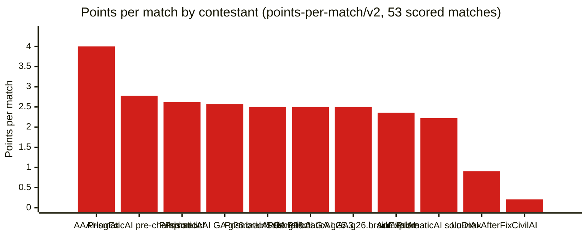
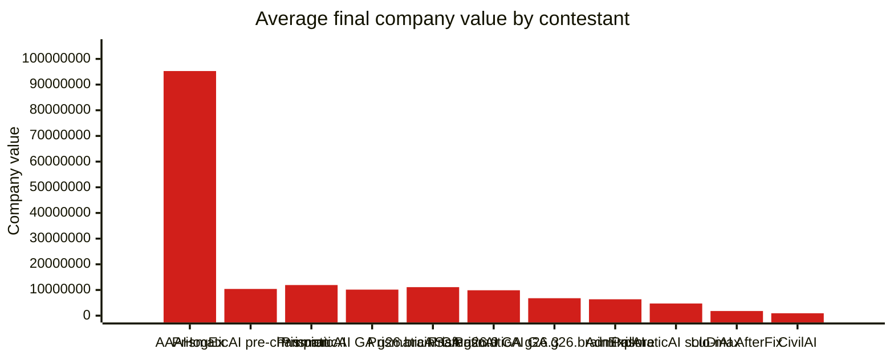
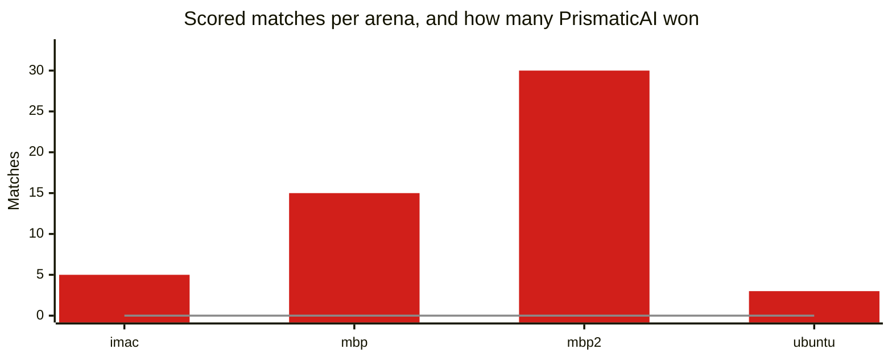

# battle-20261119T134228-6779ebec

Derived from `battle-20261119T134228-6779ebec.json` by `tools/research/ai-battle/battle.py report`; do not edit.

- Edition `6779ebece257bd2a`: PrismaticAI and referee at `0587d5c533a6fa9232f4f60b98ffa3e49f0c4d3c`, base set `opengfx-8.0.tar`
- 20-year free-for-all from 1960, map 256x256 temperate, breakdowns 1
- 53 scored match(es) on `imac` (20261119-master-gdf1e05e7d8), `mbp` (20261119-master-m038450434f), `mbp2` (20261119-master-gdf1e05e7d8), `ubuntu` (20261119-master-gdf1e05e7d8)
- Replays: 2 of 4 identical to their original on another arena

| # | Contestant | Played | Wins | Points | Points/match | Avg rank | Avg final value | Squirrel errors | Matches with anomalies |
|---|---|---|---|---|---|---|---|---|---|
| 1 | AAAHogEx | 53 | 53 | 212 | 4.0 | 1.0 | 95.3 M | 0 | 0 |
| 2 | PrismaticAI pre-champion | 9 | 0 | 25 | 2.778 | 2.22 | 10.4 M | 0 | 1 |
| 3 | PrismaticAI | 8 | 0 | 21 | 2.625 | 2.38 | 11.9 M | 0 | 2 |
| 4 | PrismaticAI GA g26.brainSafe | 7 | 0 | 18 | 2.571 | 2.43 | 10.1 M | 0 | 6 |
| 5 | PrismaticAI GA g26.0 | 8 | 0 | 20 | 2.5 | 2.5 | 11.1 M | 0 | 1 |
| 6 | PrismaticAI GA g26.3 | 6 | 0 | 15 | 2.5 | 2.5 | 9.9 M | 0 | 0 |
| 7 | PrismaticAI GA g26.brainExplore | 6 | 0 | 15 | 2.5 | 2.5 | 6.8 M | 0 | 1 |
| 8 | AdmiralAI | 53 | 0 | 125 | 2.358 | 2.64 | 6.4 M | 0 | 4 |
| 9 | PrismaticAI solo-max | 9 | 0 | 20 | 2.222 | 2.78 | 4.7 M | 0 | 9 |
| 10 | LuDiAI AfterFix | 53 | 0 | 48 | 0.906 | 4.09 | 1.8 M | 0 | 1 |
| 11 | CivilAI | 53 | 0 | 11 | 0.208 | 4.79 | 921.1 k | 3640 | 5 |

```mermaid
---
config:
  xyChart:
    width: 900
    height: 360
  themeVariables:
    xyChart:
      plotColorPalette: "#d11f1a, #8a8a8a, #0b0b0b, #ece4d6"
---
xychart-beta
    title "Final company value per scored match: winner vs best PrismaticAI"
    x-axis ["m-0001", "m-0002", "m-0003", "m-0004", "m-0005", "m-0006", "m-0007", "m-0008", "m-0009", "m-0010", "m-0011", "m-0012", "m-0013", "m-0014", "m-0015", "m-0016", "m-0017", "m-0018", "m-0019", "m-0020", "m-0021", "m-0022", "m-0023", "m-0028", "m-0029", "m-0030", "m-0031", "m-0032", "m-0033", "m-0034", "m-0035", "m-0036", "m-0037", "m-0038", "m-0039", "m-0041", "m-0042", "m-0043", "m-0044", "m-0045", "m-0046", "m-0047", "m-0049", "m-0050", "m-0051", "m-0052", "m-0053", "m-0055", "m-0057", "m-0058", "m-0059", "m-0061", "m-0063"]
    %% series: Winner | Best PrismaticAI
    %% links: battle-20261119T134228-6779ebec.md?col=Match&filter=m-0001 | battle-20261119T134228-6779ebec.md?col=Match&filter=m-0002 | battle-20261119T134228-6779ebec.md?col=Match&filter=m-0003 | battle-20261119T134228-6779ebec.md?col=Match&filter=m-0004 | battle-20261119T134228-6779ebec.md?col=Match&filter=m-0005 | battle-20261119T134228-6779ebec.md?col=Match&filter=m-0006 | battle-20261119T134228-6779ebec.md?col=Match&filter=m-0007 | battle-20261119T134228-6779ebec.md?col=Match&filter=m-0008 | battle-20261119T134228-6779ebec.md?col=Match&filter=m-0009 | battle-20261119T134228-6779ebec.md?col=Match&filter=m-0010 | battle-20261119T134228-6779ebec.md?col=Match&filter=m-0011 | battle-20261119T134228-6779ebec.md?col=Match&filter=m-0012 | battle-20261119T134228-6779ebec.md?col=Match&filter=m-0013 | battle-20261119T134228-6779ebec.md?col=Match&filter=m-0014 | battle-20261119T134228-6779ebec.md?col=Match&filter=m-0015 | battle-20261119T134228-6779ebec.md?col=Match&filter=m-0016 | battle-20261119T134228-6779ebec.md?col=Match&filter=m-0017 | battle-20261119T134228-6779ebec.md?col=Match&filter=m-0018 | battle-20261119T134228-6779ebec.md?col=Match&filter=m-0019 | battle-20261119T134228-6779ebec.md?col=Match&filter=m-0020 | battle-20261119T134228-6779ebec.md?col=Match&filter=m-0021 | battle-20261119T134228-6779ebec.md?col=Match&filter=m-0022 | battle-20261119T134228-6779ebec.md?col=Match&filter=m-0023 | battle-20261119T134228-6779ebec.md?col=Match&filter=m-0028 | battle-20261119T134228-6779ebec.md?col=Match&filter=m-0029 | battle-20261119T134228-6779ebec.md?col=Match&filter=m-0030 | battle-20261119T134228-6779ebec.md?col=Match&filter=m-0031 | battle-20261119T134228-6779ebec.md?col=Match&filter=m-0032 | battle-20261119T134228-6779ebec.md?col=Match&filter=m-0033 | battle-20261119T134228-6779ebec.md?col=Match&filter=m-0034 | battle-20261119T134228-6779ebec.md?col=Match&filter=m-0035 | battle-20261119T134228-6779ebec.md?col=Match&filter=m-0036 | battle-20261119T134228-6779ebec.md?col=Match&filter=m-0037 | battle-20261119T134228-6779ebec.md?col=Match&filter=m-0038 | battle-20261119T134228-6779ebec.md?col=Match&filter=m-0039 | battle-20261119T134228-6779ebec.md?col=Match&filter=m-0041 | battle-20261119T134228-6779ebec.md?col=Match&filter=m-0042 | battle-20261119T134228-6779ebec.md?col=Match&filter=m-0043 | battle-20261119T134228-6779ebec.md?col=Match&filter=m-0044 | battle-20261119T134228-6779ebec.md?col=Match&filter=m-0045 | battle-20261119T134228-6779ebec.md?col=Match&filter=m-0046 | battle-20261119T134228-6779ebec.md?col=Match&filter=m-0047 | battle-20261119T134228-6779ebec.md?col=Match&filter=m-0049 | battle-20261119T134228-6779ebec.md?col=Match&filter=m-0050 | battle-20261119T134228-6779ebec.md?col=Match&filter=m-0051 | battle-20261119T134228-6779ebec.md?col=Match&filter=m-0052 | battle-20261119T134228-6779ebec.md?col=Match&filter=m-0053 | battle-20261119T134228-6779ebec.md?col=Match&filter=m-0055 | battle-20261119T134228-6779ebec.md?col=Match&filter=m-0057 | battle-20261119T134228-6779ebec.md?col=Match&filter=m-0058 | battle-20261119T134228-6779ebec.md?col=Match&filter=m-0059 | battle-20261119T134228-6779ebec.md?col=Match&filter=m-0061 | battle-20261119T134228-6779ebec.md?col=Match&filter=m-0063
    y-axis "Company value" 0 --> 156000000
    bar [115578601, 104212603, 105782334, 92664111, 119668257, 117506499, 114453234, 141424837, 91794350, 112993211, 109667170, 95028021, 95183971, 109628017, 118621638, 80399426, 88051481, 80007340, 99388637, 103403109, 80256079, 78981629, 71414091, 60742936, 46688620, 79782223, 74970270, 59820082, 59137429, 76191841, 108251796, 116616498, 139365569, 111967038, 99779870, 132738269, 93133984, 100810140, 88471949, 82680005, 87633875, 85188635, 106463865, 134647999, 102757113, 104330883, 112526024, 105122762, 73877712, 65386467, 59525390, 67221552, 87671837]
    line [3839342, 9685395, 2126936, 552098, 542115, 3163111, 15196757, 6560505, 18169984, 14841804, 15004067, 4657036, 7112231, 6437171, 2918368, 4381990, 1328268, 6800453, 5773884, 4787273, 13715593, 5020275, 9272384, 13953435, 4272005, 10691896, 17500002, 14836294, 14152474, 18804134, 12106070, 5334115, 13750014, 13570536, 10938609, 16969838, 10616670, 5624816, 8531396, 15387218, 13893240, 9378975, 2537674, 6275020, 10418327, 11144298, 8949161, 8488523, 2765599, 8678013, 12889237, 6220336, 20770372]
```

<!-- battle-charts:begin -->
<!-- derived from battle-20261119T134228-6779ebec.json by `battle.py render`; `battle.py check` fails when it is stale -->

<!-- battle-charts:end -->

| Seed | Original | Replay | Arenas | Identical |
|---|---|---|---|---|
| 496519251 | m-0004 | m-0040 | imac / mbp | NO |
| 496519251 | m-0001 | m-0048 | mbp / mbp2 | yes |
| 496519251 | m-0002 | m-0056 | mbp / mbp2 | yes |
| 496519251 | m-0005 | m-0064 | imac / mbp | NO |

| Match | Arena | Seed | Winner | Value | Last | Anomalies |
|---|---|---|---|---|---|---|
| m-0001 | mbp | 496519251 | AAAHogEx | 115.6 M | CivilAI | PrismaticAI solo-max: fleet_drop:42->20 |
| m-0002 | mbp | 496519251 | AAAHogEx | 104.2 M | CivilAI | - |
| m-0003 | mbp | 496519251 | AAAHogEx | 105.8 M | CivilAI | CivilAI: fleet_drop:59->37 |
| m-0004 | imac | 496519251 | AAAHogEx | 92.7 M | PrismaticAI GA g26.brainSafe | AdmiralAI: fleet_drop:174->113; PrismaticAI GA g26.brainSafe: fleet_drop:64->30 |
| m-0005 | imac | 496519251 | AAAHogEx | 119.7 M | CivilAI | - |
| m-0006 | imac | 496519251 | AAAHogEx | 117.5 M | CivilAI | - |
| m-0007 | mbp2 | 112364617 | AAAHogEx | 114.5 M | CivilAI | - |
| m-0008 | mbp2 | 112364617 | AAAHogEx | 141.4 M | LuDiAI AfterFix | PrismaticAI solo-max: fleet_drop:42->22 |
| m-0009 | mbp2 | 112364617 | AAAHogEx | 91.8 M | LuDiAI AfterFix | - |
| m-0010 | mbp2 | 112364617 | AAAHogEx | 113.0 M | CivilAI | - |
| m-0011 | mbp2 | 112364617 | AAAHogEx | 109.7 M | CivilAI | PrismaticAI GA g26.brainSafe: fleet_drop:86->42 |
| m-0012 | mbp2 | 112364617 | AAAHogEx | 95.0 M | CivilAI | - |
| m-0013 | mbp2 | 112364617 | AAAHogEx | 95.2 M | CivilAI | AdmiralAI: fleet_drop:336->232 |
| m-0014 | mbp2 | 725554694 | AAAHogEx | 109.6 M | CivilAI | PrismaticAI: fleet_drop:77->44 |
| m-0015 | mbp2 | 725554694 | AAAHogEx | 118.6 M | CivilAI | PrismaticAI solo-max: fleet_drop:34->18 |
| m-0016 | mbp2 | 725554694 | AAAHogEx | 80.4 M | CivilAI | - |
| m-0017 | mbp2 | 725554694 | AAAHogEx | 88.1 M | PrismaticAI GA g26.0 | - |
| m-0018 | mbp2 | 725554694 | AAAHogEx | 80.0 M | CivilAI | PrismaticAI GA g26.brainSafe: fleet_drop:117->48; AdmiralAI: fleet_drop:238->153 |
| m-0019 | mbp2 | 725554694 | AAAHogEx | 99.4 M | CivilAI | PrismaticAI GA g26.brainExplore: fleet_drop:110->75 |
| m-0020 | mbp2 | 725554694 | AAAHogEx | 103.4 M | CivilAI | - |
| m-0021 | mbp2 | 600632846 | AAAHogEx | 80.3 M | CivilAI | - |
| m-0022 | mbp2 | 600632846 | AAAHogEx | 79.0 M | CivilAI | PrismaticAI solo-max: fleet_drop:26->14 |
| m-0023 | ubuntu | 600632846 | AAAHogEx | 71.4 M | LuDiAI AfterFix | - |
| m-0028 | ubuntu | 1833374827 | AAAHogEx | 60.7 M | CivilAI | - |
| m-0029 | ubuntu | 1833374827 | AAAHogEx | 46.7 M | LuDiAI AfterFix | AdmiralAI: fleet_drop:232->159; PrismaticAI solo-max: fleet_drop:34->14; LuDiAI AfterFix: fleet_drop:64->42 |
| m-0030 | mbp | 1833374827 | AAAHogEx | 79.8 M | CivilAI | - |
| m-0031 | mbp | 1833374827 | AAAHogEx | 75.0 M | CivilAI | - |
| m-0032 | mbp | 1833374827 | AAAHogEx | 59.8 M | CivilAI | - |
| m-0033 | mbp | 1833374827 | AAAHogEx | 59.1 M | CivilAI | - |
| m-0034 | mbp | 1833374827 | AAAHogEx | 76.2 M | CivilAI | - |
| m-0035 | mbp | 905704176 | AAAHogEx | 108.3 M | CivilAI | PrismaticAI: fleet_drop:82->46 |
| m-0036 | mbp2 | 905704176 | AAAHogEx | 116.6 M | CivilAI | PrismaticAI solo-max: fleet_drop:38->20; CivilAI: fleet_drop:29->13 |
| m-0037 | mbp2 | 905704176 | AAAHogEx | 139.4 M | LuDiAI AfterFix | PrismaticAI pre-champion: fleet_drop:105->66 |
| m-0038 | mbp2 | 905704176 | AAAHogEx | 112.0 M | CivilAI | PrismaticAI GA g26.0: fleet_drop:87->59 |
| m-0039 | mbp2 | 905704176 | AAAHogEx | 99.8 M | CivilAI | PrismaticAI GA g26.brainSafe: fleet_drop:73->42 |
| m-0040 (replay) | mbp | 496519251 | AAAHogEx | 88.4 M | PrismaticAI GA g26.brainSafe | - |
| m-0041 | mbp | 905704176 | AAAHogEx | 132.7 M | CivilAI | - |
| m-0042 | imac | 788855736 | AAAHogEx | 93.1 M | CivilAI | - |
| m-0043 | mbp2 | 788855736 | AAAHogEx | 100.8 M | CivilAI | PrismaticAI solo-max: fleet_drop:37->13 |
| m-0044 | mbp2 | 788855736 | AAAHogEx | 88.5 M | CivilAI | - |
| m-0045 | mbp2 | 788855736 | AAAHogEx | 82.7 M | CivilAI | - |
| m-0046 | mbp2 | 788855736 | AAAHogEx | 87.6 M | CivilAI | PrismaticAI GA g26.brainSafe: fleet_drop:57->34 |
| m-0047 | mbp2 | 788855736 | AAAHogEx | 85.2 M | CivilAI | - |
| m-0048 (replay) | mbp2 | 496519251 | AAAHogEx | 115.6 M | CivilAI | PrismaticAI solo-max: fleet_drop:42->20 |
| m-0049 | mbp2 | 186005731 | AAAHogEx | 106.5 M | CivilAI | CivilAI: fleet_drop:47->25 |
| m-0050 | mbp2 | 186005731 | AAAHogEx | 134.6 M | CivilAI | PrismaticAI solo-max: fleet_drop:51->23 |
| m-0051 | mbp2 | 186005731 | AAAHogEx | 102.8 M | CivilAI | CivilAI: squirrel_errors:3640, no_vehicles |
| m-0052 | mbp2 | 186005731 | AAAHogEx | 104.3 M | CivilAI | - |
| m-0053 | mbp | 186005731 | AAAHogEx | 112.5 M | CivilAI | PrismaticAI GA g26.brainSafe: fleet_drop:71->47 |
| m-0055 | mbp2 | 186005731 | AAAHogEx | 105.1 M | CivilAI | - |
| m-0056 (replay) | mbp2 | 496519251 | AAAHogEx | 104.2 M | CivilAI | - |
| m-0057 | imac | 1946844712 | AAAHogEx | 73.9 M | LuDiAI AfterFix | PrismaticAI solo-max: fleet_drop:24->16; CivilAI: fleet_drop:45->30 |
| m-0058 | mbp | 1946844712 | AAAHogEx | 65.4 M | LuDiAI AfterFix | - |
| m-0059 | mbp | 1946844712 | AAAHogEx | 59.5 M | CivilAI | - |
| m-0061 | mbp | 1946844712 | AAAHogEx | 67.2 M | LuDiAI AfterFix | - |
| m-0063 | mbp | 90692540 | AAAHogEx | 87.7 M | CivilAI | - |
| m-0064 (replay) | mbp | 496519251 | AAAHogEx | 105.0 M | CivilAI | PrismaticAI GA g26.brainExplore: fleet_drop:75->51; CivilAI: fleet_drop:38->9 |
