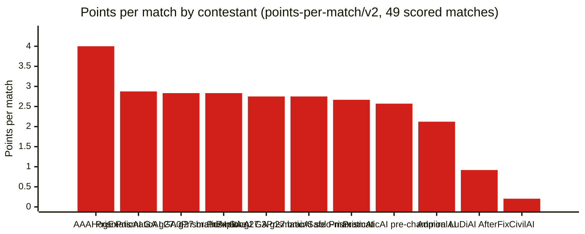
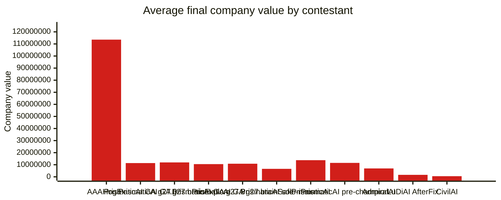
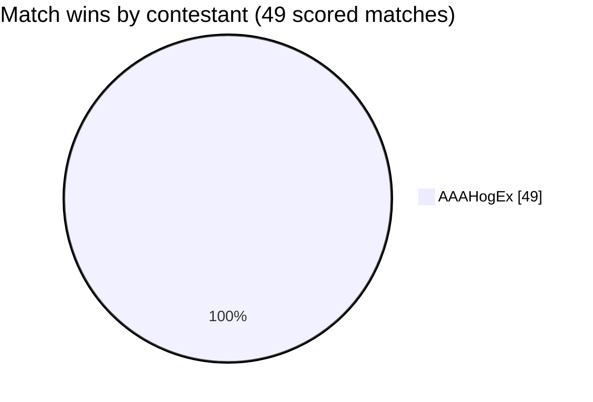
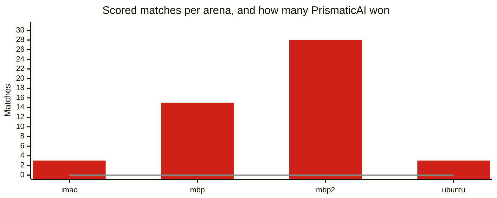

# battle-20261119T135726-ff42e8dd

Derived from `battle-20261119T135726-ff42e8dd.json` by `tools/research/ai-battle/battle.py report`; do not edit.

- Edition `ff42e8dd17229845`: PrismaticAI and referee at `0587d5c533a6fa9232f4f60b98ffa3e49f0c4d3c`, base set `opengfx-8.0.tar`
- 20-year free-for-all from 1960, map 256x256 temperate, breakdowns 1
- 49 scored match(es) on `imac` (20261119-master-gdf1e05e7d8), `mbp` (20261119-master-m038450434f), `mbp2` (20261119-master-gdf1e05e7d8), `ubuntu` (20261119-master-gdf1e05e7d8)
- Replays: 2 of 2 identical to their original on another arena

| # | Contestant | Played | Wins | Points | Points/match | Avg rank | Avg final value | Squirrel errors | Matches with anomalies |
|---|---|---|---|---|---|---|---|---|---|
| 1 | AAAHogEx | 49 | 49 | 196 | 4.0 | 1.0 | 113.6 M | 0 | 1 |
| 2 | PrismaticAI GA g27.0 | 8 | 0 | 23 | 2.875 | 2.12 | 11.4 M | 0 | 0 |
| 3 | PrismaticAI GA g27.brainExplore | 6 | 0 | 17 | 2.833 | 2.17 | 11.9 M | 0 | 3 |
| 4 | PrismaticAI GA g27.3 | 6 | 0 | 17 | 2.833 | 2.17 | 10.5 M | 0 | 3 |
| 5 | PrismaticAI GA g27.brainSafe | 8 | 0 | 22 | 2.75 | 2.25 | 10.9 M | 0 | 2 |
| 6 | PrismaticAI solo-max | 8 | 0 | 22 | 2.75 | 2.25 | 6.6 M | 0 | 8 |
| 7 | PrismaticAI | 6 | 0 | 16 | 2.667 | 2.33 | 13.8 M | 0 | 0 |
| 8 | PrismaticAI pre-champion | 7 | 0 | 18 | 2.571 | 2.43 | 11.5 M | 0 | 0 |
| 9 | AdmiralAI | 49 | 0 | 104 | 2.122 | 2.88 | 6.9 M | 0 | 2 |
| 10 | LuDiAI AfterFix | 49 | 0 | 45 | 0.918 | 4.08 | 1.6 M | 0 | 3 |
| 11 | CivilAI | 49 | 0 | 10 | 0.204 | 4.8 | 528.9 k | 0 | 7 |

```mermaid
---
config:
  xyChart:
    width: 900
    height: 360
  themeVariables:
    xyChart:
      plotColorPalette: "#d11f1a, #8a8a8a, #0b0b0b, #ece4d6"
---
xychart-beta
    title "Final company value per scored match: winner vs best PrismaticAI"
    x-axis ["m-0001", "m-0002", "m-0003", "m-0004", "m-0005", "m-0006", "m-0007", "m-0008", "m-0009", "m-0010", "m-0011", "m-0012", "m-0013", "m-0014", "m-0015", "m-0016", "m-0017", "m-0018", "m-0019", "m-0020", "m-0021", "m-0022", "m-0024", "m-0025", "m-0026", "m-0030", "m-0031", "m-0032", "m-0033", "m-0034", "m-0035", "m-0036", "m-0037", "m-0038", "m-0039", "m-0041", "m-0042", "m-0043", "m-0044", "m-0045", "m-0049", "m-0050", "m-0051", "m-0053", "m-0054", "m-0055", "m-0057", "m-0059", "m-0060"]
    %% series: Winner | Best PrismaticAI
    %% links: battle-20261119T135726-ff42e8dd.md?col=Match&filter=m-0001 | battle-20261119T135726-ff42e8dd.md?col=Match&filter=m-0002 | battle-20261119T135726-ff42e8dd.md?col=Match&filter=m-0003 | battle-20261119T135726-ff42e8dd.md?col=Match&filter=m-0004 | battle-20261119T135726-ff42e8dd.md?col=Match&filter=m-0005 | battle-20261119T135726-ff42e8dd.md?col=Match&filter=m-0006 | battle-20261119T135726-ff42e8dd.md?col=Match&filter=m-0007 | battle-20261119T135726-ff42e8dd.md?col=Match&filter=m-0008 | battle-20261119T135726-ff42e8dd.md?col=Match&filter=m-0009 | battle-20261119T135726-ff42e8dd.md?col=Match&filter=m-0010 | battle-20261119T135726-ff42e8dd.md?col=Match&filter=m-0011 | battle-20261119T135726-ff42e8dd.md?col=Match&filter=m-0012 | battle-20261119T135726-ff42e8dd.md?col=Match&filter=m-0013 | battle-20261119T135726-ff42e8dd.md?col=Match&filter=m-0014 | battle-20261119T135726-ff42e8dd.md?col=Match&filter=m-0015 | battle-20261119T135726-ff42e8dd.md?col=Match&filter=m-0016 | battle-20261119T135726-ff42e8dd.md?col=Match&filter=m-0017 | battle-20261119T135726-ff42e8dd.md?col=Match&filter=m-0018 | battle-20261119T135726-ff42e8dd.md?col=Match&filter=m-0019 | battle-20261119T135726-ff42e8dd.md?col=Match&filter=m-0020 | battle-20261119T135726-ff42e8dd.md?col=Match&filter=m-0021 | battle-20261119T135726-ff42e8dd.md?col=Match&filter=m-0022 | battle-20261119T135726-ff42e8dd.md?col=Match&filter=m-0024 | battle-20261119T135726-ff42e8dd.md?col=Match&filter=m-0025 | battle-20261119T135726-ff42e8dd.md?col=Match&filter=m-0026 | battle-20261119T135726-ff42e8dd.md?col=Match&filter=m-0030 | battle-20261119T135726-ff42e8dd.md?col=Match&filter=m-0031 | battle-20261119T135726-ff42e8dd.md?col=Match&filter=m-0032 | battle-20261119T135726-ff42e8dd.md?col=Match&filter=m-0033 | battle-20261119T135726-ff42e8dd.md?col=Match&filter=m-0034 | battle-20261119T135726-ff42e8dd.md?col=Match&filter=m-0035 | battle-20261119T135726-ff42e8dd.md?col=Match&filter=m-0036 | battle-20261119T135726-ff42e8dd.md?col=Match&filter=m-0037 | battle-20261119T135726-ff42e8dd.md?col=Match&filter=m-0038 | battle-20261119T135726-ff42e8dd.md?col=Match&filter=m-0039 | battle-20261119T135726-ff42e8dd.md?col=Match&filter=m-0041 | battle-20261119T135726-ff42e8dd.md?col=Match&filter=m-0042 | battle-20261119T135726-ff42e8dd.md?col=Match&filter=m-0043 | battle-20261119T135726-ff42e8dd.md?col=Match&filter=m-0044 | battle-20261119T135726-ff42e8dd.md?col=Match&filter=m-0045 | battle-20261119T135726-ff42e8dd.md?col=Match&filter=m-0049 | battle-20261119T135726-ff42e8dd.md?col=Match&filter=m-0050 | battle-20261119T135726-ff42e8dd.md?col=Match&filter=m-0051 | battle-20261119T135726-ff42e8dd.md?col=Match&filter=m-0053 | battle-20261119T135726-ff42e8dd.md?col=Match&filter=m-0054 | battle-20261119T135726-ff42e8dd.md?col=Match&filter=m-0055 | battle-20261119T135726-ff42e8dd.md?col=Match&filter=m-0057 | battle-20261119T135726-ff42e8dd.md?col=Match&filter=m-0059 | battle-20261119T135726-ff42e8dd.md?col=Match&filter=m-0060
    y-axis "Company value" 0 --> 209000000
    bar [144192267, 129885725, 120375155, 117124977, 140582797, 125166250, 90145417, 91272268, 73846647, 83476103, 76274910, 73468897, 74442558, 133615989, 125797705, 116170237, 114526559, 110903468, 108243048, 88680983, 94634336, 170197581, 105426552, 106480600, 99446597, 134368903, 115506482, 107711028, 87046600, 127630680, 169490807, 189597674, 165721324, 157094571, 168048016, 171361781, 64538334, 116235426, 102869015, 83394791, 101228341, 109121694, 101330416, 79059781, 113749167, 93813065, 116683297, 91702029, 82538174]
    line [5314060, 7608449, 8354628, 8681316, 9009688, 4579302, 17978198, 8135876, 6544524, 13230751, 13483655, 13317532, 16454082, 16919275, 7436369, 20427638, 15963807, 17859459, 19543796, 17760323, 4780147, 4942749, 3814649, 2445572, 13520103, 10387327, 6085482, 4773937, 10389338, 6243927, 21404197, 7595211, 17687956, 17444805, 19557281, 13566577, 11563662, 3990292, 12800779, 14946434, 9993179, 9103632, 5294756, 9152707, 5775786, 4548971, 6361675, 11243264, 10866001]
```

<!-- battle-charts:begin -->
<!-- derived from battle-20261119T135726-ff42e8dd.json by `battle.py render`; `battle.py check` fails when it is stale -->

<!-- battle-charts:end -->

| Seed | Original | Replay | Arenas | Identical |
|---|---|---|---|---|
| 1217126224 | m-0001 | m-0040 | mbp / mbp2 | yes |
| 1217126224 | m-0002 | m-0048 | mbp / mbp2 | yes |

| Match | Arena | Seed | Winner | Value | Last | Anomalies |
|---|---|---|---|---|---|---|
| m-0001 | mbp | 1217126224 | AAAHogEx | 144.2 M | CivilAI | PrismaticAI solo-max: fleet_drop:44->22 |
| m-0002 | mbp | 1217126224 | AAAHogEx | 129.9 M | LuDiAI AfterFix | - |
| m-0003 | mbp | 1217126224 | AAAHogEx | 120.4 M | CivilAI | - |
| m-0004 | imac | 1217126224 | AAAHogEx | 117.1 M | LuDiAI AfterFix | - |
| m-0005 | imac | 1217126224 | AAAHogEx | 140.6 M | CivilAI | PrismaticAI GA g27.brainExplore: fleet_drop:193->84 |
| m-0006 | imac | 1217126224 | AAAHogEx | 125.2 M | CivilAI | PrismaticAI GA g27.3: fleet_drop:125->70; CivilAI: fleet_drop:55->38 |
| m-0007 | mbp2 | 1859118493 | AAAHogEx | 90.1 M | CivilAI | - |
| m-0008 | mbp2 | 1859118493 | AAAHogEx | 91.3 M | CivilAI | PrismaticAI solo-max: fleet_drop:40->20 |
| m-0009 | mbp2 | 1859118493 | AAAHogEx | 73.8 M | CivilAI | AAAHogEx: fleet_drop:337->233; CivilAI: fleet_drop:38->26 |
| m-0010 | mbp2 | 1859118493 | AAAHogEx | 83.5 M | CivilAI | - |
| m-0011 | mbp2 | 1859118493 | AAAHogEx | 76.3 M | CivilAI | - |
| m-0012 | mbp2 | 1859118493 | AAAHogEx | 73.5 M | CivilAI | - |
| m-0013 | mbp2 | 1859118493 | AAAHogEx | 74.4 M | CivilAI | PrismaticAI GA g27.3: fleet_drop:162->69; CivilAI: fleet_drop:70->45 |
| m-0014 | mbp2 | 251849652 | AAAHogEx | 133.6 M | CivilAI | - |
| m-0015 | mbp2 | 251849652 | AAAHogEx | 125.8 M | CivilAI | PrismaticAI solo-max: fleet_drop:36->25 |
| m-0016 | mbp2 | 251849652 | AAAHogEx | 116.2 M | CivilAI | - |
| m-0017 | mbp2 | 251849652 | AAAHogEx | 114.5 M | CivilAI | - |
| m-0018 | mbp2 | 251849652 | AAAHogEx | 110.9 M | CivilAI | - |
| m-0019 | mbp2 | 251849652 | AAAHogEx | 108.2 M | LuDiAI AfterFix | PrismaticAI GA g27.brainExplore: fleet_drop:118->72; CivilAI: fleet_drop:40->23 |
| m-0020 | mbp2 | 251849652 | AAAHogEx | 88.7 M | CivilAI | - |
| m-0021 | mbp2 | 204750381 | AAAHogEx | 94.6 M | CivilAI | - |
| m-0022 | mbp2 | 204750381 | AAAHogEx | 170.2 M | CivilAI | PrismaticAI solo-max: fleet_drop:51->19 |
| m-0024 | ubuntu | 204750381 | AAAHogEx | 105.4 M | AdmiralAI | - |
| m-0025 | ubuntu | 204750381 | AAAHogEx | 106.5 M | CivilAI | PrismaticAI GA g27.brainSafe: fleet_drop:51->33 |
| m-0026 | ubuntu | 204750381 | AAAHogEx | 99.4 M | CivilAI | PrismaticAI GA g27.brainExplore: fleet_drop:183->82 |
| m-0030 | mbp | 924657013 | AAAHogEx | 134.4 M | LuDiAI AfterFix | - |
| m-0031 | mbp | 924657013 | AAAHogEx | 115.5 M | LuDiAI AfterFix | - |
| m-0032 | mbp | 924657013 | AAAHogEx | 107.7 M | LuDiAI AfterFix | PrismaticAI GA g27.brainSafe: fleet_drop:32->22 |
| m-0033 | mbp | 924657013 | AAAHogEx | 87.0 M | CivilAI | LuDiAI AfterFix: fleet_drop:54->35 |
| m-0034 | mbp | 924657013 | AAAHogEx | 127.6 M | LuDiAI AfterFix | - |
| m-0035 | mbp | 268956824 | AAAHogEx | 169.5 M | CivilAI | - |
| m-0036 | mbp | 268956824 | AAAHogEx | 189.6 M | CivilAI | PrismaticAI solo-max: fleet_drop:45->26 |
| m-0037 | mbp2 | 268956824 | AAAHogEx | 165.7 M | CivilAI | - |
| m-0038 | mbp2 | 268956824 | AAAHogEx | 157.1 M | CivilAI | AdmiralAI: fleet_drop:321->211 |
| m-0039 | mbp2 | 268956824 | AAAHogEx | 168.0 M | CivilAI | LuDiAI AfterFix: fleet_drop:74->33 |
| m-0040 (replay) | mbp2 | 1217126224 | AAAHogEx | 144.2 M | CivilAI | PrismaticAI solo-max: fleet_drop:44->22 |
| m-0041 | mbp | 268956824 | AAAHogEx | 171.4 M | CivilAI | PrismaticAI GA g27.3: fleet_drop:220->110; AdmiralAI: fleet_drop:185->98 |
| m-0042 | mbp2 | 878213703 | AAAHogEx | 64.5 M | CivilAI | - |
| m-0043 | mbp2 | 878213703 | AAAHogEx | 116.2 M | LuDiAI AfterFix | PrismaticAI solo-max: fleet_drop:37->24 |
| m-0044 | mbp2 | 878213703 | AAAHogEx | 102.9 M | CivilAI | - |
| m-0045 | mbp2 | 878213703 | AAAHogEx | 83.4 M | CivilAI | CivilAI: fleet_drop:34->16 |
| m-0048 (replay) | mbp2 | 1217126224 | AAAHogEx | 129.9 M | LuDiAI AfterFix | - |
| m-0049 | mbp2 | 20877647 | AAAHogEx | 101.2 M | CivilAI | CivilAI: fleet_drop:59->37 |
| m-0050 | mbp2 | 20877647 | AAAHogEx | 109.1 M | CivilAI | PrismaticAI solo-max: fleet_drop:42->20 |
| m-0051 | mbp | 20877647 | AAAHogEx | 101.3 M | CivilAI | - |
| m-0053 | mbp2 | 20877647 | AAAHogEx | 79.1 M | CivilAI | - |
| m-0054 | mbp2 | 20877647 | AAAHogEx | 113.7 M | CivilAI | - |
| m-0055 | mbp2 | 20877647 | AAAHogEx | 93.8 M | LuDiAI AfterFix | - |
| m-0057 | mbp | 880766484 | AAAHogEx | 116.7 M | CivilAI | PrismaticAI solo-max: fleet_drop:33->14 |
| m-0059 | mbp | 880766484 | AAAHogEx | 91.7 M | CivilAI | LuDiAI AfterFix: fleet_drop:54->30 |
| m-0060 | mbp | 880766484 | AAAHogEx | 82.5 M | CivilAI | CivilAI: fleet_drop:42->26 |
