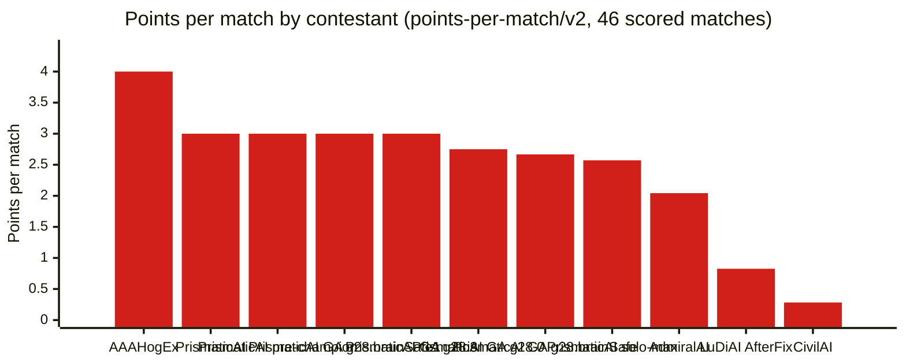
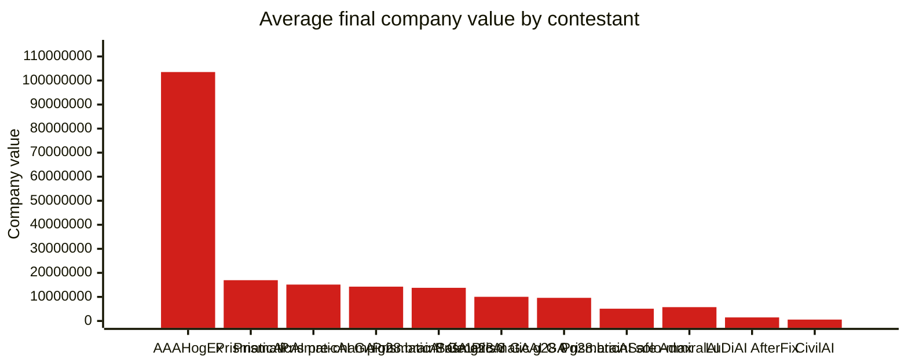
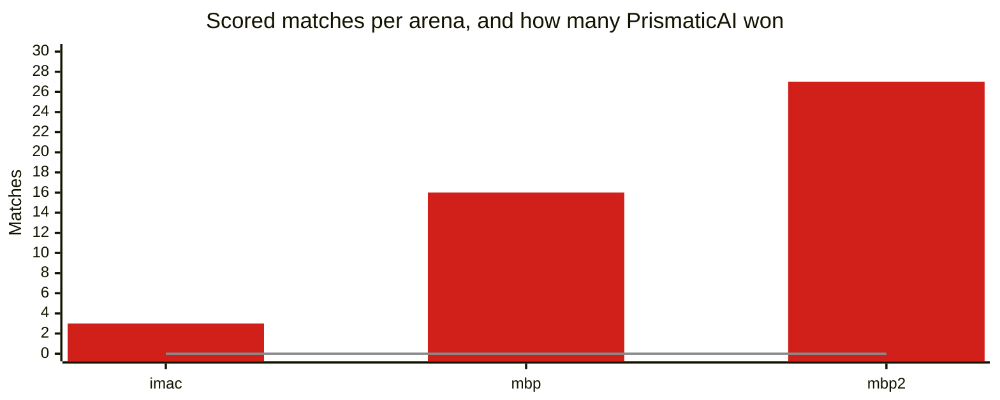

# battle-20261119T141625-f5a5b4c9

Derived from `battle-20261119T141625-f5a5b4c9.json` by `tools/research/ai-battle/battle.py report`; do not edit.

- Edition `f5a5b4c980b08e02`: PrismaticAI and referee at `f695525d1f525c0604169e6016599b0639474419`, base set `opengfx-8.0.tar`
- 20-year free-for-all from 1960, map 256x256 temperate, breakdowns 1
- 46 scored match(es) on `imac` (20261119-master-gdf1e05e7d8), `mbp` (20261119-master-m0587d5c533), `mbp2` (20261119-master-gdf1e05e7d8)
- Replays: 1 of 3 identical to their original on another arena

| # | Contestant | Played | Wins | Points | Points/match | Avg rank | Avg final value | Squirrel errors | Matches with anomalies |
|---|---|---|---|---|---|---|---|---|---|
| 1 | AAAHogEx | 46 | 46 | 184 | 4.0 | 1.0 | 103.5 M | 0 | 0 |
| 2 | PrismaticAI | 6 | 0 | 18 | 3.0 | 2.0 | 17.0 M | 0 | 0 |
| 3 | PrismaticAI pre-champion | 7 | 0 | 21 | 3.0 | 2.0 | 15.1 M | 0 | 0 |
| 4 | PrismaticAI GA g28.brainSafe1 | 6 | 0 | 18 | 3.0 | 2.0 | 14.3 M | 0 | 0 |
| 5 | PrismaticAI GA g28.3 | 6 | 0 | 18 | 3.0 | 2.0 | 13.8 M | 0 | 5 |
| 6 | PrismaticAI GA g28.0 | 8 | 0 | 22 | 2.75 | 2.25 | 10.0 M | 0 | 1 |
| 7 | PrismaticAI GA g28.brainSafe | 6 | 0 | 16 | 2.667 | 2.33 | 9.6 M | 0 | 1 |
| 8 | PrismaticAI solo-max | 7 | 0 | 18 | 2.571 | 2.43 | 5.1 M | 0 | 7 |
| 9 | AdmiralAI | 46 | 0 | 94 | 2.043 | 2.96 | 5.7 M | 0 | 1 |
| 10 | LuDiAI AfterFix | 46 | 0 | 38 | 0.826 | 4.17 | 1.5 M | 0 | 0 |
| 11 | CivilAI | 46 | 0 | 13 | 0.283 | 4.72 | 571.0 k | 0 | 13 |

```mermaid
---
config:
  xyChart:
    width: 900
    height: 360
  themeVariables:
    xyChart:
      plotColorPalette: "#d11f1a, #8a8a8a, #0b0b0b, #ece4d6"
---
xychart-beta
    title "Final company value per scored match: winner vs best PrismaticAI"
    x-axis ["m-0001", "m-0002", "m-0003", "m-0004", "m-0005", "m-0006", "m-0007", "m-0008", "m-0009", "m-0010", "m-0011", "m-0012", "m-0013", "m-0014", "m-0015", "m-0016", "m-0017", "m-0018", "m-0019", "m-0020", "m-0021", "m-0022", "m-0030", "m-0031", "m-0032", "m-0033", "m-0034", "m-0035", "m-0036", "m-0037", "m-0038", "m-0039", "m-0041", "m-0042", "m-0043", "m-0044", "m-0045", "m-0046", "m-0047", "m-0051", "m-0052", "m-0054", "m-0057", "m-0059", "m-0062", "m-0063"]
    %% series: Winner | Best PrismaticAI
    %% links: battle-20261119T141625-f5a5b4c9.md?col=Match&filter=m-0001 | battle-20261119T141625-f5a5b4c9.md?col=Match&filter=m-0002 | battle-20261119T141625-f5a5b4c9.md?col=Match&filter=m-0003 | battle-20261119T141625-f5a5b4c9.md?col=Match&filter=m-0004 | battle-20261119T141625-f5a5b4c9.md?col=Match&filter=m-0005 | battle-20261119T141625-f5a5b4c9.md?col=Match&filter=m-0006 | battle-20261119T141625-f5a5b4c9.md?col=Match&filter=m-0007 | battle-20261119T141625-f5a5b4c9.md?col=Match&filter=m-0008 | battle-20261119T141625-f5a5b4c9.md?col=Match&filter=m-0009 | battle-20261119T141625-f5a5b4c9.md?col=Match&filter=m-0010 | battle-20261119T141625-f5a5b4c9.md?col=Match&filter=m-0011 | battle-20261119T141625-f5a5b4c9.md?col=Match&filter=m-0012 | battle-20261119T141625-f5a5b4c9.md?col=Match&filter=m-0013 | battle-20261119T141625-f5a5b4c9.md?col=Match&filter=m-0014 | battle-20261119T141625-f5a5b4c9.md?col=Match&filter=m-0015 | battle-20261119T141625-f5a5b4c9.md?col=Match&filter=m-0016 | battle-20261119T141625-f5a5b4c9.md?col=Match&filter=m-0017 | battle-20261119T141625-f5a5b4c9.md?col=Match&filter=m-0018 | battle-20261119T141625-f5a5b4c9.md?col=Match&filter=m-0019 | battle-20261119T141625-f5a5b4c9.md?col=Match&filter=m-0020 | battle-20261119T141625-f5a5b4c9.md?col=Match&filter=m-0021 | battle-20261119T141625-f5a5b4c9.md?col=Match&filter=m-0022 | battle-20261119T141625-f5a5b4c9.md?col=Match&filter=m-0030 | battle-20261119T141625-f5a5b4c9.md?col=Match&filter=m-0031 | battle-20261119T141625-f5a5b4c9.md?col=Match&filter=m-0032 | battle-20261119T141625-f5a5b4c9.md?col=Match&filter=m-0033 | battle-20261119T141625-f5a5b4c9.md?col=Match&filter=m-0034 | battle-20261119T141625-f5a5b4c9.md?col=Match&filter=m-0035 | battle-20261119T141625-f5a5b4c9.md?col=Match&filter=m-0036 | battle-20261119T141625-f5a5b4c9.md?col=Match&filter=m-0037 | battle-20261119T141625-f5a5b4c9.md?col=Match&filter=m-0038 | battle-20261119T141625-f5a5b4c9.md?col=Match&filter=m-0039 | battle-20261119T141625-f5a5b4c9.md?col=Match&filter=m-0041 | battle-20261119T141625-f5a5b4c9.md?col=Match&filter=m-0042 | battle-20261119T141625-f5a5b4c9.md?col=Match&filter=m-0043 | battle-20261119T141625-f5a5b4c9.md?col=Match&filter=m-0044 | battle-20261119T141625-f5a5b4c9.md?col=Match&filter=m-0045 | battle-20261119T141625-f5a5b4c9.md?col=Match&filter=m-0046 | battle-20261119T141625-f5a5b4c9.md?col=Match&filter=m-0047 | battle-20261119T141625-f5a5b4c9.md?col=Match&filter=m-0051 | battle-20261119T141625-f5a5b4c9.md?col=Match&filter=m-0052 | battle-20261119T141625-f5a5b4c9.md?col=Match&filter=m-0054 | battle-20261119T141625-f5a5b4c9.md?col=Match&filter=m-0057 | battle-20261119T141625-f5a5b4c9.md?col=Match&filter=m-0059 | battle-20261119T141625-f5a5b4c9.md?col=Match&filter=m-0062 | battle-20261119T141625-f5a5b4c9.md?col=Match&filter=m-0063
    y-axis "Company value" 0 --> 177000000
    bar [86596544, 84079821, 86355422, 82986167, 94864962, 77286759, 147901630, 130657389, 111666603, 126224168, 132886542, 128197118, 128162772, 95519442, 101631364, 78534291, 62901684, 99329509, 82677617, 63513995, 69821960, 131917599, 93746455, 100060110, 120453668, 110827505, 72283779, 86661245, 111539951, 77799798, 76833213, 78523838, 91827707, 103606022, 160679906, 97931714, 126240793, 152997119, 130362299, 146885726, 108686984, 107271845, 110461419, 88068554, 84003640, 120649401]
    line [3056824, 8486414, 11925327, 8934734, 13502210, 11031494, 13246174, 6010264, 21035627, 15882864, 13282382, 16315605, 16250116, 14904558, 8470045, 13571717, 8262895, 8151429, 10001238, 13696635, 15872900, 6919129, 17425265, 18268665, 7386133, 13440129, 22002310, 13278352, 3754164, 13628398, 5585377, 6872592, 12469232, 25109818, 3803043, 22492505, 13576170, 13044269, 25258765, 9254989, 2222468, 7082253, 3659161, 4589070, 7241935, 19320276]
```

<!-- battle-charts:begin -->
<!-- derived from battle-20261119T141625-f5a5b4c9.json by `battle.py render`; `battle.py check` fails when it is stale -->

<!-- battle-charts:end -->

| Seed | Original | Replay | Arenas | Identical |
|---|---|---|---|---|
| 761959336 | m-0002 | m-0048 | mbp / mbp2 | yes |
| 761959336 | m-0004 | m-0056 | imac / mbp | NO |
| 761959336 | m-0005 | m-0064 | imac / mbp | NO |

| Match | Arena | Seed | Winner | Value | Last | Anomalies |
|---|---|---|---|---|---|---|
| m-0001 | mbp | 761959336 | AAAHogEx | 86.6 M | CivilAI | PrismaticAI solo-max: fleet_drop:47->22 |
| m-0002 | mbp | 761959336 | AAAHogEx | 84.1 M | CivilAI | - |
| m-0003 | mbp | 761959336 | AAAHogEx | 86.4 M | CivilAI | - |
| m-0004 | imac | 761959336 | AAAHogEx | 83.0 M | LuDiAI AfterFix | - |
| m-0005 | imac | 761959336 | AAAHogEx | 94.9 M | CivilAI | - |
| m-0006 | imac | 761959336 | AAAHogEx | 77.3 M | CivilAI | PrismaticAI GA g28.3: fleet_drop:181->63 |
| m-0007 | mbp2 | 1669891890 | AAAHogEx | 147.9 M | CivilAI | CivilAI: fleet_drop:54->34 |
| m-0008 | mbp2 | 1669891890 | AAAHogEx | 130.7 M | CivilAI | PrismaticAI solo-max: fleet_drop:43->26 |
| m-0009 | mbp2 | 1669891890 | AAAHogEx | 111.7 M | AdmiralAI | CivilAI: fleet_drop:76->52 |
| m-0010 | mbp2 | 1669891890 | AAAHogEx | 126.2 M | CivilAI | - |
| m-0011 | mbp2 | 1669891890 | AAAHogEx | 132.9 M | CivilAI | - |
| m-0012 | mbp2 | 1669891890 | AAAHogEx | 128.2 M | CivilAI | - |
| m-0013 | mbp2 | 1669891890 | AAAHogEx | 128.2 M | CivilAI | PrismaticAI GA g28.3: fleet_drop:177->99; AdmiralAI: fleet_drop:218->152 |
| m-0014 | mbp2 | 1791817241 | AAAHogEx | 95.5 M | CivilAI | - |
| m-0015 | mbp2 | 1791817241 | AAAHogEx | 101.6 M | CivilAI | PrismaticAI solo-max: fleet_drop:39->15; CivilAI: fleet_drop:32->18 |
| m-0016 | mbp2 | 1791817241 | AAAHogEx | 78.5 M | CivilAI | CivilAI: fleet_drop:145->69 |
| m-0017 | mbp2 | 1791817241 | AAAHogEx | 62.9 M | CivilAI | - |
| m-0018 | mbp2 | 1791817241 | AAAHogEx | 99.3 M | CivilAI | - |
| m-0019 | mbp2 | 1791817241 | AAAHogEx | 82.7 M | CivilAI | - |
| m-0020 | mbp2 | 1791817241 | AAAHogEx | 63.5 M | LuDiAI AfterFix | PrismaticAI GA g28.3: fleet_drop:116->69; CivilAI: fleet_drop:105->54 |
| m-0021 | mbp2 | 263169837 | AAAHogEx | 69.8 M | CivilAI | - |
| m-0022 | mbp2 | 263169837 | AAAHogEx | 131.9 M | LuDiAI AfterFix | PrismaticAI solo-max: fleet_drop:34->20 |
| m-0030 | mbp | 1709844214 | AAAHogEx | 93.7 M | LuDiAI AfterFix | - |
| m-0031 | mbp | 1709844214 | AAAHogEx | 100.1 M | CivilAI | - |
| m-0032 | mbp | 1709844214 | AAAHogEx | 120.5 M | CivilAI | PrismaticAI GA g28.brainSafe: fleet_drop:115->58; CivilAI: fleet_drop:46->21 |
| m-0033 | mbp | 1709844214 | AAAHogEx | 110.8 M | LuDiAI AfterFix | - |
| m-0034 | mbp | 1709844214 | AAAHogEx | 72.3 M | LuDiAI AfterFix | PrismaticAI GA g28.3: fleet_drop:232->102 |
| m-0035 | mbp | 89167670 | AAAHogEx | 86.7 M | CivilAI | CivilAI: no_vehicles |
| m-0036 | mbp2 | 89167670 | AAAHogEx | 111.5 M | CivilAI | PrismaticAI solo-max: fleet_drop:32->19 |
| m-0037 | mbp2 | 89167670 | AAAHogEx | 77.8 M | CivilAI | CivilAI: fleet_drop:34->16 |
| m-0038 | mbp | 89167670 | AAAHogEx | 76.8 M | CivilAI | - |
| m-0039 | mbp | 89167670 | AAAHogEx | 78.5 M | CivilAI | - |
| m-0041 | mbp2 | 89167670 | AAAHogEx | 91.8 M | LuDiAI AfterFix | PrismaticAI GA g28.3: fleet_drop:112->48 |
| m-0042 | mbp2 | 866552619 | AAAHogEx | 103.6 M | CivilAI | CivilAI: fleet_drop:14->7 |
| m-0043 | mbp | 866552619 | AAAHogEx | 160.7 M | CivilAI | PrismaticAI solo-max: fleet_drop:37->15 |
| m-0044 | mbp2 | 866552619 | AAAHogEx | 97.9 M | CivilAI | - |
| m-0045 | mbp2 | 866552619 | AAAHogEx | 126.2 M | CivilAI | CivilAI: fleet_drop:27->16 |
| m-0046 | mbp2 | 866552619 | AAAHogEx | 153.0 M | LuDiAI AfterFix | - |
| m-0047 | mbp2 | 866552619 | AAAHogEx | 130.4 M | AdmiralAI | - |
| m-0048 (replay) | mbp2 | 761959336 | AAAHogEx | 84.1 M | CivilAI | - |
| m-0051 | mbp2 | 1752899291 | AAAHogEx | 146.9 M | CivilAI | CivilAI: fleet_drop:62->19 |
| m-0052 | mbp2 | 1752899291 | AAAHogEx | 108.7 M | CivilAI | PrismaticAI GA g28.0: fleet_drop:62->43 |
| m-0054 | mbp2 | 1752899291 | AAAHogEx | 107.3 M | CivilAI | CivilAI: fleet_drop:25->16 |
| m-0056 (replay) | mbp | 761959336 | AAAHogEx | 90.4 M | CivilAI | PrismaticAI GA g28.brainSafe: fleet_drop:82->49; LuDiAI AfterFix: fleet_drop:58->35 |
| m-0057 | mbp | 599581161 | AAAHogEx | 110.5 M | CivilAI | PrismaticAI solo-max: fleet_drop:27->14; CivilAI: fleet_drop:15->10 |
| m-0059 | mbp | 599581161 | AAAHogEx | 88.1 M | CivilAI | - |
| m-0062 | mbp | 599581161 | AAAHogEx | 84.0 M | LuDiAI AfterFix | - |
| m-0063 | mbp | 170201890 | AAAHogEx | 120.6 M | LuDiAI AfterFix | - |
| m-0064 (replay) | mbp | 761959336 | AAAHogEx | 92.1 M | CivilAI | - |
