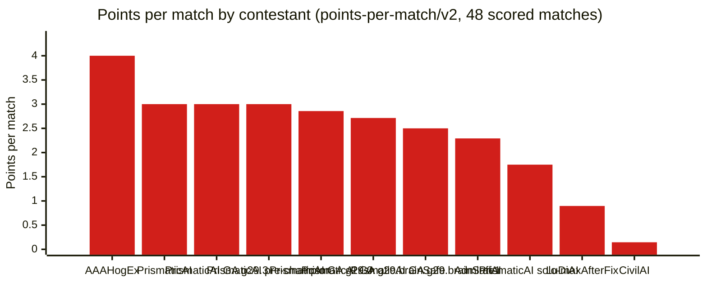
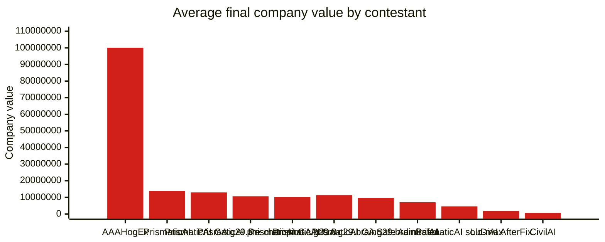
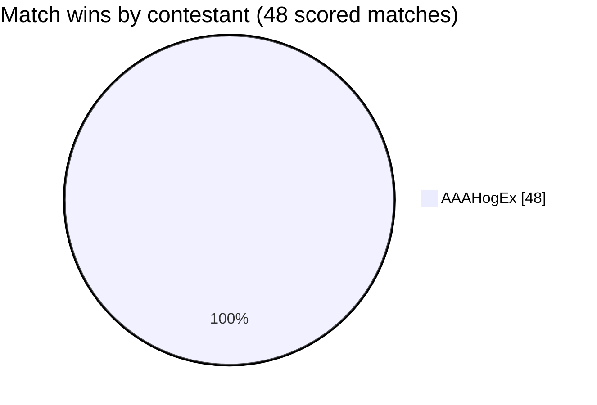
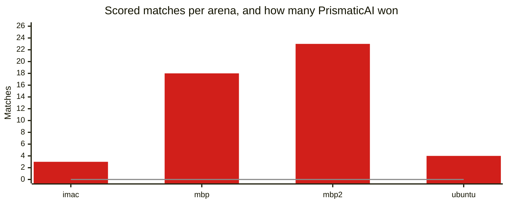

# battle-20261119T143339-7930f86c

Derived from `battle-20261119T143339-7930f86c.json` by `tools/research/ai-battle/battle.py report`; do not edit.

- Edition `7930f86cd1ccaacb`: PrismaticAI and referee at `f695525d1f525c0604169e6016599b0639474419`, base set `opengfx-8.0.tar`
- 20-year free-for-all from 1960, map 256x256 temperate, breakdowns 1
- 48 scored match(es) on `imac` (20261119-master-gdf1e05e7d8), `mbp` (20261119-master-m0587d5c533), `mbp2` (20261119-master-gdf1e05e7d8), `ubuntu` (20261119-master-gdf1e05e7d8)
- Replays: 0 of 0 identical to their original on another arena

| # | Contestant | Played | Wins | Points | Points/match | Avg rank | Avg final value | Squirrel errors | Matches with anomalies |
|---|---|---|---|---|---|---|---|---|---|
| 1 | AAAHogEx | 48 | 48 | 192 | 4.0 | 1.0 | 100.1 M | 0 | 0 |
| 2 | PrismaticAI | 6 | 0 | 18 | 3.0 | 2.0 | 13.9 M | 0 | 1 |
| 3 | PrismaticAI GA g29.3 | 7 | 0 | 21 | 3.0 | 2.0 | 13.0 M | 0 | 4 |
| 4 | PrismaticAI pre-champion | 7 | 0 | 21 | 3.0 | 2.0 | 10.6 M | 0 | 0 |
| 5 | PrismaticAI GA g29.0 | 7 | 0 | 20 | 2.857 | 2.14 | 10.1 M | 0 | 6 |
| 6 | PrismaticAI GA g29.brainSafe | 7 | 0 | 19 | 2.714 | 2.29 | 11.4 M | 0 | 0 |
| 7 | PrismaticAI GA g29.brainSafe1 | 6 | 0 | 15 | 2.5 | 2.5 | 9.7 M | 0 | 5 |
| 8 | AdmiralAI | 48 | 0 | 110 | 2.292 | 2.71 | 7.0 M | 0 | 3 |
| 9 | PrismaticAI solo-max | 8 | 0 | 14 | 1.75 | 3.25 | 4.6 M | 0 | 8 |
| 10 | LuDiAI AfterFix | 48 | 0 | 43 | 0.896 | 4.1 | 1.8 M | 0 | 0 |
| 11 | CivilAI | 48 | 0 | 7 | 0.146 | 4.85 | 688.5 k | 0 | 8 |

```mermaid
---
config:
  xyChart:
    width: 900
    height: 360
  themeVariables:
    xyChart:
      plotColorPalette: "#d11f1a, #8a8a8a, #0b0b0b, #ece4d6"
---
xychart-beta
    title "Final company value per scored match: winner vs best PrismaticAI"
    x-axis ["m-0001", "m-0002", "m-0003", "m-0004", "m-0005", "m-0006", "m-0007", "m-0008", "m-0009", "m-0010", "m-0011", "m-0012", "m-0013", "m-0014", "m-0015", "m-0016", "m-0017", "m-0018", "m-0019", "m-0020", "m-0021", "m-0022", "m-0023", "m-0025", "m-0027", "m-0029", "m-0030", "m-0031", "m-0032", "m-0033", "m-0034", "m-0035", "m-0036", "m-0038", "m-0039", "m-0041", "m-0042", "m-0043", "m-0044", "m-0045", "m-0046", "m-0047", "m-0057", "m-0058", "m-0059", "m-0061", "m-0062", "m-0063"]
    %% series: Winner | Best PrismaticAI
    %% links: battle-20261119T143339-7930f86c.md?col=Match&filter=m-0001 | battle-20261119T143339-7930f86c.md?col=Match&filter=m-0002 | battle-20261119T143339-7930f86c.md?col=Match&filter=m-0003 | battle-20261119T143339-7930f86c.md?col=Match&filter=m-0004 | battle-20261119T143339-7930f86c.md?col=Match&filter=m-0005 | battle-20261119T143339-7930f86c.md?col=Match&filter=m-0006 | battle-20261119T143339-7930f86c.md?col=Match&filter=m-0007 | battle-20261119T143339-7930f86c.md?col=Match&filter=m-0008 | battle-20261119T143339-7930f86c.md?col=Match&filter=m-0009 | battle-20261119T143339-7930f86c.md?col=Match&filter=m-0010 | battle-20261119T143339-7930f86c.md?col=Match&filter=m-0011 | battle-20261119T143339-7930f86c.md?col=Match&filter=m-0012 | battle-20261119T143339-7930f86c.md?col=Match&filter=m-0013 | battle-20261119T143339-7930f86c.md?col=Match&filter=m-0014 | battle-20261119T143339-7930f86c.md?col=Match&filter=m-0015 | battle-20261119T143339-7930f86c.md?col=Match&filter=m-0016 | battle-20261119T143339-7930f86c.md?col=Match&filter=m-0017 | battle-20261119T143339-7930f86c.md?col=Match&filter=m-0018 | battle-20261119T143339-7930f86c.md?col=Match&filter=m-0019 | battle-20261119T143339-7930f86c.md?col=Match&filter=m-0020 | battle-20261119T143339-7930f86c.md?col=Match&filter=m-0021 | battle-20261119T143339-7930f86c.md?col=Match&filter=m-0022 | battle-20261119T143339-7930f86c.md?col=Match&filter=m-0023 | battle-20261119T143339-7930f86c.md?col=Match&filter=m-0025 | battle-20261119T143339-7930f86c.md?col=Match&filter=m-0027 | battle-20261119T143339-7930f86c.md?col=Match&filter=m-0029 | battle-20261119T143339-7930f86c.md?col=Match&filter=m-0030 | battle-20261119T143339-7930f86c.md?col=Match&filter=m-0031 | battle-20261119T143339-7930f86c.md?col=Match&filter=m-0032 | battle-20261119T143339-7930f86c.md?col=Match&filter=m-0033 | battle-20261119T143339-7930f86c.md?col=Match&filter=m-0034 | battle-20261119T143339-7930f86c.md?col=Match&filter=m-0035 | battle-20261119T143339-7930f86c.md?col=Match&filter=m-0036 | battle-20261119T143339-7930f86c.md?col=Match&filter=m-0038 | battle-20261119T143339-7930f86c.md?col=Match&filter=m-0039 | battle-20261119T143339-7930f86c.md?col=Match&filter=m-0041 | battle-20261119T143339-7930f86c.md?col=Match&filter=m-0042 | battle-20261119T143339-7930f86c.md?col=Match&filter=m-0043 | battle-20261119T143339-7930f86c.md?col=Match&filter=m-0044 | battle-20261119T143339-7930f86c.md?col=Match&filter=m-0045 | battle-20261119T143339-7930f86c.md?col=Match&filter=m-0046 | battle-20261119T143339-7930f86c.md?col=Match&filter=m-0047 | battle-20261119T143339-7930f86c.md?col=Match&filter=m-0057 | battle-20261119T143339-7930f86c.md?col=Match&filter=m-0058 | battle-20261119T143339-7930f86c.md?col=Match&filter=m-0059 | battle-20261119T143339-7930f86c.md?col=Match&filter=m-0061 | battle-20261119T143339-7930f86c.md?col=Match&filter=m-0062 | battle-20261119T143339-7930f86c.md?col=Match&filter=m-0063
    y-axis "Company value" 0 --> 179000000
    bar [126194286, 122705807, 103800497, 108874517, 113132271, 123434811, 145124921, 162511654, 133855755, 122381272, 124173906, 95792623, 131997347, 79728889, 74617340, 93645167, 77173797, 87699421, 88512714, 75144625, 87001112, 102766174, 72765423, 103229245, 92767317, 101604210, 115526789, 104410770, 116590478, 81010230, 94128613, 82432059, 78428008, 74703359, 65989103, 53519616, 100595556, 97422485, 102288074, 97479989, 99539324, 92190223, 108172803, 119434780, 93955308, 93102401, 97374251, 84106952]
    line [4444839, 6304781, 7417730, 5857387, 6465192, 6372297, 17403209, 4322732, 13382866, 16456726, 20214157, 13033833, 19284242, 10577910, 4297965, 6787796, 8038362, 9171170, 5927424, 9406958, 11611521, 607408, 16024381, 12124397, 15795616, 5911145, 8982647, 9995091, 8512500, 7374116, 19264349, 10406576, 3871439, 10653845, 9371846, 10109396, 16337092, 5322638, 10117276, 12046462, 14210496, 8282244, 7846304, 12921912, 6223679, 17302755, 10569561, 16779089]
```

<!-- battle-charts:begin -->
<!-- derived from battle-20261119T143339-7930f86c.json by `battle.py render`; `battle.py check` fails when it is stale -->

<!-- battle-charts:end -->

| Match | Arena | Seed | Winner | Value | Last | Anomalies |
|---|---|---|---|---|---|---|
| m-0001 | mbp | 715308188 | AAAHogEx | 126.2 M | CivilAI | PrismaticAI solo-max: fleet_drop:35->17 |
| m-0002 | mbp | 715308188 | AAAHogEx | 122.7 M | CivilAI | - |
| m-0003 | mbp | 715308188 | AAAHogEx | 103.8 M | CivilAI | PrismaticAI GA g29.0: fleet_drop:132->92 |
| m-0004 | imac | 715308188 | AAAHogEx | 108.9 M | CivilAI | - |
| m-0005 | imac | 715308188 | AAAHogEx | 113.1 M | CivilAI | PrismaticAI GA g29.brainSafe1: fleet_drop:131->79 |
| m-0006 | imac | 715308188 | AAAHogEx | 123.4 M | CivilAI | - |
| m-0007 | mbp2 | 1099659295 | AAAHogEx | 145.1 M | CivilAI | - |
| m-0008 | mbp2 | 1099659295 | AAAHogEx | 162.5 M | CivilAI | PrismaticAI solo-max: fleet_drop:37->13 |
| m-0009 | mbp2 | 1099659295 | AAAHogEx | 133.9 M | CivilAI | - |
| m-0010 | mbp2 | 1099659295 | AAAHogEx | 122.4 M | LuDiAI AfterFix | PrismaticAI GA g29.0: fleet_drop:164->110; AdmiralAI: fleet_drop:184->111; CivilAI: fleet_drop:104->69 |
| m-0011 | mbp2 | 1099659295 | AAAHogEx | 124.2 M | LuDiAI AfterFix | - |
| m-0012 | mbp2 | 1099659295 | AAAHogEx | 95.8 M | CivilAI | - |
| m-0013 | mbp2 | 1099659295 | AAAHogEx | 132.0 M | LuDiAI AfterFix | - |
| m-0014 | mbp2 | 954230220 | AAAHogEx | 79.7 M | LuDiAI AfterFix | PrismaticAI: fleet_drop:65->40 |
| m-0015 | mbp2 | 954230220 | AAAHogEx | 74.6 M | CivilAI | PrismaticAI solo-max: fleet_drop:43->18 |
| m-0016 | mbp2 | 954230220 | AAAHogEx | 93.6 M | CivilAI | CivilAI: fleet_drop:43->22 |
| m-0017 | mbp2 | 954230220 | AAAHogEx | 77.2 M | CivilAI | PrismaticAI GA g29.0: fleet_drop:87->35; CivilAI: fleet_drop:41->11 |
| m-0018 | mbp2 | 954230220 | AAAHogEx | 87.7 M | CivilAI | CivilAI: fleet_drop:53->29 |
| m-0019 | mbp2 | 954230220 | AAAHogEx | 88.5 M | CivilAI | PrismaticAI GA g29.brainSafe1: fleet_drop:65->24; AdmiralAI: fleet_drop:245->160 |
| m-0020 | mbp2 | 954230220 | AAAHogEx | 75.1 M | CivilAI | PrismaticAI GA g29.3: fleet_drop:76->52 |
| m-0021 | mbp2 | 982825956 | AAAHogEx | 87.0 M | CivilAI | - |
| m-0022 | mbp2 | 982825956 | AAAHogEx | 102.8 M | PrismaticAI solo-max | PrismaticAI solo-max: fleet_drop:25->10 |
| m-0023 | ubuntu | 982825956 | AAAHogEx | 72.8 M | CivilAI | AdmiralAI: fleet_drop:146->85 |
| m-0025 | ubuntu | 982825956 | AAAHogEx | 103.2 M | CivilAI | CivilAI: no_vehicles |
| m-0027 | ubuntu | 982825956 | AAAHogEx | 92.8 M | CivilAI | PrismaticAI GA g29.3: fleet_drop:175->100; CivilAI: fleet_drop:85->55 |
| m-0029 | ubuntu | 1465600066 | AAAHogEx | 101.6 M | CivilAI | PrismaticAI solo-max: fleet_drop:48->30; CivilAI: fleet_drop:33->23 |
| m-0030 | mbp | 1465600066 | AAAHogEx | 115.5 M | CivilAI | - |
| m-0031 | mbp | 1465600066 | AAAHogEx | 104.4 M | CivilAI | - |
| m-0032 | mbp | 1465600066 | AAAHogEx | 116.6 M | CivilAI | - |
| m-0033 | mbp | 1465600066 | AAAHogEx | 81.0 M | CivilAI | PrismaticAI GA g29.brainSafe1: fleet_drop:192->126 |
| m-0034 | mbp | 1465600066 | AAAHogEx | 94.1 M | CivilAI | - |
| m-0035 | mbp | 127202327 | AAAHogEx | 82.4 M | CivilAI | - |
| m-0036 | mbp2 | 127202327 | AAAHogEx | 78.4 M | CivilAI | PrismaticAI solo-max: fleet_drop:49->20 |
| m-0038 | mbp2 | 127202327 | AAAHogEx | 74.7 M | CivilAI | PrismaticAI GA g29.0: fleet_drop:172->72 |
| m-0039 | mbp2 | 127202327 | AAAHogEx | 66.0 M | CivilAI | - |
| m-0041 | mbp2 | 127202327 | AAAHogEx | 53.5 M | CivilAI | PrismaticAI GA g29.3: fleet_drop:160->71 |
| m-0042 | mbp | 269154969 | AAAHogEx | 100.6 M | CivilAI | - |
| m-0043 | mbp2 | 269154969 | AAAHogEx | 97.4 M | CivilAI | PrismaticAI solo-max: fleet_drop:41->15 |
| m-0044 | mbp2 | 269154969 | AAAHogEx | 102.3 M | CivilAI | - |
| m-0045 | mbp | 269154969 | AAAHogEx | 97.5 M | CivilAI | PrismaticAI GA g29.0: fleet_drop:162->91 |
| m-0046 | mbp | 269154969 | AAAHogEx | 99.5 M | CivilAI | - |
| m-0047 | mbp2 | 269154969 | AAAHogEx | 92.2 M | LuDiAI AfterFix | PrismaticAI GA g29.brainSafe1: fleet_drop:111->28 |
| m-0057 | mbp | 1311446714 | AAAHogEx | 108.2 M | CivilAI | PrismaticAI solo-max: fleet_drop:50->22 |
| m-0058 | mbp | 1311446714 | AAAHogEx | 119.4 M | LuDiAI AfterFix | - |
| m-0059 | mbp | 1311446714 | AAAHogEx | 94.0 M | CivilAI | PrismaticAI GA g29.0: fleet_drop:183->45; CivilAI: fleet_drop:44->28 |
| m-0061 | mbp | 1311446714 | AAAHogEx | 93.1 M | CivilAI | PrismaticAI GA g29.brainSafe1: fleet_drop:163->59 |
| m-0062 | mbp | 1311446714 | AAAHogEx | 97.4 M | CivilAI | PrismaticAI GA g29.3: fleet_drop:156->62 |
| m-0063 | mbp | 297242765 | AAAHogEx | 84.1 M | CivilAI | - |
