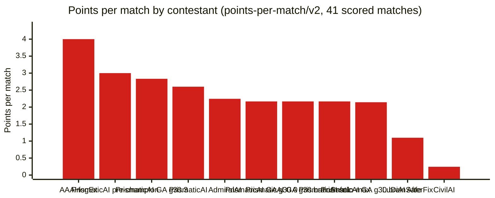
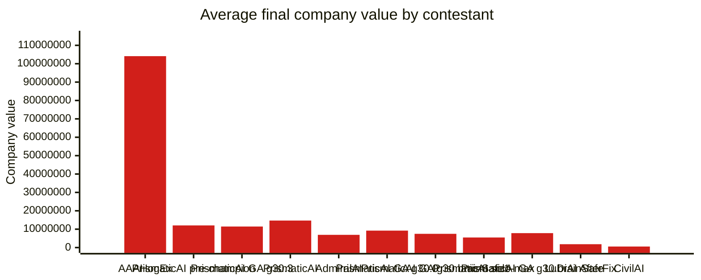
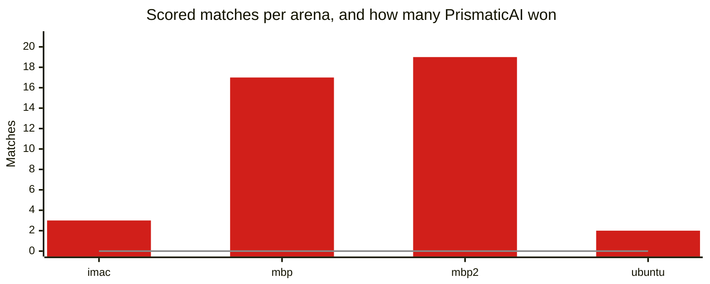

# battle-20261119T144903-150ed917

Derived from `battle-20261119T144903-150ed917.json` by `tools/research/ai-battle/battle.py report`; do not edit.

- Edition `150ed9171a788761`: PrismaticAI and referee at `f695525d1f525c0604169e6016599b0639474419`, base set `opengfx-8.0.tar`
- 20-year free-for-all from 1960, map 256x256 temperate, breakdowns 1
- 41 scored match(es) on `imac` (20261119-master-gdf1e05e7d8), `mbp` (20261119-master-m0587d5c533), `mbp2` (20261119-master-gdf1e05e7d8), `ubuntu` (20261119-master-gdf1e05e7d8)
- Replays: 1 of 1 identical to their original on another arena

| # | Contestant | Played | Wins | Points | Points/match | Avg rank | Avg final value | Squirrel errors | Matches with anomalies |
|---|---|---|---|---|---|---|---|---|---|
| 1 | AAAHogEx | 41 | 41 | 164 | 4.0 | 1.0 | 104.1 M | 0 | 0 |
| 2 | PrismaticAI pre-champion | 5 | 0 | 15 | 3.0 | 2.0 | 12.0 M | 0 | 0 |
| 3 | PrismaticAI GA g30.3 | 6 | 0 | 17 | 2.833 | 2.17 | 11.4 M | 0 | 0 |
| 4 | PrismaticAI | 5 | 0 | 13 | 2.6 | 2.4 | 14.7 M | 0 | 0 |
| 5 | AdmiralAI | 41 | 0 | 92 | 2.244 | 2.76 | 6.9 M | 0 | 0 |
| 6 | PrismaticAI GA g30.0 | 6 | 0 | 13 | 2.167 | 2.83 | 9.2 M | 0 | 4 |
| 7 | PrismaticAI GA g30.brainSafe1 | 6 | 0 | 13 | 2.167 | 2.83 | 7.5 M | 0 | 3 |
| 8 | PrismaticAI solo-max | 6 | 0 | 13 | 2.167 | 2.83 | 5.5 M | 0 | 6 |
| 9 | PrismaticAI GA g30.brainSafe | 7 | 0 | 15 | 2.143 | 2.86 | 7.9 M | 0 | 5 |
| 10 | LuDiAI AfterFix | 41 | 0 | 45 | 1.098 | 3.9 | 1.8 M | 0 | 0 |
| 11 | CivilAI | 41 | 0 | 10 | 0.244 | 4.76 | 566.0 k | 3730 | 3 |

```mermaid
---
config:
  xyChart:
    width: 900
    height: 360
  themeVariables:
    xyChart:
      plotColorPalette: "#d11f1a, #8a8a8a, #0b0b0b, #ece4d6"
---
xychart-beta
    title "Final company value per scored match: winner vs best PrismaticAI"
    x-axis ["m-0001", "m-0002", "m-0003", "m-0004", "m-0005", "m-0006", "m-0007", "m-0008", "m-0009", "m-0010", "m-0011", "m-0012", "m-0013", "m-0014", "m-0015", "m-0016", "m-0017", "m-0018", "m-0019", "m-0020", "m-0021", "m-0022", "m-0027", "m-0029", "m-0030", "m-0031", "m-0032", "m-0033", "m-0034", "m-0035", "m-0036", "m-0037", "m-0038", "m-0039", "m-0041", "m-0046", "m-0052", "m-0053", "m-0054", "m-0061", "m-0063"]
    %% series: Winner | Best PrismaticAI
    %% links: battle-20261119T144903-150ed917.md?col=Match&filter=m-0001 | battle-20261119T144903-150ed917.md?col=Match&filter=m-0002 | battle-20261119T144903-150ed917.md?col=Match&filter=m-0003 | battle-20261119T144903-150ed917.md?col=Match&filter=m-0004 | battle-20261119T144903-150ed917.md?col=Match&filter=m-0005 | battle-20261119T144903-150ed917.md?col=Match&filter=m-0006 | battle-20261119T144903-150ed917.md?col=Match&filter=m-0007 | battle-20261119T144903-150ed917.md?col=Match&filter=m-0008 | battle-20261119T144903-150ed917.md?col=Match&filter=m-0009 | battle-20261119T144903-150ed917.md?col=Match&filter=m-0010 | battle-20261119T144903-150ed917.md?col=Match&filter=m-0011 | battle-20261119T144903-150ed917.md?col=Match&filter=m-0012 | battle-20261119T144903-150ed917.md?col=Match&filter=m-0013 | battle-20261119T144903-150ed917.md?col=Match&filter=m-0014 | battle-20261119T144903-150ed917.md?col=Match&filter=m-0015 | battle-20261119T144903-150ed917.md?col=Match&filter=m-0016 | battle-20261119T144903-150ed917.md?col=Match&filter=m-0017 | battle-20261119T144903-150ed917.md?col=Match&filter=m-0018 | battle-20261119T144903-150ed917.md?col=Match&filter=m-0019 | battle-20261119T144903-150ed917.md?col=Match&filter=m-0020 | battle-20261119T144903-150ed917.md?col=Match&filter=m-0021 | battle-20261119T144903-150ed917.md?col=Match&filter=m-0022 | battle-20261119T144903-150ed917.md?col=Match&filter=m-0027 | battle-20261119T144903-150ed917.md?col=Match&filter=m-0029 | battle-20261119T144903-150ed917.md?col=Match&filter=m-0030 | battle-20261119T144903-150ed917.md?col=Match&filter=m-0031 | battle-20261119T144903-150ed917.md?col=Match&filter=m-0032 | battle-20261119T144903-150ed917.md?col=Match&filter=m-0033 | battle-20261119T144903-150ed917.md?col=Match&filter=m-0034 | battle-20261119T144903-150ed917.md?col=Match&filter=m-0035 | battle-20261119T144903-150ed917.md?col=Match&filter=m-0036 | battle-20261119T144903-150ed917.md?col=Match&filter=m-0037 | battle-20261119T144903-150ed917.md?col=Match&filter=m-0038 | battle-20261119T144903-150ed917.md?col=Match&filter=m-0039 | battle-20261119T144903-150ed917.md?col=Match&filter=m-0041 | battle-20261119T144903-150ed917.md?col=Match&filter=m-0046 | battle-20261119T144903-150ed917.md?col=Match&filter=m-0052 | battle-20261119T144903-150ed917.md?col=Match&filter=m-0053 | battle-20261119T144903-150ed917.md?col=Match&filter=m-0054 | battle-20261119T144903-150ed917.md?col=Match&filter=m-0061 | battle-20261119T144903-150ed917.md?col=Match&filter=m-0063
    y-axis "Company value" 0 --> 171000000
    bar [118040037, 114562473, 115259444, 105360276, 124872513, 127199255, 101571934, 83340625, 96696245, 75577345, 94898776, 90678676, 121054565, 130136959, 123387048, 100194068, 114757176, 104067523, 119898051, 96453837, 155771379, 152200993, 81748780, 146263400, 84519702, 77299900, 87280913, 102327410, 111227473, 122277494, 113965516, 88342628, 79185121, 102869122, 98074050, 126940148, 68105542, 48865108, 74457613, 92299900, 96489901]
    line [3900317, 10507962, 983741, 379441, 1, 3475037, 946477, 5996258, 12974998, 1827677, 1, 356517, 948139, 15438018, 4508198, 15028617, 11774490, 9286631, 10684975, 18339407, 29218106, 7000996, 18284581, 6866339, 9761971, 12734783, 12550642, 11416728, 13778145, 19326802, 4622135, 11966973, 22335466, 10312754, 13809785, 12614713, 5628824, 9825107, 10603291, 11771496, 8520874]
```

<!-- battle-charts:begin -->
<!-- derived from battle-20261119T144903-150ed917.json by `battle.py render`; `battle.py check` fails when it is stale -->

<!-- battle-charts:end -->

| Seed | Original | Replay | Arenas | Identical |
|---|---|---|---|---|
| 1516196607 | m-0001 | m-0040 | mbp / mbp2 | yes |

| Match | Arena | Seed | Winner | Value | Last | Anomalies |
|---|---|---|---|---|---|---|
| m-0001 | mbp | 1516196607 | AAAHogEx | 118.0 M | LuDiAI AfterFix | PrismaticAI solo-max: fleet_drop:36->18 |
| m-0002 | mbp | 1516196607 | AAAHogEx | 114.6 M | CivilAI | - |
| m-0003 | mbp | 1516196607 | AAAHogEx | 115.3 M | CivilAI | - |
| m-0004 | imac | 1516196607 | AAAHogEx | 105.4 M | CivilAI | PrismaticAI GA g30.brainSafe: fleet_drop:71->26 |
| m-0005 | imac | 1516196607 | AAAHogEx | 124.9 M | PrismaticAI GA g30.brainSafe1 | - |
| m-0006 | imac | 1516196607 | AAAHogEx | 127.2 M | CivilAI | - |
| m-0007 | mbp2 | 802140864 | AAAHogEx | 101.6 M | CivilAI | - |
| m-0008 | mbp2 | 802140864 | AAAHogEx | 83.3 M | CivilAI | PrismaticAI solo-max: fleet_drop:48->19 |
| m-0009 | mbp2 | 802140864 | AAAHogEx | 96.7 M | LuDiAI AfterFix | - |
| m-0010 | mbp2 | 802140864 | AAAHogEx | 75.6 M | CivilAI | - |
| m-0011 | mbp2 | 802140864 | AAAHogEx | 94.9 M | PrismaticAI GA g30.brainSafe | - |
| m-0012 | mbp2 | 802140864 | AAAHogEx | 90.7 M | CivilAI | PrismaticAI GA g30.brainSafe1: fleet_drop:51->21; CivilAI: squirrel_errors:3730 |
| m-0013 | mbp2 | 802140864 | AAAHogEx | 121.1 M | AdmiralAI | - |
| m-0014 | mbp2 | 1755963337 | AAAHogEx | 130.1 M | CivilAI | CivilAI: fleet_drop:29->5 |
| m-0015 | mbp2 | 1755963337 | AAAHogEx | 123.4 M | CivilAI | PrismaticAI solo-max: fleet_drop:44->19 |
| m-0016 | mbp2 | 1755963337 | AAAHogEx | 100.2 M | CivilAI | - |
| m-0017 | mbp2 | 1755963337 | AAAHogEx | 114.8 M | CivilAI | PrismaticAI GA g30.0: fleet_drop:203->110 |
| m-0018 | mbp2 | 1755963337 | AAAHogEx | 104.1 M | CivilAI | - |
| m-0019 | mbp2 | 1755963337 | AAAHogEx | 119.9 M | CivilAI | PrismaticAI GA g30.brainSafe1: fleet_drop:160->96 |
| m-0020 | mbp2 | 1755963337 | AAAHogEx | 96.5 M | LuDiAI AfterFix | - |
| m-0021 | mbp2 | 1580471581 | AAAHogEx | 155.8 M | CivilAI | CivilAI: fleet_drop:16->11 |
| m-0022 | mbp2 | 1580471581 | AAAHogEx | 152.2 M | CivilAI | PrismaticAI solo-max: fleet_drop:45->24 |
| m-0027 | ubuntu | 1580471581 | AAAHogEx | 81.7 M | CivilAI | - |
| m-0029 | ubuntu | 1966825873 | AAAHogEx | 146.3 M | CivilAI | PrismaticAI solo-max: fleet_drop:34->21 |
| m-0030 | mbp | 1966825873 | AAAHogEx | 84.5 M | CivilAI | - |
| m-0031 | mbp | 1966825873 | AAAHogEx | 77.3 M | CivilAI | PrismaticAI GA g30.0: fleet_drop:85->56 |
| m-0032 | mbp | 1966825873 | AAAHogEx | 87.3 M | LuDiAI AfterFix | PrismaticAI GA g30.brainSafe: fleet_drop:108->48 |
| m-0033 | mbp | 1966825873 | AAAHogEx | 102.3 M | CivilAI | - |
| m-0034 | mbp | 1966825873 | AAAHogEx | 111.2 M | CivilAI | - |
| m-0035 | mbp | 1193060114 | AAAHogEx | 122.3 M | CivilAI | - |
| m-0036 | mbp | 1193060114 | AAAHogEx | 114.0 M | CivilAI | PrismaticAI solo-max: fleet_drop:46->18 |
| m-0037 | mbp | 1193060114 | AAAHogEx | 88.3 M | CivilAI | - |
| m-0038 | mbp | 1193060114 | AAAHogEx | 79.2 M | CivilAI | PrismaticAI GA g30.0: fleet_drop:196->128 |
| m-0039 | mbp2 | 1193060114 | AAAHogEx | 102.9 M | CivilAI | PrismaticAI GA g30.brainSafe: fleet_drop:129->65 |
| m-0040 (replay) | mbp2 | 1516196607 | AAAHogEx | 118.0 M | LuDiAI AfterFix | PrismaticAI solo-max: fleet_drop:36->18 |
| m-0041 | mbp2 | 1193060114 | AAAHogEx | 98.1 M | LuDiAI AfterFix | - |
| m-0046 | mbp2 | 1725934758 | AAAHogEx | 126.9 M | CivilAI | PrismaticAI GA g30.brainSafe: fleet_drop:104->53 |
| m-0052 | mbp | 383025027 | AAAHogEx | 68.1 M | CivilAI | PrismaticAI GA g30.0: fleet_drop:50->25 |
| m-0053 | mbp | 383025027 | AAAHogEx | 48.9 M | CivilAI | PrismaticAI GA g30.brainSafe: fleet_drop:111->54 |
| m-0054 | mbp | 383025027 | AAAHogEx | 74.5 M | CivilAI | - |
| m-0061 | mbp | 682258779 | AAAHogEx | 92.3 M | CivilAI | PrismaticAI GA g30.brainSafe1: fleet_drop:109->49 |
| m-0063 | mbp | 229011551 | AAAHogEx | 96.5 M | CivilAI | - |
