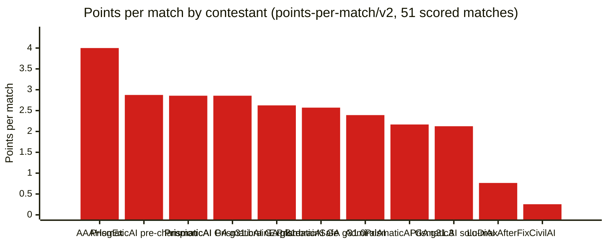
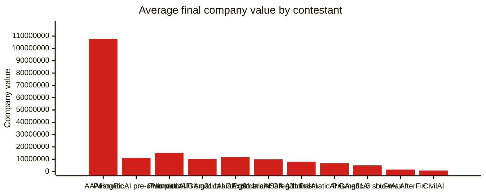
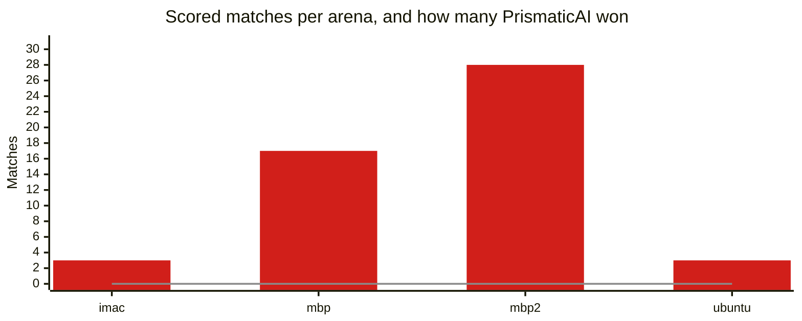

# battle-20261119T150503-d69b881c

Derived from `battle-20261119T150503-d69b881c.json` by `tools/research/ai-battle/battle.py report`; do not edit.

- Edition `d69b881cbfda5434`: PrismaticAI and referee at `f695525d1f525c0604169e6016599b0639474419`, base set `opengfx-8.0.tar`
- 20-year free-for-all from 1960, map 256x256 temperate, breakdowns 1
- 51 scored match(es) on `imac` (20261119-master-gdf1e05e7d8), `mbp` (20261119-master-m0587d5c533), `mbp2` (20261119-master-gdf1e05e7d8), `ubuntu` (20261119-master-gdf1e05e7d8)
- Replays: 1 of 2 identical to their original on another arena

| # | Contestant | Played | Wins | Points | Points/match | Avg rank | Avg final value | Squirrel errors | Matches with anomalies |
|---|---|---|---|---|---|---|---|---|---|
| 1 | AAAHogEx | 51 | 51 | 204 | 4.0 | 1.0 | 107.7 M | 0 | 0 |
| 2 | PrismaticAI pre-champion | 8 | 0 | 23 | 2.875 | 2.12 | 11.1 M | 0 | 0 |
| 3 | PrismaticAI | 7 | 0 | 20 | 2.857 | 2.14 | 15.2 M | 0 | 0 |
| 4 | PrismaticAI GA g31.brainExplore | 7 | 0 | 20 | 2.857 | 2.14 | 10.3 M | 0 | 4 |
| 5 | PrismaticAI GA g31.brainSafe | 8 | 0 | 21 | 2.625 | 2.38 | 11.8 M | 0 | 5 |
| 6 | PrismaticAI GA g31.0 | 7 | 0 | 18 | 2.571 | 2.43 | 9.9 M | 0 | 0 |
| 7 | AdmiralAI | 51 | 0 | 122 | 2.392 | 2.61 | 7.9 M | 106 | 3 |
| 8 | PrismaticAI GA g31.3 | 6 | 0 | 13 | 2.167 | 2.83 | 6.8 M | 0 | 4 |
| 9 | PrismaticAI solo-max | 8 | 0 | 17 | 2.125 | 2.88 | 5.0 M | 0 | 8 |
| 10 | LuDiAI AfterFix | 51 | 0 | 39 | 0.765 | 4.24 | 1.6 M | 0 | 0 |
| 11 | CivilAI | 51 | 0 | 13 | 0.255 | 4.75 | 817.9 k | 33 | 11 |

```mermaid
---
config:
  xyChart:
    width: 900
    height: 360
  themeVariables:
    xyChart:
      plotColorPalette: "#d11f1a, #8a8a8a, #0b0b0b, #ece4d6"
---
xychart-beta
    title "Final company value per scored match: winner vs best PrismaticAI"
    x-axis ["m-0001", "m-0002", "m-0003", "m-0004", "m-0005", "m-0006", "m-0007", "m-0008", "m-0009", "m-0010", "m-0011", "m-0012", "m-0013", "m-0014", "m-0015", "m-0016", "m-0017", "m-0018", "m-0019", "m-0020", "m-0021", "m-0022", "m-0024", "m-0025", "m-0029", "m-0030", "m-0031", "m-0032", "m-0033", "m-0034", "m-0035", "m-0036", "m-0037", "m-0038", "m-0039", "m-0041", "m-0042", "m-0043", "m-0044", "m-0045", "m-0046", "m-0047", "m-0049", "m-0050", "m-0051", "m-0054", "m-0058", "m-0060", "m-0061", "m-0062", "m-0063"]
    %% series: Winner | Best PrismaticAI
    %% links: battle-20261119T150503-d69b881c.md?col=Match&filter=m-0001 | battle-20261119T150503-d69b881c.md?col=Match&filter=m-0002 | battle-20261119T150503-d69b881c.md?col=Match&filter=m-0003 | battle-20261119T150503-d69b881c.md?col=Match&filter=m-0004 | battle-20261119T150503-d69b881c.md?col=Match&filter=m-0005 | battle-20261119T150503-d69b881c.md?col=Match&filter=m-0006 | battle-20261119T150503-d69b881c.md?col=Match&filter=m-0007 | battle-20261119T150503-d69b881c.md?col=Match&filter=m-0008 | battle-20261119T150503-d69b881c.md?col=Match&filter=m-0009 | battle-20261119T150503-d69b881c.md?col=Match&filter=m-0010 | battle-20261119T150503-d69b881c.md?col=Match&filter=m-0011 | battle-20261119T150503-d69b881c.md?col=Match&filter=m-0012 | battle-20261119T150503-d69b881c.md?col=Match&filter=m-0013 | battle-20261119T150503-d69b881c.md?col=Match&filter=m-0014 | battle-20261119T150503-d69b881c.md?col=Match&filter=m-0015 | battle-20261119T150503-d69b881c.md?col=Match&filter=m-0016 | battle-20261119T150503-d69b881c.md?col=Match&filter=m-0017 | battle-20261119T150503-d69b881c.md?col=Match&filter=m-0018 | battle-20261119T150503-d69b881c.md?col=Match&filter=m-0019 | battle-20261119T150503-d69b881c.md?col=Match&filter=m-0020 | battle-20261119T150503-d69b881c.md?col=Match&filter=m-0021 | battle-20261119T150503-d69b881c.md?col=Match&filter=m-0022 | battle-20261119T150503-d69b881c.md?col=Match&filter=m-0024 | battle-20261119T150503-d69b881c.md?col=Match&filter=m-0025 | battle-20261119T150503-d69b881c.md?col=Match&filter=m-0029 | battle-20261119T150503-d69b881c.md?col=Match&filter=m-0030 | battle-20261119T150503-d69b881c.md?col=Match&filter=m-0031 | battle-20261119T150503-d69b881c.md?col=Match&filter=m-0032 | battle-20261119T150503-d69b881c.md?col=Match&filter=m-0033 | battle-20261119T150503-d69b881c.md?col=Match&filter=m-0034 | battle-20261119T150503-d69b881c.md?col=Match&filter=m-0035 | battle-20261119T150503-d69b881c.md?col=Match&filter=m-0036 | battle-20261119T150503-d69b881c.md?col=Match&filter=m-0037 | battle-20261119T150503-d69b881c.md?col=Match&filter=m-0038 | battle-20261119T150503-d69b881c.md?col=Match&filter=m-0039 | battle-20261119T150503-d69b881c.md?col=Match&filter=m-0041 | battle-20261119T150503-d69b881c.md?col=Match&filter=m-0042 | battle-20261119T150503-d69b881c.md?col=Match&filter=m-0043 | battle-20261119T150503-d69b881c.md?col=Match&filter=m-0044 | battle-20261119T150503-d69b881c.md?col=Match&filter=m-0045 | battle-20261119T150503-d69b881c.md?col=Match&filter=m-0046 | battle-20261119T150503-d69b881c.md?col=Match&filter=m-0047 | battle-20261119T150503-d69b881c.md?col=Match&filter=m-0049 | battle-20261119T150503-d69b881c.md?col=Match&filter=m-0050 | battle-20261119T150503-d69b881c.md?col=Match&filter=m-0051 | battle-20261119T150503-d69b881c.md?col=Match&filter=m-0054 | battle-20261119T150503-d69b881c.md?col=Match&filter=m-0058 | battle-20261119T150503-d69b881c.md?col=Match&filter=m-0060 | battle-20261119T150503-d69b881c.md?col=Match&filter=m-0061 | battle-20261119T150503-d69b881c.md?col=Match&filter=m-0062 | battle-20261119T150503-d69b881c.md?col=Match&filter=m-0063
    y-axis "Company value" 0 --> 175000000
    bar [100870886, 121388853, 109058264, 95917828, 126040445, 101732893, 117063914, 159153202, 118369871, 115429369, 113827665, 122717106, 108537652, 109731992, 140735575, 109460921, 126932572, 94642285, 112027199, 104448623, 107351338, 128393114, 99558264, 86729324, 105790422, 91279595, 90495466, 103021491, 101637988, 111868002, 79901081, 96686500, 67034470, 104391662, 75112959, 87230659, 116973156, 116577046, 109350414, 105860727, 102976662, 90997505, 127772630, 137002922, 103744356, 88735980, 62873289, 124791007, 86673358, 143315214, 132048184]
    line [3150871, 10636298, 14552983, 11359003, 8232851, 6840023, 18578709, 3604749, 4493891, 11620950, 13364465, 13851667, 7942619, 8800042, 3797277, 14872186, 4393308, 9203796, 5704325, 8709024, 23708916, 5807015, 11367536, 10170065, 4661356, 8762739, 7416884, 6542670, 10887973, 2993033, 10260562, 7183594, 10124507, 5662072, 10421185, 12600241, 17321873, 5789704, 10880800, 14474286, 19139573, 11532163, 12917394, 6239318, 11968629, 13067495, 16751681, 13946748, 8583455, 1489009, 14496066]
```

<!-- battle-charts:begin -->
<!-- derived from battle-20261119T150503-d69b881c.json by `battle.py render`; `battle.py check` fails when it is stale -->

<!-- battle-charts:end -->

| Seed | Original | Replay | Arenas | Identical |
|---|---|---|---|---|
| 456143305 | m-0001 | m-0040 | mbp / mbp2 | yes |
| 456143305 | m-0004 | m-0056 | imac / mbp | NO |

| Match | Arena | Seed | Winner | Value | Last | Anomalies |
|---|---|---|---|---|---|---|
| m-0001 | mbp | 456143305 | AAAHogEx | 100.9 M | CivilAI | PrismaticAI solo-max: fleet_drop:34->18 |
| m-0002 | mbp | 456143305 | AAAHogEx | 121.4 M | CivilAI | CivilAI: fleet_drop:54->26 |
| m-0003 | mbp | 456143305 | AAAHogEx | 109.1 M | CivilAI | CivilAI: fleet_drop:63->30 |
| m-0004 | imac | 456143305 | AAAHogEx | 95.9 M | CivilAI | PrismaticAI GA g31.brainSafe: fleet_drop:122->44 |
| m-0005 | imac | 456143305 | AAAHogEx | 126.0 M | CivilAI | PrismaticAI GA g31.brainExplore: fleet_drop:185->62 |
| m-0006 | imac | 456143305 | AAAHogEx | 101.7 M | LuDiAI AfterFix | PrismaticAI GA g31.3: fleet_drop:151->50 |
| m-0007 | mbp2 | 992746843 | AAAHogEx | 117.1 M | CivilAI | CivilAI: fleet_drop:15->8 |
| m-0008 | mbp2 | 992746843 | AAAHogEx | 159.2 M | CivilAI | PrismaticAI solo-max: fleet_drop:35->18 |
| m-0009 | mbp2 | 992746843 | AAAHogEx | 118.4 M | CivilAI | - |
| m-0010 | mbp2 | 992746843 | AAAHogEx | 115.4 M | LuDiAI AfterFix | - |
| m-0011 | mbp2 | 992746843 | AAAHogEx | 113.8 M | CivilAI | PrismaticAI GA g31.brainSafe: fleet_drop:64->38 |
| m-0012 | mbp2 | 992746843 | AAAHogEx | 122.7 M | CivilAI | PrismaticAI GA g31.brainExplore: fleet_drop:148->46; AdmiralAI: squirrel_errors:44 |
| m-0013 | mbp2 | 992746843 | AAAHogEx | 108.5 M | CivilAI | PrismaticAI GA g31.3: fleet_drop:80->39 |
| m-0014 | mbp2 | 1350973541 | AAAHogEx | 109.7 M | CivilAI | CivilAI: no_vehicles |
| m-0015 | mbp2 | 1350973541 | AAAHogEx | 140.7 M | CivilAI | PrismaticAI solo-max: fleet_drop:43->18 |
| m-0016 | mbp2 | 1350973541 | AAAHogEx | 109.5 M | CivilAI | - |
| m-0017 | mbp2 | 1350973541 | AAAHogEx | 126.9 M | CivilAI | - |
| m-0018 | mbp2 | 1350973541 | AAAHogEx | 94.6 M | CivilAI | - |
| m-0019 | mbp2 | 1350973541 | AAAHogEx | 112.0 M | LuDiAI AfterFix | CivilAI: fleet_drop:65->34 |
| m-0020 | mbp2 | 1350973541 | AAAHogEx | 104.4 M | CivilAI | CivilAI: no_vehicles |
| m-0021 | mbp2 | 1230702394 | AAAHogEx | 107.4 M | CivilAI | - |
| m-0022 | mbp2 | 1230702394 | AAAHogEx | 128.4 M | CivilAI | PrismaticAI solo-max: fleet_drop:53->22 |
| m-0024 | ubuntu | 1230702394 | AAAHogEx | 99.6 M | LuDiAI AfterFix | - |
| m-0025 | ubuntu | 1230702394 | AAAHogEx | 86.7 M | LuDiAI AfterFix | - |
| m-0029 | ubuntu | 92713744 | AAAHogEx | 105.8 M | LuDiAI AfterFix | PrismaticAI solo-max: fleet_drop:37->20 |
| m-0030 | mbp | 92713744 | AAAHogEx | 91.3 M | LuDiAI AfterFix | CivilAI: squirrel_errors:33 |
| m-0031 | mbp | 92713744 | AAAHogEx | 90.5 M | CivilAI | - |
| m-0032 | mbp | 92713744 | AAAHogEx | 103.0 M | CivilAI | PrismaticAI GA g31.brainSafe: fleet_drop:84->31 |
| m-0033 | mbp | 92713744 | AAAHogEx | 101.6 M | LuDiAI AfterFix | PrismaticAI GA g31.brainExplore: fleet_drop:152->53 |
| m-0034 | mbp | 92713744 | AAAHogEx | 111.9 M | CivilAI | PrismaticAI GA g31.3: fleet_drop:89->49 |
| m-0035 | mbp | 1420180954 | AAAHogEx | 79.9 M | CivilAI | - |
| m-0036 | mbp | 1420180954 | AAAHogEx | 96.7 M | CivilAI | PrismaticAI solo-max: fleet_drop:41->19 |
| m-0037 | mbp | 1420180954 | AAAHogEx | 67.0 M | CivilAI | CivilAI: fleet_drop:85->50 |
| m-0038 | mbp | 1420180954 | AAAHogEx | 104.4 M | CivilAI | - |
| m-0039 | mbp2 | 1420180954 | AAAHogEx | 75.1 M | CivilAI | PrismaticAI GA g31.brainSafe: fleet_drop:97->48 |
| m-0040 (replay) | mbp2 | 456143305 | AAAHogEx | 100.9 M | CivilAI | PrismaticAI solo-max: fleet_drop:34->18 |
| m-0041 | mbp2 | 1420180954 | AAAHogEx | 87.2 M | CivilAI | PrismaticAI GA g31.3: fleet_drop:175->105 |
| m-0042 | mbp2 | 1189445430 | AAAHogEx | 117.0 M | LuDiAI AfterFix | - |
| m-0043 | mbp2 | 1189445430 | AAAHogEx | 116.6 M | CivilAI | PrismaticAI solo-max: fleet_drop:34->17 |
| m-0044 | mbp2 | 1189445430 | AAAHogEx | 109.4 M | LuDiAI AfterFix | - |
| m-0045 | mbp2 | 1189445430 | AAAHogEx | 105.9 M | CivilAI | - |
| m-0046 | mbp2 | 1189445430 | AAAHogEx | 103.0 M | LuDiAI AfterFix | PrismaticAI GA g31.brainSafe: fleet_drop:113->75; AdmiralAI: squirrel_errors:62; CivilAI: fleet_drop:51->29 |
| m-0047 | mbp2 | 1189445430 | AAAHogEx | 91.0 M | CivilAI | - |
| m-0049 | mbp2 | 1439755003 | AAAHogEx | 127.8 M | CivilAI | CivilAI: fleet_drop:67->39 |
| m-0050 | mbp2 | 1439755003 | AAAHogEx | 137.0 M | CivilAI | PrismaticAI solo-max: fleet_drop:50->17 |
| m-0051 | mbp2 | 1439755003 | AAAHogEx | 103.7 M | CivilAI | - |
| m-0054 | mbp2 | 1439755003 | AAAHogEx | 88.7 M | CivilAI | PrismaticAI GA g31.brainExplore: fleet_drop:186->74; CivilAI: fleet_drop:76->51 |
| m-0056 (replay) | mbp | 456143305 | AAAHogEx | 99.7 M | CivilAI | PrismaticAI GA g31.brainSafe: fleet_drop:112->59 |
| m-0058 | mbp | 1316819927 | AAAHogEx | 62.9 M | LuDiAI AfterFix | - |
| m-0060 | mbp | 1316819927 | AAAHogEx | 124.8 M | CivilAI | - |
| m-0061 | mbp | 1316819927 | AAAHogEx | 86.7 M | LuDiAI AfterFix | - |
| m-0062 | mbp | 1316819927 | AAAHogEx | 143.3 M | CivilAI | - |
| m-0063 | mbp | 881827516 | AAAHogEx | 132.0 M | CivilAI | AdmiralAI: fleet_drop:188->130 |
