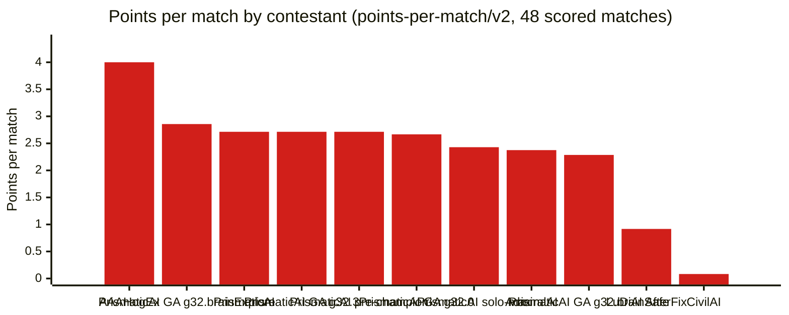
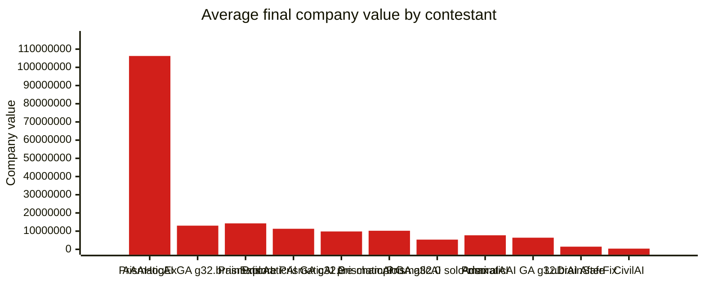
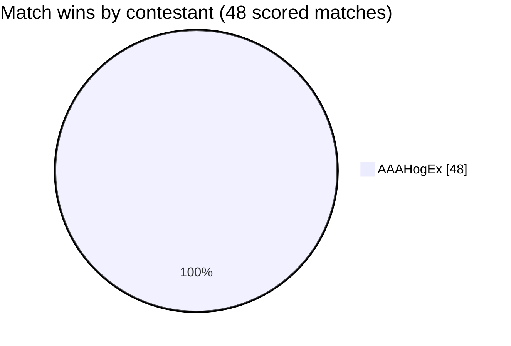
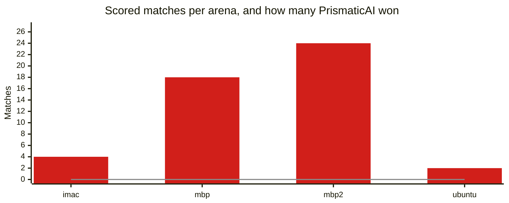

# battle-20261119T152039-c31bfd37

Derived from `battle-20261119T152039-c31bfd37.json` by `tools/research/ai-battle/battle.py report`; do not edit.

- Edition `c31bfd379a8818ac`: PrismaticAI and referee at `f695525d1f525c0604169e6016599b0639474419`, base set `opengfx-8.0.tar`
- 20-year free-for-all from 1960, map 256x256 temperate, breakdowns 1
- 48 scored match(es) on `imac` (20261119-master-gdf1e05e7d8), `mbp` (20261119-master-m0587d5c533), `mbp2` (20261119-master-gdf1e05e7d8), `ubuntu` (20261119-master-gdf1e05e7d8)
- Replays: 0 of 0 identical to their original on another arena

| # | Contestant | Played | Wins | Points | Points/match | Avg rank | Avg final value | Squirrel errors | Matches with anomalies |
|---|---|---|---|---|---|---|---|---|---|
| 1 | AAAHogEx | 48 | 48 | 192 | 4.0 | 1.0 | 106.2 M | 0 | 0 |
| 2 | PrismaticAI GA g32.brainExplore | 7 | 0 | 20 | 2.857 | 2.14 | 13.0 M | 0 | 5 |
| 3 | PrismaticAI | 7 | 0 | 19 | 2.714 | 2.29 | 14.3 M | 0 | 0 |
| 4 | PrismaticAI GA g32.3 | 7 | 0 | 19 | 2.714 | 2.29 | 11.3 M | 0 | 3 |
| 5 | PrismaticAI pre-champion | 7 | 0 | 19 | 2.714 | 2.29 | 9.8 M | 0 | 1 |
| 6 | PrismaticAI GA g32.0 | 6 | 0 | 16 | 2.667 | 2.33 | 10.2 M | 0 | 1 |
| 7 | PrismaticAI solo-max | 7 | 0 | 17 | 2.429 | 2.57 | 5.3 M | 0 | 7 |
| 8 | AdmiralAI | 48 | 0 | 114 | 2.375 | 2.62 | 7.7 M | 44 | 4 |
| 9 | PrismaticAI GA g32.brainSafe | 7 | 0 | 16 | 2.286 | 2.71 | 6.4 M | 0 | 2 |
| 10 | LuDiAI AfterFix | 48 | 0 | 44 | 0.917 | 4.08 | 1.5 M | 0 | 2 |
| 11 | CivilAI | 48 | 0 | 4 | 0.083 | 4.92 | 392.2 k | 0 | 13 |

```mermaid
---
config:
  xyChart:
    width: 900
    height: 360
  themeVariables:
    xyChart:
      plotColorPalette: "#d11f1a, #8a8a8a, #0b0b0b, #ece4d6"
---
xychart-beta
    title "Final company value per scored match: winner vs best PrismaticAI"
    x-axis ["m-0001", "m-0002", "m-0003", "m-0004", "m-0005", "m-0006", "m-0007", "m-0008", "m-0009", "m-0010", "m-0011", "m-0012", "m-0013", "m-0014", "m-0015", "m-0016", "m-0017", "m-0018", "m-0019", "m-0020", "m-0021", "m-0022", "m-0026", "m-0027", "m-0030", "m-0031", "m-0032", "m-0033", "m-0034", "m-0035", "m-0036", "m-0037", "m-0038", "m-0039", "m-0041", "m-0042", "m-0043", "m-0044", "m-0045", "m-0046", "m-0049", "m-0050", "m-0051", "m-0054", "m-0055", "m-0060", "m-0061", "m-0063"]
    %% series: Winner | Best PrismaticAI
    %% links: battle-20261119T152039-c31bfd37.md?col=Match&filter=m-0001 | battle-20261119T152039-c31bfd37.md?col=Match&filter=m-0002 | battle-20261119T152039-c31bfd37.md?col=Match&filter=m-0003 | battle-20261119T152039-c31bfd37.md?col=Match&filter=m-0004 | battle-20261119T152039-c31bfd37.md?col=Match&filter=m-0005 | battle-20261119T152039-c31bfd37.md?col=Match&filter=m-0006 | battle-20261119T152039-c31bfd37.md?col=Match&filter=m-0007 | battle-20261119T152039-c31bfd37.md?col=Match&filter=m-0008 | battle-20261119T152039-c31bfd37.md?col=Match&filter=m-0009 | battle-20261119T152039-c31bfd37.md?col=Match&filter=m-0010 | battle-20261119T152039-c31bfd37.md?col=Match&filter=m-0011 | battle-20261119T152039-c31bfd37.md?col=Match&filter=m-0012 | battle-20261119T152039-c31bfd37.md?col=Match&filter=m-0013 | battle-20261119T152039-c31bfd37.md?col=Match&filter=m-0014 | battle-20261119T152039-c31bfd37.md?col=Match&filter=m-0015 | battle-20261119T152039-c31bfd37.md?col=Match&filter=m-0016 | battle-20261119T152039-c31bfd37.md?col=Match&filter=m-0017 | battle-20261119T152039-c31bfd37.md?col=Match&filter=m-0018 | battle-20261119T152039-c31bfd37.md?col=Match&filter=m-0019 | battle-20261119T152039-c31bfd37.md?col=Match&filter=m-0020 | battle-20261119T152039-c31bfd37.md?col=Match&filter=m-0021 | battle-20261119T152039-c31bfd37.md?col=Match&filter=m-0022 | battle-20261119T152039-c31bfd37.md?col=Match&filter=m-0026 | battle-20261119T152039-c31bfd37.md?col=Match&filter=m-0027 | battle-20261119T152039-c31bfd37.md?col=Match&filter=m-0030 | battle-20261119T152039-c31bfd37.md?col=Match&filter=m-0031 | battle-20261119T152039-c31bfd37.md?col=Match&filter=m-0032 | battle-20261119T152039-c31bfd37.md?col=Match&filter=m-0033 | battle-20261119T152039-c31bfd37.md?col=Match&filter=m-0034 | battle-20261119T152039-c31bfd37.md?col=Match&filter=m-0035 | battle-20261119T152039-c31bfd37.md?col=Match&filter=m-0036 | battle-20261119T152039-c31bfd37.md?col=Match&filter=m-0037 | battle-20261119T152039-c31bfd37.md?col=Match&filter=m-0038 | battle-20261119T152039-c31bfd37.md?col=Match&filter=m-0039 | battle-20261119T152039-c31bfd37.md?col=Match&filter=m-0041 | battle-20261119T152039-c31bfd37.md?col=Match&filter=m-0042 | battle-20261119T152039-c31bfd37.md?col=Match&filter=m-0043 | battle-20261119T152039-c31bfd37.md?col=Match&filter=m-0044 | battle-20261119T152039-c31bfd37.md?col=Match&filter=m-0045 | battle-20261119T152039-c31bfd37.md?col=Match&filter=m-0046 | battle-20261119T152039-c31bfd37.md?col=Match&filter=m-0049 | battle-20261119T152039-c31bfd37.md?col=Match&filter=m-0050 | battle-20261119T152039-c31bfd37.md?col=Match&filter=m-0051 | battle-20261119T152039-c31bfd37.md?col=Match&filter=m-0054 | battle-20261119T152039-c31bfd37.md?col=Match&filter=m-0055 | battle-20261119T152039-c31bfd37.md?col=Match&filter=m-0060 | battle-20261119T152039-c31bfd37.md?col=Match&filter=m-0061 | battle-20261119T152039-c31bfd37.md?col=Match&filter=m-0063
    y-axis "Company value" 0 --> 165000000
    bar [109546210, 93167831, 113103577, 75444945, 74049125, 102005754, 114499950, 106725008, 121838379, 99434945, 119591792, 96893040, 117907725, 141371944, 146761553, 145604538, 122593997, 142444811, 147565056, 149718713, 92781952, 123623673, 99757138, 110479499, 93414038, 126630215, 140576106, 100765304, 106603731, 77903839, 95524798, 95605934, 70379286, 91408862, 70076336, 113742523, 89144723, 93010397, 101055105, 84235408, 75303016, 130891861, 83622099, 70038121, 101943992, 93056187, 81183810, 146456984]
    line [6602957, 12317038, 14106886, 15513942, 10248974, 16146181, 13442437, 6371532, 4413360, 13564832, 2017896, 5363665, 3179419, 19033705, 3862399, 10773916, 11979731, 11080521, 10910123, 10535907, 14906606, 3913217, 13430988, 8893116, 14261351, 7849821, 3804698, 17766636, 22276926, 6142062, 4864378, 6709360, 12505134, 5299761, 11298101, 4252903, 8096836, 10907448, 1264119, 3369455, 20007488, 3654854, 9359575, 15346943, 6749097, 3683052, 18013486, 22075720]
```

<!-- battle-charts:begin -->
<!-- derived from battle-20261119T152039-c31bfd37.json by `battle.py render`; `battle.py check` fails when it is stale -->

<!-- battle-charts:end -->

| Match | Arena | Seed | Winner | Value | Last | Anomalies |
|---|---|---|---|---|---|---|
| m-0001 | mbp | 175908566 | AAAHogEx | 109.5 M | CivilAI | PrismaticAI solo-max: fleet_drop:37->19 |
| m-0002 | mbp | 175908566 | AAAHogEx | 93.2 M | CivilAI | - |
| m-0003 | mbp | 175908566 | AAAHogEx | 113.1 M | CivilAI | CivilAI: fleet_drop:56->11 |
| m-0004 | imac | 175908566 | AAAHogEx | 75.4 M | CivilAI | - |
| m-0005 | imac | 175908566 | AAAHogEx | 74.0 M | CivilAI | - |
| m-0006 | imac | 175908566 | AAAHogEx | 102.0 M | CivilAI | - |
| m-0007 | mbp2 | 1172755897 | AAAHogEx | 114.5 M | CivilAI | - |
| m-0008 | mbp2 | 1172755897 | AAAHogEx | 106.7 M | CivilAI | PrismaticAI solo-max: fleet_drop:44->23 |
| m-0009 | mbp2 | 1172755897 | AAAHogEx | 121.8 M | LuDiAI AfterFix | PrismaticAI pre-champion: fleet_drop:75->44; CivilAI: fleet_drop:16->11 |
| m-0010 | mbp2 | 1172755897 | AAAHogEx | 99.4 M | CivilAI | - |
| m-0011 | mbp2 | 1172755897 | AAAHogEx | 119.6 M | CivilAI | - |
| m-0012 | mbp2 | 1172755897 | AAAHogEx | 96.9 M | CivilAI | PrismaticAI GA g32.brainExplore: fleet_drop:124->77 |
| m-0013 | mbp2 | 1172755897 | AAAHogEx | 117.9 M | LuDiAI AfterFix | - |
| m-0014 | mbp2 | 1635886157 | AAAHogEx | 141.4 M | CivilAI | CivilAI: fleet_drop:89->50 |
| m-0015 | mbp2 | 1635886157 | AAAHogEx | 146.8 M | CivilAI | PrismaticAI solo-max: fleet_drop:49->21 |
| m-0016 | mbp2 | 1635886157 | AAAHogEx | 145.6 M | CivilAI | AdmiralAI: fleet_drop:346->158 |
| m-0017 | mbp2 | 1635886157 | AAAHogEx | 122.6 M | CivilAI | PrismaticAI GA g32.0: fleet_drop:115->77 |
| m-0018 | mbp2 | 1635886157 | AAAHogEx | 142.4 M | CivilAI | - |
| m-0019 | mbp2 | 1635886157 | AAAHogEx | 147.6 M | CivilAI | PrismaticAI GA g32.brainExplore: fleet_drop:167->99 |
| m-0020 | mbp2 | 1635886157 | AAAHogEx | 149.7 M | CivilAI | - |
| m-0021 | mbp2 | 1447815377 | AAAHogEx | 92.8 M | CivilAI | AdmiralAI: fleet_drop:153->77 |
| m-0022 | mbp2 | 1447815377 | AAAHogEx | 123.6 M | CivilAI | PrismaticAI solo-max: fleet_drop:40->18 |
| m-0026 | ubuntu | 1447815377 | AAAHogEx | 99.8 M | CivilAI | AdmiralAI: squirrel_errors:44, fleet_drop:164->103 |
| m-0027 | ubuntu | 1447815377 | AAAHogEx | 110.5 M | CivilAI | PrismaticAI GA g32.3: fleet_drop:133->58; AdmiralAI: fleet_drop:125->63 |
| m-0030 | mbp | 271896462 | AAAHogEx | 93.4 M | CivilAI | - |
| m-0031 | mbp | 271896462 | AAAHogEx | 126.6 M | CivilAI | - |
| m-0032 | mbp | 271896462 | AAAHogEx | 140.6 M | CivilAI | PrismaticAI GA g32.brainSafe: fleet_drop:115->75; CivilAI: fleet_drop:49->30 |
| m-0033 | mbp | 271896462 | AAAHogEx | 100.8 M | LuDiAI AfterFix | PrismaticAI GA g32.brainExplore: fleet_drop:199->58; CivilAI: fleet_drop:69->44; LuDiAI AfterFix: fleet_drop:96->66 |
| m-0034 | mbp | 271896462 | AAAHogEx | 106.6 M | CivilAI | PrismaticAI GA g32.3: fleet_drop:138->65 |
| m-0035 | mbp | 255206648 | AAAHogEx | 77.9 M | CivilAI | CivilAI: fleet_drop:37->12 |
| m-0036 | mbp2 | 255206648 | AAAHogEx | 95.5 M | LuDiAI AfterFix | PrismaticAI solo-max: fleet_drop:40->13 |
| m-0037 | mbp | 255206648 | AAAHogEx | 95.6 M | CivilAI | CivilAI: fleet_drop:34->13 |
| m-0038 | mbp2 | 255206648 | AAAHogEx | 70.4 M | CivilAI | LuDiAI AfterFix: fleet_drop:83->46 |
| m-0039 | mbp2 | 255206648 | AAAHogEx | 91.4 M | CivilAI | - |
| m-0041 | mbp2 | 255206648 | AAAHogEx | 70.1 M | CivilAI | PrismaticAI GA g32.3: fleet_drop:92->47; CivilAI: fleet_drop:44->13 |
| m-0042 | mbp | 215874466 | AAAHogEx | 113.7 M | CivilAI | CivilAI: no_vehicles |
| m-0043 | mbp | 215874466 | AAAHogEx | 89.1 M | CivilAI | PrismaticAI solo-max: fleet_drop:39->18 |
| m-0044 | mbp2 | 215874466 | AAAHogEx | 93.0 M | CivilAI | - |
| m-0045 | mbp2 | 215874466 | AAAHogEx | 101.1 M | CivilAI | CivilAI: no_vehicles |
| m-0046 | mbp2 | 215874466 | AAAHogEx | 84.2 M | CivilAI | - |
| m-0049 | imac | 59062752 | AAAHogEx | 75.3 M | CivilAI | - |
| m-0050 | mbp2 | 59062752 | AAAHogEx | 130.9 M | CivilAI | PrismaticAI solo-max: fleet_drop:39->16; CivilAI: no_vehicles |
| m-0051 | mbp | 59062752 | AAAHogEx | 83.6 M | CivilAI | - |
| m-0054 | mbp | 59062752 | AAAHogEx | 70.0 M | CivilAI | PrismaticAI GA g32.brainExplore: fleet_drop:233->69 |
| m-0055 | mbp | 59062752 | AAAHogEx | 101.9 M | CivilAI | CivilAI: fleet_drop:17->7 |
| m-0060 | mbp | 1431800086 | AAAHogEx | 93.1 M | CivilAI | PrismaticAI GA g32.brainSafe: fleet_drop:166->62 |
| m-0061 | mbp | 1431800086 | AAAHogEx | 81.2 M | CivilAI | PrismaticAI GA g32.brainExplore: fleet_drop:238->82 |
| m-0063 | mbp | 132160706 | AAAHogEx | 146.5 M | CivilAI | CivilAI: fleet_drop:35->22 |
