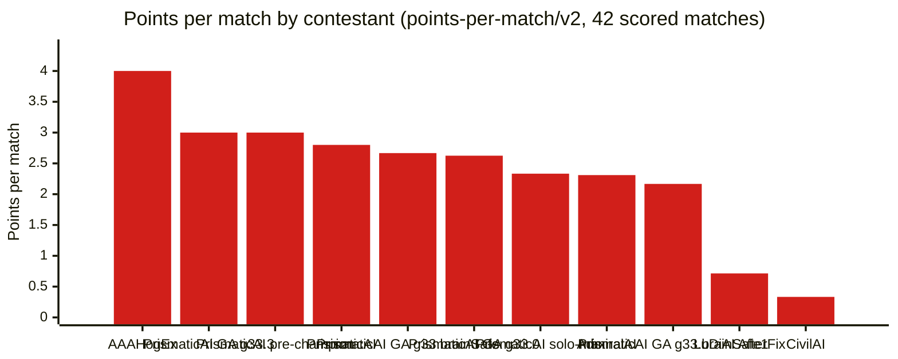
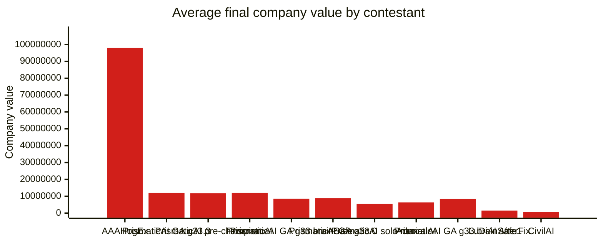
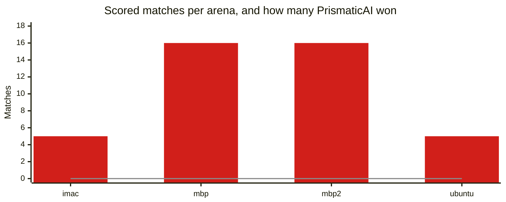

# battle-20261119T153708-f87ff647

Derived from `battle-20261119T153708-f87ff647.json` by `tools/research/ai-battle/battle.py report`; do not edit.

- Edition `f87ff647ad6c7451`: PrismaticAI and referee at `f695525d1f525c0604169e6016599b0639474419`, base set `opengfx-8.0.tar`
- 20-year free-for-all from 1960, map 256x256 temperate, breakdowns 1
- 42 scored match(es) on `imac` (20261119-master-gdf1e05e7d8), `mbp` (20261119-master-m0587d5c533), `mbp2` (20261119-master-gdf1e05e7d8), `ubuntu` (20261119-master-gdf1e05e7d8)
- Replays: 0 of 2 identical to their original on another arena

| # | Contestant | Played | Wins | Points | Points/match | Avg rank | Avg final value | Squirrel errors | Matches with anomalies |
|---|---|---|---|---|---|---|---|---|---|
| 1 | AAAHogEx | 42 | 42 | 168 | 4.0 | 1.0 | 98.0 M | 0 | 0 |
| 2 | PrismaticAI GA g33.3 | 6 | 0 | 18 | 3.0 | 2.0 | 12.0 M | 0 | 4 |
| 3 | PrismaticAI pre-champion | 5 | 0 | 15 | 3.0 | 2.0 | 11.8 M | 0 | 0 |
| 4 | PrismaticAI | 5 | 0 | 14 | 2.8 | 2.2 | 12.0 M | 0 | 0 |
| 5 | PrismaticAI GA g33.brainSafe | 6 | 0 | 16 | 2.667 | 2.33 | 8.5 M | 0 | 0 |
| 6 | PrismaticAI GA g33.0 | 8 | 0 | 21 | 2.625 | 2.38 | 8.9 M | 0 | 5 |
| 7 | PrismaticAI solo-max | 6 | 0 | 14 | 2.333 | 2.67 | 5.5 M | 0 | 6 |
| 8 | AdmiralAI | 42 | 0 | 97 | 2.31 | 2.69 | 6.3 M | 0 | 0 |
| 9 | PrismaticAI GA g33.brainSafe1 | 6 | 0 | 13 | 2.167 | 2.83 | 8.5 M | 0 | 0 |
| 10 | LuDiAI AfterFix | 42 | 0 | 30 | 0.714 | 4.29 | 1.5 M | 0 | 1 |
| 11 | CivilAI | 42 | 0 | 14 | 0.333 | 4.67 | 684.8 k | 0 | 5 |

```mermaid
---
config:
  xyChart:
    width: 900
    height: 360
  themeVariables:
    xyChart:
      plotColorPalette: "#d11f1a, #8a8a8a, #0b0b0b, #ece4d6"
---
xychart-beta
    title "Final company value per scored match: winner vs best PrismaticAI"
    x-axis ["m-0001", "m-0002", "m-0003", "m-0004", "m-0005", "m-0006", "m-0007", "m-0008", "m-0009", "m-0010", "m-0011", "m-0012", "m-0013", "m-0014", "m-0015", "m-0016", "m-0017", "m-0018", "m-0019", "m-0020", "m-0021", "m-0022", "m-0024", "m-0026", "m-0027", "m-0028", "m-0029", "m-0030", "m-0031", "m-0032", "m-0033", "m-0034", "m-0035", "m-0036", "m-0037", "m-0038", "m-0039", "m-0041", "m-0047", "m-0052", "m-0059", "m-0060"]
    %% series: Winner | Best PrismaticAI
    %% links: battle-20261119T153708-f87ff647.md?col=Match&filter=m-0001 | battle-20261119T153708-f87ff647.md?col=Match&filter=m-0002 | battle-20261119T153708-f87ff647.md?col=Match&filter=m-0003 | battle-20261119T153708-f87ff647.md?col=Match&filter=m-0004 | battle-20261119T153708-f87ff647.md?col=Match&filter=m-0005 | battle-20261119T153708-f87ff647.md?col=Match&filter=m-0006 | battle-20261119T153708-f87ff647.md?col=Match&filter=m-0007 | battle-20261119T153708-f87ff647.md?col=Match&filter=m-0008 | battle-20261119T153708-f87ff647.md?col=Match&filter=m-0009 | battle-20261119T153708-f87ff647.md?col=Match&filter=m-0010 | battle-20261119T153708-f87ff647.md?col=Match&filter=m-0011 | battle-20261119T153708-f87ff647.md?col=Match&filter=m-0012 | battle-20261119T153708-f87ff647.md?col=Match&filter=m-0013 | battle-20261119T153708-f87ff647.md?col=Match&filter=m-0014 | battle-20261119T153708-f87ff647.md?col=Match&filter=m-0015 | battle-20261119T153708-f87ff647.md?col=Match&filter=m-0016 | battle-20261119T153708-f87ff647.md?col=Match&filter=m-0017 | battle-20261119T153708-f87ff647.md?col=Match&filter=m-0018 | battle-20261119T153708-f87ff647.md?col=Match&filter=m-0019 | battle-20261119T153708-f87ff647.md?col=Match&filter=m-0020 | battle-20261119T153708-f87ff647.md?col=Match&filter=m-0021 | battle-20261119T153708-f87ff647.md?col=Match&filter=m-0022 | battle-20261119T153708-f87ff647.md?col=Match&filter=m-0024 | battle-20261119T153708-f87ff647.md?col=Match&filter=m-0026 | battle-20261119T153708-f87ff647.md?col=Match&filter=m-0027 | battle-20261119T153708-f87ff647.md?col=Match&filter=m-0028 | battle-20261119T153708-f87ff647.md?col=Match&filter=m-0029 | battle-20261119T153708-f87ff647.md?col=Match&filter=m-0030 | battle-20261119T153708-f87ff647.md?col=Match&filter=m-0031 | battle-20261119T153708-f87ff647.md?col=Match&filter=m-0032 | battle-20261119T153708-f87ff647.md?col=Match&filter=m-0033 | battle-20261119T153708-f87ff647.md?col=Match&filter=m-0034 | battle-20261119T153708-f87ff647.md?col=Match&filter=m-0035 | battle-20261119T153708-f87ff647.md?col=Match&filter=m-0036 | battle-20261119T153708-f87ff647.md?col=Match&filter=m-0037 | battle-20261119T153708-f87ff647.md?col=Match&filter=m-0038 | battle-20261119T153708-f87ff647.md?col=Match&filter=m-0039 | battle-20261119T153708-f87ff647.md?col=Match&filter=m-0041 | battle-20261119T153708-f87ff647.md?col=Match&filter=m-0047 | battle-20261119T153708-f87ff647.md?col=Match&filter=m-0052 | battle-20261119T153708-f87ff647.md?col=Match&filter=m-0059 | battle-20261119T153708-f87ff647.md?col=Match&filter=m-0060
    y-axis "Company value" 0 --> 151000000
    bar [137574664, 122275506, 117866885, 101527226, 95849095, 93230388, 86358498, 83316908, 99013808, 93968997, 99041817, 73972455, 76498210, 95639617, 80183568, 75504809, 115407505, 104422497, 78190709, 104284337, 131718791, 128961663, 59210839, 67754829, 90394831, 80187782, 113070428, 89251973, 81057011, 113054338, 97235642, 84604893, 99600773, 128104434, 97378526, 90709195, 85129659, 109926378, 96934368, 127762096, 101904275, 108317718]
    line [3881462, 8691550, 2519885, 11241971, 1853529, 13461638, 12124920, 5756782, 14571669, 9039078, 5662249, 8594244, 13182540, 13213775, 6484923, 9507557, 7489163, 5678815, 8008352, 9475115, 8379412, 4603431, 5671082, 16261105, 9446985, 16067328, 5698401, 11183855, 8942406, 4686748, 1573362, 6938347, 10036760, 6767241, 15130528, 12230032, 14355067, 19199209, 14643707, 16266905, 9037405, 9483534]
```

<!-- battle-charts:begin -->
<!-- derived from battle-20261119T153708-f87ff647.json by `battle.py render`; `battle.py check` fails when it is stale -->

<!-- battle-charts:end -->

| Seed | Original | Replay | Arenas | Identical |
|---|---|---|---|---|
| 1828861057 | m-0004 | m-0048 | imac / mbp | NO |
| 1828861057 | m-0005 | m-0064 | imac / mbp | NO |

| Match | Arena | Seed | Winner | Value | Last | Anomalies |
|---|---|---|---|---|---|---|
| m-0001 | mbp | 1828861057 | AAAHogEx | 137.6 M | CivilAI | PrismaticAI solo-max: fleet_drop:45->23 |
| m-0002 | mbp | 1828861057 | AAAHogEx | 122.3 M | LuDiAI AfterFix | CivilAI: fleet_drop:53->34 |
| m-0003 | mbp | 1828861057 | AAAHogEx | 117.9 M | CivilAI | - |
| m-0004 | imac | 1828861057 | AAAHogEx | 101.5 M | CivilAI | - |
| m-0005 | imac | 1828861057 | AAAHogEx | 95.8 M | CivilAI | - |
| m-0006 | imac | 1828861057 | AAAHogEx | 93.2 M | LuDiAI AfterFix | PrismaticAI GA g33.3: fleet_drop:199->113 |
| m-0007 | mbp2 | 1104706568 | AAAHogEx | 86.4 M | CivilAI | - |
| m-0008 | mbp2 | 1104706568 | AAAHogEx | 83.3 M | CivilAI | PrismaticAI solo-max: fleet_drop:43->23 |
| m-0009 | mbp2 | 1104706568 | AAAHogEx | 99.0 M | CivilAI | - |
| m-0010 | mbp2 | 1104706568 | AAAHogEx | 94.0 M | CivilAI | PrismaticAI GA g33.0: fleet_drop:215->105; CivilAI: fleet_drop:57->30 |
| m-0011 | mbp2 | 1104706568 | AAAHogEx | 99.0 M | CivilAI | - |
| m-0012 | mbp2 | 1104706568 | AAAHogEx | 74.0 M | CivilAI | - |
| m-0013 | mbp2 | 1104706568 | AAAHogEx | 76.5 M | CivilAI | - |
| m-0014 | mbp2 | 477641526 | AAAHogEx | 95.6 M | LuDiAI AfterFix | CivilAI: fleet_drop:41->19 |
| m-0015 | mbp2 | 477641526 | AAAHogEx | 80.2 M | CivilAI | PrismaticAI solo-max: fleet_drop:37->20 |
| m-0016 | mbp2 | 477641526 | AAAHogEx | 75.5 M | CivilAI | - |
| m-0017 | mbp2 | 477641526 | AAAHogEx | 115.4 M | LuDiAI AfterFix | - |
| m-0018 | mbp2 | 477641526 | AAAHogEx | 104.4 M | LuDiAI AfterFix | LuDiAI AfterFix: fleet_drop:10->0, no_vehicles |
| m-0019 | mbp2 | 477641526 | AAAHogEx | 78.2 M | CivilAI | - |
| m-0020 | mbp2 | 477641526 | AAAHogEx | 104.3 M | LuDiAI AfterFix | PrismaticAI GA g33.3: fleet_drop:190->102 |
| m-0021 | mbp2 | 678710568 | AAAHogEx | 131.7 M | CivilAI | - |
| m-0022 | mbp2 | 678710568 | AAAHogEx | 129.0 M | CivilAI | PrismaticAI solo-max: fleet_drop:36->17; CivilAI: fleet_drop:86->41 |
| m-0024 | ubuntu | 678710568 | AAAHogEx | 59.2 M | CivilAI | PrismaticAI GA g33.0: fleet_drop:161->111 |
| m-0026 | ubuntu | 678710568 | AAAHogEx | 67.8 M | LuDiAI AfterFix | CivilAI: no_vehicles |
| m-0027 | ubuntu | 678710568 | AAAHogEx | 90.4 M | CivilAI | - |
| m-0028 | ubuntu | 370047007 | AAAHogEx | 80.2 M | LuDiAI AfterFix | - |
| m-0029 | ubuntu | 370047007 | AAAHogEx | 113.1 M | LuDiAI AfterFix | PrismaticAI solo-max: fleet_drop:38->15 |
| m-0030 | mbp | 370047007 | AAAHogEx | 89.3 M | LuDiAI AfterFix | - |
| m-0031 | mbp | 370047007 | AAAHogEx | 81.1 M | CivilAI | PrismaticAI GA g33.0: fleet_drop:133->47 |
| m-0032 | mbp | 370047007 | AAAHogEx | 113.1 M | LuDiAI AfterFix | - |
| m-0033 | mbp | 370047007 | AAAHogEx | 97.2 M | CivilAI | - |
| m-0034 | mbp | 370047007 | AAAHogEx | 84.6 M | CivilAI | PrismaticAI GA g33.3: fleet_drop:141->41 |
| m-0035 | mbp | 619859730 | AAAHogEx | 99.6 M | LuDiAI AfterFix | - |
| m-0036 | mbp | 619859730 | AAAHogEx | 128.1 M | CivilAI | PrismaticAI solo-max: fleet_drop:41->18 |
| m-0037 | mbp | 619859730 | AAAHogEx | 97.4 M | CivilAI | - |
| m-0038 | imac | 619859730 | AAAHogEx | 90.7 M | CivilAI | PrismaticAI GA g33.0: fleet_drop:228->77 |
| m-0039 | mbp | 619859730 | AAAHogEx | 85.1 M | LuDiAI AfterFix | - |
| m-0041 | imac | 619859730 | AAAHogEx | 109.9 M | CivilAI | PrismaticAI GA g33.3: fleet_drop:141->87 |
| m-0047 | mbp | 501480386 | AAAHogEx | 96.9 M | LuDiAI AfterFix | - |
| m-0048 (replay) | mbp | 1828861057 | AAAHogEx | 110.3 M | CivilAI | - |
| m-0052 | mbp | 1635048229 | AAAHogEx | 127.8 M | CivilAI | - |
| m-0059 | mbp | 425889631 | AAAHogEx | 101.9 M | CivilAI | PrismaticAI GA g33.0: fleet_drop:196->60 |
| m-0060 | mbp | 425889631 | AAAHogEx | 108.3 M | CivilAI | - |
| m-0064 (replay) | mbp | 1828861057 | AAAHogEx | 112.2 M | CivilAI | CivilAI: fleet_drop:30->10 |
