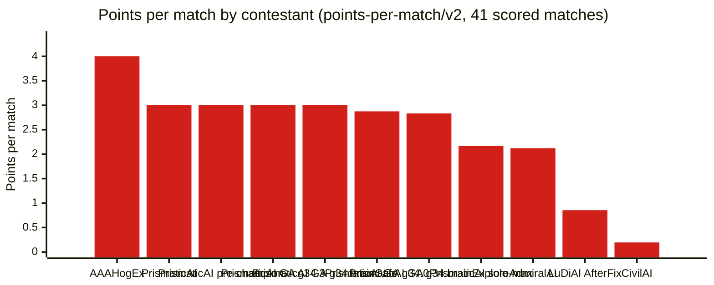
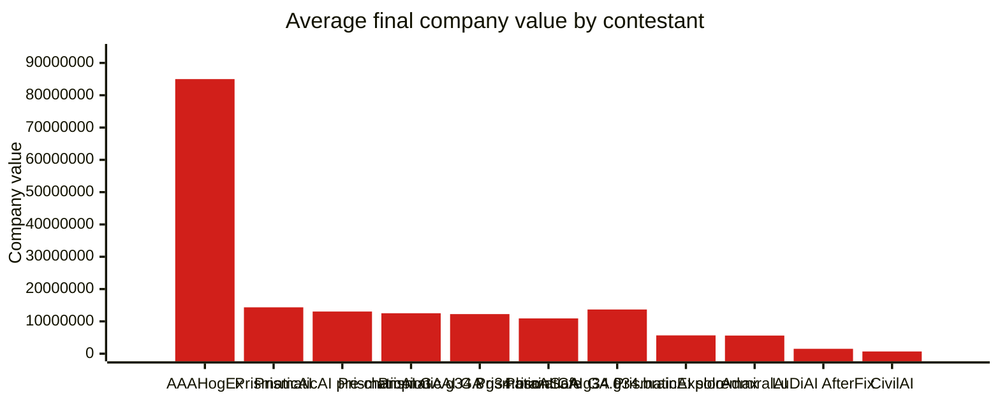
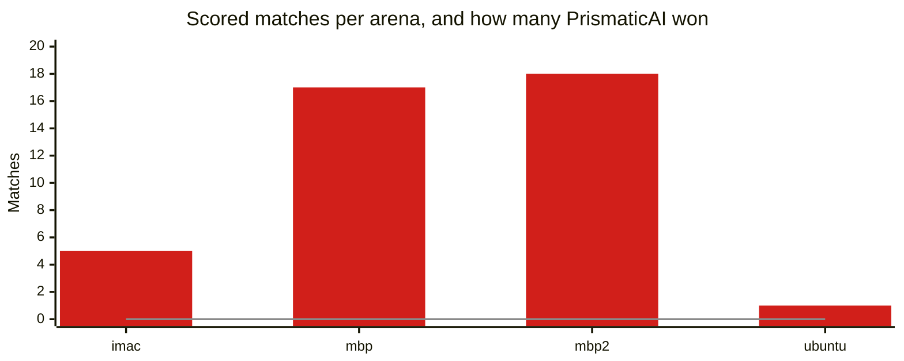

# battle-20261119T160236-e44cffa7

Derived from `battle-20261119T160236-e44cffa7.json` by `tools/research/ai-battle/battle.py report`; do not edit.

- Edition `e44cffa7a6b2d39c`: PrismaticAI and referee at `ebf7516b54d7130fa0908c68ff298075c517fb41`, base set `opengfx-8.0.tar`
- 20-year free-for-all from 1960, map 256x256 temperate, breakdowns 1
- 41 scored match(es) on `imac` (20261119-master-gdf1e05e7d8), `mbp` (20261119-master-m1ac503f477), `mbp2` (20261119-master-gdf1e05e7d8), `ubuntu` (20261119-master-gdf1e05e7d8)
- Replays: 0 of 1 identical to their original on another arena

| # | Contestant | Played | Wins | Points | Points/match | Avg rank | Avg final value | Squirrel errors | Matches with anomalies |
|---|---|---|---|---|---|---|---|---|---|
| 1 | AAAHogEx | 41 | 41 | 164 | 4.0 | 1.0 | 85.0 M | 0 | 0 |
| 2 | PrismaticAI | 4 | 0 | 12 | 3.0 | 2.0 | 14.3 M | 0 | 0 |
| 3 | PrismaticAI pre-champion | 5 | 0 | 15 | 3.0 | 2.0 | 13.0 M | 0 | 0 |
| 4 | PrismaticAI GA g34.3 | 6 | 0 | 18 | 3.0 | 2.0 | 12.5 M | 0 | 2 |
| 5 | PrismaticAI GA g34.brainSafe | 6 | 0 | 18 | 3.0 | 2.0 | 12.2 M | 0 | 2 |
| 6 | PrismaticAI GA g34.0 | 8 | 0 | 23 | 2.875 | 2.12 | 10.9 M | 0 | 4 |
| 7 | PrismaticAI GA g34.brainExplore | 6 | 0 | 17 | 2.833 | 2.17 | 13.7 M | 0 | 0 |
| 8 | PrismaticAI solo-max | 6 | 0 | 13 | 2.167 | 2.83 | 5.7 M | 0 | 5 |
| 9 | AdmiralAI | 41 | 0 | 87 | 2.122 | 2.88 | 5.6 M | 0 | 2 |
| 10 | LuDiAI AfterFix | 41 | 0 | 35 | 0.854 | 4.15 | 1.5 M | 0 | 1 |
| 11 | CivilAI | 41 | 0 | 8 | 0.195 | 4.8 | 681.9 k | 0 | 9 |

```mermaid
---
config:
  xyChart:
    width: 900
    height: 360
  themeVariables:
    xyChart:
      plotColorPalette: "#d11f1a, #8a8a8a, #0b0b0b, #ece4d6"
---
xychart-beta
    title "Final company value per scored match: winner vs best PrismaticAI"
    x-axis ["m-0001", "m-0002", "m-0003", "m-0004", "m-0005", "m-0006", "m-0007", "m-0008", "m-0009", "m-0010", "m-0011", "m-0012", "m-0013", "m-0014", "m-0015", "m-0016", "m-0017", "m-0018", "m-0019", "m-0020", "m-0021", "m-0022", "m-0029", "m-0030", "m-0031", "m-0032", "m-0033", "m-0034", "m-0035", "m-0036", "m-0037", "m-0038", "m-0039", "m-0041", "m-0045", "m-0047", "m-0052", "m-0053", "m-0059", "m-0061", "m-0062"]
    %% series: Winner | Best PrismaticAI
    %% links: battle-20261119T160236-e44cffa7.md?col=Match&filter=m-0001 | battle-20261119T160236-e44cffa7.md?col=Match&filter=m-0002 | battle-20261119T160236-e44cffa7.md?col=Match&filter=m-0003 | battle-20261119T160236-e44cffa7.md?col=Match&filter=m-0004 | battle-20261119T160236-e44cffa7.md?col=Match&filter=m-0005 | battle-20261119T160236-e44cffa7.md?col=Match&filter=m-0006 | battle-20261119T160236-e44cffa7.md?col=Match&filter=m-0007 | battle-20261119T160236-e44cffa7.md?col=Match&filter=m-0008 | battle-20261119T160236-e44cffa7.md?col=Match&filter=m-0009 | battle-20261119T160236-e44cffa7.md?col=Match&filter=m-0010 | battle-20261119T160236-e44cffa7.md?col=Match&filter=m-0011 | battle-20261119T160236-e44cffa7.md?col=Match&filter=m-0012 | battle-20261119T160236-e44cffa7.md?col=Match&filter=m-0013 | battle-20261119T160236-e44cffa7.md?col=Match&filter=m-0014 | battle-20261119T160236-e44cffa7.md?col=Match&filter=m-0015 | battle-20261119T160236-e44cffa7.md?col=Match&filter=m-0016 | battle-20261119T160236-e44cffa7.md?col=Match&filter=m-0017 | battle-20261119T160236-e44cffa7.md?col=Match&filter=m-0018 | battle-20261119T160236-e44cffa7.md?col=Match&filter=m-0019 | battle-20261119T160236-e44cffa7.md?col=Match&filter=m-0020 | battle-20261119T160236-e44cffa7.md?col=Match&filter=m-0021 | battle-20261119T160236-e44cffa7.md?col=Match&filter=m-0022 | battle-20261119T160236-e44cffa7.md?col=Match&filter=m-0029 | battle-20261119T160236-e44cffa7.md?col=Match&filter=m-0030 | battle-20261119T160236-e44cffa7.md?col=Match&filter=m-0031 | battle-20261119T160236-e44cffa7.md?col=Match&filter=m-0032 | battle-20261119T160236-e44cffa7.md?col=Match&filter=m-0033 | battle-20261119T160236-e44cffa7.md?col=Match&filter=m-0034 | battle-20261119T160236-e44cffa7.md?col=Match&filter=m-0035 | battle-20261119T160236-e44cffa7.md?col=Match&filter=m-0036 | battle-20261119T160236-e44cffa7.md?col=Match&filter=m-0037 | battle-20261119T160236-e44cffa7.md?col=Match&filter=m-0038 | battle-20261119T160236-e44cffa7.md?col=Match&filter=m-0039 | battle-20261119T160236-e44cffa7.md?col=Match&filter=m-0041 | battle-20261119T160236-e44cffa7.md?col=Match&filter=m-0045 | battle-20261119T160236-e44cffa7.md?col=Match&filter=m-0047 | battle-20261119T160236-e44cffa7.md?col=Match&filter=m-0052 | battle-20261119T160236-e44cffa7.md?col=Match&filter=m-0053 | battle-20261119T160236-e44cffa7.md?col=Match&filter=m-0059 | battle-20261119T160236-e44cffa7.md?col=Match&filter=m-0061 | battle-20261119T160236-e44cffa7.md?col=Match&filter=m-0062
    y-axis "Company value" 0 --> 149000000
    bar [135293550, 107605256, 120965336, 103267456, 91247708, 116778463, 52772453, 33302079, 55720520, 60516331, 56417867, 66986229, 66018628, 105606926, 85583576, 107987563, 98852750, 78861873, 86954317, 102223543, 73496913, 79380095, 118535519, 119869320, 95385095, 87431393, 89738592, 88979378, 54638963, 98521852, 88799310, 63135122, 51718266, 69256097, 57465072, 82284284, 62238308, 107376490, 69086141, 91751890, 102714013]
    line [8343109, 15235520, 5997201, 10848114, 11368146, 19082107, 16159053, 6545456, 12560775, 16103783, 9695836, 17437934, 7868852, 15246605, 5552843, 17627118, 9618074, 11981404, 15133201, 16221925, 10470315, 4276451, 3846774, 10387166, 12295941, 10914099, 21412188, 7759704, 15507004, 5382622, 9398988, 7851663, 13940027, 9273273, 10227479, 12450031, 20599779, 16110060, 4640622, 4239558, 14867370]
```

<!-- battle-charts:begin -->
<!-- derived from battle-20261119T160236-e44cffa7.json by `battle.py render`; `battle.py check` fails when it is stale -->

<!-- battle-charts:end -->

| Seed | Original | Replay | Arenas | Identical |
|---|---|---|---|---|
| 373945468 | m-0004 | m-0048 | imac / mbp | NO |

| Match | Arena | Seed | Winner | Value | Last | Anomalies |
|---|---|---|---|---|---|---|
| m-0001 | mbp | 373945468 | AAAHogEx | 135.3 M | CivilAI | PrismaticAI solo-max: fleet_drop:45->17 |
| m-0002 | mbp | 373945468 | AAAHogEx | 107.6 M | CivilAI | - |
| m-0003 | mbp | 373945468 | AAAHogEx | 121.0 M | CivilAI | PrismaticAI GA g34.0: fleet_drop:180->119 |
| m-0004 | imac | 373945468 | AAAHogEx | 103.3 M | CivilAI | - |
| m-0005 | imac | 373945468 | AAAHogEx | 91.2 M | CivilAI | - |
| m-0006 | imac | 373945468 | AAAHogEx | 116.8 M | CivilAI | PrismaticAI GA g34.3: fleet_drop:152->43 |
| m-0007 | mbp2 | 1294242332 | AAAHogEx | 52.8 M | CivilAI | - |
| m-0008 | mbp2 | 1294242332 | AAAHogEx | 33.3 M | CivilAI | PrismaticAI solo-max: fleet_drop:40->16 |
| m-0009 | mbp2 | 1294242332 | AAAHogEx | 55.7 M | CivilAI | - |
| m-0010 | mbp2 | 1294242332 | AAAHogEx | 60.5 M | LuDiAI AfterFix | - |
| m-0011 | mbp2 | 1294242332 | AAAHogEx | 56.4 M | CivilAI | - |
| m-0012 | mbp2 | 1294242332 | AAAHogEx | 67.0 M | LuDiAI AfterFix | CivilAI: fleet_drop:37->17 |
| m-0013 | mbp2 | 1294242332 | AAAHogEx | 66.0 M | CivilAI | - |
| m-0014 | mbp2 | 1800316498 | AAAHogEx | 105.6 M | CivilAI | - |
| m-0015 | mbp2 | 1800316498 | AAAHogEx | 85.6 M | CivilAI | - |
| m-0016 | mbp2 | 1800316498 | AAAHogEx | 108.0 M | CivilAI | - |
| m-0017 | mbp2 | 1800316498 | AAAHogEx | 98.9 M | CivilAI | CivilAI: fleet_drop:16->10 |
| m-0018 | mbp2 | 1800316498 | AAAHogEx | 78.9 M | CivilAI | PrismaticAI GA g34.brainSafe: fleet_drop:141->82 |
| m-0019 | mbp2 | 1800316498 | AAAHogEx | 87.0 M | CivilAI | CivilAI: fleet_drop:17->8 |
| m-0020 | mbp2 | 1800316498 | AAAHogEx | 102.2 M | CivilAI | - |
| m-0021 | mbp2 | 1346704106 | AAAHogEx | 73.5 M | CivilAI | - |
| m-0022 | mbp2 | 1346704106 | AAAHogEx | 79.4 M | CivilAI | PrismaticAI solo-max: fleet_drop:38->17; CivilAI: fleet_drop:22->14 |
| m-0029 | ubuntu | 1893510161 | AAAHogEx | 118.5 M | CivilAI | PrismaticAI solo-max: fleet_drop:47->16 |
| m-0030 | mbp | 1893510161 | AAAHogEx | 119.9 M | CivilAI | CivilAI: fleet_drop:35->3 |
| m-0031 | mbp | 1893510161 | AAAHogEx | 95.4 M | CivilAI | PrismaticAI GA g34.0: fleet_drop:131->75; CivilAI: fleet_drop:37->7 |
| m-0032 | mbp | 1893510161 | AAAHogEx | 87.4 M | CivilAI | CivilAI: fleet_drop:55->33 |
| m-0033 | mbp | 1893510161 | AAAHogEx | 89.7 M | CivilAI | - |
| m-0034 | mbp | 1893510161 | AAAHogEx | 89.0 M | CivilAI | - |
| m-0035 | mbp | 114285789 | AAAHogEx | 54.6 M | LuDiAI AfterFix | - |
| m-0036 | mbp | 114285789 | AAAHogEx | 98.5 M | CivilAI | PrismaticAI solo-max: fleet_drop:32->13 |
| m-0037 | mbp | 114285789 | AAAHogEx | 88.8 M | LuDiAI AfterFix | CivilAI: fleet_drop:28->19 |
| m-0038 | mbp | 114285789 | AAAHogEx | 63.1 M | LuDiAI AfterFix | PrismaticAI GA g34.0: fleet_drop:63->32 |
| m-0039 | mbp2 | 114285789 | AAAHogEx | 51.7 M | LuDiAI AfterFix | PrismaticAI GA g34.brainSafe: fleet_drop:62->43 |
| m-0041 | imac | 114285789 | AAAHogEx | 69.3 M | CivilAI | PrismaticAI GA g34.3: fleet_drop:53->30; AdmiralAI: fleet_drop:260->162; LuDiAI AfterFix: fleet_drop:167->111; CivilAI: fleet_drop:33->19 |
| m-0045 | mbp2 | 878125181 | AAAHogEx | 57.5 M | CivilAI | AdmiralAI: fleet_drop:153->93 |
| m-0047 | imac | 878125181 | AAAHogEx | 82.3 M | LuDiAI AfterFix | - |
| m-0048 (replay) | mbp | 373945468 | AAAHogEx | 100.1 M | CivilAI | - |
| m-0052 | mbp | 265724962 | AAAHogEx | 62.2 M | CivilAI | PrismaticAI GA g34.0: fleet_drop:142->55 |
| m-0053 | mbp | 265724962 | AAAHogEx | 107.4 M | CivilAI | - |
| m-0059 | mbp | 718880908 | AAAHogEx | 69.1 M | CivilAI | - |
| m-0061 | mbp | 718880908 | AAAHogEx | 91.8 M | CivilAI | - |
| m-0062 | mbp | 718880908 | AAAHogEx | 102.7 M | CivilAI | - |
