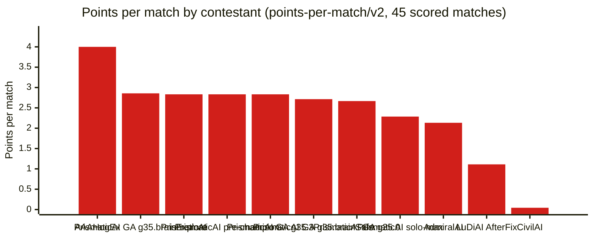
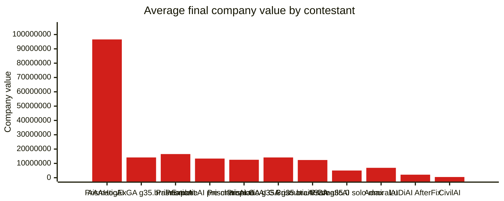
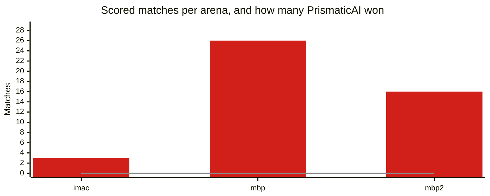

# battle-20261119T161428-55a65528

Derived from `battle-20261119T161428-55a65528.json` by `tools/research/ai-battle/battle.py report`; do not edit.

- Edition `55a655285a57726e`: PrismaticAI and referee at `ebf7516b54d7130fa0908c68ff298075c517fb41`, base set `opengfx-8.0.tar`
- 20-year free-for-all from 1960, map 256x256 temperate, breakdowns 1
- 45 scored match(es) on `imac` (20261119-master-gdf1e05e7d8), `mbp` (20261119-master-m7235eee285, 20261119-master-mebf7516b54), `mbp2` (20261119-master-gdf1e05e7d8)
- Replays: 0 of 0 identical to their original on another arena

| # | Contestant | Played | Wins | Points | Points/match | Avg rank | Avg final value | Squirrel errors | Matches with anomalies |
|---|---|---|---|---|---|---|---|---|---|
| 1 | AAAHogEx | 45 | 45 | 180 | 4.0 | 1.0 | 96.6 M | 0 | 0 |
| 2 | PrismaticAI GA g35.brainExplore | 7 | 0 | 20 | 2.857 | 2.14 | 14.2 M | 0 | 0 |
| 3 | PrismaticAI | 6 | 0 | 17 | 2.833 | 2.17 | 16.5 M | 0 | 0 |
| 4 | PrismaticAI pre-champion | 6 | 0 | 17 | 2.833 | 2.17 | 13.4 M | 0 | 0 |
| 5 | PrismaticAI GA g35.3 | 6 | 0 | 17 | 2.833 | 2.17 | 12.5 M | 0 | 2 |
| 6 | PrismaticAI GA g35.brainSafe | 7 | 0 | 19 | 2.714 | 2.29 | 14.2 M | 0 | 0 |
| 7 | PrismaticAI GA g35.0 | 6 | 0 | 16 | 2.667 | 2.33 | 12.4 M | 0 | 2 |
| 8 | PrismaticAI solo-max | 7 | 0 | 16 | 2.286 | 2.71 | 5.0 M | 0 | 7 |
| 9 | AdmiralAI | 45 | 0 | 96 | 2.133 | 2.87 | 6.9 M | 0 | 2 |
| 10 | LuDiAI AfterFix | 45 | 0 | 50 | 1.111 | 3.89 | 2.1 M | 0 | 2 |
| 11 | CivilAI | 45 | 0 | 2 | 0.044 | 4.96 | 494.7 k | 3640 | 9 |

```mermaid
---
config:
  xyChart:
    width: 900
    height: 360
  themeVariables:
    xyChart:
      plotColorPalette: "#d11f1a, #8a8a8a, #0b0b0b, #ece4d6"
---
xychart-beta
    title "Final company value per scored match: winner vs best PrismaticAI"
    x-axis ["m-0001", "m-0002", "m-0003", "m-0004", "m-0005", "m-0006", "m-0007", "m-0008", "m-0009", "m-0010", "m-0011", "m-0012", "m-0013", "m-0014", "m-0015", "m-0016", "m-0017", "m-0018", "m-0019", "m-0020", "m-0021", "m-0022", "m-0030", "m-0031", "m-0032", "m-0033", "m-0034", "m-0035", "m-0036", "m-0037", "m-0038", "m-0039", "m-0040", "m-0041", "m-0042", "m-0043", "m-0044", "m-0047", "m-0052", "m-0053", "m-0057", "m-0067", "m-0068", "m-0069", "m-0070"]
    %% series: Winner | Best PrismaticAI
    %% links: battle-20261119T161428-55a65528.md?col=Match&filter=m-0001 | battle-20261119T161428-55a65528.md?col=Match&filter=m-0002 | battle-20261119T161428-55a65528.md?col=Match&filter=m-0003 | battle-20261119T161428-55a65528.md?col=Match&filter=m-0004 | battle-20261119T161428-55a65528.md?col=Match&filter=m-0005 | battle-20261119T161428-55a65528.md?col=Match&filter=m-0006 | battle-20261119T161428-55a65528.md?col=Match&filter=m-0007 | battle-20261119T161428-55a65528.md?col=Match&filter=m-0008 | battle-20261119T161428-55a65528.md?col=Match&filter=m-0009 | battle-20261119T161428-55a65528.md?col=Match&filter=m-0010 | battle-20261119T161428-55a65528.md?col=Match&filter=m-0011 | battle-20261119T161428-55a65528.md?col=Match&filter=m-0012 | battle-20261119T161428-55a65528.md?col=Match&filter=m-0013 | battle-20261119T161428-55a65528.md?col=Match&filter=m-0014 | battle-20261119T161428-55a65528.md?col=Match&filter=m-0015 | battle-20261119T161428-55a65528.md?col=Match&filter=m-0016 | battle-20261119T161428-55a65528.md?col=Match&filter=m-0017 | battle-20261119T161428-55a65528.md?col=Match&filter=m-0018 | battle-20261119T161428-55a65528.md?col=Match&filter=m-0019 | battle-20261119T161428-55a65528.md?col=Match&filter=m-0020 | battle-20261119T161428-55a65528.md?col=Match&filter=m-0021 | battle-20261119T161428-55a65528.md?col=Match&filter=m-0022 | battle-20261119T161428-55a65528.md?col=Match&filter=m-0030 | battle-20261119T161428-55a65528.md?col=Match&filter=m-0031 | battle-20261119T161428-55a65528.md?col=Match&filter=m-0032 | battle-20261119T161428-55a65528.md?col=Match&filter=m-0033 | battle-20261119T161428-55a65528.md?col=Match&filter=m-0034 | battle-20261119T161428-55a65528.md?col=Match&filter=m-0035 | battle-20261119T161428-55a65528.md?col=Match&filter=m-0036 | battle-20261119T161428-55a65528.md?col=Match&filter=m-0037 | battle-20261119T161428-55a65528.md?col=Match&filter=m-0038 | battle-20261119T161428-55a65528.md?col=Match&filter=m-0039 | battle-20261119T161428-55a65528.md?col=Match&filter=m-0040 | battle-20261119T161428-55a65528.md?col=Match&filter=m-0041 | battle-20261119T161428-55a65528.md?col=Match&filter=m-0042 | battle-20261119T161428-55a65528.md?col=Match&filter=m-0043 | battle-20261119T161428-55a65528.md?col=Match&filter=m-0044 | battle-20261119T161428-55a65528.md?col=Match&filter=m-0047 | battle-20261119T161428-55a65528.md?col=Match&filter=m-0052 | battle-20261119T161428-55a65528.md?col=Match&filter=m-0053 | battle-20261119T161428-55a65528.md?col=Match&filter=m-0057 | battle-20261119T161428-55a65528.md?col=Match&filter=m-0067 | battle-20261119T161428-55a65528.md?col=Match&filter=m-0068 | battle-20261119T161428-55a65528.md?col=Match&filter=m-0069 | battle-20261119T161428-55a65528.md?col=Match&filter=m-0070
    y-axis "Company value" 0 --> 175000000
    bar [88461662, 92918891, 123694481, 81154306, 72819157, 101749854, 85684776, 108731646, 67636282, 93868333, 80729832, 78800967, 88869513, 78233971, 91985349, 95922790, 75919094, 112419346, 81530658, 80871856, 69035808, 73323055, 72156938, 76086769, 73434244, 61653783, 71346126, 117475909, 159138861, 135397164, 144712400, 134277195, 123699234, 151917846, 95823203, 111560371, 110615798, 112728610, 95945859, 85434143, 125639787, 107367780, 98322179, 82962848, 73788028]
    line [5895125, 18575124, 17413674, 19778893, 14310084, 16611065, 17233435, 5460105, 15287240, 12508497, 21983568, 15542461, 14481908, 16483543, 2151119, 9013121, 13465485, 10327199, 20500160, 18034517, 8707596, 7699806, 9716262, 2046097, 15338140, 9143323, 1994139, 26497835, 4510549, 18760623, 21741839, 17146221, 18301823, 11764359, 8805704, 4794807, 8891241, 5122362, 7013573, 3252854, 4687769, 11232642, 16156936, 12324200, 21405391]
```

<!-- battle-charts:begin -->
<!-- derived from battle-20261119T161428-55a65528.json by `battle.py render`; `battle.py check` fails when it is stale -->

<!-- battle-charts:end -->

| Match | Arena | Seed | Winner | Value | Last | Anomalies |
|---|---|---|---|---|---|---|
| m-0001 | mbp | 1989639840 | AAAHogEx | 88.5 M | CivilAI | PrismaticAI solo-max: fleet_drop:38->19 |
| m-0002 | mbp | 1989639840 | AAAHogEx | 92.9 M | CivilAI | - |
| m-0003 | mbp | 1989639840 | AAAHogEx | 123.7 M | CivilAI | - |
| m-0004 | imac | 1989639840 | AAAHogEx | 81.2 M | CivilAI | - |
| m-0005 | imac | 1989639840 | AAAHogEx | 72.8 M | CivilAI | - |
| m-0006 | imac | 1989639840 | AAAHogEx | 101.7 M | CivilAI | - |
| m-0007 | mbp2 | 276307476 | AAAHogEx | 85.7 M | CivilAI | CivilAI: fleet_drop:32->16 |
| m-0008 | mbp2 | 276307476 | AAAHogEx | 108.7 M | CivilAI | PrismaticAI solo-max: fleet_drop:40->18 |
| m-0009 | mbp2 | 276307476 | AAAHogEx | 67.6 M | CivilAI | - |
| m-0010 | mbp2 | 276307476 | AAAHogEx | 93.9 M | CivilAI | AdmiralAI: fleet_drop:296->200 |
| m-0011 | mbp2 | 276307476 | AAAHogEx | 80.7 M | CivilAI | - |
| m-0012 | mbp2 | 276307476 | AAAHogEx | 78.8 M | CivilAI | - |
| m-0013 | mbp2 | 276307476 | AAAHogEx | 88.9 M | CivilAI | CivilAI: fleet_drop:16->11 |
| m-0014 | mbp2 | 1837500427 | AAAHogEx | 78.2 M | CivilAI | CivilAI: no_vehicles |
| m-0015 | mbp2 | 1837500427 | AAAHogEx | 92.0 M | CivilAI | PrismaticAI solo-max: fleet_drop:37->18 |
| m-0016 | mbp2 | 1837500427 | AAAHogEx | 95.9 M | CivilAI | - |
| m-0017 | mbp2 | 1837500427 | AAAHogEx | 75.9 M | CivilAI | - |
| m-0018 | mbp2 | 1837500427 | AAAHogEx | 112.4 M | CivilAI | CivilAI: squirrel_errors:3640, no_vehicles |
| m-0019 | mbp2 | 1837500427 | AAAHogEx | 81.5 M | CivilAI | - |
| m-0020 | mbp2 | 1837500427 | AAAHogEx | 80.9 M | CivilAI | - |
| m-0021 | mbp2 | 1196898461 | AAAHogEx | 69.0 M | CivilAI | - |
| m-0022 | mbp2 | 1196898461 | AAAHogEx | 73.3 M | CivilAI | PrismaticAI solo-max: fleet_drop:34->13 |
| m-0030 | mbp | 164870533 | AAAHogEx | 72.2 M | CivilAI | - |
| m-0031 | mbp | 164870533 | AAAHogEx | 76.1 M | CivilAI | AdmiralAI: fleet_drop:180->116 |
| m-0032 | mbp | 164870533 | AAAHogEx | 73.4 M | CivilAI | - |
| m-0033 | mbp | 164870533 | AAAHogEx | 61.7 M | CivilAI | - |
| m-0034 | mbp | 164870533 | AAAHogEx | 71.3 M | CivilAI | PrismaticAI GA g35.3: fleet_drop:62->25; CivilAI: fleet_drop:73->46 |
| m-0035 | mbp | 1808543174 | AAAHogEx | 117.5 M | CivilAI | - |
| m-0036 | mbp | 1808543174 | AAAHogEx | 159.1 M | CivilAI | PrismaticAI solo-max: fleet_drop:45->25 |
| m-0037 | mbp | 1808543174 | AAAHogEx | 135.4 M | CivilAI | CivilAI: fleet_drop:36->22 |
| m-0038 | mbp | 1808543174 | AAAHogEx | 144.7 M | CivilAI | PrismaticAI GA g35.0: fleet_drop:213->123 |
| m-0039 | mbp | 1808543174 | AAAHogEx | 134.3 M | CivilAI | - |
| m-0040 | mbp | 1808543174 | AAAHogEx | 123.7 M | CivilAI | - |
| m-0041 | mbp | 1808543174 | AAAHogEx | 151.9 M | CivilAI | PrismaticAI GA g35.3: fleet_drop:148->74; CivilAI: no_vehicles |
| m-0042 | mbp | 914849225 | AAAHogEx | 95.8 M | AdmiralAI | - |
| m-0043 | mbp | 914849225 | AAAHogEx | 111.6 M | CivilAI | PrismaticAI solo-max: fleet_drop:49->15 |
| m-0044 | mbp | 914849225 | AAAHogEx | 110.6 M | CivilAI | - |
| m-0047 | mbp | 914849225 | AAAHogEx | 112.7 M | CivilAI | - |
| m-0052 | mbp | 1057396744 | AAAHogEx | 95.9 M | CivilAI | PrismaticAI GA g35.0: fleet_drop:85->50 |
| m-0053 | mbp | 1057396744 | AAAHogEx | 85.4 M | CivilAI | - |
| m-0057 | mbp | 388018445 | AAAHogEx | 125.6 M | CivilAI | PrismaticAI solo-max: fleet_drop:48->18; CivilAI: fleet_drop:13->9 |
| m-0067 | mbp | 1998336559 | AAAHogEx | 107.4 M | CivilAI | - |
| m-0068 | mbp | 1998336559 | AAAHogEx | 98.3 M | LuDiAI AfterFix | LuDiAI AfterFix: fleet_drop:16->6 |
| m-0069 | mbp | 1998336559 | AAAHogEx | 83.0 M | CivilAI | LuDiAI AfterFix: fleet_drop:49->30; CivilAI: fleet_drop:28->13 |
| m-0070 | mbp | 396312907 | AAAHogEx | 73.8 M | CivilAI | - |
