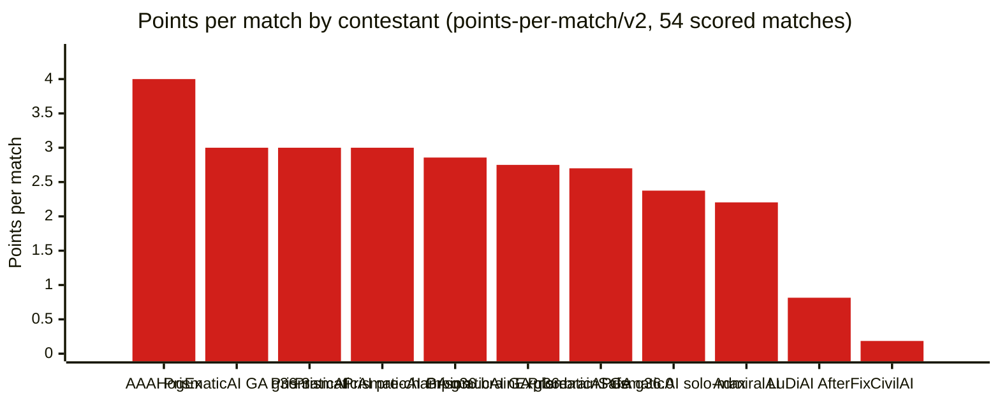
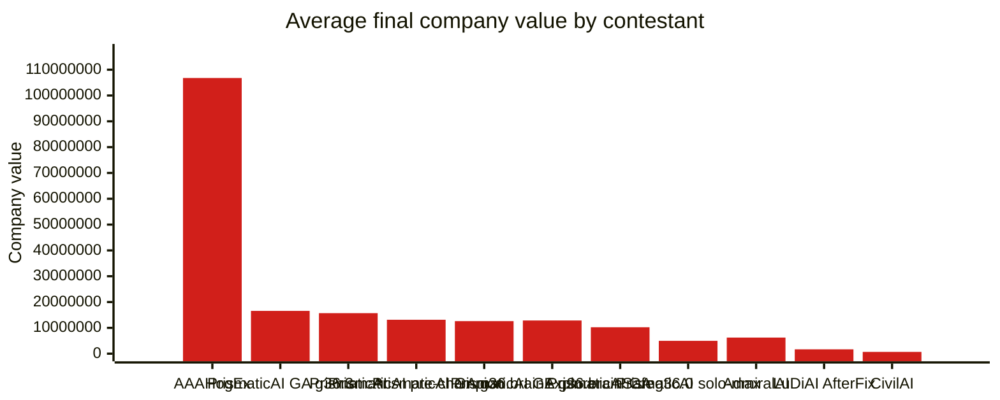
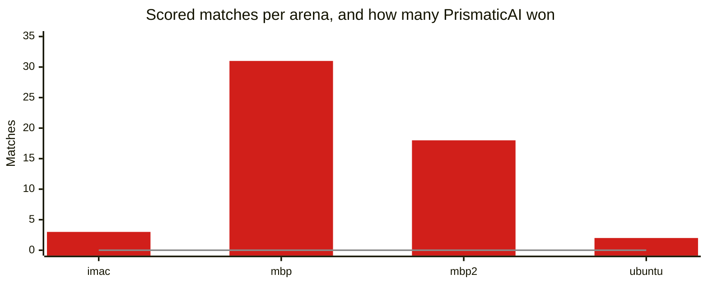

# battle-20261119T162924-bdf1fe4e

Derived from `battle-20261119T162924-bdf1fe4e.json` by `tools/research/ai-battle/battle.py report`; do not edit.

- Edition `bdf1fe4e0e55cac9`: PrismaticAI and referee at `ebf7516b54d7130fa0908c68ff298075c517fb41`, base set `opengfx-8.0.tar`
- 20-year free-for-all from 1960, map 256x256 temperate, breakdowns 1
- 54 scored match(es) on `imac` (20261119-master-gdf1e05e7d8), `mbp` (20261119-master-m7235eee285), `mbp2` (20261119-master-gdf1e05e7d8), `ubuntu` (20261119-master-gdf1e05e7d8)
- Replays: 0 of 1 identical to their original on another arena

| # | Contestant | Played | Wins | Points | Points/match | Avg rank | Avg final value | Squirrel errors | Matches with anomalies |
|---|---|---|---|---|---|---|---|---|---|
| 1 | AAAHogEx | 54 | 54 | 216 | 4.0 | 1.0 | 106.8 M | 0 | 0 |
| 2 | PrismaticAI GA g36.3 | 6 | 0 | 18 | 3.0 | 2.0 | 16.6 M | 0 | 0 |
| 3 | PrismaticAI | 7 | 0 | 21 | 3.0 | 2.0 | 15.7 M | 0 | 2 |
| 4 | PrismaticAI pre-champion | 8 | 0 | 24 | 3.0 | 2.0 | 13.1 M | 0 | 0 |
| 5 | PrismaticAI GA g36.brainExplore | 7 | 0 | 20 | 2.857 | 2.14 | 12.6 M | 0 | 0 |
| 6 | PrismaticAI GA g36.brainSafe | 8 | 0 | 22 | 2.75 | 2.25 | 12.9 M | 0 | 0 |
| 7 | PrismaticAI GA g36.0 | 10 | 0 | 27 | 2.7 | 2.3 | 10.2 M | 0 | 1 |
| 8 | PrismaticAI solo-max | 8 | 0 | 19 | 2.375 | 2.62 | 5.0 M | 0 | 8 |
| 9 | AdmiralAI | 54 | 0 | 119 | 2.204 | 2.8 | 6.2 M | 47 | 4 |
| 10 | LuDiAI AfterFix | 54 | 0 | 44 | 0.815 | 4.19 | 1.7 M | 0 | 2 |
| 11 | CivilAI | 54 | 0 | 10 | 0.185 | 4.81 | 690.4 k | 7325 | 9 |

```mermaid
---
config:
  xyChart:
    width: 900
    height: 360
  themeVariables:
    xyChart:
      plotColorPalette: "#d11f1a, #8a8a8a, #0b0b0b, #ece4d6"
---
xychart-beta
    title "Final company value per scored match: winner vs best PrismaticAI"
    x-axis ["m-0001", "m-0002", "m-0003", "m-0004", "m-0005", "m-0006", "m-0007", "m-0008", "m-0009", "m-0010", "m-0011", "m-0012", "m-0013", "m-0014", "m-0015", "m-0016", "m-0017", "m-0018", "m-0019", "m-0020", "m-0021", "m-0022", "m-0023", "m-0024", "m-0025", "m-0026", "m-0027", "m-0028", "m-0029", "m-0031", "m-0036", "m-0037", "m-0038", "m-0039", "m-0040", "m-0041", "m-0042", "m-0043", "m-0044", "m-0045", "m-0047", "m-0049", "m-0050", "m-0051", "m-0052", "m-0053", "m-0058", "m-0059", "m-0060", "m-0073", "m-0074", "m-0075", "m-0076", "m-0077"]
    %% series: Winner | Best PrismaticAI
    %% links: battle-20261119T162924-bdf1fe4e.md?col=Match&filter=m-0001 | battle-20261119T162924-bdf1fe4e.md?col=Match&filter=m-0002 | battle-20261119T162924-bdf1fe4e.md?col=Match&filter=m-0003 | battle-20261119T162924-bdf1fe4e.md?col=Match&filter=m-0004 | battle-20261119T162924-bdf1fe4e.md?col=Match&filter=m-0005 | battle-20261119T162924-bdf1fe4e.md?col=Match&filter=m-0006 | battle-20261119T162924-bdf1fe4e.md?col=Match&filter=m-0007 | battle-20261119T162924-bdf1fe4e.md?col=Match&filter=m-0008 | battle-20261119T162924-bdf1fe4e.md?col=Match&filter=m-0009 | battle-20261119T162924-bdf1fe4e.md?col=Match&filter=m-0010 | battle-20261119T162924-bdf1fe4e.md?col=Match&filter=m-0011 | battle-20261119T162924-bdf1fe4e.md?col=Match&filter=m-0012 | battle-20261119T162924-bdf1fe4e.md?col=Match&filter=m-0013 | battle-20261119T162924-bdf1fe4e.md?col=Match&filter=m-0014 | battle-20261119T162924-bdf1fe4e.md?col=Match&filter=m-0015 | battle-20261119T162924-bdf1fe4e.md?col=Match&filter=m-0016 | battle-20261119T162924-bdf1fe4e.md?col=Match&filter=m-0017 | battle-20261119T162924-bdf1fe4e.md?col=Match&filter=m-0018 | battle-20261119T162924-bdf1fe4e.md?col=Match&filter=m-0019 | battle-20261119T162924-bdf1fe4e.md?col=Match&filter=m-0020 | battle-20261119T162924-bdf1fe4e.md?col=Match&filter=m-0021 | battle-20261119T162924-bdf1fe4e.md?col=Match&filter=m-0022 | battle-20261119T162924-bdf1fe4e.md?col=Match&filter=m-0023 | battle-20261119T162924-bdf1fe4e.md?col=Match&filter=m-0024 | battle-20261119T162924-bdf1fe4e.md?col=Match&filter=m-0025 | battle-20261119T162924-bdf1fe4e.md?col=Match&filter=m-0026 | battle-20261119T162924-bdf1fe4e.md?col=Match&filter=m-0027 | battle-20261119T162924-bdf1fe4e.md?col=Match&filter=m-0028 | battle-20261119T162924-bdf1fe4e.md?col=Match&filter=m-0029 | battle-20261119T162924-bdf1fe4e.md?col=Match&filter=m-0031 | battle-20261119T162924-bdf1fe4e.md?col=Match&filter=m-0036 | battle-20261119T162924-bdf1fe4e.md?col=Match&filter=m-0037 | battle-20261119T162924-bdf1fe4e.md?col=Match&filter=m-0038 | battle-20261119T162924-bdf1fe4e.md?col=Match&filter=m-0039 | battle-20261119T162924-bdf1fe4e.md?col=Match&filter=m-0040 | battle-20261119T162924-bdf1fe4e.md?col=Match&filter=m-0041 | battle-20261119T162924-bdf1fe4e.md?col=Match&filter=m-0042 | battle-20261119T162924-bdf1fe4e.md?col=Match&filter=m-0043 | battle-20261119T162924-bdf1fe4e.md?col=Match&filter=m-0044 | battle-20261119T162924-bdf1fe4e.md?col=Match&filter=m-0045 | battle-20261119T162924-bdf1fe4e.md?col=Match&filter=m-0047 | battle-20261119T162924-bdf1fe4e.md?col=Match&filter=m-0049 | battle-20261119T162924-bdf1fe4e.md?col=Match&filter=m-0050 | battle-20261119T162924-bdf1fe4e.md?col=Match&filter=m-0051 | battle-20261119T162924-bdf1fe4e.md?col=Match&filter=m-0052 | battle-20261119T162924-bdf1fe4e.md?col=Match&filter=m-0053 | battle-20261119T162924-bdf1fe4e.md?col=Match&filter=m-0058 | battle-20261119T162924-bdf1fe4e.md?col=Match&filter=m-0059 | battle-20261119T162924-bdf1fe4e.md?col=Match&filter=m-0060 | battle-20261119T162924-bdf1fe4e.md?col=Match&filter=m-0073 | battle-20261119T162924-bdf1fe4e.md?col=Match&filter=m-0074 | battle-20261119T162924-bdf1fe4e.md?col=Match&filter=m-0075 | battle-20261119T162924-bdf1fe4e.md?col=Match&filter=m-0076 | battle-20261119T162924-bdf1fe4e.md?col=Match&filter=m-0077
    y-axis "Company value" 0 --> 167000000
    bar [122740018, 143877853, 116493039, 108849845, 104127030, 109588502, 61171349, 90536262, 84495810, 81111011, 79398723, 71587238, 76866297, 93280034, 100669748, 97636243, 86368054, 108734730, 95110662, 73036813, 120411061, 147825171, 136202576, 103294025, 134097009, 120502511, 151420342, 65985992, 79805284, 65895563, 149413217, 126171241, 109219625, 127853434, 120960734, 106966354, 115315780, 108251256, 110589395, 88040224, 105185785, 125648326, 130344152, 140860541, 111371888, 137552126, 75205267, 103796861, 112077619, 97151689, 101382593, 107370060, 102211721, 122038178]
    line [6171915, 12344243, 12538924, 17802673, 12088825, 17567278, 16944827, 5926197, 16626568, 5900885, 11084003, 13639599, 16006063, 16985670, 4008697, 10139591, 10486130, 16624111, 12118626, 16262012, 14984883, 3510324, 11408174, 10071708, 8638029, 19204575, 16537192, 9284886, 3499339, 2845309, 5998827, 8622168, 4480307, 3933785, 8071406, 14114467, 19167537, 6129822, 15625786, 15391546, 13595820, 14571497, 4535733, 13781060, 13830492, 10894834, 16566601, 9225219, 16135962, 17515153, 17696070, 9501624, 18918463, 17890850]
```

<!-- battle-charts:begin -->
<!-- derived from battle-20261119T162924-bdf1fe4e.json by `battle.py render`; `battle.py check` fails when it is stale -->

<!-- battle-charts:end -->

| Seed | Original | Replay | Arenas | Identical |
|---|---|---|---|---|
| 775226928 | m-0010 | m-0048 | imac / mbp | NO |

| Match | Arena | Seed | Winner | Value | Last | Anomalies |
|---|---|---|---|---|---|---|
| m-0001 | mbp | 1640058463 | AAAHogEx | 122.7 M | CivilAI | PrismaticAI solo-max: fleet_drop:47->18 |
| m-0002 | mbp | 1640058463 | AAAHogEx | 143.9 M | LuDiAI AfterFix | - |
| m-0003 | mbp | 1640058463 | AAAHogEx | 116.5 M | CivilAI | LuDiAI AfterFix: fleet_drop:104->68 |
| m-0004 | mbp | 1640058463 | AAAHogEx | 108.8 M | LuDiAI AfterFix | CivilAI: fleet_drop:15->7 |
| m-0005 | mbp | 1640058463 | AAAHogEx | 104.1 M | CivilAI | CivilAI: fleet_drop:11->7 |
| m-0006 | mbp | 1640058463 | AAAHogEx | 109.6 M | CivilAI | CivilAI: squirrel_errors:3630 |
| m-0007 | mbp | 775226928 | AAAHogEx | 61.2 M | CivilAI | CivilAI: fleet_drop:62->41 |
| m-0008 | mbp | 775226928 | AAAHogEx | 90.5 M | CivilAI | PrismaticAI solo-max: fleet_drop:40->18 |
| m-0009 | mbp | 775226928 | AAAHogEx | 84.5 M | CivilAI | - |
| m-0010 | imac | 775226928 | AAAHogEx | 81.1 M | CivilAI | - |
| m-0011 | imac | 775226928 | AAAHogEx | 79.4 M | LuDiAI AfterFix | AdmiralAI: fleet_drop:293->202 |
| m-0012 | imac | 775226928 | AAAHogEx | 71.6 M | CivilAI | - |
| m-0013 | mbp2 | 775226928 | AAAHogEx | 76.9 M | LuDiAI AfterFix | LuDiAI AfterFix: fleet_drop:96->56 |
| m-0014 | mbp2 | 1948773525 | AAAHogEx | 93.3 M | CivilAI | - |
| m-0015 | mbp2 | 1948773525 | AAAHogEx | 100.7 M | CivilAI | PrismaticAI solo-max: fleet_drop:28->9 |
| m-0016 | mbp2 | 1948773525 | AAAHogEx | 97.6 M | LuDiAI AfterFix | AdmiralAI: squirrel_errors:47 |
| m-0017 | mbp2 | 1948773525 | AAAHogEx | 86.4 M | CivilAI | - |
| m-0018 | mbp2 | 1948773525 | AAAHogEx | 108.7 M | CivilAI | CivilAI: no_vehicles |
| m-0019 | mbp2 | 1948773525 | AAAHogEx | 95.1 M | CivilAI | CivilAI: fleet_drop:41->12 |
| m-0020 | mbp2 | 1948773525 | AAAHogEx | 73.0 M | LuDiAI AfterFix | - |
| m-0021 | mbp2 | 1155684554 | AAAHogEx | 120.4 M | CivilAI | - |
| m-0022 | mbp2 | 1155684554 | AAAHogEx | 147.8 M | CivilAI | PrismaticAI solo-max: fleet_drop:42->22 |
| m-0023 | mbp2 | 1155684554 | AAAHogEx | 136.2 M | CivilAI | - |
| m-0024 | mbp2 | 1155684554 | AAAHogEx | 103.3 M | CivilAI | - |
| m-0025 | mbp2 | 1155684554 | AAAHogEx | 134.1 M | CivilAI | - |
| m-0026 | mbp2 | 1155684554 | AAAHogEx | 120.5 M | CivilAI | - |
| m-0027 | mbp2 | 1155684554 | AAAHogEx | 151.4 M | CivilAI | - |
| m-0028 | mbp2 | 1456833400 | AAAHogEx | 66.0 M | CivilAI | PrismaticAI: fleet_drop:65->41 |
| m-0029 | ubuntu | 1456833400 | AAAHogEx | 79.8 M | CivilAI | PrismaticAI solo-max: fleet_drop:32->13 |
| m-0031 | ubuntu | 1456833400 | AAAHogEx | 65.9 M | CivilAI | PrismaticAI GA g36.0: fleet_drop:29->19; CivilAI: fleet_drop:48->23 |
| m-0036 | mbp | 857732548 | AAAHogEx | 149.4 M | CivilAI | PrismaticAI solo-max: fleet_drop:44->24 |
| m-0037 | mbp | 857732548 | AAAHogEx | 126.2 M | LuDiAI AfterFix | - |
| m-0038 | mbp | 857732548 | AAAHogEx | 109.2 M | CivilAI | - |
| m-0039 | mbp | 857732548 | AAAHogEx | 127.9 M | CivilAI | - |
| m-0040 | mbp | 857732548 | AAAHogEx | 121.0 M | CivilAI | - |
| m-0041 | mbp | 857732548 | AAAHogEx | 107.0 M | CivilAI | CivilAI: fleet_drop:67->39 |
| m-0042 | mbp | 1536097952 | AAAHogEx | 115.3 M | CivilAI | - |
| m-0043 | mbp | 1536097952 | AAAHogEx | 108.3 M | CivilAI | PrismaticAI solo-max: fleet_drop:36->17 |
| m-0044 | mbp | 1536097952 | AAAHogEx | 110.6 M | LuDiAI AfterFix | - |
| m-0045 | mbp2 | 1536097952 | AAAHogEx | 88.0 M | LuDiAI AfterFix | - |
| m-0047 | mbp2 | 1536097952 | AAAHogEx | 105.2 M | CivilAI | - |
| m-0048 (replay) | mbp | 775226928 | AAAHogEx | 79.3 M | CivilAI | - |
| m-0049 | mbp | 1320554039 | AAAHogEx | 125.6 M | CivilAI | - |
| m-0050 | mbp | 1320554039 | AAAHogEx | 130.3 M | CivilAI | PrismaticAI solo-max: fleet_drop:44->16 |
| m-0051 | mbp | 1320554039 | AAAHogEx | 140.9 M | CivilAI | - |
| m-0052 | mbp | 1320554039 | AAAHogEx | 111.4 M | CivilAI | AdmiralAI: fleet_drop:356->221 |
| m-0053 | mbp | 1320554039 | AAAHogEx | 137.6 M | LuDiAI AfterFix | AdmiralAI: fleet_drop:77->53 |
| m-0058 | mbp | 148546610 | AAAHogEx | 75.2 M | CivilAI | - |
| m-0059 | mbp | 148546610 | AAAHogEx | 103.8 M | CivilAI | - |
| m-0060 | mbp | 148546610 | AAAHogEx | 112.1 M | CivilAI | - |
| m-0073 | mbp | 226966100 | AAAHogEx | 97.2 M | CivilAI | - |
| m-0074 | mbp | 226966100 | AAAHogEx | 101.4 M | CivilAI | - |
| m-0075 | mbp | 226966100 | AAAHogEx | 107.4 M | CivilAI | CivilAI: squirrel_errors:3695 |
| m-0076 | mbp | 226966100 | AAAHogEx | 102.2 M | CivilAI | - |
| m-0077 | mbp | 616979847 | AAAHogEx | 122.0 M | CivilAI | PrismaticAI: fleet_drop:75->50 |
