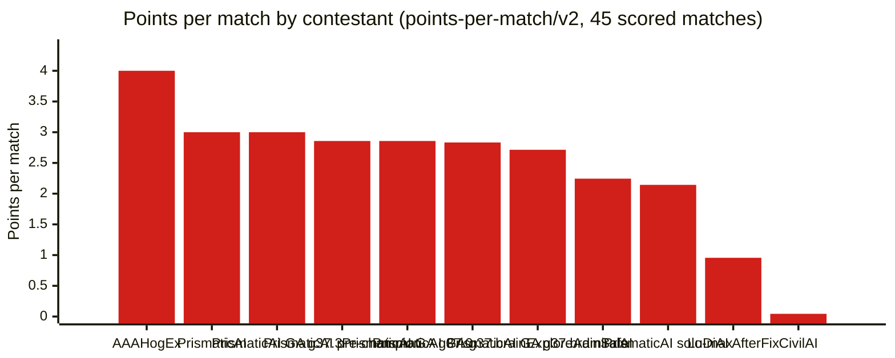
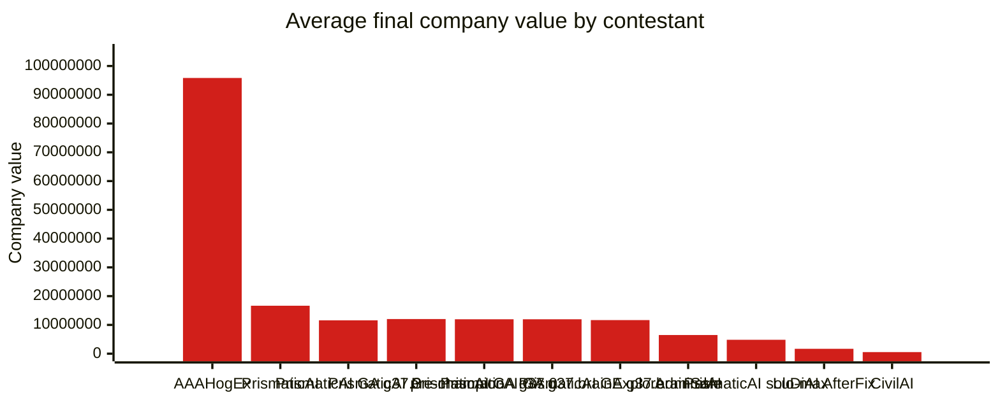
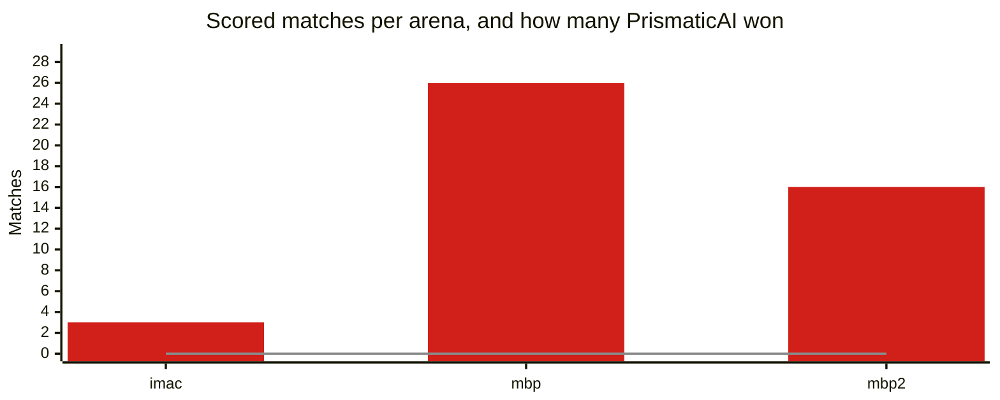

# battle-20261119T163955-f2d8edb4

Derived from `battle-20261119T163955-f2d8edb4.json` by `tools/research/ai-battle/battle.py report`; do not edit.

- Edition `f2d8edb4d8f3e18c`: PrismaticAI and referee at `ebf7516b54d7130fa0908c68ff298075c517fb41`, base set `opengfx-8.0.tar`
- 20-year free-for-all from 1960, map 256x256 temperate, breakdowns 1
- 45 scored match(es) on `imac` (20261119-master-gdf1e05e7d8), `mbp` (20261119-master-m7235eee285), `mbp2` (20261119-master-gdf1e05e7d8)
- Replays: 0 of 1 identical to their original on another arena

| # | Contestant | Played | Wins | Points | Points/match | Avg rank | Avg final value | Squirrel errors | Matches with anomalies |
|---|---|---|---|---|---|---|---|---|---|
| 1 | AAAHogEx | 45 | 45 | 180 | 4.0 | 1.0 | 95.8 M | 0 | 0 |
| 2 | PrismaticAI | 5 | 0 | 15 | 3.0 | 2.0 | 16.7 M | 0 | 0 |
| 3 | PrismaticAI GA g37.3 | 6 | 0 | 18 | 3.0 | 2.0 | 11.6 M | 0 | 0 |
| 4 | PrismaticAI pre-champion | 7 | 0 | 20 | 2.857 | 2.14 | 12.0 M | 0 | 0 |
| 5 | PrismaticAI GA g37.0 | 7 | 0 | 20 | 2.857 | 2.14 | 12.0 M | 0 | 0 |
| 6 | PrismaticAI GA g37.brainExplore | 6 | 0 | 17 | 2.833 | 2.17 | 12.0 M | 0 | 1 |
| 7 | PrismaticAI GA g37.brainSafe | 7 | 0 | 19 | 2.714 | 2.29 | 11.7 M | 0 | 2 |
| 8 | AdmiralAI | 45 | 0 | 101 | 2.244 | 2.76 | 6.5 M | 57 | 2 |
| 9 | PrismaticAI solo-max | 7 | 0 | 15 | 2.143 | 2.86 | 4.8 M | 0 | 7 |
| 10 | LuDiAI AfterFix | 45 | 0 | 43 | 0.956 | 4.04 | 1.7 M | 0 | 3 |
| 11 | CivilAI | 45 | 0 | 2 | 0.044 | 4.96 | 547.0 k | 0 | 9 |

```mermaid
---
config:
  xyChart:
    width: 900
    height: 360
  themeVariables:
    xyChart:
      plotColorPalette: "#d11f1a, #8a8a8a, #0b0b0b, #ece4d6"
---
xychart-beta
    title "Final company value per scored match: winner vs best PrismaticAI"
    x-axis ["m-0001", "m-0002", "m-0003", "m-0004", "m-0005", "m-0006", "m-0007", "m-0008", "m-0009", "m-0010", "m-0011", "m-0012", "m-0013", "m-0014", "m-0015", "m-0016", "m-0017", "m-0018", "m-0019", "m-0020", "m-0021", "m-0022", "m-0023", "m-0024", "m-0025", "m-0026", "m-0027", "m-0028", "m-0036", "m-0037", "m-0038", "m-0039", "m-0040", "m-0041", "m-0042", "m-0043", "m-0044", "m-0046", "m-0052", "m-0053", "m-0054", "m-0055", "m-0057", "m-0058", "m-0059"]
    %% series: Winner | Best PrismaticAI
    %% links: battle-20261119T163955-f2d8edb4.md?col=Match&filter=m-0001 | battle-20261119T163955-f2d8edb4.md?col=Match&filter=m-0002 | battle-20261119T163955-f2d8edb4.md?col=Match&filter=m-0003 | battle-20261119T163955-f2d8edb4.md?col=Match&filter=m-0004 | battle-20261119T163955-f2d8edb4.md?col=Match&filter=m-0005 | battle-20261119T163955-f2d8edb4.md?col=Match&filter=m-0006 | battle-20261119T163955-f2d8edb4.md?col=Match&filter=m-0007 | battle-20261119T163955-f2d8edb4.md?col=Match&filter=m-0008 | battle-20261119T163955-f2d8edb4.md?col=Match&filter=m-0009 | battle-20261119T163955-f2d8edb4.md?col=Match&filter=m-0010 | battle-20261119T163955-f2d8edb4.md?col=Match&filter=m-0011 | battle-20261119T163955-f2d8edb4.md?col=Match&filter=m-0012 | battle-20261119T163955-f2d8edb4.md?col=Match&filter=m-0013 | battle-20261119T163955-f2d8edb4.md?col=Match&filter=m-0014 | battle-20261119T163955-f2d8edb4.md?col=Match&filter=m-0015 | battle-20261119T163955-f2d8edb4.md?col=Match&filter=m-0016 | battle-20261119T163955-f2d8edb4.md?col=Match&filter=m-0017 | battle-20261119T163955-f2d8edb4.md?col=Match&filter=m-0018 | battle-20261119T163955-f2d8edb4.md?col=Match&filter=m-0019 | battle-20261119T163955-f2d8edb4.md?col=Match&filter=m-0020 | battle-20261119T163955-f2d8edb4.md?col=Match&filter=m-0021 | battle-20261119T163955-f2d8edb4.md?col=Match&filter=m-0022 | battle-20261119T163955-f2d8edb4.md?col=Match&filter=m-0023 | battle-20261119T163955-f2d8edb4.md?col=Match&filter=m-0024 | battle-20261119T163955-f2d8edb4.md?col=Match&filter=m-0025 | battle-20261119T163955-f2d8edb4.md?col=Match&filter=m-0026 | battle-20261119T163955-f2d8edb4.md?col=Match&filter=m-0027 | battle-20261119T163955-f2d8edb4.md?col=Match&filter=m-0028 | battle-20261119T163955-f2d8edb4.md?col=Match&filter=m-0036 | battle-20261119T163955-f2d8edb4.md?col=Match&filter=m-0037 | battle-20261119T163955-f2d8edb4.md?col=Match&filter=m-0038 | battle-20261119T163955-f2d8edb4.md?col=Match&filter=m-0039 | battle-20261119T163955-f2d8edb4.md?col=Match&filter=m-0040 | battle-20261119T163955-f2d8edb4.md?col=Match&filter=m-0041 | battle-20261119T163955-f2d8edb4.md?col=Match&filter=m-0042 | battle-20261119T163955-f2d8edb4.md?col=Match&filter=m-0043 | battle-20261119T163955-f2d8edb4.md?col=Match&filter=m-0044 | battle-20261119T163955-f2d8edb4.md?col=Match&filter=m-0046 | battle-20261119T163955-f2d8edb4.md?col=Match&filter=m-0052 | battle-20261119T163955-f2d8edb4.md?col=Match&filter=m-0053 | battle-20261119T163955-f2d8edb4.md?col=Match&filter=m-0054 | battle-20261119T163955-f2d8edb4.md?col=Match&filter=m-0055 | battle-20261119T163955-f2d8edb4.md?col=Match&filter=m-0057 | battle-20261119T163955-f2d8edb4.md?col=Match&filter=m-0058 | battle-20261119T163955-f2d8edb4.md?col=Match&filter=m-0059
    y-axis "Company value" 0 --> 165000000
    bar [102175968, 69817016, 69908964, 66761509, 81192328, 69414818, 106323032, 92272888, 93221307, 50393727, 97484448, 105214370, 70881368, 118738867, 142134212, 115483638, 150061925, 126326197, 134236008, 146274301, 91068327, 103958532, 104647224, 88360544, 71500096, 88911458, 89409242, 137549566, 93864806, 115219357, 104220907, 81922969, 111068302, 96291175, 82030853, 98599641, 97740208, 89856700, 78014541, 90307264, 70448821, 76958848, 70168114, 98019661, 74283521]
    line [4317248, 13676922, 10880377, 16939039, 11434964, 15086999, 18262431, 4300999, 11570547, 19626051, 16269311, 19983246, 15928967, 17371332, 3444871, 14458598, 6666102, 10688739, 6500436, 4541128, 16051226, 7175072, 9693217, 9015989, 6685650, 13359879, 7598504, 11191881, 5819077, 11187629, 15718938, 12850097, 13736909, 18054131, 20443722, 3174337, 9548821, 14726439, 7125173, 3521303, 6707985, 8331102, 5549501, 14108001, 14663005]
```

<!-- battle-charts:begin -->
<!-- derived from battle-20261119T163955-f2d8edb4.json by `battle.py render`; `battle.py check` fails when it is stale -->

<!-- battle-charts:end -->

| Seed | Original | Replay | Arenas | Identical |
|---|---|---|---|---|
| 135005749 | m-0010 | m-0056 | imac / mbp | NO |

| Match | Arena | Seed | Winner | Value | Last | Anomalies |
|---|---|---|---|---|---|---|
| m-0001 | mbp | 178472613 | AAAHogEx | 102.2 M | CivilAI | PrismaticAI solo-max: fleet_drop:37->19 |
| m-0002 | mbp | 178472613 | AAAHogEx | 69.8 M | CivilAI | - |
| m-0003 | mbp | 178472613 | AAAHogEx | 69.9 M | CivilAI | - |
| m-0004 | mbp | 178472613 | AAAHogEx | 66.8 M | CivilAI | - |
| m-0005 | mbp | 178472613 | AAAHogEx | 81.2 M | CivilAI | - |
| m-0006 | mbp | 178472613 | AAAHogEx | 69.4 M | CivilAI | - |
| m-0007 | mbp | 135005749 | AAAHogEx | 106.3 M | CivilAI | LuDiAI AfterFix: fleet_drop:45->20 |
| m-0008 | mbp | 135005749 | AAAHogEx | 92.3 M | CivilAI | PrismaticAI solo-max: fleet_drop:38->12 |
| m-0009 | mbp | 135005749 | AAAHogEx | 93.2 M | LuDiAI AfterFix | - |
| m-0010 | imac | 135005749 | AAAHogEx | 50.4 M | CivilAI | - |
| m-0011 | imac | 135005749 | AAAHogEx | 97.5 M | CivilAI | CivilAI: fleet_drop:30->13 |
| m-0012 | imac | 135005749 | AAAHogEx | 105.2 M | CivilAI | CivilAI: fleet_drop:20->12 |
| m-0013 | mbp2 | 135005749 | AAAHogEx | 70.9 M | CivilAI | CivilAI: fleet_drop:13->8 |
| m-0014 | mbp2 | 1779983185 | AAAHogEx | 118.7 M | CivilAI | - |
| m-0015 | mbp2 | 1779983185 | AAAHogEx | 142.1 M | CivilAI | PrismaticAI solo-max: fleet_drop:34->18 |
| m-0016 | mbp2 | 1779983185 | AAAHogEx | 115.5 M | CivilAI | CivilAI: fleet_drop:57->24 |
| m-0017 | mbp2 | 1779983185 | AAAHogEx | 150.1 M | CivilAI | CivilAI: fleet_drop:39->24 |
| m-0018 | mbp2 | 1779983185 | AAAHogEx | 126.3 M | CivilAI | PrismaticAI GA g37.brainSafe: fleet_drop:94->63; CivilAI: fleet_drop:13->5 |
| m-0019 | mbp2 | 1779983185 | AAAHogEx | 134.2 M | CivilAI | - |
| m-0020 | mbp2 | 1779983185 | AAAHogEx | 146.3 M | LuDiAI AfterFix | - |
| m-0021 | mbp2 | 265698458 | AAAHogEx | 91.1 M | CivilAI | - |
| m-0022 | mbp2 | 265698458 | AAAHogEx | 104.0 M | CivilAI | PrismaticAI solo-max: fleet_drop:38->25 |
| m-0023 | mbp2 | 265698458 | AAAHogEx | 104.6 M | CivilAI | - |
| m-0024 | mbp2 | 265698458 | AAAHogEx | 88.4 M | CivilAI | - |
| m-0025 | mbp2 | 265698458 | AAAHogEx | 71.5 M | CivilAI | - |
| m-0026 | mbp2 | 265698458 | AAAHogEx | 88.9 M | CivilAI | AdmiralAI: fleet_drop:252->138; CivilAI: fleet_drop:15->10 |
| m-0027 | mbp2 | 265698458 | AAAHogEx | 89.4 M | CivilAI | - |
| m-0028 | mbp2 | 1282131635 | AAAHogEx | 137.5 M | CivilAI | - |
| m-0036 | mbp | 1816381444 | AAAHogEx | 93.9 M | CivilAI | PrismaticAI solo-max: fleet_drop:44->25; CivilAI: fleet_drop:33->11 |
| m-0037 | mbp | 1816381444 | AAAHogEx | 115.2 M | CivilAI | - |
| m-0038 | mbp | 1816381444 | AAAHogEx | 104.2 M | CivilAI | - |
| m-0039 | mbp | 1816381444 | AAAHogEx | 81.9 M | CivilAI | LuDiAI AfterFix: fleet_drop:156->109 |
| m-0040 | mbp | 1816381444 | AAAHogEx | 111.1 M | CivilAI | PrismaticAI GA g37.brainExplore: fleet_drop:113->79 |
| m-0041 | mbp | 1816381444 | AAAHogEx | 96.3 M | CivilAI | - |
| m-0042 | mbp | 1682947286 | AAAHogEx | 82.0 M | CivilAI | - |
| m-0043 | mbp | 1682947286 | AAAHogEx | 98.6 M | CivilAI | PrismaticAI solo-max: fleet_drop:33->12 |
| m-0044 | mbp | 1682947286 | AAAHogEx | 97.7 M | CivilAI | - |
| m-0046 | mbp | 1682947286 | AAAHogEx | 89.9 M | CivilAI | AdmiralAI: squirrel_errors:57 |
| m-0052 | mbp | 397419625 | AAAHogEx | 78.0 M | CivilAI | - |
| m-0053 | mbp | 397419625 | AAAHogEx | 90.3 M | CivilAI | PrismaticAI GA g37.brainSafe: fleet_drop:50->25 |
| m-0054 | mbp | 397419625 | AAAHogEx | 70.4 M | CivilAI | - |
| m-0055 | mbp | 397419625 | AAAHogEx | 77.0 M | CivilAI | LuDiAI AfterFix: fleet_drop:68->45 |
| m-0056 (replay) | mbp | 135005749 | AAAHogEx | 56.1 M | CivilAI | CivilAI: fleet_drop:12->6 |
| m-0057 | mbp | 1493905563 | AAAHogEx | 70.2 M | CivilAI | PrismaticAI solo-max: fleet_drop:35->17 |
| m-0058 | mbp | 1493905563 | AAAHogEx | 98.0 M | CivilAI | CivilAI: fleet_drop:41->14 |
| m-0059 | mbp | 1493905563 | AAAHogEx | 74.3 M | CivilAI | - |
