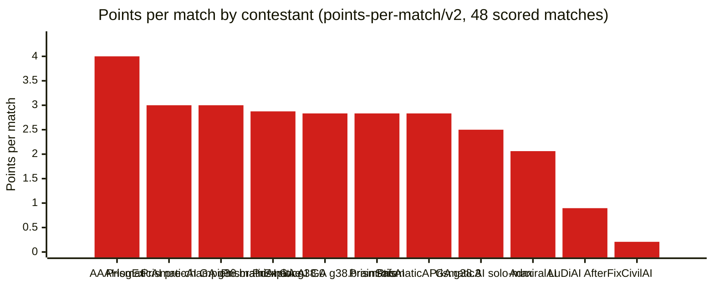
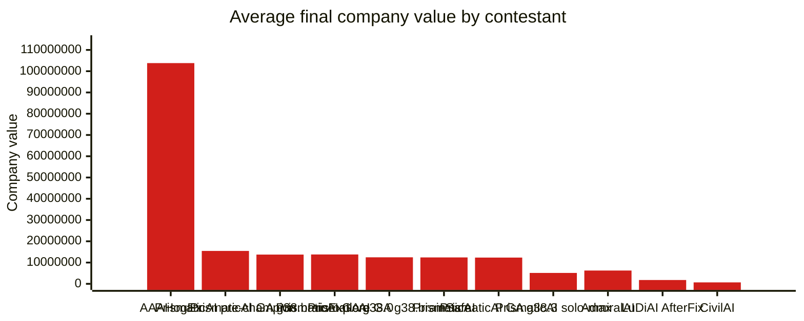
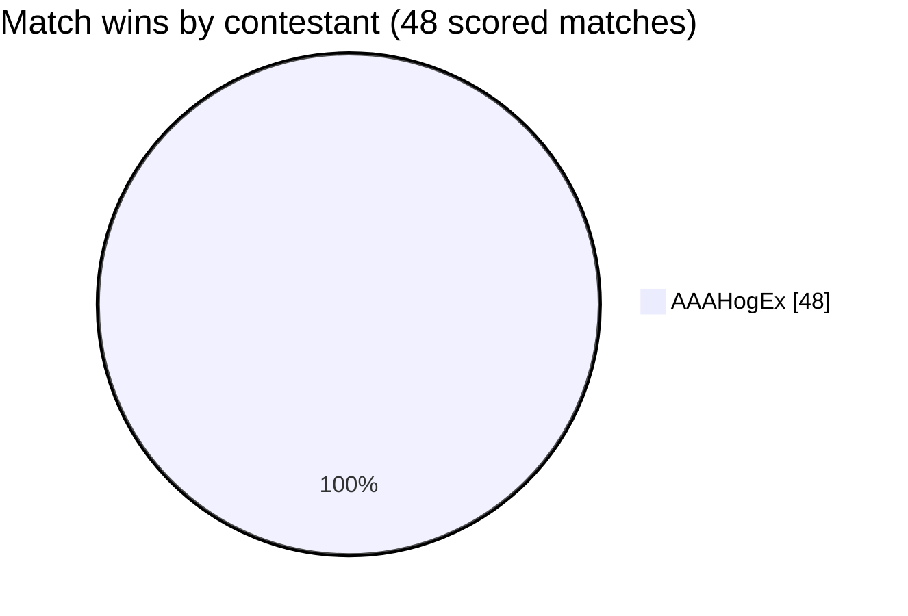
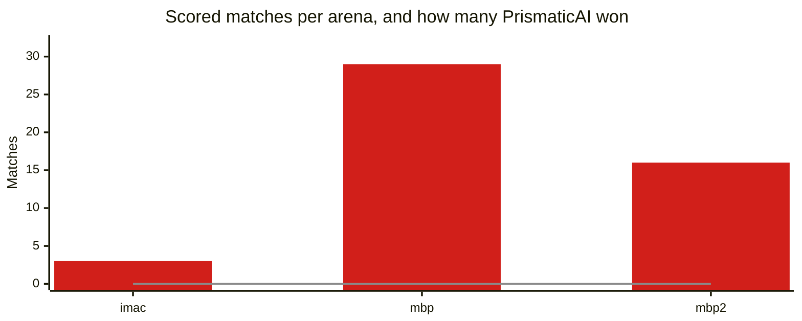

# battle-20261119T165341-f9116fc0

Derived from `battle-20261119T165341-f9116fc0.json` by `tools/research/ai-battle/battle.py report`; do not edit.

- Edition `f9116fc029620c7e`: PrismaticAI and referee at `ebf7516b54d7130fa0908c68ff298075c517fb41`, base set `opengfx-8.0.tar`
- 20-year free-for-all from 1960, map 256x256 temperate, breakdowns 1
- 48 scored match(es) on `imac` (20261119-master-gdf1e05e7d8), `mbp` (20261119-master-m7235eee285), `mbp2` (20261119-master-gdf1e05e7d8)
- Replays: 1 of 1 identical to their original on another arena

| # | Contestant | Played | Wins | Points | Points/match | Avg rank | Avg final value | Squirrel errors | Matches with anomalies |
|---|---|---|---|---|---|---|---|---|---|
| 1 | AAAHogEx | 48 | 48 | 192 | 4.0 | 1.0 | 103.8 M | 0 | 0 |
| 2 | PrismaticAI pre-champion | 7 | 0 | 21 | 3.0 | 2.0 | 15.5 M | 0 | 0 |
| 3 | PrismaticAI GA g38.brainExplore | 7 | 0 | 21 | 3.0 | 2.0 | 13.7 M | 0 | 4 |
| 4 | PrismaticAI GA g38.0 | 8 | 0 | 23 | 2.875 | 2.12 | 13.8 M | 0 | 3 |
| 5 | PrismaticAI GA g38.brainSafe | 6 | 0 | 17 | 2.833 | 2.17 | 12.5 M | 0 | 4 |
| 6 | PrismaticAI | 6 | 0 | 17 | 2.833 | 2.17 | 12.4 M | 0 | 0 |
| 7 | PrismaticAI GA g38.3 | 6 | 0 | 17 | 2.833 | 2.17 | 12.3 M | 0 | 3 |
| 8 | PrismaticAI solo-max | 8 | 0 | 20 | 2.5 | 2.5 | 5.1 M | 0 | 8 |
| 9 | AdmiralAI | 48 | 0 | 99 | 2.062 | 2.94 | 6.2 M | 0 | 2 |
| 10 | LuDiAI AfterFix | 48 | 0 | 43 | 0.896 | 4.1 | 1.8 M | 0 | 1 |
| 11 | CivilAI | 48 | 0 | 10 | 0.208 | 4.79 | 673.9 k | 3730 | 7 |

```mermaid
---
config:
  xyChart:
    width: 900
    height: 360
  themeVariables:
    xyChart:
      plotColorPalette: "#d11f1a, #8a8a8a, #0b0b0b, #ece4d6"
---
xychart-beta
    title "Final company value per scored match: winner vs best PrismaticAI"
    x-axis ["m-0001", "m-0002", "m-0003", "m-0004", "m-0005", "m-0006", "m-0007", "m-0008", "m-0009", "m-0010", "m-0011", "m-0012", "m-0013", "m-0014", "m-0015", "m-0016", "m-0017", "m-0018", "m-0019", "m-0020", "m-0021", "m-0022", "m-0023", "m-0024", "m-0025", "m-0026", "m-0027", "m-0028", "m-0036", "m-0037", "m-0038", "m-0039", "m-0040", "m-0041", "m-0042", "m-0043", "m-0044", "m-0045", "m-0046", "m-0047", "m-0049", "m-0050", "m-0051", "m-0052", "m-0054", "m-0073", "m-0076", "m-0078"]
    %% series: Winner | Best PrismaticAI
    %% links: battle-20261119T165341-f9116fc0.md?col=Match&filter=m-0001 | battle-20261119T165341-f9116fc0.md?col=Match&filter=m-0002 | battle-20261119T165341-f9116fc0.md?col=Match&filter=m-0003 | battle-20261119T165341-f9116fc0.md?col=Match&filter=m-0004 | battle-20261119T165341-f9116fc0.md?col=Match&filter=m-0005 | battle-20261119T165341-f9116fc0.md?col=Match&filter=m-0006 | battle-20261119T165341-f9116fc0.md?col=Match&filter=m-0007 | battle-20261119T165341-f9116fc0.md?col=Match&filter=m-0008 | battle-20261119T165341-f9116fc0.md?col=Match&filter=m-0009 | battle-20261119T165341-f9116fc0.md?col=Match&filter=m-0010 | battle-20261119T165341-f9116fc0.md?col=Match&filter=m-0011 | battle-20261119T165341-f9116fc0.md?col=Match&filter=m-0012 | battle-20261119T165341-f9116fc0.md?col=Match&filter=m-0013 | battle-20261119T165341-f9116fc0.md?col=Match&filter=m-0014 | battle-20261119T165341-f9116fc0.md?col=Match&filter=m-0015 | battle-20261119T165341-f9116fc0.md?col=Match&filter=m-0016 | battle-20261119T165341-f9116fc0.md?col=Match&filter=m-0017 | battle-20261119T165341-f9116fc0.md?col=Match&filter=m-0018 | battle-20261119T165341-f9116fc0.md?col=Match&filter=m-0019 | battle-20261119T165341-f9116fc0.md?col=Match&filter=m-0020 | battle-20261119T165341-f9116fc0.md?col=Match&filter=m-0021 | battle-20261119T165341-f9116fc0.md?col=Match&filter=m-0022 | battle-20261119T165341-f9116fc0.md?col=Match&filter=m-0023 | battle-20261119T165341-f9116fc0.md?col=Match&filter=m-0024 | battle-20261119T165341-f9116fc0.md?col=Match&filter=m-0025 | battle-20261119T165341-f9116fc0.md?col=Match&filter=m-0026 | battle-20261119T165341-f9116fc0.md?col=Match&filter=m-0027 | battle-20261119T165341-f9116fc0.md?col=Match&filter=m-0028 | battle-20261119T165341-f9116fc0.md?col=Match&filter=m-0036 | battle-20261119T165341-f9116fc0.md?col=Match&filter=m-0037 | battle-20261119T165341-f9116fc0.md?col=Match&filter=m-0038 | battle-20261119T165341-f9116fc0.md?col=Match&filter=m-0039 | battle-20261119T165341-f9116fc0.md?col=Match&filter=m-0040 | battle-20261119T165341-f9116fc0.md?col=Match&filter=m-0041 | battle-20261119T165341-f9116fc0.md?col=Match&filter=m-0042 | battle-20261119T165341-f9116fc0.md?col=Match&filter=m-0043 | battle-20261119T165341-f9116fc0.md?col=Match&filter=m-0044 | battle-20261119T165341-f9116fc0.md?col=Match&filter=m-0045 | battle-20261119T165341-f9116fc0.md?col=Match&filter=m-0046 | battle-20261119T165341-f9116fc0.md?col=Match&filter=m-0047 | battle-20261119T165341-f9116fc0.md?col=Match&filter=m-0049 | battle-20261119T165341-f9116fc0.md?col=Match&filter=m-0050 | battle-20261119T165341-f9116fc0.md?col=Match&filter=m-0051 | battle-20261119T165341-f9116fc0.md?col=Match&filter=m-0052 | battle-20261119T165341-f9116fc0.md?col=Match&filter=m-0054 | battle-20261119T165341-f9116fc0.md?col=Match&filter=m-0073 | battle-20261119T165341-f9116fc0.md?col=Match&filter=m-0076 | battle-20261119T165341-f9116fc0.md?col=Match&filter=m-0078
    y-axis "Company value" 0 --> 165000000
    bar [106185045, 116900644, 107545185, 119887743, 97388509, 104317285, 81038220, 102297521, 115612315, 91872388, 82201259, 85845353, 79940730, 73265438, 95603040, 61717615, 64345191, 73235248, 76638555, 71563689, 143211172, 133829868, 125117021, 139941972, 131659306, 123636952, 120214942, 105892295, 142923528, 108540221, 85261537, 77802559, 91815284, 94839293, 131621417, 150217098, 119407089, 94593580, 113237662, 122379289, 88494930, 123558815, 95017724, 96547511, 106195796, 81405679, 93647363, 134271522]
    line [4479275, 19241554, 11150504, 13512590, 14848962, 15180689, 14943820, 7892816, 14760763, 19598493, 13294538, 13161924, 21911080, 8440925, 3761333, 11054111, 11251781, 8966640, 13522040, 11123463, 7297749, 4935193, 10248721, 4104456, 12261559, 12273328, 3567826, 15415389, 3563101, 15910616, 10338463, 8107267, 11449850, 11980840, 15236876, 5380891, 20248555, 25106871, 18668193, 21759941, 13143801, 4275692, 16814319, 17906893, 9218585, 10961764, 10262261, 6667831]
```

<!-- battle-charts:begin -->
<!-- derived from battle-20261119T165341-f9116fc0.json by `battle.py render`; `battle.py check` fails when it is stale -->

<!-- battle-charts:end -->

| Seed | Original | Replay | Arenas | Identical |
|---|---|---|---|---|
| 1218322093 | m-0015 | m-0048 | mbp2 / mbp | yes |

| Match | Arena | Seed | Winner | Value | Last | Anomalies |
|---|---|---|---|---|---|---|
| m-0001 | mbp | 273906673 | AAAHogEx | 106.2 M | CivilAI | PrismaticAI solo-max: fleet_drop:34->16 |
| m-0002 | mbp | 273906673 | AAAHogEx | 116.9 M | CivilAI | CivilAI: squirrel_errors:3730 |
| m-0003 | mbp | 273906673 | AAAHogEx | 107.5 M | AdmiralAI | PrismaticAI GA g38.0: fleet_drop:99->64; AdmiralAI: no_vehicles |
| m-0004 | mbp | 273906673 | AAAHogEx | 119.9 M | CivilAI | PrismaticAI GA g38.brainSafe: fleet_drop:135->61 |
| m-0005 | mbp | 273906673 | AAAHogEx | 97.4 M | CivilAI | PrismaticAI GA g38.brainExplore: fleet_drop:130->38 |
| m-0006 | mbp | 273906673 | AAAHogEx | 104.3 M | CivilAI | - |
| m-0007 | mbp | 98607722 | AAAHogEx | 81.0 M | CivilAI | - |
| m-0008 | mbp | 98607722 | AAAHogEx | 102.3 M | CivilAI | PrismaticAI solo-max: fleet_drop:45->26 |
| m-0009 | mbp | 98607722 | AAAHogEx | 115.6 M | CivilAI | CivilAI: no_vehicles |
| m-0010 | imac | 98607722 | AAAHogEx | 91.9 M | CivilAI | - |
| m-0011 | imac | 98607722 | AAAHogEx | 82.2 M | CivilAI | - |
| m-0012 | imac | 98607722 | AAAHogEx | 85.8 M | CivilAI | PrismaticAI GA g38.brainExplore: fleet_drop:135->85 |
| m-0013 | mbp2 | 98607722 | AAAHogEx | 79.9 M | CivilAI | PrismaticAI GA g38.3: fleet_drop:136->86 |
| m-0014 | mbp2 | 1218322093 | AAAHogEx | 73.3 M | CivilAI | - |
| m-0015 | mbp2 | 1218322093 | AAAHogEx | 95.6 M | CivilAI | PrismaticAI solo-max: fleet_drop:30->16 |
| m-0016 | mbp2 | 1218322093 | AAAHogEx | 61.7 M | CivilAI | - |
| m-0017 | mbp2 | 1218322093 | AAAHogEx | 64.3 M | CivilAI | - |
| m-0018 | mbp2 | 1218322093 | AAAHogEx | 73.2 M | CivilAI | - |
| m-0019 | mbp2 | 1218322093 | AAAHogEx | 76.6 M | CivilAI | PrismaticAI GA g38.brainExplore: fleet_drop:87->39 |
| m-0020 | mbp2 | 1218322093 | AAAHogEx | 71.6 M | CivilAI | PrismaticAI GA g38.3: fleet_drop:159->102 |
| m-0021 | mbp2 | 124001049 | AAAHogEx | 143.2 M | CivilAI | - |
| m-0022 | mbp2 | 124001049 | AAAHogEx | 133.8 M | CivilAI | PrismaticAI solo-max: fleet_drop:45->20 |
| m-0023 | mbp2 | 124001049 | AAAHogEx | 125.1 M | CivilAI | - |
| m-0024 | mbp2 | 124001049 | AAAHogEx | 139.9 M | CivilAI | AdmiralAI: fleet_drop:337->204; PrismaticAI GA g38.0: fleet_drop:83->57 |
| m-0025 | mbp2 | 124001049 | AAAHogEx | 131.7 M | CivilAI | PrismaticAI GA g38.brainSafe: fleet_drop:130->46 |
| m-0026 | mbp2 | 124001049 | AAAHogEx | 123.6 M | CivilAI | - |
| m-0027 | mbp2 | 124001049 | AAAHogEx | 120.2 M | CivilAI | PrismaticAI GA g38.3: fleet_drop:145->44 |
| m-0028 | mbp2 | 734132 | AAAHogEx | 105.9 M | LuDiAI AfterFix | - |
| m-0036 | mbp | 114469984 | AAAHogEx | 142.9 M | CivilAI | PrismaticAI solo-max: fleet_drop:39->16 |
| m-0037 | mbp | 114469984 | AAAHogEx | 108.5 M | CivilAI | LuDiAI AfterFix: fleet_drop:64->34 |
| m-0038 | mbp | 114469984 | AAAHogEx | 85.3 M | CivilAI | - |
| m-0039 | mbp | 114469984 | AAAHogEx | 77.8 M | LuDiAI AfterFix | PrismaticAI GA g38.brainSafe: fleet_drop:84->43 |
| m-0040 | mbp | 114469984 | AAAHogEx | 91.8 M | CivilAI | CivilAI: fleet_drop:23->5 |
| m-0041 | mbp | 114469984 | AAAHogEx | 94.8 M | CivilAI | CivilAI: fleet_drop:41->23 |
| m-0042 | mbp | 1652373654 | AAAHogEx | 131.6 M | LuDiAI AfterFix | CivilAI: fleet_drop:46->32 |
| m-0043 | mbp | 1652373654 | AAAHogEx | 150.2 M | LuDiAI AfterFix | PrismaticAI solo-max: fleet_drop:51->26 |
| m-0044 | mbp | 1652373654 | AAAHogEx | 119.4 M | LuDiAI AfterFix | CivilAI: fleet_drop:61->42 |
| m-0045 | mbp | 1652373654 | AAAHogEx | 94.6 M | CivilAI | CivilAI: fleet_drop:36->17 |
| m-0046 | mbp | 1652373654 | AAAHogEx | 113.2 M | LuDiAI AfterFix | PrismaticAI GA g38.brainSafe: fleet_drop:185->62 |
| m-0047 | mbp | 1652373654 | AAAHogEx | 122.4 M | AdmiralAI | PrismaticAI GA g38.brainExplore: fleet_drop:129->75 |
| m-0048 (replay) | mbp | 1218322093 | AAAHogEx | 95.6 M | CivilAI | PrismaticAI solo-max: fleet_drop:30->16 |
| m-0049 | mbp | 265669516 | AAAHogEx | 88.5 M | CivilAI | - |
| m-0050 | mbp | 265669516 | AAAHogEx | 123.6 M | CivilAI | PrismaticAI solo-max: fleet_drop:43->22 |
| m-0051 | mbp | 265669516 | AAAHogEx | 95.0 M | CivilAI | - |
| m-0052 | mbp | 265669516 | AAAHogEx | 96.5 M | CivilAI | - |
| m-0054 | mbp | 265669516 | AAAHogEx | 106.2 M | CivilAI | - |
| m-0073 | mbp | 1245953641 | AAAHogEx | 81.4 M | CivilAI | PrismaticAI GA g38.0: fleet_drop:84->51 |
| m-0076 | mbp | 1245953641 | AAAHogEx | 93.6 M | CivilAI | - |
| m-0078 | mbp | 275799857 | AAAHogEx | 134.3 M | CivilAI | PrismaticAI solo-max: fleet_drop:40->22 |
