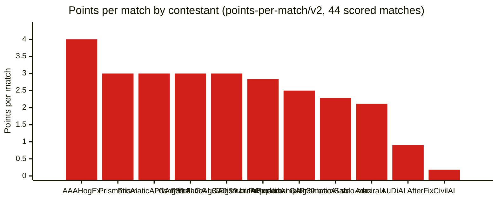
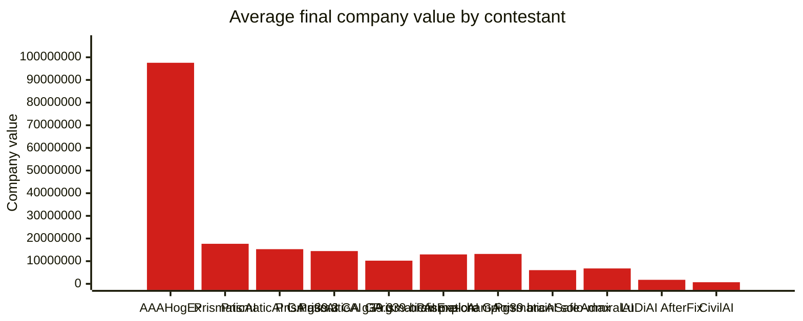
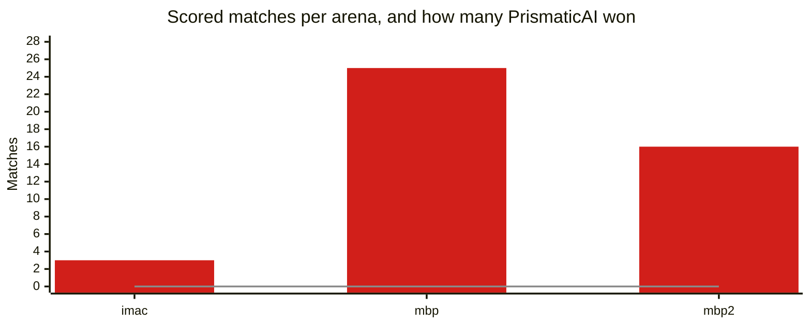

# battle-20261119T170558-287737c4

Derived from `battle-20261119T170558-287737c4.json` by `tools/research/ai-battle/battle.py report`; do not edit.

- Edition `287737c4e86a8c53`: PrismaticAI and referee at `ebf7516b54d7130fa0908c68ff298075c517fb41`, base set `opengfx-8.0.tar`
- 20-year free-for-all from 1960, map 256x256 temperate, breakdowns 1
- 44 scored match(es) on `imac` (20261119-master-gdf1e05e7d8), `mbp` (20261119-master-m7235eee285), `mbp2` (20261119-master-gdf1e05e7d8)
- Replays: 0 of 0 identical to their original on another arena

| # | Contestant | Played | Wins | Points | Points/match | Avg rank | Avg final value | Squirrel errors | Matches with anomalies |
|---|---|---|---|---|---|---|---|---|---|
| 1 | AAAHogEx | 44 | 44 | 176 | 4.0 | 1.0 | 97.6 M | 0 | 0 |
| 2 | PrismaticAI | 6 | 0 | 18 | 3.0 | 2.0 | 17.7 M | 0 | 0 |
| 3 | PrismaticAI GA g39.3 | 6 | 0 | 18 | 3.0 | 2.0 | 15.3 M | 0 | 1 |
| 4 | PrismaticAI GA g39.0 | 7 | 0 | 21 | 3.0 | 2.0 | 14.5 M | 0 | 2 |
| 5 | PrismaticAI GA g39.brainExplore | 6 | 0 | 18 | 3.0 | 2.0 | 10.2 M | 0 | 1 |
| 6 | PrismaticAI pre-champion | 6 | 0 | 17 | 2.833 | 2.17 | 13.0 M | 0 | 0 |
| 7 | PrismaticAI GA g39.brainSafe | 6 | 0 | 15 | 2.5 | 2.5 | 13.2 M | 0 | 0 |
| 8 | PrismaticAI solo-max | 7 | 0 | 16 | 2.286 | 2.71 | 6.0 M | 0 | 7 |
| 9 | AdmiralAI | 44 | 0 | 93 | 2.114 | 2.89 | 6.8 M | 47 | 2 |
| 10 | LuDiAI AfterFix | 44 | 0 | 40 | 0.909 | 4.09 | 1.8 M | 0 | 0 |
| 11 | CivilAI | 44 | 0 | 8 | 0.182 | 4.82 | 702.4 k | 7643 | 10 |

```mermaid
---
config:
  xyChart:
    width: 900
    height: 360
  themeVariables:
    xyChart:
      plotColorPalette: "#d11f1a, #8a8a8a, #0b0b0b, #ece4d6"
---
xychart-beta
    title "Final company value per scored match: winner vs best PrismaticAI"
    x-axis ["m-0001", "m-0002", "m-0003", "m-0004", "m-0005", "m-0006", "m-0007", "m-0008", "m-0009", "m-0010", "m-0011", "m-0012", "m-0013", "m-0014", "m-0015", "m-0016", "m-0017", "m-0018", "m-0019", "m-0020", "m-0021", "m-0022", "m-0023", "m-0024", "m-0025", "m-0026", "m-0027", "m-0028", "m-0036", "m-0037", "m-0038", "m-0039", "m-0040", "m-0041", "m-0042", "m-0043", "m-0044", "m-0045", "m-0046", "m-0047", "m-0048", "m-0049", "m-0050", "m-0052"]
    %% series: Winner | Best PrismaticAI
    %% links: battle-20261119T170558-287737c4.md?col=Match&filter=m-0001 | battle-20261119T170558-287737c4.md?col=Match&filter=m-0002 | battle-20261119T170558-287737c4.md?col=Match&filter=m-0003 | battle-20261119T170558-287737c4.md?col=Match&filter=m-0004 | battle-20261119T170558-287737c4.md?col=Match&filter=m-0005 | battle-20261119T170558-287737c4.md?col=Match&filter=m-0006 | battle-20261119T170558-287737c4.md?col=Match&filter=m-0007 | battle-20261119T170558-287737c4.md?col=Match&filter=m-0008 | battle-20261119T170558-287737c4.md?col=Match&filter=m-0009 | battle-20261119T170558-287737c4.md?col=Match&filter=m-0010 | battle-20261119T170558-287737c4.md?col=Match&filter=m-0011 | battle-20261119T170558-287737c4.md?col=Match&filter=m-0012 | battle-20261119T170558-287737c4.md?col=Match&filter=m-0013 | battle-20261119T170558-287737c4.md?col=Match&filter=m-0014 | battle-20261119T170558-287737c4.md?col=Match&filter=m-0015 | battle-20261119T170558-287737c4.md?col=Match&filter=m-0016 | battle-20261119T170558-287737c4.md?col=Match&filter=m-0017 | battle-20261119T170558-287737c4.md?col=Match&filter=m-0018 | battle-20261119T170558-287737c4.md?col=Match&filter=m-0019 | battle-20261119T170558-287737c4.md?col=Match&filter=m-0020 | battle-20261119T170558-287737c4.md?col=Match&filter=m-0021 | battle-20261119T170558-287737c4.md?col=Match&filter=m-0022 | battle-20261119T170558-287737c4.md?col=Match&filter=m-0023 | battle-20261119T170558-287737c4.md?col=Match&filter=m-0024 | battle-20261119T170558-287737c4.md?col=Match&filter=m-0025 | battle-20261119T170558-287737c4.md?col=Match&filter=m-0026 | battle-20261119T170558-287737c4.md?col=Match&filter=m-0027 | battle-20261119T170558-287737c4.md?col=Match&filter=m-0028 | battle-20261119T170558-287737c4.md?col=Match&filter=m-0036 | battle-20261119T170558-287737c4.md?col=Match&filter=m-0037 | battle-20261119T170558-287737c4.md?col=Match&filter=m-0038 | battle-20261119T170558-287737c4.md?col=Match&filter=m-0039 | battle-20261119T170558-287737c4.md?col=Match&filter=m-0040 | battle-20261119T170558-287737c4.md?col=Match&filter=m-0041 | battle-20261119T170558-287737c4.md?col=Match&filter=m-0042 | battle-20261119T170558-287737c4.md?col=Match&filter=m-0043 | battle-20261119T170558-287737c4.md?col=Match&filter=m-0044 | battle-20261119T170558-287737c4.md?col=Match&filter=m-0045 | battle-20261119T170558-287737c4.md?col=Match&filter=m-0046 | battle-20261119T170558-287737c4.md?col=Match&filter=m-0047 | battle-20261119T170558-287737c4.md?col=Match&filter=m-0048 | battle-20261119T170558-287737c4.md?col=Match&filter=m-0049 | battle-20261119T170558-287737c4.md?col=Match&filter=m-0050 | battle-20261119T170558-287737c4.md?col=Match&filter=m-0052
    y-axis "Company value" 0 --> 159000000
    bar [73368819, 50966726, 77053084, 54985617, 49426498, 69661302, 104354005, 117235603, 123876089, 115820020, 105213614, 99519727, 101873392, 122839755, 129612018, 136519033, 143485043, 115717916, 144061348, 105774683, 66124986, 79193480, 114494846, 76246323, 69234090, 67050456, 71243811, 86201567, 101607926, 118424386, 100926316, 105769205, 94634749, 98039824, 93795696, 100939331, 79043885, 86266207, 73356836, 84682711, 66991824, 138348757, 144308864, 135075882]
    line [3811083, 8348288, 8707287, 11204157, 6309977, 9672169, 21503382, 6292502, 16637685, 18029678, 22687336, 13827145, 14776742, 15223239, 6362745, 16364213, 15438243, 15507347, 15524097, 19488671, 17093089, 6802308, 12111069, 17265338, 22742388, 6500616, 18312958, 16640600, 5639429, 7620288, 6621567, 6258143, 8927772, 15167568, 12139161, 7307731, 16768947, 13509314, 733813, 10240368, 14342266, 23406836, 6033385, 21593137]
```

<!-- battle-charts:begin -->
<!-- derived from battle-20261119T170558-287737c4.json by `battle.py render`; `battle.py check` fails when it is stale -->

<!-- battle-charts:end -->

| Match | Arena | Seed | Winner | Value | Last | Anomalies |
|---|---|---|---|---|---|---|
| m-0001 | mbp | 1217312877 | AAAHogEx | 73.4 M | CivilAI | PrismaticAI solo-max: fleet_drop:39->23 |
| m-0002 | mbp | 1217312877 | AAAHogEx | 51.0 M | CivilAI | - |
| m-0003 | mbp | 1217312877 | AAAHogEx | 77.1 M | CivilAI | PrismaticAI GA g39.0: fleet_drop:93->64 |
| m-0004 | mbp | 1217312877 | AAAHogEx | 55.0 M | CivilAI | CivilAI: fleet_drop:33->21 |
| m-0005 | mbp | 1217312877 | AAAHogEx | 49.4 M | CivilAI | - |
| m-0006 | mbp | 1217312877 | AAAHogEx | 69.7 M | CivilAI | CivilAI: fleet_drop:58->23 |
| m-0007 | mbp | 1239484907 | AAAHogEx | 104.4 M | CivilAI | CivilAI: fleet_drop:19->9 |
| m-0008 | mbp | 1239484907 | AAAHogEx | 117.2 M | CivilAI | PrismaticAI solo-max: fleet_drop:44->21 |
| m-0009 | mbp | 1239484907 | AAAHogEx | 123.9 M | CivilAI | - |
| m-0010 | imac | 1239484907 | AAAHogEx | 115.8 M | CivilAI | AdmiralAI: fleet_drop:215->108 |
| m-0011 | imac | 1239484907 | AAAHogEx | 105.2 M | CivilAI | - |
| m-0012 | imac | 1239484907 | AAAHogEx | 99.5 M | CivilAI | PrismaticAI GA g39.brainExplore: fleet_drop:118->72 |
| m-0013 | mbp2 | 1239484907 | AAAHogEx | 101.9 M | CivilAI | - |
| m-0014 | mbp2 | 780014743 | AAAHogEx | 122.8 M | CivilAI | CivilAI: squirrel_errors:33 |
| m-0015 | mbp2 | 780014743 | AAAHogEx | 129.6 M | CivilAI | PrismaticAI solo-max: fleet_drop:38->16; CivilAI: fleet_drop:39->27 |
| m-0016 | mbp2 | 780014743 | AAAHogEx | 136.5 M | CivilAI | - |
| m-0017 | mbp2 | 780014743 | AAAHogEx | 143.5 M | CivilAI | PrismaticAI GA g39.0: fleet_drop:126->74 |
| m-0018 | mbp2 | 780014743 | AAAHogEx | 115.7 M | CivilAI | - |
| m-0019 | mbp2 | 780014743 | AAAHogEx | 144.1 M | CivilAI | - |
| m-0020 | mbp2 | 780014743 | AAAHogEx | 105.8 M | LuDiAI AfterFix | PrismaticAI GA g39.3: fleet_drop:135->74 |
| m-0021 | mbp2 | 850882400 | AAAHogEx | 66.1 M | LuDiAI AfterFix | CivilAI: fleet_drop:66->34 |
| m-0022 | mbp2 | 850882400 | AAAHogEx | 79.2 M | CivilAI | PrismaticAI solo-max: fleet_drop:36->21 |
| m-0023 | mbp2 | 850882400 | AAAHogEx | 114.5 M | CivilAI | CivilAI: fleet_drop:61->40 |
| m-0024 | mbp2 | 850882400 | AAAHogEx | 76.2 M | CivilAI | - |
| m-0025 | mbp2 | 850882400 | AAAHogEx | 69.2 M | LuDiAI AfterFix | - |
| m-0026 | mbp2 | 850882400 | AAAHogEx | 67.1 M | CivilAI | CivilAI: squirrel_errors:3935 |
| m-0027 | mbp2 | 850882400 | AAAHogEx | 71.2 M | CivilAI | - |
| m-0028 | mbp2 | 1448509168 | AAAHogEx | 86.2 M | CivilAI | - |
| m-0036 | mbp | 240487295 | AAAHogEx | 101.6 M | CivilAI | PrismaticAI solo-max: fleet_drop:46->19 |
| m-0037 | mbp | 240487295 | AAAHogEx | 118.4 M | CivilAI | - |
| m-0038 | mbp | 240487295 | AAAHogEx | 100.9 M | CivilAI | - |
| m-0039 | mbp | 240487295 | AAAHogEx | 105.8 M | CivilAI | - |
| m-0040 | mbp | 240487295 | AAAHogEx | 94.6 M | CivilAI | - |
| m-0041 | mbp | 240487295 | AAAHogEx | 98.0 M | CivilAI | - |
| m-0042 | mbp | 801600013 | AAAHogEx | 93.8 M | LuDiAI AfterFix | - |
| m-0043 | mbp | 801600013 | AAAHogEx | 100.9 M | CivilAI | PrismaticAI solo-max: fleet_drop:37->14 |
| m-0044 | mbp | 801600013 | AAAHogEx | 79.0 M | CivilAI | CivilAI: squirrel_errors:3675 |
| m-0045 | mbp | 801600013 | AAAHogEx | 86.3 M | LuDiAI AfterFix | AdmiralAI: squirrel_errors:47 |
| m-0046 | mbp | 801600013 | AAAHogEx | 73.4 M | PrismaticAI GA g39.brainSafe | - |
| m-0047 | mbp | 801600013 | AAAHogEx | 84.7 M | CivilAI | - |
| m-0048 | mbp | 801600013 | AAAHogEx | 67.0 M | CivilAI | - |
| m-0049 | mbp | 1871316836 | AAAHogEx | 138.3 M | LuDiAI AfterFix | - |
| m-0050 | mbp | 1871316836 | AAAHogEx | 144.3 M | CivilAI | PrismaticAI solo-max: fleet_drop:49->21 |
| m-0052 | mbp | 1871316836 | AAAHogEx | 135.1 M | LuDiAI AfterFix | CivilAI: fleet_drop:53->37 |
