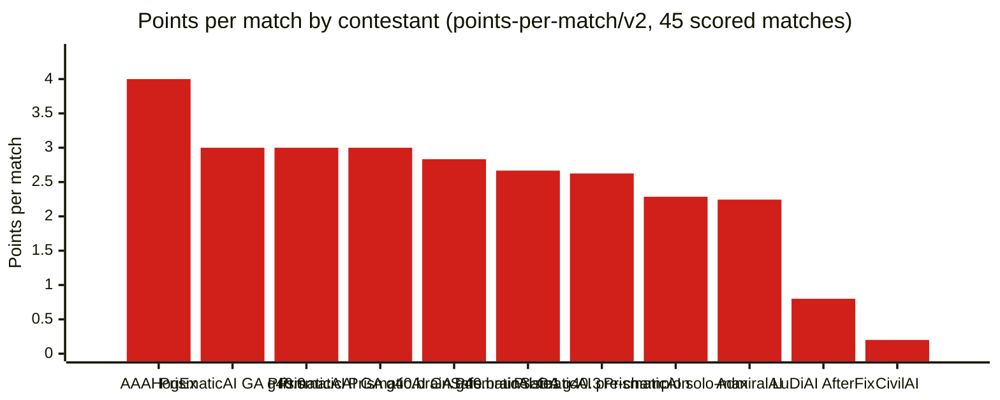
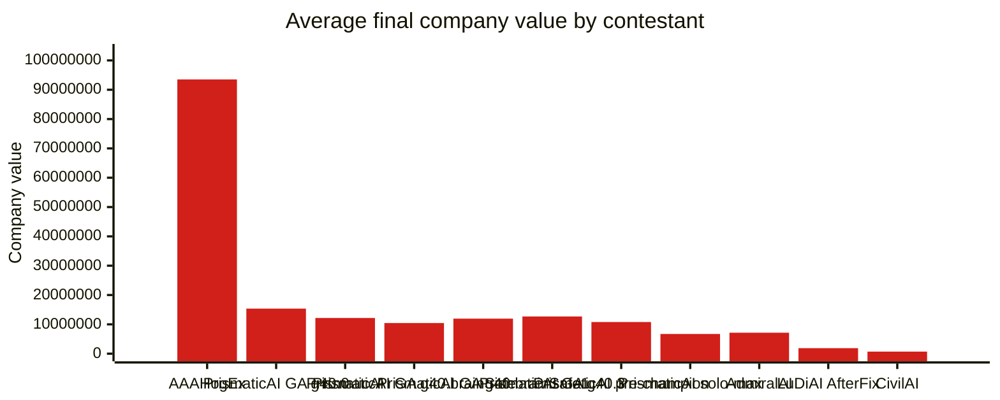
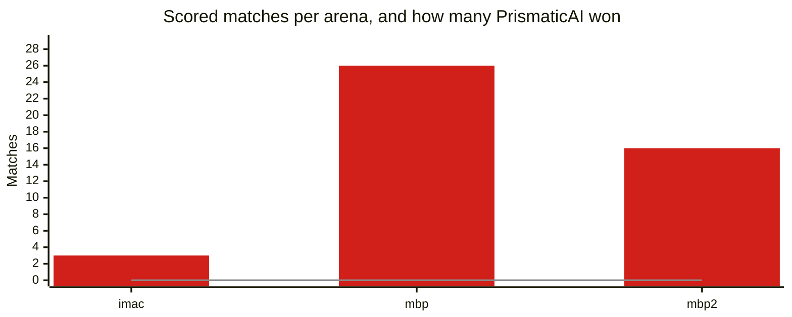

# battle-20261119T171729-e644d81f

Derived from `battle-20261119T171729-e644d81f.json` by `tools/research/ai-battle/battle.py report`; do not edit.

- Edition `e644d81f1c333103`: PrismaticAI and referee at `ebf7516b54d7130fa0908c68ff298075c517fb41`, base set `opengfx-8.0.tar`
- 20-year free-for-all from 1960, map 256x256 temperate, breakdowns 1
- 45 scored match(es) on `imac` (20261119-master-gdf1e05e7d8), `mbp` (20261119-master-m7235eee285), `mbp2` (20261119-master-gdf1e05e7d8)
- Replays: 0 of 1 identical to their original on another arena

| # | Contestant | Played | Wins | Points | Points/match | Avg rank | Avg final value | Squirrel errors | Matches with anomalies |
|---|---|---|---|---|---|---|---|---|---|
| 1 | AAAHogEx | 45 | 45 | 180 | 4.0 | 1.0 | 93.5 M | 0 | 0 |
| 2 | PrismaticAI GA g40.0 | 7 | 0 | 21 | 3.0 | 2.0 | 15.4 M | 0 | 5 |
| 3 | PrismaticAI | 5 | 0 | 15 | 3.0 | 2.0 | 12.2 M | 0 | 0 |
| 4 | PrismaticAI GA g40.brainSafe | 6 | 0 | 18 | 3.0 | 2.0 | 10.4 M | 0 | 0 |
| 5 | PrismaticAI GA g40.brainSafe1 | 6 | 0 | 17 | 2.833 | 2.17 | 11.9 M | 0 | 2 |
| 6 | PrismaticAI GA g40.3 | 6 | 0 | 16 | 2.667 | 2.33 | 12.7 M | 0 | 0 |
| 7 | PrismaticAI pre-champion | 8 | 0 | 21 | 2.625 | 2.38 | 10.8 M | 0 | 2 |
| 8 | PrismaticAI solo-max | 7 | 0 | 16 | 2.286 | 2.71 | 6.7 M | 0 | 7 |
| 9 | AdmiralAI | 45 | 0 | 101 | 2.244 | 2.76 | 7.1 M | 0 | 1 |
| 10 | LuDiAI AfterFix | 45 | 0 | 36 | 0.8 | 4.2 | 1.9 M | 0 | 2 |
| 11 | CivilAI | 45 | 0 | 9 | 0.2 | 4.8 | 695.8 k | 0 | 7 |

```mermaid
---
config:
  xyChart:
    width: 900
    height: 360
  themeVariables:
    xyChart:
      plotColorPalette: "#d11f1a, #8a8a8a, #0b0b0b, #ece4d6"
---
xychart-beta
    title "Final company value per scored match: winner vs best PrismaticAI"
    x-axis ["m-0001", "m-0002", "m-0003", "m-0004", "m-0005", "m-0006", "m-0007", "m-0008", "m-0009", "m-0010", "m-0011", "m-0012", "m-0013", "m-0014", "m-0015", "m-0016", "m-0017", "m-0018", "m-0019", "m-0020", "m-0021", "m-0022", "m-0023", "m-0024", "m-0025", "m-0026", "m-0027", "m-0028", "m-0036", "m-0037", "m-0038", "m-0039", "m-0040", "m-0041", "m-0042", "m-0043", "m-0044", "m-0051", "m-0052", "m-0053", "m-0054", "m-0055", "m-0057", "m-0065", "m-0066"]
    %% series: Winner | Best PrismaticAI
    %% links: battle-20261119T171729-e644d81f.md?col=Match&filter=m-0001 | battle-20261119T171729-e644d81f.md?col=Match&filter=m-0002 | battle-20261119T171729-e644d81f.md?col=Match&filter=m-0003 | battle-20261119T171729-e644d81f.md?col=Match&filter=m-0004 | battle-20261119T171729-e644d81f.md?col=Match&filter=m-0005 | battle-20261119T171729-e644d81f.md?col=Match&filter=m-0006 | battle-20261119T171729-e644d81f.md?col=Match&filter=m-0007 | battle-20261119T171729-e644d81f.md?col=Match&filter=m-0008 | battle-20261119T171729-e644d81f.md?col=Match&filter=m-0009 | battle-20261119T171729-e644d81f.md?col=Match&filter=m-0010 | battle-20261119T171729-e644d81f.md?col=Match&filter=m-0011 | battle-20261119T171729-e644d81f.md?col=Match&filter=m-0012 | battle-20261119T171729-e644d81f.md?col=Match&filter=m-0013 | battle-20261119T171729-e644d81f.md?col=Match&filter=m-0014 | battle-20261119T171729-e644d81f.md?col=Match&filter=m-0015 | battle-20261119T171729-e644d81f.md?col=Match&filter=m-0016 | battle-20261119T171729-e644d81f.md?col=Match&filter=m-0017 | battle-20261119T171729-e644d81f.md?col=Match&filter=m-0018 | battle-20261119T171729-e644d81f.md?col=Match&filter=m-0019 | battle-20261119T171729-e644d81f.md?col=Match&filter=m-0020 | battle-20261119T171729-e644d81f.md?col=Match&filter=m-0021 | battle-20261119T171729-e644d81f.md?col=Match&filter=m-0022 | battle-20261119T171729-e644d81f.md?col=Match&filter=m-0023 | battle-20261119T171729-e644d81f.md?col=Match&filter=m-0024 | battle-20261119T171729-e644d81f.md?col=Match&filter=m-0025 | battle-20261119T171729-e644d81f.md?col=Match&filter=m-0026 | battle-20261119T171729-e644d81f.md?col=Match&filter=m-0027 | battle-20261119T171729-e644d81f.md?col=Match&filter=m-0028 | battle-20261119T171729-e644d81f.md?col=Match&filter=m-0036 | battle-20261119T171729-e644d81f.md?col=Match&filter=m-0037 | battle-20261119T171729-e644d81f.md?col=Match&filter=m-0038 | battle-20261119T171729-e644d81f.md?col=Match&filter=m-0039 | battle-20261119T171729-e644d81f.md?col=Match&filter=m-0040 | battle-20261119T171729-e644d81f.md?col=Match&filter=m-0041 | battle-20261119T171729-e644d81f.md?col=Match&filter=m-0042 | battle-20261119T171729-e644d81f.md?col=Match&filter=m-0043 | battle-20261119T171729-e644d81f.md?col=Match&filter=m-0044 | battle-20261119T171729-e644d81f.md?col=Match&filter=m-0051 | battle-20261119T171729-e644d81f.md?col=Match&filter=m-0052 | battle-20261119T171729-e644d81f.md?col=Match&filter=m-0053 | battle-20261119T171729-e644d81f.md?col=Match&filter=m-0054 | battle-20261119T171729-e644d81f.md?col=Match&filter=m-0055 | battle-20261119T171729-e644d81f.md?col=Match&filter=m-0057 | battle-20261119T171729-e644d81f.md?col=Match&filter=m-0065 | battle-20261119T171729-e644d81f.md?col=Match&filter=m-0066
    y-axis "Company value" 0 --> 146000000
    bar [129989392, 132459977, 110843218, 123494454, 109433250, 110139360, 81750797, 89052354, 60578299, 73697669, 82527112, 55358158, 68285639, 95771650, 95081053, 121869709, 111710403, 112347731, 87043197, 87593502, 64177785, 73950186, 54183138, 50891279, 73963215, 65678648, 50609342, 123159779, 95005786, 104814689, 92671169, 89649037, 99127178, 96606042, 98897291, 102520781, 94509321, 103298391, 93175401, 111476070, 97413498, 111126019, 110797318, 123142659, 88463940]
    line [7885751, 19286346, 21419232, 11223213, 19953234, 20620185, 13859066, 8833142, 10946276, 12708262, 16899645, 16336186, 10764183, 15447559, 5748130, 10698948, 16240428, 11452689, 6491148, 13371725, 5803145, 3450426, 4287302, 5854342, 4286860, 5697415, 4326944, 15174749, 8036092, 10914757, 10023314, 8605698, 8899601, 11575711, 10542272, 7514177, 7043086, 10609147, 22083317, 10185783, 14275960, 15429026, 5533503, 12532085, 19186733]
```

<!-- battle-charts:begin -->
<!-- derived from battle-20261119T171729-e644d81f.json by `battle.py render`; `battle.py check` fails when it is stale -->

<!-- battle-charts:end -->

| Seed | Original | Replay | Arenas | Identical |
|---|---|---|---|---|
| 1817993317 | m-0010 | m-0056 | imac / mbp | NO |

| Match | Arena | Seed | Winner | Value | Last | Anomalies |
|---|---|---|---|---|---|---|
| m-0001 | mbp | 414861212 | AAAHogEx | 130.0 M | CivilAI | PrismaticAI solo-max: fleet_drop:50->30 |
| m-0002 | mbp | 414861212 | AAAHogEx | 132.5 M | CivilAI | - |
| m-0003 | mbp | 414861212 | AAAHogEx | 110.8 M | CivilAI | PrismaticAI GA g40.0: fleet_drop:154->85 |
| m-0004 | mbp | 414861212 | AAAHogEx | 123.5 M | CivilAI | - |
| m-0005 | mbp | 414861212 | AAAHogEx | 109.4 M | CivilAI | PrismaticAI GA g40.brainSafe1: fleet_drop:141->81 |
| m-0006 | mbp | 414861212 | AAAHogEx | 110.1 M | CivilAI | - |
| m-0007 | mbp | 1817993317 | AAAHogEx | 81.8 M | CivilAI | - |
| m-0008 | mbp | 1817993317 | AAAHogEx | 89.1 M | CivilAI | PrismaticAI solo-max: fleet_drop:33->16 |
| m-0009 | mbp | 1817993317 | AAAHogEx | 60.6 M | CivilAI | CivilAI: fleet_drop:69->44 |
| m-0010 | imac | 1817993317 | AAAHogEx | 73.7 M | CivilAI | - |
| m-0011 | imac | 1817993317 | AAAHogEx | 82.5 M | CivilAI | - |
| m-0012 | imac | 1817993317 | AAAHogEx | 55.4 M | CivilAI | - |
| m-0013 | mbp2 | 1817993317 | AAAHogEx | 68.3 M | CivilAI | - |
| m-0014 | mbp2 | 110079967 | AAAHogEx | 95.8 M | CivilAI | - |
| m-0015 | mbp2 | 110079967 | AAAHogEx | 95.1 M | CivilAI | PrismaticAI solo-max: fleet_drop:40->15 |
| m-0016 | mbp2 | 110079967 | AAAHogEx | 121.9 M | LuDiAI AfterFix | - |
| m-0017 | mbp2 | 110079967 | AAAHogEx | 111.7 M | CivilAI | PrismaticAI GA g40.0: fleet_drop:92->64; CivilAI: fleet_drop:61->12 |
| m-0018 | mbp2 | 110079967 | AAAHogEx | 112.3 M | CivilAI | CivilAI: fleet_drop:26->14 |
| m-0019 | mbp2 | 110079967 | AAAHogEx | 87.0 M | CivilAI | - |
| m-0020 | mbp2 | 110079967 | AAAHogEx | 87.6 M | CivilAI | - |
| m-0021 | mbp2 | 295801119 | AAAHogEx | 64.2 M | LuDiAI AfterFix | CivilAI: fleet_drop:78->50 |
| m-0022 | mbp2 | 295801119 | AAAHogEx | 74.0 M | CivilAI | PrismaticAI solo-max: fleet_drop:30->15; CivilAI: fleet_drop:29->2 |
| m-0023 | mbp2 | 295801119 | AAAHogEx | 54.2 M | CivilAI | PrismaticAI pre-champion: fleet_drop:58->37 |
| m-0024 | mbp2 | 295801119 | AAAHogEx | 50.9 M | LuDiAI AfterFix | LuDiAI AfterFix: fleet_drop:15->10 |
| m-0025 | mbp2 | 295801119 | AAAHogEx | 74.0 M | LuDiAI AfterFix | - |
| m-0026 | mbp2 | 295801119 | AAAHogEx | 65.7 M | CivilAI | - |
| m-0027 | mbp2 | 295801119 | AAAHogEx | 50.6 M | CivilAI | - |
| m-0028 | mbp2 | 1018509510 | AAAHogEx | 123.2 M | CivilAI | - |
| m-0036 | mbp | 271772313 | AAAHogEx | 95.0 M | CivilAI | PrismaticAI solo-max: fleet_drop:46->21 |
| m-0037 | mbp | 271772313 | AAAHogEx | 104.8 M | CivilAI | - |
| m-0038 | mbp | 271772313 | AAAHogEx | 92.7 M | CivilAI | PrismaticAI GA g40.0: fleet_drop:125->58 |
| m-0039 | mbp | 271772313 | AAAHogEx | 89.6 M | CivilAI | - |
| m-0040 | mbp | 271772313 | AAAHogEx | 99.1 M | LuDiAI AfterFix | PrismaticAI GA g40.brainSafe1: fleet_drop:161->80 |
| m-0041 | mbp | 271772313 | AAAHogEx | 96.6 M | CivilAI | - |
| m-0042 | mbp | 772113485 | AAAHogEx | 98.9 M | CivilAI | - |
| m-0043 | mbp | 772113485 | AAAHogEx | 102.5 M | CivilAI | PrismaticAI solo-max: fleet_drop:39->18 |
| m-0044 | mbp | 772113485 | AAAHogEx | 94.5 M | CivilAI | - |
| m-0051 | mbp | 165335290 | AAAHogEx | 103.3 M | LuDiAI AfterFix | PrismaticAI pre-champion: fleet_drop:74->50 |
| m-0052 | mbp | 165335290 | AAAHogEx | 93.2 M | CivilAI | PrismaticAI GA g40.0: fleet_drop:167->80; AdmiralAI: fleet_drop:214->145 |
| m-0053 | mbp | 165335290 | AAAHogEx | 111.5 M | LuDiAI AfterFix | LuDiAI AfterFix: fleet_drop:98->52 |
| m-0054 | mbp | 165335290 | AAAHogEx | 97.4 M | CivilAI | - |
| m-0055 | mbp | 165335290 | AAAHogEx | 111.1 M | LuDiAI AfterFix | CivilAI: fleet_drop:39->26 |
| m-0056 (replay) | mbp | 1817993317 | AAAHogEx | 67.2 M | CivilAI | - |
| m-0057 | mbp | 928173475 | AAAHogEx | 110.8 M | CivilAI | PrismaticAI solo-max: fleet_drop:42->21 |
| m-0065 | mbp | 384547507 | AAAHogEx | 123.1 M | LuDiAI AfterFix | - |
| m-0066 | mbp | 384547507 | AAAHogEx | 88.5 M | CivilAI | PrismaticAI GA g40.0: fleet_drop:160->91; CivilAI: no_vehicles |
