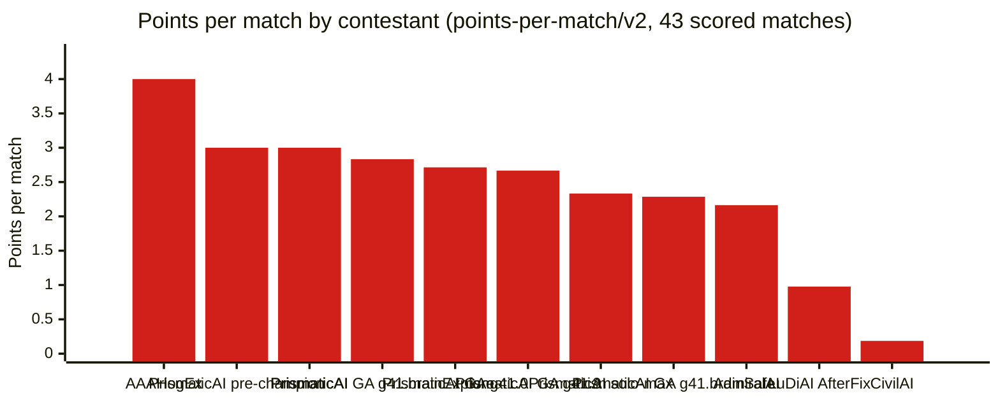
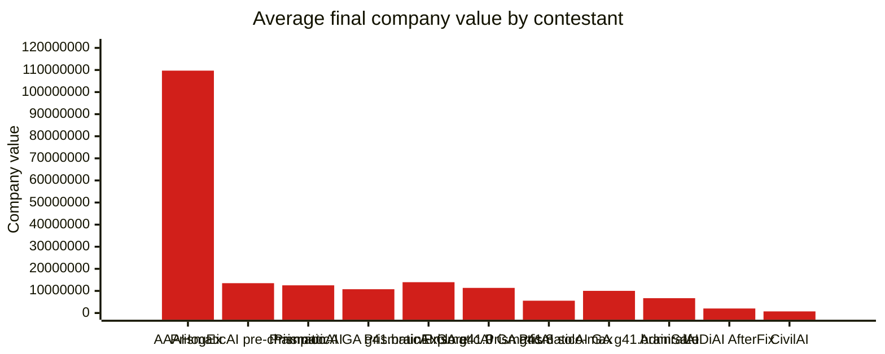
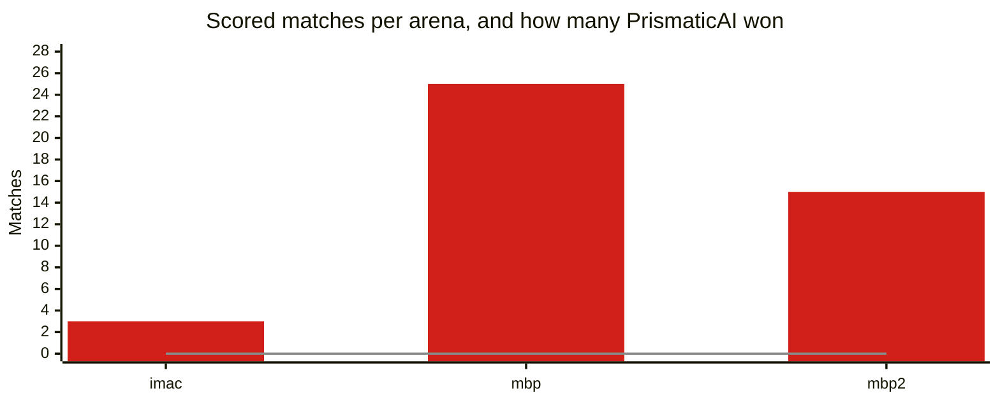

# battle-20261119T172957-bf3d5211

Derived from `battle-20261119T172957-bf3d5211.json` by `tools/research/ai-battle/battle.py report`; do not edit.

- Edition `bf3d5211e0546609`: PrismaticAI and referee at `ebf7516b54d7130fa0908c68ff298075c517fb41`, base set `opengfx-8.0.tar`
- 20-year free-for-all from 1960, map 256x256 temperate, breakdowns 1
- 43 scored match(es) on `imac` (20261119-master-gdf1e05e7d8), `mbp` (20261119-master-m7235eee285), `mbp2` (20261119-master-gdf1e05e7d8)
- Replays: 0 of 1 identical to their original on another arena

| # | Contestant | Played | Wins | Points | Points/match | Avg rank | Avg final value | Squirrel errors | Matches with anomalies |
|---|---|---|---|---|---|---|---|---|---|
| 1 | AAAHogEx | 43 | 43 | 172 | 4.0 | 1.0 | 109.7 M | 0 | 0 |
| 2 | PrismaticAI pre-champion | 6 | 0 | 18 | 3.0 | 2.0 | 13.5 M | 0 | 1 |
| 3 | PrismaticAI | 5 | 0 | 15 | 3.0 | 2.0 | 12.5 M | 0 | 0 |
| 4 | PrismaticAI GA g41.brainExplore | 6 | 0 | 17 | 2.833 | 2.17 | 10.8 M | 0 | 0 |
| 5 | PrismaticAI GA g41.0 | 7 | 0 | 19 | 2.714 | 2.29 | 13.9 M | 0 | 5 |
| 6 | PrismaticAI GA g41.3 | 6 | 0 | 16 | 2.667 | 2.33 | 11.4 M | 0 | 3 |
| 7 | PrismaticAI solo-max | 6 | 0 | 14 | 2.333 | 2.67 | 5.6 M | 0 | 6 |
| 8 | PrismaticAI GA g41.brainSafe | 7 | 0 | 16 | 2.286 | 2.71 | 10.0 M | 0 | 3 |
| 9 | AdmiralAI | 43 | 0 | 93 | 2.163 | 2.84 | 6.7 M | 0 | 3 |
| 10 | LuDiAI AfterFix | 43 | 0 | 42 | 0.977 | 4.02 | 2.0 M | 0 | 4 |
| 11 | CivilAI | 43 | 0 | 8 | 0.186 | 4.81 | 724.8 k | 3675 | 5 |

```mermaid
---
config:
  xyChart:
    width: 900
    height: 360
  themeVariables:
    xyChart:
      plotColorPalette: "#d11f1a, #8a8a8a, #0b0b0b, #ece4d6"
---
xychart-beta
    title "Final company value per scored match: winner vs best PrismaticAI"
    x-axis ["m-0001", "m-0002", "m-0003", "m-0004", "m-0005", "m-0006", "m-0007", "m-0008", "m-0009", "m-0010", "m-0011", "m-0012", "m-0013", "m-0014", "m-0015", "m-0016", "m-0017", "m-0018", "m-0020", "m-0021", "m-0022", "m-0023", "m-0024", "m-0025", "m-0026", "m-0027", "m-0028", "m-0036", "m-0037", "m-0038", "m-0039", "m-0040", "m-0041", "m-0042", "m-0043", "m-0044", "m-0045", "m-0046", "m-0047", "m-0052", "m-0053", "m-0054", "m-0055"]
    %% series: Winner | Best PrismaticAI
    %% links: battle-20261119T172957-bf3d5211.md?col=Match&filter=m-0001 | battle-20261119T172957-bf3d5211.md?col=Match&filter=m-0002 | battle-20261119T172957-bf3d5211.md?col=Match&filter=m-0003 | battle-20261119T172957-bf3d5211.md?col=Match&filter=m-0004 | battle-20261119T172957-bf3d5211.md?col=Match&filter=m-0005 | battle-20261119T172957-bf3d5211.md?col=Match&filter=m-0006 | battle-20261119T172957-bf3d5211.md?col=Match&filter=m-0007 | battle-20261119T172957-bf3d5211.md?col=Match&filter=m-0008 | battle-20261119T172957-bf3d5211.md?col=Match&filter=m-0009 | battle-20261119T172957-bf3d5211.md?col=Match&filter=m-0010 | battle-20261119T172957-bf3d5211.md?col=Match&filter=m-0011 | battle-20261119T172957-bf3d5211.md?col=Match&filter=m-0012 | battle-20261119T172957-bf3d5211.md?col=Match&filter=m-0013 | battle-20261119T172957-bf3d5211.md?col=Match&filter=m-0014 | battle-20261119T172957-bf3d5211.md?col=Match&filter=m-0015 | battle-20261119T172957-bf3d5211.md?col=Match&filter=m-0016 | battle-20261119T172957-bf3d5211.md?col=Match&filter=m-0017 | battle-20261119T172957-bf3d5211.md?col=Match&filter=m-0018 | battle-20261119T172957-bf3d5211.md?col=Match&filter=m-0020 | battle-20261119T172957-bf3d5211.md?col=Match&filter=m-0021 | battle-20261119T172957-bf3d5211.md?col=Match&filter=m-0022 | battle-20261119T172957-bf3d5211.md?col=Match&filter=m-0023 | battle-20261119T172957-bf3d5211.md?col=Match&filter=m-0024 | battle-20261119T172957-bf3d5211.md?col=Match&filter=m-0025 | battle-20261119T172957-bf3d5211.md?col=Match&filter=m-0026 | battle-20261119T172957-bf3d5211.md?col=Match&filter=m-0027 | battle-20261119T172957-bf3d5211.md?col=Match&filter=m-0028 | battle-20261119T172957-bf3d5211.md?col=Match&filter=m-0036 | battle-20261119T172957-bf3d5211.md?col=Match&filter=m-0037 | battle-20261119T172957-bf3d5211.md?col=Match&filter=m-0038 | battle-20261119T172957-bf3d5211.md?col=Match&filter=m-0039 | battle-20261119T172957-bf3d5211.md?col=Match&filter=m-0040 | battle-20261119T172957-bf3d5211.md?col=Match&filter=m-0041 | battle-20261119T172957-bf3d5211.md?col=Match&filter=m-0042 | battle-20261119T172957-bf3d5211.md?col=Match&filter=m-0043 | battle-20261119T172957-bf3d5211.md?col=Match&filter=m-0044 | battle-20261119T172957-bf3d5211.md?col=Match&filter=m-0045 | battle-20261119T172957-bf3d5211.md?col=Match&filter=m-0046 | battle-20261119T172957-bf3d5211.md?col=Match&filter=m-0047 | battle-20261119T172957-bf3d5211.md?col=Match&filter=m-0052 | battle-20261119T172957-bf3d5211.md?col=Match&filter=m-0053 | battle-20261119T172957-bf3d5211.md?col=Match&filter=m-0054 | battle-20261119T172957-bf3d5211.md?col=Match&filter=m-0055
    y-axis "Company value" 0 --> 160000000
    bar [102716142, 111649848, 101894489, 93849922, 111615341, 95530517, 145638148, 110455853, 136866042, 106600072, 124576255, 136871355, 126024594, 116738102, 118997951, 104792592, 100746118, 123503124, 105720883, 103263288, 108562415, 118430850, 91515338, 109995808, 89691129, 110214293, 91867585, 110034586, 118205738, 104409142, 134250805, 100213930, 91131750, 93149374, 111883895, 90207082, 90108481, 96070404, 88802342, 129617688, 118399471, 126760632, 115783558]
    line [7819844, 14573517, 14984636, 5925223, 11064815, 8573176, 3189765, 4954578, 9187793, 10553524, 720009, 3932444, 7565321, 19988103, 5616902, 17211794, 18284381, 16072906, 14092871, 15333850, 4643014, 13049423, 10277389, 8567209, 6877866, 9229979, 10116958, 7789609, 15858019, 12040349, 12921541, 10958173, 9960584, 13989179, 2557515, 11105241, 12960610, 10723884, 12537596, 18497917, 15223598, 19188861, 18743464]
```

<!-- battle-charts:begin -->
<!-- derived from battle-20261119T172957-bf3d5211.json by `battle.py render`; `battle.py check` fails when it is stale -->

<!-- battle-charts:end -->

| Seed | Original | Replay | Arenas | Identical |
|---|---|---|---|---|
| 170513829 | m-0011 | m-0048 | imac / mbp | NO |

| Match | Arena | Seed | Winner | Value | Last | Anomalies |
|---|---|---|---|---|---|---|
| m-0001 | mbp | 782497585 | AAAHogEx | 102.7 M | CivilAI | PrismaticAI solo-max: fleet_drop:44->26 |
| m-0002 | mbp | 782497585 | AAAHogEx | 111.6 M | LuDiAI AfterFix | - |
| m-0003 | mbp | 782497585 | AAAHogEx | 101.9 M | LuDiAI AfterFix | PrismaticAI GA g41.0: fleet_drop:99->56 |
| m-0004 | mbp | 782497585 | AAAHogEx | 93.8 M | CivilAI | PrismaticAI GA g41.brainSafe: fleet_drop:85->47; LuDiAI AfterFix: fleet_drop:67->32 |
| m-0005 | mbp | 782497585 | AAAHogEx | 111.6 M | LuDiAI AfterFix | - |
| m-0006 | mbp | 782497585 | AAAHogEx | 95.5 M | LuDiAI AfterFix | PrismaticAI GA g41.3: fleet_drop:90->45 |
| m-0007 | mbp | 170513829 | AAAHogEx | 145.6 M | CivilAI | - |
| m-0008 | mbp | 170513829 | AAAHogEx | 110.5 M | CivilAI | PrismaticAI solo-max: fleet_drop:36->15 |
| m-0009 | mbp | 170513829 | AAAHogEx | 136.9 M | CivilAI | - |
| m-0010 | imac | 170513829 | AAAHogEx | 106.6 M | CivilAI | PrismaticAI GA g41.0: fleet_drop:90->45; LuDiAI AfterFix: fleet_drop:99->67 |
| m-0011 | imac | 170513829 | AAAHogEx | 124.6 M | PrismaticAI GA g41.brainSafe | AdmiralAI: fleet_drop:118->78 |
| m-0012 | imac | 170513829 | AAAHogEx | 136.9 M | CivilAI | - |
| m-0013 | mbp2 | 170513829 | AAAHogEx | 126.0 M | CivilAI | PrismaticAI GA g41.3: fleet_drop:127->87 |
| m-0014 | mbp2 | 1905983985 | AAAHogEx | 116.7 M | CivilAI | - |
| m-0015 | mbp2 | 1905983985 | AAAHogEx | 119.0 M | CivilAI | AdmiralAI: fleet_drop:223->146; PrismaticAI solo-max: fleet_drop:44->18 |
| m-0016 | mbp2 | 1905983985 | AAAHogEx | 104.8 M | CivilAI | - |
| m-0017 | mbp2 | 1905983985 | AAAHogEx | 100.7 M | CivilAI | - |
| m-0018 | mbp2 | 1905983985 | AAAHogEx | 123.5 M | CivilAI | - |
| m-0020 | mbp2 | 1905983985 | AAAHogEx | 105.7 M | LuDiAI AfterFix | - |
| m-0021 | mbp2 | 49288598 | AAAHogEx | 103.3 M | CivilAI | CivilAI: fleet_drop:58->40 |
| m-0022 | mbp2 | 49288598 | AAAHogEx | 108.6 M | CivilAI | PrismaticAI solo-max: fleet_drop:38->18; CivilAI: fleet_drop:11->5 |
| m-0023 | mbp2 | 49288598 | AAAHogEx | 118.4 M | CivilAI | - |
| m-0024 | mbp2 | 49288598 | AAAHogEx | 91.5 M | CivilAI | PrismaticAI GA g41.0: fleet_drop:96->61 |
| m-0025 | mbp2 | 49288598 | AAAHogEx | 110.0 M | CivilAI | AdmiralAI: fleet_drop:307->194; PrismaticAI GA g41.brainSafe: fleet_drop:205->77 |
| m-0026 | mbp2 | 49288598 | AAAHogEx | 89.7 M | CivilAI | LuDiAI AfterFix: fleet_drop:190->86 |
| m-0027 | mbp2 | 49288598 | AAAHogEx | 110.2 M | CivilAI | PrismaticAI GA g41.3: fleet_drop:142->68 |
| m-0028 | mbp2 | 754377513 | AAAHogEx | 91.9 M | CivilAI | CivilAI: fleet_drop:27->9 |
| m-0036 | mbp | 1856687710 | AAAHogEx | 110.0 M | CivilAI | PrismaticAI solo-max: fleet_drop:39->19 |
| m-0037 | mbp | 1856687710 | AAAHogEx | 118.2 M | CivilAI | - |
| m-0038 | mbp | 1856687710 | AAAHogEx | 104.4 M | CivilAI | PrismaticAI GA g41.0: fleet_drop:153->65 |
| m-0039 | mbp | 1856687710 | AAAHogEx | 134.3 M | CivilAI | - |
| m-0040 | mbp | 1856687710 | AAAHogEx | 100.2 M | CivilAI | CivilAI: squirrel_errors:3675, no_vehicles |
| m-0041 | mbp | 1856687710 | AAAHogEx | 91.1 M | CivilAI | - |
| m-0042 | mbp | 286141647 | AAAHogEx | 93.1 M | CivilAI | - |
| m-0043 | mbp | 286141647 | AAAHogEx | 111.9 M | CivilAI | PrismaticAI solo-max: fleet_drop:32->16 |
| m-0044 | mbp | 286141647 | AAAHogEx | 90.2 M | CivilAI | PrismaticAI pre-champion: fleet_drop:69->46 |
| m-0045 | mbp | 286141647 | AAAHogEx | 90.1 M | LuDiAI AfterFix | - |
| m-0046 | mbp | 286141647 | AAAHogEx | 96.1 M | CivilAI | - |
| m-0047 | mbp | 286141647 | AAAHogEx | 88.8 M | CivilAI | - |
| m-0048 (replay) | mbp | 170513829 | AAAHogEx | 135.3 M | PrismaticAI GA g41.brainSafe | PrismaticAI GA g41.brainSafe: fleet_drop:114->55 |
| m-0052 | mbp | 185547653 | AAAHogEx | 129.6 M | LuDiAI AfterFix | PrismaticAI GA g41.0: fleet_drop:126->81; CivilAI: fleet_drop:105->49; LuDiAI AfterFix: fleet_drop:29->9 |
| m-0053 | mbp | 185547653 | AAAHogEx | 118.4 M | CivilAI | PrismaticAI GA g41.brainSafe: fleet_drop:200->127 |
| m-0054 | mbp | 185547653 | AAAHogEx | 126.8 M | CivilAI | - |
| m-0055 | mbp | 185547653 | AAAHogEx | 115.8 M | CivilAI | - |
