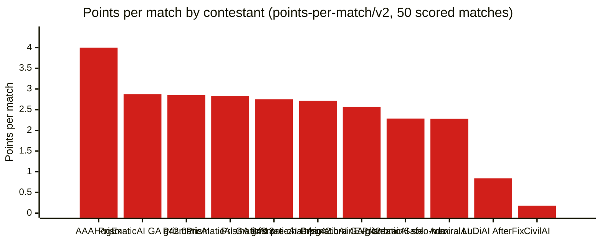
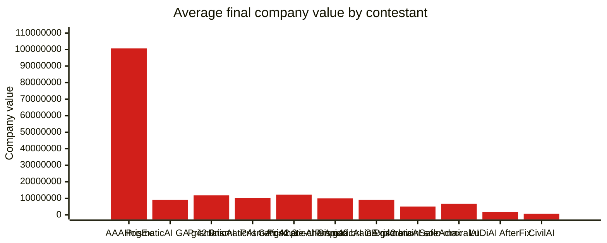
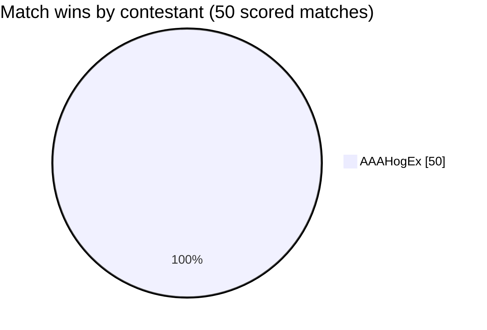
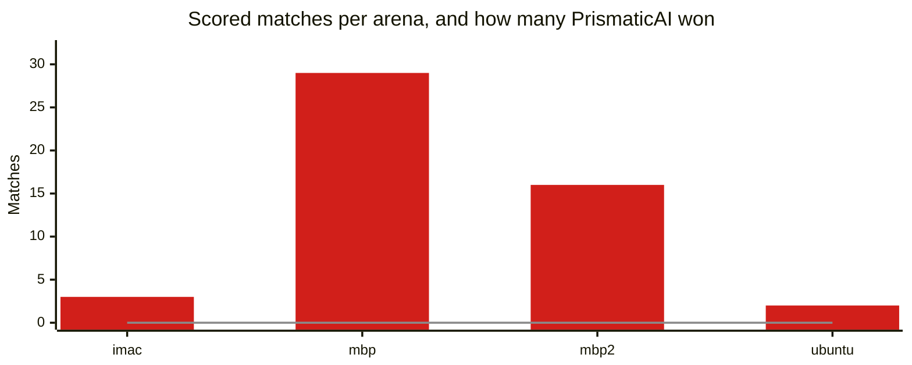

# battle-20261119T174435-272cfc37

Derived from `battle-20261119T174435-272cfc37.json` by `tools/research/ai-battle/battle.py report`; do not edit.

- Edition `272cfc374faa143f`: PrismaticAI and referee at `ebf7516b54d7130fa0908c68ff298075c517fb41`, base set `opengfx-8.0.tar`
- 20-year free-for-all from 1960, map 256x256 temperate, breakdowns 1
- 50 scored match(es) on `imac` (20261119-master-gdf1e05e7d8), `mbp` (20261119-master-m356d6e49c0, 20261119-master-m7235eee285), `mbp2` (20261119-master-gdf1e05e7d8), `ubuntu` (20261119-master-gdf1e05e7d8)
- Replays: 0 of 1 identical to their original on another arena

| # | Contestant | Played | Wins | Points | Points/match | Avg rank | Avg final value | Squirrel errors | Matches with anomalies |
|---|---|---|---|---|---|---|---|---|---|
| 1 | AAAHogEx | 50 | 50 | 200 | 4.0 | 1.0 | 100.7 M | 0 | 0 |
| 2 | PrismaticAI GA g42.0 | 8 | 0 | 23 | 2.875 | 2.12 | 9.1 M | 0 | 0 |
| 3 | PrismaticAI | 7 | 0 | 20 | 2.857 | 2.14 | 11.8 M | 0 | 0 |
| 4 | PrismaticAI GA g42.3 | 6 | 0 | 17 | 2.833 | 2.17 | 10.3 M | 0 | 0 |
| 5 | PrismaticAI pre-champion | 8 | 0 | 22 | 2.75 | 2.25 | 12.3 M | 0 | 0 |
| 6 | PrismaticAI GA g42.brainExplore | 7 | 0 | 19 | 2.714 | 2.29 | 10.0 M | 0 | 0 |
| 7 | PrismaticAI GA g42.brainSafe | 7 | 0 | 18 | 2.571 | 2.43 | 9.1 M | 0 | 4 |
| 8 | PrismaticAI solo-max | 7 | 0 | 16 | 2.286 | 2.71 | 5.0 M | 0 | 7 |
| 9 | AdmiralAI | 50 | 0 | 114 | 2.28 | 2.72 | 6.7 M | 0 | 2 |
| 10 | LuDiAI AfterFix | 50 | 0 | 42 | 0.84 | 4.16 | 1.7 M | 0 | 0 |
| 11 | CivilAI | 50 | 0 | 9 | 0.18 | 4.82 | 638.3 k | 0 | 15 |

```mermaid
---
config:
  xyChart:
    width: 900
    height: 360
  themeVariables:
    xyChart:
      plotColorPalette: "#d11f1a, #8a8a8a, #0b0b0b, #ece4d6"
---
xychart-beta
    title "Final company value per scored match: winner vs best PrismaticAI"
    x-axis ["m-0001", "m-0002", "m-0003", "m-0004", "m-0005", "m-0006", "m-0007", "m-0008", "m-0009", "m-0010", "m-0011", "m-0012", "m-0013", "m-0014", "m-0015", "m-0016", "m-0017", "m-0018", "m-0019", "m-0020", "m-0021", "m-0022", "m-0023", "m-0024", "m-0025", "m-0026", "m-0027", "m-0028", "m-0034", "m-0035", "m-0036", "m-0037", "m-0038", "m-0039", "m-0040", "m-0041", "m-0042", "m-0043", "m-0044", "m-0045", "m-0046", "m-0047", "m-0049", "m-0051", "m-0052", "m-0053", "m-0054", "m-0057", "m-0058", "m-0059"]
    %% series: Winner | Best PrismaticAI
    %% links: battle-20261119T174435-272cfc37.md?col=Match&filter=m-0001 | battle-20261119T174435-272cfc37.md?col=Match&filter=m-0002 | battle-20261119T174435-272cfc37.md?col=Match&filter=m-0003 | battle-20261119T174435-272cfc37.md?col=Match&filter=m-0004 | battle-20261119T174435-272cfc37.md?col=Match&filter=m-0005 | battle-20261119T174435-272cfc37.md?col=Match&filter=m-0006 | battle-20261119T174435-272cfc37.md?col=Match&filter=m-0007 | battle-20261119T174435-272cfc37.md?col=Match&filter=m-0008 | battle-20261119T174435-272cfc37.md?col=Match&filter=m-0009 | battle-20261119T174435-272cfc37.md?col=Match&filter=m-0010 | battle-20261119T174435-272cfc37.md?col=Match&filter=m-0011 | battle-20261119T174435-272cfc37.md?col=Match&filter=m-0012 | battle-20261119T174435-272cfc37.md?col=Match&filter=m-0013 | battle-20261119T174435-272cfc37.md?col=Match&filter=m-0014 | battle-20261119T174435-272cfc37.md?col=Match&filter=m-0015 | battle-20261119T174435-272cfc37.md?col=Match&filter=m-0016 | battle-20261119T174435-272cfc37.md?col=Match&filter=m-0017 | battle-20261119T174435-272cfc37.md?col=Match&filter=m-0018 | battle-20261119T174435-272cfc37.md?col=Match&filter=m-0019 | battle-20261119T174435-272cfc37.md?col=Match&filter=m-0020 | battle-20261119T174435-272cfc37.md?col=Match&filter=m-0021 | battle-20261119T174435-272cfc37.md?col=Match&filter=m-0022 | battle-20261119T174435-272cfc37.md?col=Match&filter=m-0023 | battle-20261119T174435-272cfc37.md?col=Match&filter=m-0024 | battle-20261119T174435-272cfc37.md?col=Match&filter=m-0025 | battle-20261119T174435-272cfc37.md?col=Match&filter=m-0026 | battle-20261119T174435-272cfc37.md?col=Match&filter=m-0027 | battle-20261119T174435-272cfc37.md?col=Match&filter=m-0028 | battle-20261119T174435-272cfc37.md?col=Match&filter=m-0034 | battle-20261119T174435-272cfc37.md?col=Match&filter=m-0035 | battle-20261119T174435-272cfc37.md?col=Match&filter=m-0036 | battle-20261119T174435-272cfc37.md?col=Match&filter=m-0037 | battle-20261119T174435-272cfc37.md?col=Match&filter=m-0038 | battle-20261119T174435-272cfc37.md?col=Match&filter=m-0039 | battle-20261119T174435-272cfc37.md?col=Match&filter=m-0040 | battle-20261119T174435-272cfc37.md?col=Match&filter=m-0041 | battle-20261119T174435-272cfc37.md?col=Match&filter=m-0042 | battle-20261119T174435-272cfc37.md?col=Match&filter=m-0043 | battle-20261119T174435-272cfc37.md?col=Match&filter=m-0044 | battle-20261119T174435-272cfc37.md?col=Match&filter=m-0045 | battle-20261119T174435-272cfc37.md?col=Match&filter=m-0046 | battle-20261119T174435-272cfc37.md?col=Match&filter=m-0047 | battle-20261119T174435-272cfc37.md?col=Match&filter=m-0049 | battle-20261119T174435-272cfc37.md?col=Match&filter=m-0051 | battle-20261119T174435-272cfc37.md?col=Match&filter=m-0052 | battle-20261119T174435-272cfc37.md?col=Match&filter=m-0053 | battle-20261119T174435-272cfc37.md?col=Match&filter=m-0054 | battle-20261119T174435-272cfc37.md?col=Match&filter=m-0057 | battle-20261119T174435-272cfc37.md?col=Match&filter=m-0058 | battle-20261119T174435-272cfc37.md?col=Match&filter=m-0059
    y-axis "Company value" 0 --> 175000000
    bar [143495765, 143722337, 115379065, 119591686, 117205502, 110474898, 123153425, 137188736, 157274985, 148445974, 134783026, 145482714, 159211028, 107555016, 107462061, 97076660, 91500933, 117508722, 103010875, 86952285, 77081872, 112390293, 81138857, 87518811, 82419503, 90385691, 71504711, 91731840, 97257456, 65990001, 64920117, 59849264, 67394111, 70492989, 75973789, 76147435, 78394183, 149004886, 114286952, 104050383, 107196911, 91512784, 62148274, 62842011, 61577376, 53186167, 72513684, 103578273, 120355226, 113957754]
    line [5521653, 11720799, 9767265, 6494490, 11326468, 8185269, 8848665, 3414399, 7984414, 9323784, 9020394, 5296360, 4842725, 15325550, 5135475, 13867658, 9072869, 12979845, 16748995, 11043907, 9318183, 5561858, 7184732, 6361738, 4389110, 8030048, 15823002, 9306102, 13454416, 12619443, 2882949, 14081428, 9560246, 10177610, 13109846, 8741679, 13433085, 7516147, 13733223, 15177010, 14574134, 9523765, 13690294, 13096213, 5974353, 6240697, 5931335, 5265197, 16422108, 7630962]
```

<!-- battle-charts:begin -->
<!-- derived from battle-20261119T174435-272cfc37.json by `battle.py render`; `battle.py check` fails when it is stale -->

<!-- battle-charts:end -->

| Seed | Original | Replay | Arenas | Identical |
|---|---|---|---|---|
| 1413456639 | m-0010 | m-0048 | imac / mbp | NO |

| Match | Arena | Seed | Winner | Value | Last | Anomalies |
|---|---|---|---|---|---|---|
| m-0001 | mbp | 1577809727 | AAAHogEx | 143.5 M | CivilAI | PrismaticAI solo-max: fleet_drop:34->14 |
| m-0002 | mbp | 1577809727 | AAAHogEx | 143.7 M | CivilAI | - |
| m-0003 | mbp | 1577809727 | AAAHogEx | 115.4 M | LuDiAI AfterFix | - |
| m-0004 | mbp | 1577809727 | AAAHogEx | 119.6 M | LuDiAI AfterFix | - |
| m-0005 | mbp | 1577809727 | AAAHogEx | 117.2 M | CivilAI | - |
| m-0006 | mbp | 1577809727 | AAAHogEx | 110.5 M | CivilAI | AdmiralAI: fleet_drop:418->263 |
| m-0007 | mbp | 1413456639 | AAAHogEx | 123.2 M | CivilAI | - |
| m-0008 | mbp | 1413456639 | AAAHogEx | 137.2 M | CivilAI | PrismaticAI solo-max: fleet_drop:41->22 |
| m-0009 | mbp | 1413456639 | AAAHogEx | 157.3 M | CivilAI | - |
| m-0010 | imac | 1413456639 | AAAHogEx | 148.4 M | LuDiAI AfterFix | - |
| m-0011 | imac | 1413456639 | AAAHogEx | 134.8 M | CivilAI | PrismaticAI GA g42.brainSafe: fleet_drop:174->79; CivilAI: fleet_drop:50->25 |
| m-0012 | imac | 1413456639 | AAAHogEx | 145.5 M | CivilAI | CivilAI: fleet_drop:15->7 |
| m-0013 | mbp2 | 1413456639 | AAAHogEx | 159.2 M | CivilAI | CivilAI: fleet_drop:74->50 |
| m-0014 | mbp2 | 682723502 | AAAHogEx | 107.6 M | CivilAI | - |
| m-0015 | mbp2 | 682723502 | AAAHogEx | 107.5 M | CivilAI | PrismaticAI solo-max: fleet_drop:46->20 |
| m-0016 | mbp2 | 682723502 | AAAHogEx | 97.1 M | CivilAI | - |
| m-0017 | mbp2 | 682723502 | AAAHogEx | 91.5 M | CivilAI | AdmiralAI: fleet_drop:201->140 |
| m-0018 | mbp2 | 682723502 | AAAHogEx | 117.5 M | CivilAI | PrismaticAI GA g42.brainSafe: fleet_drop:136->69 |
| m-0019 | mbp2 | 682723502 | AAAHogEx | 103.0 M | LuDiAI AfterFix | - |
| m-0020 | mbp2 | 682723502 | AAAHogEx | 87.0 M | CivilAI | - |
| m-0021 | mbp2 | 1514542411 | AAAHogEx | 77.1 M | CivilAI | CivilAI: fleet_drop:60->23 |
| m-0022 | mbp2 | 1514542411 | AAAHogEx | 112.4 M | CivilAI | PrismaticAI solo-max: fleet_drop:42->21 |
| m-0023 | mbp2 | 1514542411 | AAAHogEx | 81.1 M | LuDiAI AfterFix | - |
| m-0024 | mbp2 | 1514542411 | AAAHogEx | 87.5 M | CivilAI | - |
| m-0025 | mbp2 | 1514542411 | AAAHogEx | 82.4 M | CivilAI | PrismaticAI GA g42.brainSafe: fleet_drop:104->64; CivilAI: fleet_drop:51->34 |
| m-0026 | mbp2 | 1514542411 | AAAHogEx | 90.4 M | CivilAI | - |
| m-0027 | mbp2 | 1514542411 | AAAHogEx | 71.5 M | LuDiAI AfterFix | - |
| m-0028 | mbp2 | 1437986811 | AAAHogEx | 91.7 M | CivilAI | CivilAI: fleet_drop:50->34 |
| m-0034 | ubuntu | 1437986811 | AAAHogEx | 97.3 M | CivilAI | - |
| m-0035 | ubuntu | 1707884956 | AAAHogEx | 66.0 M | CivilAI | - |
| m-0036 | mbp | 1707884956 | AAAHogEx | 64.9 M | CivilAI | PrismaticAI solo-max: fleet_drop:41->15 |
| m-0037 | mbp | 1707884956 | AAAHogEx | 59.8 M | CivilAI | CivilAI: fleet_drop:72->48 |
| m-0038 | mbp | 1707884956 | AAAHogEx | 67.4 M | LuDiAI AfterFix | CivilAI: fleet_drop:29->19 |
| m-0039 | mbp | 1707884956 | AAAHogEx | 70.5 M | CivilAI | - |
| m-0040 | mbp | 1707884956 | AAAHogEx | 76.0 M | CivilAI | - |
| m-0041 | mbp | 1707884956 | AAAHogEx | 76.1 M | CivilAI | CivilAI: fleet_drop:51->32 |
| m-0042 | mbp | 303771219 | AAAHogEx | 78.4 M | CivilAI | - |
| m-0043 | mbp | 303771219 | AAAHogEx | 149.0 M | CivilAI | PrismaticAI solo-max: fleet_drop:43->22 |
| m-0044 | mbp | 303771219 | AAAHogEx | 114.3 M | CivilAI | CivilAI: fleet_drop:10->5 |
| m-0045 | mbp | 303771219 | AAAHogEx | 104.1 M | CivilAI | - |
| m-0046 | mbp | 303771219 | AAAHogEx | 107.2 M | CivilAI | PrismaticAI GA g42.brainSafe: fleet_drop:104->54; CivilAI: fleet_drop:45->23 |
| m-0047 | mbp | 303771219 | AAAHogEx | 91.5 M | LuDiAI AfterFix | CivilAI: fleet_drop:82->33 |
| m-0048 (replay) | mbp | 1413456639 | AAAHogEx | 146.6 M | LuDiAI AfterFix | AdmiralAI: fleet_drop:145->101 |
| m-0049 | mbp | 831685492 | AAAHogEx | 62.1 M | CivilAI | CivilAI: fleet_drop:59->28 |
| m-0051 | mbp | 831685492 | AAAHogEx | 62.8 M | CivilAI | - |
| m-0052 | mbp | 831685492 | AAAHogEx | 61.6 M | CivilAI | CivilAI: fleet_drop:34->19 |
| m-0053 | mbp | 831685492 | AAAHogEx | 53.2 M | CivilAI | - |
| m-0054 | mbp | 831685492 | AAAHogEx | 72.5 M | CivilAI | - |
| m-0057 | mbp | 1780679084 | AAAHogEx | 103.6 M | CivilAI | PrismaticAI solo-max: fleet_drop:41->16 |
| m-0058 | mbp | 1780679084 | AAAHogEx | 120.4 M | LuDiAI AfterFix | CivilAI: fleet_drop:56->36 |
| m-0059 | mbp | 1780679084 | AAAHogEx | 114.0 M | CivilAI | - |
