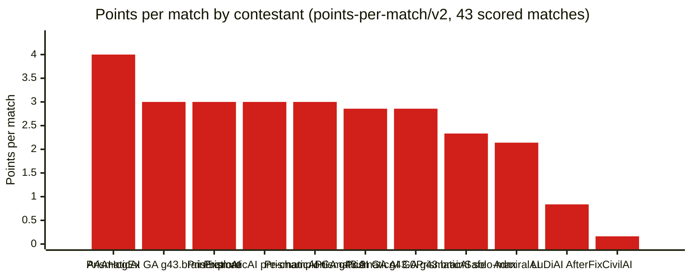
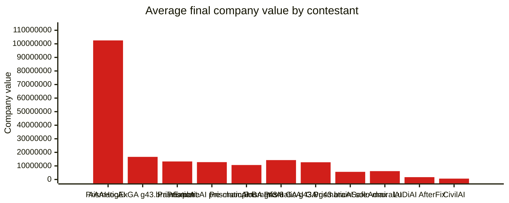
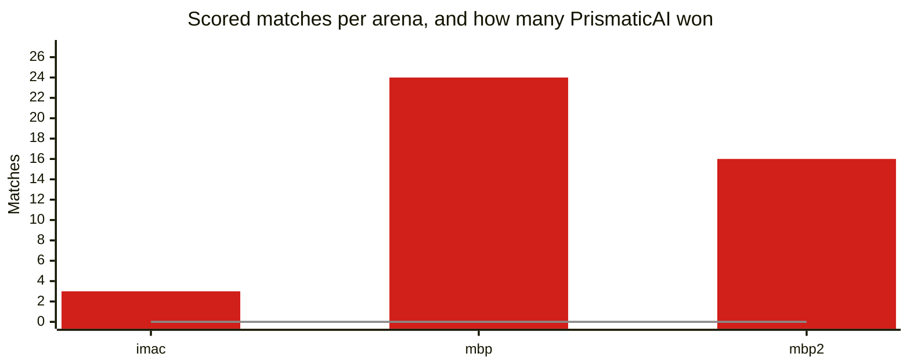

# battle-20261119T175620-31821a20

Derived from `battle-20261119T175620-31821a20.json` by `tools/research/ai-battle/battle.py report`; do not edit.

- Edition `31821a2034265991`: PrismaticAI and referee at `ebf7516b54d7130fa0908c68ff298075c517fb41`, base set `opengfx-8.0.tar`
- 20-year free-for-all from 1960, map 256x256 temperate, breakdowns 1
- 43 scored match(es) on `imac` (20261119-master-gdf1e05e7d8), `mbp` (20261119-master-m356d6e49c0), `mbp2` (20261119-master-gdf1e05e7d8)
- Replays: 0 of 0 identical to their original on another arena

| # | Contestant | Played | Wins | Points | Points/match | Avg rank | Avg final value | Squirrel errors | Matches with anomalies |
|---|---|---|---|---|---|---|---|---|---|
| 1 | AAAHogEx | 43 | 43 | 172 | 4.0 | 1.0 | 102.5 M | 0 | 0 |
| 2 | PrismaticAI GA g43.brainExplore | 6 | 0 | 18 | 3.0 | 2.0 | 16.7 M | 0 | 4 |
| 3 | PrismaticAI | 5 | 0 | 15 | 3.0 | 2.0 | 13.3 M | 0 | 0 |
| 4 | PrismaticAI pre-champion | 6 | 0 | 18 | 3.0 | 2.0 | 12.8 M | 0 | 1 |
| 5 | PrismaticAI GA g43.3 | 6 | 0 | 18 | 3.0 | 2.0 | 10.7 M | 0 | 1 |
| 6 | PrismaticAI GA g43.0 | 7 | 0 | 20 | 2.857 | 2.14 | 14.3 M | 0 | 0 |
| 7 | PrismaticAI GA g43.brainSafe | 7 | 0 | 20 | 2.857 | 2.14 | 12.7 M | 0 | 0 |
| 8 | PrismaticAI solo-max | 6 | 0 | 14 | 2.333 | 2.67 | 5.6 M | 0 | 6 |
| 9 | AdmiralAI | 43 | 0 | 92 | 2.14 | 2.86 | 6.2 M | 47 | 4 |
| 10 | LuDiAI AfterFix | 43 | 0 | 36 | 0.837 | 4.16 | 1.7 M | 0 | 3 |
| 11 | CivilAI | 43 | 0 | 7 | 0.163 | 4.84 | 639.7 k | 7475 | 10 |

```mermaid
---
config:
  xyChart:
    width: 900
    height: 360
  themeVariables:
    xyChart:
      plotColorPalette: "#d11f1a, #8a8a8a, #0b0b0b, #ece4d6"
---
xychart-beta
    title "Final company value per scored match: winner vs best PrismaticAI"
    x-axis ["m-0001", "m-0002", "m-0003", "m-0004", "m-0005", "m-0006", "m-0007", "m-0008", "m-0009", "m-0010", "m-0011", "m-0012", "m-0013", "m-0014", "m-0015", "m-0016", "m-0017", "m-0018", "m-0019", "m-0020", "m-0021", "m-0022", "m-0023", "m-0024", "m-0025", "m-0026", "m-0027", "m-0028", "m-0036", "m-0037", "m-0038", "m-0039", "m-0040", "m-0041", "m-0042", "m-0043", "m-0044", "m-0052", "m-0053", "m-0054", "m-0059", "m-0060", "m-0062"]
    %% series: Winner | Best PrismaticAI
    %% links: battle-20261119T175620-31821a20.md?col=Match&filter=m-0001 | battle-20261119T175620-31821a20.md?col=Match&filter=m-0002 | battle-20261119T175620-31821a20.md?col=Match&filter=m-0003 | battle-20261119T175620-31821a20.md?col=Match&filter=m-0004 | battle-20261119T175620-31821a20.md?col=Match&filter=m-0005 | battle-20261119T175620-31821a20.md?col=Match&filter=m-0006 | battle-20261119T175620-31821a20.md?col=Match&filter=m-0007 | battle-20261119T175620-31821a20.md?col=Match&filter=m-0008 | battle-20261119T175620-31821a20.md?col=Match&filter=m-0009 | battle-20261119T175620-31821a20.md?col=Match&filter=m-0010 | battle-20261119T175620-31821a20.md?col=Match&filter=m-0011 | battle-20261119T175620-31821a20.md?col=Match&filter=m-0012 | battle-20261119T175620-31821a20.md?col=Match&filter=m-0013 | battle-20261119T175620-31821a20.md?col=Match&filter=m-0014 | battle-20261119T175620-31821a20.md?col=Match&filter=m-0015 | battle-20261119T175620-31821a20.md?col=Match&filter=m-0016 | battle-20261119T175620-31821a20.md?col=Match&filter=m-0017 | battle-20261119T175620-31821a20.md?col=Match&filter=m-0018 | battle-20261119T175620-31821a20.md?col=Match&filter=m-0019 | battle-20261119T175620-31821a20.md?col=Match&filter=m-0020 | battle-20261119T175620-31821a20.md?col=Match&filter=m-0021 | battle-20261119T175620-31821a20.md?col=Match&filter=m-0022 | battle-20261119T175620-31821a20.md?col=Match&filter=m-0023 | battle-20261119T175620-31821a20.md?col=Match&filter=m-0024 | battle-20261119T175620-31821a20.md?col=Match&filter=m-0025 | battle-20261119T175620-31821a20.md?col=Match&filter=m-0026 | battle-20261119T175620-31821a20.md?col=Match&filter=m-0027 | battle-20261119T175620-31821a20.md?col=Match&filter=m-0028 | battle-20261119T175620-31821a20.md?col=Match&filter=m-0036 | battle-20261119T175620-31821a20.md?col=Match&filter=m-0037 | battle-20261119T175620-31821a20.md?col=Match&filter=m-0038 | battle-20261119T175620-31821a20.md?col=Match&filter=m-0039 | battle-20261119T175620-31821a20.md?col=Match&filter=m-0040 | battle-20261119T175620-31821a20.md?col=Match&filter=m-0041 | battle-20261119T175620-31821a20.md?col=Match&filter=m-0042 | battle-20261119T175620-31821a20.md?col=Match&filter=m-0043 | battle-20261119T175620-31821a20.md?col=Match&filter=m-0044 | battle-20261119T175620-31821a20.md?col=Match&filter=m-0052 | battle-20261119T175620-31821a20.md?col=Match&filter=m-0053 | battle-20261119T175620-31821a20.md?col=Match&filter=m-0054 | battle-20261119T175620-31821a20.md?col=Match&filter=m-0059 | battle-20261119T175620-31821a20.md?col=Match&filter=m-0060 | battle-20261119T175620-31821a20.md?col=Match&filter=m-0062
    y-axis "Company value" 0 --> 188000000
    bar [124778447, 102830511, 83487652, 94949111, 124631379, 122539938, 88881246, 101370177, 102538203, 97903627, 86988497, 104074063, 111731344, 82838866, 99298426, 95578529, 75961759, 74847661, 94679783, 87599349, 70459159, 77485459, 56403796, 45332308, 80100144, 55180927, 65560964, 88486018, 155114043, 148594235, 120785330, 155407423, 146853099, 171002397, 112336795, 132169654, 134037292, 139344678, 111152258, 154759167, 59456256, 98067152, 72568388]
    line [6039429, 16292472, 13717144, 19373730, 18940025, 15301794, 16381397, 5266160, 10755072, 14268592, 12640830, 21426557, 9729123, 13129998, 4857618, 17141480, 20839809, 13095008, 19033832, 11442826, 4297556, 4190979, 4339463, 1579417, 960898, 6549274, 3014018, 16439532, 8066849, 13890718, 14004697, 18077902, 15027198, 8908293, 16180608, 5417487, 14352118, 15976778, 12723384, 19050448, 19678762, 11970459, 15618394]
```

<!-- battle-charts:begin -->
<!-- derived from battle-20261119T175620-31821a20.json by `battle.py render`; `battle.py check` fails when it is stale -->

<!-- battle-charts:end -->

| Match | Arena | Seed | Winner | Value | Last | Anomalies |
|---|---|---|---|---|---|---|
| m-0001 | mbp | 870069692 | AAAHogEx | 124.8 M | CivilAI | AdmiralAI: squirrel_errors:47; PrismaticAI solo-max: fleet_drop:50->26 |
| m-0002 | mbp | 870069692 | AAAHogEx | 102.8 M | CivilAI | - |
| m-0003 | mbp | 870069692 | AAAHogEx | 83.5 M | CivilAI | CivilAI: no_vehicles |
| m-0004 | mbp | 870069692 | AAAHogEx | 94.9 M | CivilAI | - |
| m-0005 | mbp | 870069692 | AAAHogEx | 124.6 M | CivilAI | PrismaticAI GA g43.brainExplore: fleet_drop:149->90; AdmiralAI: fleet_drop:253->160 |
| m-0006 | mbp | 870069692 | AAAHogEx | 122.5 M | CivilAI | CivilAI: fleet_drop:99->61 |
| m-0007 | mbp | 5457317 | AAAHogEx | 88.9 M | CivilAI | - |
| m-0008 | mbp | 5457317 | AAAHogEx | 101.4 M | CivilAI | PrismaticAI solo-max: fleet_drop:43->18 |
| m-0009 | mbp | 5457317 | AAAHogEx | 102.5 M | CivilAI | PrismaticAI pre-champion: fleet_drop:109->75 |
| m-0010 | imac | 5457317 | AAAHogEx | 97.9 M | CivilAI | - |
| m-0011 | imac | 5457317 | AAAHogEx | 87.0 M | CivilAI | CivilAI: fleet_drop:29->19 |
| m-0012 | imac | 5457317 | AAAHogEx | 104.1 M | CivilAI | PrismaticAI GA g43.brainExplore: fleet_drop:201->82 |
| m-0013 | mbp2 | 5457317 | AAAHogEx | 111.7 M | CivilAI | PrismaticAI GA g43.3: fleet_drop:69->48 |
| m-0014 | mbp2 | 139368908 | AAAHogEx | 82.8 M | CivilAI | - |
| m-0015 | mbp2 | 139368908 | AAAHogEx | 99.3 M | CivilAI | PrismaticAI solo-max: fleet_drop:37->17; CivilAI: fleet_drop:15->6 |
| m-0016 | mbp2 | 139368908 | AAAHogEx | 95.6 M | LuDiAI AfterFix | - |
| m-0017 | mbp2 | 139368908 | AAAHogEx | 76.0 M | LuDiAI AfterFix | - |
| m-0018 | mbp2 | 139368908 | AAAHogEx | 74.8 M | CivilAI | - |
| m-0019 | mbp2 | 139368908 | AAAHogEx | 94.7 M | CivilAI | CivilAI: fleet_drop:13->6 |
| m-0020 | mbp2 | 139368908 | AAAHogEx | 87.6 M | LuDiAI AfterFix | - |
| m-0021 | mbp2 | 188675125 | AAAHogEx | 70.5 M | CivilAI | - |
| m-0022 | mbp2 | 188675125 | AAAHogEx | 77.5 M | CivilAI | PrismaticAI solo-max: fleet_drop:29->15; LuDiAI AfterFix: fleet_drop:13->8; CivilAI: squirrel_errors:3620 |
| m-0023 | mbp2 | 188675125 | AAAHogEx | 56.4 M | CivilAI | - |
| m-0024 | mbp2 | 188675125 | AAAHogEx | 45.3 M | CivilAI | - |
| m-0025 | mbp2 | 188675125 | AAAHogEx | 80.1 M | CivilAI | CivilAI: no_vehicles |
| m-0026 | mbp2 | 188675125 | AAAHogEx | 55.2 M | CivilAI | PrismaticAI GA g43.brainExplore: fleet_drop:44->30 |
| m-0027 | mbp2 | 188675125 | AAAHogEx | 65.6 M | CivilAI | - |
| m-0028 | mbp2 | 182308222 | AAAHogEx | 88.5 M | CivilAI | - |
| m-0036 | mbp | 18295378 | AAAHogEx | 155.1 M | CivilAI | PrismaticAI solo-max: fleet_drop:50->25 |
| m-0037 | mbp | 18295378 | AAAHogEx | 148.6 M | LuDiAI AfterFix | - |
| m-0038 | mbp | 18295378 | AAAHogEx | 120.8 M | CivilAI | AdmiralAI: fleet_drop:488->334 |
| m-0039 | mbp | 18295378 | AAAHogEx | 155.4 M | CivilAI | AdmiralAI: fleet_drop:230->109 |
| m-0040 | mbp | 18295378 | AAAHogEx | 146.9 M | CivilAI | PrismaticAI GA g43.brainExplore: fleet_drop:136->90; CivilAI: squirrel_errors:3855 |
| m-0041 | mbp | 18295378 | AAAHogEx | 171.0 M | CivilAI | - |
| m-0042 | mbp | 1288400343 | AAAHogEx | 112.3 M | LuDiAI AfterFix | LuDiAI AfterFix: fleet_drop:36->19 |
| m-0043 | mbp | 1288400343 | AAAHogEx | 132.2 M | CivilAI | PrismaticAI solo-max: fleet_drop:45->17; CivilAI: fleet_drop:33->19 |
| m-0044 | mbp | 1288400343 | AAAHogEx | 134.0 M | LuDiAI AfterFix | CivilAI: fleet_drop:28->11 |
| m-0052 | mbp | 127999323 | AAAHogEx | 139.3 M | CivilAI | - |
| m-0053 | mbp | 127999323 | AAAHogEx | 111.2 M | CivilAI | - |
| m-0054 | mbp | 127999323 | AAAHogEx | 154.8 M | CivilAI | - |
| m-0059 | mbp | 409927005 | AAAHogEx | 59.5 M | CivilAI | - |
| m-0060 | mbp | 409927005 | AAAHogEx | 98.1 M | LuDiAI AfterFix | LuDiAI AfterFix: fleet_drop:23->5 |
| m-0062 | mbp | 409927005 | AAAHogEx | 72.6 M | CivilAI | - |
