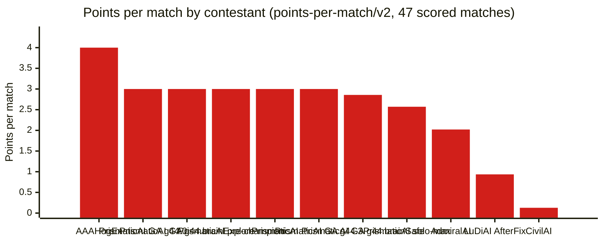
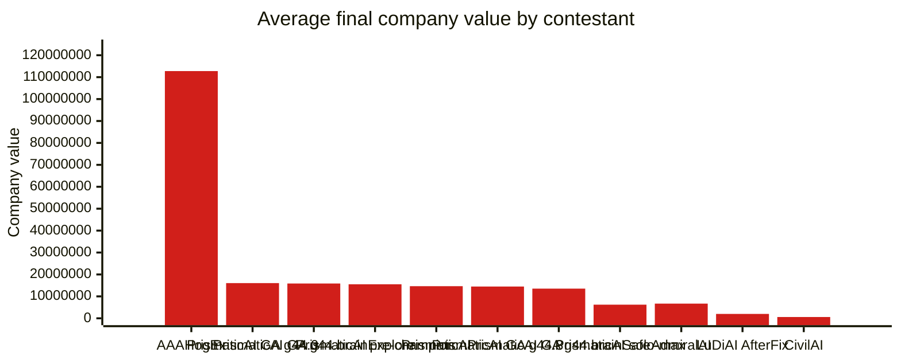
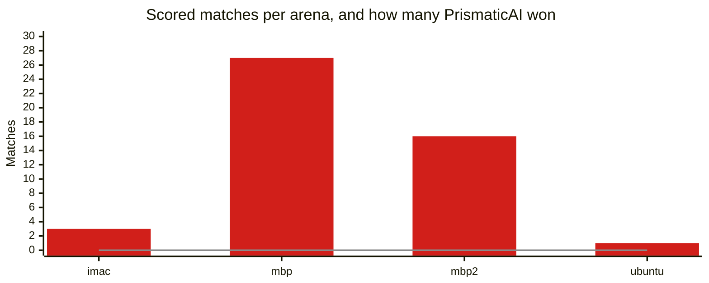

# battle-20261119T181020-3677974f

Derived from `battle-20261119T181020-3677974f.json` by `tools/research/ai-battle/battle.py report`; do not edit.

- Edition `3677974f4964d327`: PrismaticAI and referee at `ebf7516b54d7130fa0908c68ff298075c517fb41`, base set `opengfx-8.0.tar`
- 20-year free-for-all from 1960, map 256x256 temperate, breakdowns 1
- 47 scored match(es) on `imac` (20261119-master-gdf1e05e7d8), `mbp` (20261119-master-m356d6e49c0), `mbp2` (20261119-master-gdf1e05e7d8), `ubuntu` (20261119-master-gdf1e05e7d8)
- Replays: 0 of 0 identical to their original on another arena

| # | Contestant | Played | Wins | Points | Points/match | Avg rank | Avg final value | Squirrel errors | Matches with anomalies |
|---|---|---|---|---|---|---|---|---|---|
| 1 | AAAHogEx | 47 | 47 | 188 | 4.0 | 1.0 | 112.8 M | 0 | 0 |
| 2 | PrismaticAI GA g44.0 | 7 | 0 | 21 | 3.0 | 2.0 | 16.1 M | 0 | 2 |
| 3 | PrismaticAI GA g44.brainExplore | 7 | 0 | 21 | 3.0 | 2.0 | 15.9 M | 0 | 0 |
| 4 | PrismaticAI pre-champion | 7 | 0 | 21 | 3.0 | 2.0 | 15.5 M | 0 | 0 |
| 5 | PrismaticAI | 6 | 0 | 18 | 3.0 | 2.0 | 14.6 M | 0 | 0 |
| 6 | PrismaticAI GA g44.3 | 6 | 0 | 18 | 3.0 | 2.0 | 14.5 M | 0 | 0 |
| 7 | PrismaticAI GA g44.brainSafe | 7 | 0 | 20 | 2.857 | 2.14 | 13.5 M | 0 | 3 |
| 8 | PrismaticAI solo-max | 7 | 0 | 18 | 2.571 | 2.43 | 6.2 M | 0 | 7 |
| 9 | AdmiralAI | 47 | 0 | 95 | 2.021 | 2.98 | 6.7 M | 0 | 3 |
| 10 | LuDiAI AfterFix | 47 | 0 | 44 | 0.936 | 4.06 | 2.0 M | 0 | 1 |
| 11 | CivilAI | 47 | 0 | 6 | 0.128 | 4.87 | 583.7 k | 0 | 3 |

```mermaid
---
config:
  xyChart:
    width: 900
    height: 360
  themeVariables:
    xyChart:
      plotColorPalette: "#d11f1a, #8a8a8a, #0b0b0b, #ece4d6"
---
xychart-beta
    title "Final company value per scored match: winner vs best PrismaticAI"
    x-axis ["m-0001", "m-0002", "m-0003", "m-0004", "m-0005", "m-0006", "m-0007", "m-0008", "m-0009", "m-0010", "m-0011", "m-0012", "m-0013", "m-0014", "m-0015", "m-0016", "m-0017", "m-0018", "m-0019", "m-0020", "m-0021", "m-0022", "m-0023", "m-0024", "m-0025", "m-0026", "m-0027", "m-0028", "m-0034", "m-0036", "m-0037", "m-0038", "m-0039", "m-0040", "m-0041", "m-0042", "m-0043", "m-0044", "m-0045", "m-0046", "m-0047", "m-0049", "m-0050", "m-0051", "m-0052", "m-0053", "m-0054"]
    %% series: Winner | Best PrismaticAI
    %% links: battle-20261119T181020-3677974f.md?col=Match&filter=m-0001 | battle-20261119T181020-3677974f.md?col=Match&filter=m-0002 | battle-20261119T181020-3677974f.md?col=Match&filter=m-0003 | battle-20261119T181020-3677974f.md?col=Match&filter=m-0004 | battle-20261119T181020-3677974f.md?col=Match&filter=m-0005 | battle-20261119T181020-3677974f.md?col=Match&filter=m-0006 | battle-20261119T181020-3677974f.md?col=Match&filter=m-0007 | battle-20261119T181020-3677974f.md?col=Match&filter=m-0008 | battle-20261119T181020-3677974f.md?col=Match&filter=m-0009 | battle-20261119T181020-3677974f.md?col=Match&filter=m-0010 | battle-20261119T181020-3677974f.md?col=Match&filter=m-0011 | battle-20261119T181020-3677974f.md?col=Match&filter=m-0012 | battle-20261119T181020-3677974f.md?col=Match&filter=m-0013 | battle-20261119T181020-3677974f.md?col=Match&filter=m-0014 | battle-20261119T181020-3677974f.md?col=Match&filter=m-0015 | battle-20261119T181020-3677974f.md?col=Match&filter=m-0016 | battle-20261119T181020-3677974f.md?col=Match&filter=m-0017 | battle-20261119T181020-3677974f.md?col=Match&filter=m-0018 | battle-20261119T181020-3677974f.md?col=Match&filter=m-0019 | battle-20261119T181020-3677974f.md?col=Match&filter=m-0020 | battle-20261119T181020-3677974f.md?col=Match&filter=m-0021 | battle-20261119T181020-3677974f.md?col=Match&filter=m-0022 | battle-20261119T181020-3677974f.md?col=Match&filter=m-0023 | battle-20261119T181020-3677974f.md?col=Match&filter=m-0024 | battle-20261119T181020-3677974f.md?col=Match&filter=m-0025 | battle-20261119T181020-3677974f.md?col=Match&filter=m-0026 | battle-20261119T181020-3677974f.md?col=Match&filter=m-0027 | battle-20261119T181020-3677974f.md?col=Match&filter=m-0028 | battle-20261119T181020-3677974f.md?col=Match&filter=m-0034 | battle-20261119T181020-3677974f.md?col=Match&filter=m-0036 | battle-20261119T181020-3677974f.md?col=Match&filter=m-0037 | battle-20261119T181020-3677974f.md?col=Match&filter=m-0038 | battle-20261119T181020-3677974f.md?col=Match&filter=m-0039 | battle-20261119T181020-3677974f.md?col=Match&filter=m-0040 | battle-20261119T181020-3677974f.md?col=Match&filter=m-0041 | battle-20261119T181020-3677974f.md?col=Match&filter=m-0042 | battle-20261119T181020-3677974f.md?col=Match&filter=m-0043 | battle-20261119T181020-3677974f.md?col=Match&filter=m-0044 | battle-20261119T181020-3677974f.md?col=Match&filter=m-0045 | battle-20261119T181020-3677974f.md?col=Match&filter=m-0046 | battle-20261119T181020-3677974f.md?col=Match&filter=m-0047 | battle-20261119T181020-3677974f.md?col=Match&filter=m-0049 | battle-20261119T181020-3677974f.md?col=Match&filter=m-0050 | battle-20261119T181020-3677974f.md?col=Match&filter=m-0051 | battle-20261119T181020-3677974f.md?col=Match&filter=m-0052 | battle-20261119T181020-3677974f.md?col=Match&filter=m-0053 | battle-20261119T181020-3677974f.md?col=Match&filter=m-0054
    y-axis "Company value" 0 --> 189000000
    bar [119484345, 78054265, 107878831, 84183481, 101494235, 105827999, 151375421, 137413142, 103781866, 136711371, 148983953, 94562100, 116242454, 62741561, 89772201, 70496092, 103616741, 89530409, 77610272, 67115756, 124009385, 135660149, 171827237, 108695619, 107430569, 131755817, 117229704, 98135103, 73880699, 125721921, 116571398, 109670201, 119685317, 81707427, 114029710, 109653245, 118778061, 125035775, 109952725, 98010021, 112424315, 158251744, 147225017, 122237454, 133568140, 130653031, 151386764]
    line [6235784, 13928225, 11751611, 16323511, 14461452, 11653026, 20609497, 7359894, 17778386, 20273350, 16799317, 14458111, 18225609, 13787394, 6166188, 15203580, 8825503, 9527835, 12547826, 15042475, 14017403, 4390247, 11217642, 15755765, 6688785, 13492737, 13258507, 8397022, 10574604, 6716044, 16255717, 18616528, 18891571, 18699850, 18191265, 16217438, 6439592, 18349033, 21490291, 17606027, 20705143, 14865615, 6194792, 15894057, 15665867, 8904540, 16723488]
```

<!-- battle-charts:begin -->
<!-- derived from battle-20261119T181020-3677974f.json by `battle.py render`; `battle.py check` fails when it is stale -->

<!-- battle-charts:end -->

| Match | Arena | Seed | Winner | Value | Last | Anomalies |
|---|---|---|---|---|---|---|
| m-0001 | mbp | 145051882 | AAAHogEx | 119.5 M | CivilAI | PrismaticAI solo-max: fleet_drop:41->19 |
| m-0002 | mbp | 145051882 | AAAHogEx | 78.1 M | CivilAI | - |
| m-0003 | mbp | 145051882 | AAAHogEx | 107.9 M | CivilAI | - |
| m-0004 | mbp | 145051882 | AAAHogEx | 84.2 M | CivilAI | - |
| m-0005 | mbp | 145051882 | AAAHogEx | 101.5 M | CivilAI | - |
| m-0006 | mbp | 145051882 | AAAHogEx | 105.8 M | CivilAI | - |
| m-0007 | mbp | 692590703 | AAAHogEx | 151.4 M | CivilAI | LuDiAI AfterFix: fleet_drop:53->25 |
| m-0008 | mbp | 692590703 | AAAHogEx | 137.4 M | CivilAI | PrismaticAI solo-max: fleet_drop:41->25 |
| m-0009 | mbp | 692590703 | AAAHogEx | 103.8 M | LuDiAI AfterFix | - |
| m-0010 | imac | 692590703 | AAAHogEx | 136.7 M | CivilAI | - |
| m-0011 | imac | 692590703 | AAAHogEx | 149.0 M | LuDiAI AfterFix | PrismaticAI GA g44.brainSafe: fleet_drop:143->75 |
| m-0012 | imac | 692590703 | AAAHogEx | 94.6 M | LuDiAI AfterFix | - |
| m-0013 | mbp2 | 692590703 | AAAHogEx | 116.2 M | CivilAI | - |
| m-0014 | mbp2 | 305300444 | AAAHogEx | 62.7 M | CivilAI | AdmiralAI: fleet_drop:268->181 |
| m-0015 | mbp2 | 305300444 | AAAHogEx | 89.8 M | CivilAI | PrismaticAI solo-max: fleet_drop:40->20; CivilAI: fleet_drop:51->31 |
| m-0016 | mbp2 | 305300444 | AAAHogEx | 70.5 M | CivilAI | - |
| m-0017 | mbp2 | 305300444 | AAAHogEx | 103.6 M | CivilAI | - |
| m-0018 | mbp2 | 305300444 | AAAHogEx | 89.5 M | CivilAI | - |
| m-0019 | mbp2 | 305300444 | AAAHogEx | 77.6 M | CivilAI | - |
| m-0020 | mbp2 | 305300444 | AAAHogEx | 67.1 M | CivilAI | - |
| m-0021 | mbp2 | 1922759919 | AAAHogEx | 124.0 M | CivilAI | - |
| m-0022 | mbp2 | 1922759919 | AAAHogEx | 135.7 M | CivilAI | PrismaticAI solo-max: fleet_drop:47->29 |
| m-0023 | mbp2 | 1922759919 | AAAHogEx | 171.8 M | CivilAI | - |
| m-0024 | mbp2 | 1922759919 | AAAHogEx | 108.7 M | CivilAI | - |
| m-0025 | mbp2 | 1922759919 | AAAHogEx | 107.4 M | CivilAI | PrismaticAI GA g44.brainSafe: fleet_drop:102->61; CivilAI: fleet_drop:40->19 |
| m-0026 | mbp2 | 1922759919 | AAAHogEx | 131.8 M | CivilAI | - |
| m-0027 | mbp2 | 1922759919 | AAAHogEx | 117.2 M | CivilAI | - |
| m-0028 | mbp2 | 1345450263 | AAAHogEx | 98.1 M | AdmiralAI | - |
| m-0034 | ubuntu | 1345450263 | AAAHogEx | 73.9 M | CivilAI | - |
| m-0036 | mbp | 135078135 | AAAHogEx | 125.7 M | CivilAI | PrismaticAI solo-max: fleet_drop:39->14; CivilAI: fleet_drop:30->9 |
| m-0037 | mbp | 135078135 | AAAHogEx | 116.6 M | CivilAI | - |
| m-0038 | mbp | 135078135 | AAAHogEx | 109.7 M | LuDiAI AfterFix | - |
| m-0039 | mbp | 135078135 | AAAHogEx | 119.7 M | LuDiAI AfterFix | - |
| m-0040 | mbp | 135078135 | AAAHogEx | 81.7 M | CivilAI | - |
| m-0041 | mbp | 135078135 | AAAHogEx | 114.0 M | CivilAI | - |
| m-0042 | mbp | 1103540328 | AAAHogEx | 109.7 M | CivilAI | - |
| m-0043 | mbp | 1103540328 | AAAHogEx | 118.8 M | CivilAI | PrismaticAI solo-max: fleet_drop:42->17 |
| m-0044 | mbp | 1103540328 | AAAHogEx | 125.0 M | CivilAI | - |
| m-0045 | mbp | 1103540328 | AAAHogEx | 110.0 M | CivilAI | PrismaticAI GA g44.0: fleet_drop:141->78 |
| m-0046 | mbp | 1103540328 | AAAHogEx | 98.0 M | CivilAI | AdmiralAI: fleet_drop:510->298 |
| m-0047 | mbp | 1103540328 | AAAHogEx | 112.4 M | CivilAI | - |
| m-0049 | mbp | 614298232 | AAAHogEx | 158.3 M | CivilAI | - |
| m-0050 | mbp | 614298232 | AAAHogEx | 147.2 M | CivilAI | PrismaticAI solo-max: fleet_drop:49->23 |
| m-0051 | mbp | 614298232 | AAAHogEx | 122.2 M | CivilAI | - |
| m-0052 | mbp | 614298232 | AAAHogEx | 133.6 M | CivilAI | PrismaticAI GA g44.0: fleet_drop:129->73; AdmiralAI: fleet_drop:168->106 |
| m-0053 | mbp | 614298232 | AAAHogEx | 130.7 M | CivilAI | PrismaticAI GA g44.brainSafe: fleet_drop:123->66 |
| m-0054 | mbp | 614298232 | AAAHogEx | 151.4 M | CivilAI | - |
