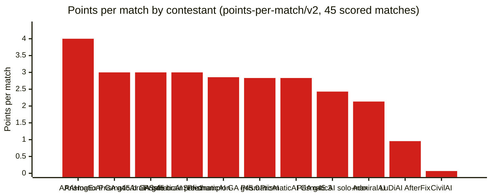
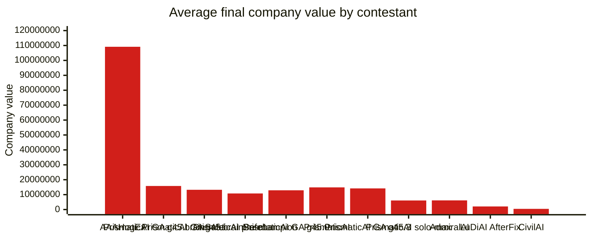
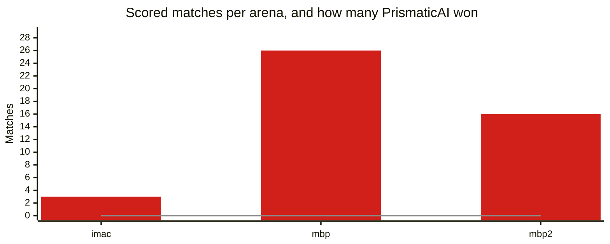

# battle-20261119T182305-7d8d766d

Derived from `battle-20261119T182305-7d8d766d.json` by `tools/research/ai-battle/battle.py report`; do not edit.

- Edition `7d8d766d2942f4bc`: PrismaticAI and referee at `ebf7516b54d7130fa0908c68ff298075c517fb41`, base set `opengfx-8.0.tar`
- 20-year free-for-all from 1960, map 256x256 temperate, breakdowns 1
- 45 scored match(es) on `imac` (20261119-master-gdf1e05e7d8), `mbp` (20261119-master-m356d6e49c0), `mbp2` (20261119-master-gdf1e05e7d8)
- Replays: 1 of 1 identical to their original on another arena

| # | Contestant | Played | Wins | Points | Points/match | Avg rank | Avg final value | Squirrel errors | Matches with anomalies |
|---|---|---|---|---|---|---|---|---|---|
| 1 | AAAHogEx | 45 | 45 | 180 | 4.0 | 1.0 | 109.1 M | 0 | 0 |
| 2 | PrismaticAI GA g45.brainSafe | 6 | 0 | 18 | 3.0 | 2.0 | 15.8 M | 0 | 2 |
| 3 | PrismaticAI GA g45.brainSafe1 | 6 | 0 | 18 | 3.0 | 2.0 | 13.3 M | 0 | 0 |
| 4 | PrismaticAI pre-champion | 7 | 0 | 21 | 3.0 | 2.0 | 10.8 M | 0 | 0 |
| 5 | PrismaticAI GA g45.0 | 7 | 0 | 20 | 2.857 | 2.14 | 12.9 M | 0 | 0 |
| 6 | PrismaticAI | 6 | 0 | 17 | 2.833 | 2.17 | 14.9 M | 0 | 0 |
| 7 | PrismaticAI GA g45.3 | 6 | 0 | 17 | 2.833 | 2.17 | 14.2 M | 0 | 0 |
| 8 | PrismaticAI solo-max | 7 | 0 | 17 | 2.429 | 2.57 | 6.1 M | 0 | 7 |
| 9 | AdmiralAI | 45 | 0 | 96 | 2.133 | 2.87 | 6.1 M | 0 | 1 |
| 10 | LuDiAI AfterFix | 45 | 0 | 43 | 0.956 | 4.04 | 2.1 M | 0 | 1 |
| 11 | CivilAI | 45 | 0 | 3 | 0.067 | 4.93 | 460.9 k | 0 | 10 |

```mermaid
---
config:
  xyChart:
    width: 900
    height: 360
  themeVariables:
    xyChart:
      plotColorPalette: "#d11f1a, #8a8a8a, #0b0b0b, #ece4d6"
---
xychart-beta
    title "Final company value per scored match: winner vs best PrismaticAI"
    x-axis ["m-0001", "m-0002", "m-0003", "m-0004", "m-0005", "m-0006", "m-0007", "m-0008", "m-0009", "m-0010", "m-0011", "m-0012", "m-0013", "m-0014", "m-0015", "m-0016", "m-0017", "m-0018", "m-0019", "m-0020", "m-0021", "m-0022", "m-0023", "m-0024", "m-0025", "m-0026", "m-0027", "m-0028", "m-0036", "m-0037", "m-0038", "m-0039", "m-0040", "m-0041", "m-0042", "m-0043", "m-0044", "m-0045", "m-0046", "m-0049", "m-0050", "m-0051", "m-0052", "m-0054", "m-0055"]
    %% series: Winner | Best PrismaticAI
    %% links: battle-20261119T182305-7d8d766d.md?col=Match&filter=m-0001 | battle-20261119T182305-7d8d766d.md?col=Match&filter=m-0002 | battle-20261119T182305-7d8d766d.md?col=Match&filter=m-0003 | battle-20261119T182305-7d8d766d.md?col=Match&filter=m-0004 | battle-20261119T182305-7d8d766d.md?col=Match&filter=m-0005 | battle-20261119T182305-7d8d766d.md?col=Match&filter=m-0006 | battle-20261119T182305-7d8d766d.md?col=Match&filter=m-0007 | battle-20261119T182305-7d8d766d.md?col=Match&filter=m-0008 | battle-20261119T182305-7d8d766d.md?col=Match&filter=m-0009 | battle-20261119T182305-7d8d766d.md?col=Match&filter=m-0010 | battle-20261119T182305-7d8d766d.md?col=Match&filter=m-0011 | battle-20261119T182305-7d8d766d.md?col=Match&filter=m-0012 | battle-20261119T182305-7d8d766d.md?col=Match&filter=m-0013 | battle-20261119T182305-7d8d766d.md?col=Match&filter=m-0014 | battle-20261119T182305-7d8d766d.md?col=Match&filter=m-0015 | battle-20261119T182305-7d8d766d.md?col=Match&filter=m-0016 | battle-20261119T182305-7d8d766d.md?col=Match&filter=m-0017 | battle-20261119T182305-7d8d766d.md?col=Match&filter=m-0018 | battle-20261119T182305-7d8d766d.md?col=Match&filter=m-0019 | battle-20261119T182305-7d8d766d.md?col=Match&filter=m-0020 | battle-20261119T182305-7d8d766d.md?col=Match&filter=m-0021 | battle-20261119T182305-7d8d766d.md?col=Match&filter=m-0022 | battle-20261119T182305-7d8d766d.md?col=Match&filter=m-0023 | battle-20261119T182305-7d8d766d.md?col=Match&filter=m-0024 | battle-20261119T182305-7d8d766d.md?col=Match&filter=m-0025 | battle-20261119T182305-7d8d766d.md?col=Match&filter=m-0026 | battle-20261119T182305-7d8d766d.md?col=Match&filter=m-0027 | battle-20261119T182305-7d8d766d.md?col=Match&filter=m-0028 | battle-20261119T182305-7d8d766d.md?col=Match&filter=m-0036 | battle-20261119T182305-7d8d766d.md?col=Match&filter=m-0037 | battle-20261119T182305-7d8d766d.md?col=Match&filter=m-0038 | battle-20261119T182305-7d8d766d.md?col=Match&filter=m-0039 | battle-20261119T182305-7d8d766d.md?col=Match&filter=m-0040 | battle-20261119T182305-7d8d766d.md?col=Match&filter=m-0041 | battle-20261119T182305-7d8d766d.md?col=Match&filter=m-0042 | battle-20261119T182305-7d8d766d.md?col=Match&filter=m-0043 | battle-20261119T182305-7d8d766d.md?col=Match&filter=m-0044 | battle-20261119T182305-7d8d766d.md?col=Match&filter=m-0045 | battle-20261119T182305-7d8d766d.md?col=Match&filter=m-0046 | battle-20261119T182305-7d8d766d.md?col=Match&filter=m-0049 | battle-20261119T182305-7d8d766d.md?col=Match&filter=m-0050 | battle-20261119T182305-7d8d766d.md?col=Match&filter=m-0051 | battle-20261119T182305-7d8d766d.md?col=Match&filter=m-0052 | battle-20261119T182305-7d8d766d.md?col=Match&filter=m-0054 | battle-20261119T182305-7d8d766d.md?col=Match&filter=m-0055
    y-axis "Company value" 0 --> 160000000
    bar [120232674, 96662862, 92037196, 97983445, 128899553, 106811076, 145336282, 123023604, 138973035, 105649576, 129159207, 111848122, 130939405, 95514055, 103571877, 121331579, 113219091, 126037596, 123195697, 116729374, 89491477, 141225513, 130538482, 106397771, 133175070, 127236875, 110883824, 88547645, 112898951, 117266009, 122098640, 102856852, 113745198, 92411687, 100005854, 94955192, 88787218, 80902209, 83121714, 96161581, 95540931, 85788812, 96785371, 85966091, 87569877]
    line [7076969, 13059402, 15786943, 19730581, 10515667, 10912032, 16332290, 7128202, 6826176, 10143016, 13104575, 16230218, 16316373, 13837854, 5773908, 8966128, 10762295, 16449567, 9055599, 10114332, 12820792, 7087792, 7536887, 9937313, 10192312, 12900583, 13453883, 16608119, 7159295, 13634638, 14946077, 20545709, 18203540, 18240604, 17036324, 5425598, 13846842, 16109902, 14794055, 12564892, 2902299, 11640365, 12659505, 12605532, 16003627]
```

<!-- battle-charts:begin -->
<!-- derived from battle-20261119T182305-7d8d766d.json by `battle.py render`; `battle.py check` fails when it is stale -->

<!-- battle-charts:end -->

| Seed | Original | Replay | Arenas | Identical |
|---|---|---|---|---|
| 1522854323 | m-0022 | m-0048 | mbp2 / mbp | yes |

| Match | Arena | Seed | Winner | Value | Last | Anomalies |
|---|---|---|---|---|---|---|
| m-0001 | mbp | 1182780514 | AAAHogEx | 120.2 M | CivilAI | PrismaticAI solo-max: fleet_drop:46->15 |
| m-0002 | mbp | 1182780514 | AAAHogEx | 96.7 M | CivilAI | - |
| m-0003 | mbp | 1182780514 | AAAHogEx | 92.0 M | CivilAI | - |
| m-0004 | mbp | 1182780514 | AAAHogEx | 98.0 M | CivilAI | - |
| m-0005 | mbp | 1182780514 | AAAHogEx | 128.9 M | CivilAI | LuDiAI AfterFix: fleet_drop:85->54 |
| m-0006 | mbp | 1182780514 | AAAHogEx | 106.8 M | CivilAI | - |
| m-0007 | mbp | 157516615 | AAAHogEx | 145.3 M | CivilAI | - |
| m-0008 | mbp | 157516615 | AAAHogEx | 123.0 M | LuDiAI AfterFix | PrismaticAI solo-max: fleet_drop:31->14 |
| m-0009 | mbp | 157516615 | AAAHogEx | 139.0 M | CivilAI | - |
| m-0010 | imac | 157516615 | AAAHogEx | 105.6 M | CivilAI | - |
| m-0011 | imac | 157516615 | AAAHogEx | 129.2 M | CivilAI | - |
| m-0012 | imac | 157516615 | AAAHogEx | 111.8 M | CivilAI | - |
| m-0013 | mbp2 | 157516615 | AAAHogEx | 130.9 M | CivilAI | - |
| m-0014 | mbp2 | 216887979 | AAAHogEx | 95.5 M | CivilAI | - |
| m-0015 | mbp2 | 216887979 | AAAHogEx | 103.6 M | CivilAI | PrismaticAI solo-max: fleet_drop:41->13 |
| m-0016 | mbp2 | 216887979 | AAAHogEx | 121.3 M | CivilAI | CivilAI: fleet_drop:21->4 |
| m-0017 | mbp2 | 216887979 | AAAHogEx | 113.2 M | CivilAI | - |
| m-0018 | mbp2 | 216887979 | AAAHogEx | 126.0 M | CivilAI | PrismaticAI GA g45.brainSafe: fleet_drop:61->41 |
| m-0019 | mbp2 | 216887979 | AAAHogEx | 123.2 M | CivilAI | CivilAI: no_vehicles |
| m-0020 | mbp2 | 216887979 | AAAHogEx | 116.7 M | CivilAI | - |
| m-0021 | mbp2 | 1522854323 | AAAHogEx | 89.5 M | CivilAI | CivilAI: fleet_drop:43->29 |
| m-0022 | mbp2 | 1522854323 | AAAHogEx | 141.2 M | CivilAI | PrismaticAI solo-max: fleet_drop:43->17 |
| m-0023 | mbp2 | 1522854323 | AAAHogEx | 130.5 M | CivilAI | - |
| m-0024 | mbp2 | 1522854323 | AAAHogEx | 106.4 M | CivilAI | CivilAI: no_vehicles |
| m-0025 | mbp2 | 1522854323 | AAAHogEx | 133.2 M | CivilAI | - |
| m-0026 | mbp2 | 1522854323 | AAAHogEx | 127.2 M | CivilAI | - |
| m-0027 | mbp2 | 1522854323 | AAAHogEx | 110.9 M | CivilAI | CivilAI: fleet_drop:37->23 |
| m-0028 | mbp2 | 1524292062 | AAAHogEx | 88.5 M | CivilAI | - |
| m-0036 | mbp | 1110435526 | AAAHogEx | 112.9 M | CivilAI | PrismaticAI solo-max: fleet_drop:47->27 |
| m-0037 | mbp | 1110435526 | AAAHogEx | 117.3 M | CivilAI | - |
| m-0038 | mbp | 1110435526 | AAAHogEx | 122.1 M | CivilAI | - |
| m-0039 | mbp | 1110435526 | AAAHogEx | 102.9 M | CivilAI | - |
| m-0040 | mbp | 1110435526 | AAAHogEx | 113.7 M | CivilAI | CivilAI: fleet_drop:35->23 |
| m-0041 | mbp | 1110435526 | AAAHogEx | 92.4 M | CivilAI | - |
| m-0042 | mbp | 1559040277 | AAAHogEx | 100.0 M | CivilAI | - |
| m-0043 | mbp | 1559040277 | AAAHogEx | 95.0 M | LuDiAI AfterFix | PrismaticAI solo-max: fleet_drop:40->18 |
| m-0044 | mbp | 1559040277 | AAAHogEx | 88.8 M | CivilAI | - |
| m-0045 | mbp | 1559040277 | AAAHogEx | 80.9 M | CivilAI | CivilAI: fleet_drop:34->21 |
| m-0046 | mbp | 1559040277 | AAAHogEx | 83.1 M | CivilAI | PrismaticAI GA g45.brainSafe: fleet_drop:150->67; AdmiralAI: fleet_drop:152->56; CivilAI: fleet_drop:23->14 |
| m-0048 (replay) | mbp | 1522854323 | AAAHogEx | 141.2 M | CivilAI | PrismaticAI solo-max: fleet_drop:43->17 |
| m-0049 | mbp | 1527355150 | AAAHogEx | 96.2 M | CivilAI | - |
| m-0050 | mbp | 1527355150 | AAAHogEx | 95.5 M | CivilAI | PrismaticAI solo-max: fleet_drop:34->12 |
| m-0051 | mbp | 1527355150 | AAAHogEx | 85.8 M | LuDiAI AfterFix | CivilAI: fleet_drop:39->20 |
| m-0052 | mbp | 1527355150 | AAAHogEx | 96.8 M | CivilAI | - |
| m-0054 | mbp | 1527355150 | AAAHogEx | 86.0 M | CivilAI | CivilAI: fleet_drop:32->20 |
| m-0055 | mbp | 1527355150 | AAAHogEx | 87.6 M | CivilAI | - |
