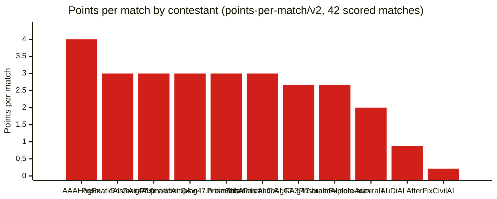
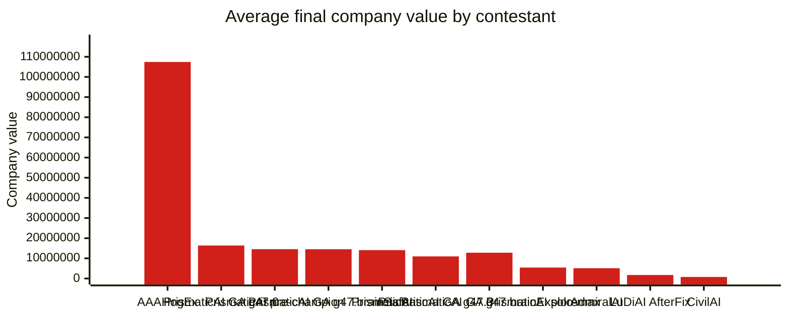
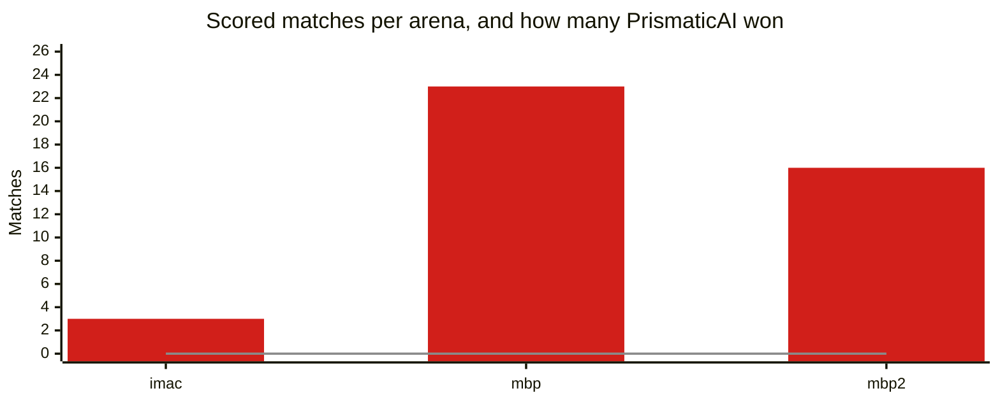

# battle-20261119T184802-f1e5c700

Derived from `battle-20261119T184802-f1e5c700.json` by `tools/research/ai-battle/battle.py report`; do not edit.

- Edition `f1e5c700e08b92fe`: PrismaticAI and referee at `ebf7516b54d7130fa0908c68ff298075c517fb41`, base set `opengfx-8.0.tar`
- 20-year free-for-all from 1960, map 256x256 temperate, breakdowns 1
- 42 scored match(es) on `imac` (20261119-master-gdf1e05e7d8), `mbp` (20261119-master-m356d6e49c0), `mbp2` (20261119-master-gdf1e05e7d8)
- Replays: 0 of 1 identical to their original on another arena

| # | Contestant | Played | Wins | Points | Points/match | Avg rank | Avg final value | Squirrel errors | Matches with anomalies |
|---|---|---|---|---|---|---|---|---|---|
| 1 | AAAHogEx | 42 | 42 | 168 | 4.0 | 1.0 | 107.4 M | 0 | 0 |
| 2 | PrismaticAI GA g47.0 | 6 | 0 | 18 | 3.0 | 2.0 | 16.4 M | 0 | 4 |
| 3 | PrismaticAI pre-champion | 6 | 0 | 18 | 3.0 | 2.0 | 14.6 M | 0 | 0 |
| 4 | PrismaticAI GA g47.brainSafe | 7 | 0 | 21 | 3.0 | 2.0 | 14.5 M | 0 | 0 |
| 5 | PrismaticAI | 5 | 0 | 15 | 3.0 | 2.0 | 14.1 M | 0 | 0 |
| 6 | PrismaticAI GA g47.3 | 6 | 0 | 18 | 3.0 | 2.0 | 11.0 M | 0 | 5 |
| 7 | PrismaticAI GA g47.brainExplore | 6 | 0 | 16 | 2.667 | 2.33 | 12.8 M | 0 | 2 |
| 8 | PrismaticAI solo-max | 6 | 0 | 16 | 2.667 | 2.33 | 5.4 M | 0 | 6 |
| 9 | AdmiralAI | 42 | 0 | 84 | 2.0 | 3.0 | 5.1 M | 0 | 1 |
| 10 | LuDiAI AfterFix | 42 | 0 | 37 | 0.881 | 4.12 | 1.7 M | 0 | 3 |
| 11 | CivilAI | 42 | 0 | 9 | 0.214 | 4.79 | 765.5 k | 3730 | 7 |

```mermaid
---
config:
  xyChart:
    width: 900
    height: 360
  themeVariables:
    xyChart:
      plotColorPalette: "#d11f1a, #8a8a8a, #0b0b0b, #ece4d6"
---
xychart-beta
    title "Final company value per scored match: winner vs best PrismaticAI"
    x-axis ["m-0001", "m-0002", "m-0003", "m-0004", "m-0005", "m-0006", "m-0007", "m-0008", "m-0009", "m-0010", "m-0011", "m-0012", "m-0013", "m-0014", "m-0015", "m-0016", "m-0017", "m-0018", "m-0019", "m-0020", "m-0021", "m-0022", "m-0023", "m-0024", "m-0025", "m-0026", "m-0027", "m-0028", "m-0036", "m-0037", "m-0038", "m-0039", "m-0040", "m-0041", "m-0042", "m-0043", "m-0044", "m-0046", "m-0047", "m-0052", "m-0053", "m-0055"]
    %% series: Winner | Best PrismaticAI
    %% links: battle-20261119T184802-f1e5c700.md?col=Match&filter=m-0001 | battle-20261119T184802-f1e5c700.md?col=Match&filter=m-0002 | battle-20261119T184802-f1e5c700.md?col=Match&filter=m-0003 | battle-20261119T184802-f1e5c700.md?col=Match&filter=m-0004 | battle-20261119T184802-f1e5c700.md?col=Match&filter=m-0005 | battle-20261119T184802-f1e5c700.md?col=Match&filter=m-0006 | battle-20261119T184802-f1e5c700.md?col=Match&filter=m-0007 | battle-20261119T184802-f1e5c700.md?col=Match&filter=m-0008 | battle-20261119T184802-f1e5c700.md?col=Match&filter=m-0009 | battle-20261119T184802-f1e5c700.md?col=Match&filter=m-0010 | battle-20261119T184802-f1e5c700.md?col=Match&filter=m-0011 | battle-20261119T184802-f1e5c700.md?col=Match&filter=m-0012 | battle-20261119T184802-f1e5c700.md?col=Match&filter=m-0013 | battle-20261119T184802-f1e5c700.md?col=Match&filter=m-0014 | battle-20261119T184802-f1e5c700.md?col=Match&filter=m-0015 | battle-20261119T184802-f1e5c700.md?col=Match&filter=m-0016 | battle-20261119T184802-f1e5c700.md?col=Match&filter=m-0017 | battle-20261119T184802-f1e5c700.md?col=Match&filter=m-0018 | battle-20261119T184802-f1e5c700.md?col=Match&filter=m-0019 | battle-20261119T184802-f1e5c700.md?col=Match&filter=m-0020 | battle-20261119T184802-f1e5c700.md?col=Match&filter=m-0021 | battle-20261119T184802-f1e5c700.md?col=Match&filter=m-0022 | battle-20261119T184802-f1e5c700.md?col=Match&filter=m-0023 | battle-20261119T184802-f1e5c700.md?col=Match&filter=m-0024 | battle-20261119T184802-f1e5c700.md?col=Match&filter=m-0025 | battle-20261119T184802-f1e5c700.md?col=Match&filter=m-0026 | battle-20261119T184802-f1e5c700.md?col=Match&filter=m-0027 | battle-20261119T184802-f1e5c700.md?col=Match&filter=m-0028 | battle-20261119T184802-f1e5c700.md?col=Match&filter=m-0036 | battle-20261119T184802-f1e5c700.md?col=Match&filter=m-0037 | battle-20261119T184802-f1e5c700.md?col=Match&filter=m-0038 | battle-20261119T184802-f1e5c700.md?col=Match&filter=m-0039 | battle-20261119T184802-f1e5c700.md?col=Match&filter=m-0040 | battle-20261119T184802-f1e5c700.md?col=Match&filter=m-0041 | battle-20261119T184802-f1e5c700.md?col=Match&filter=m-0042 | battle-20261119T184802-f1e5c700.md?col=Match&filter=m-0043 | battle-20261119T184802-f1e5c700.md?col=Match&filter=m-0044 | battle-20261119T184802-f1e5c700.md?col=Match&filter=m-0046 | battle-20261119T184802-f1e5c700.md?col=Match&filter=m-0047 | battle-20261119T184802-f1e5c700.md?col=Match&filter=m-0052 | battle-20261119T184802-f1e5c700.md?col=Match&filter=m-0053 | battle-20261119T184802-f1e5c700.md?col=Match&filter=m-0055
    y-axis "Company value" 0 --> 174000000
    bar [113737253, 102392642, 88186434, 103160525, 106716705, 82084859, 88167917, 135014937, 118416921, 92582839, 90462520, 114664186, 94108033, 86239922, 123111204, 96999311, 99164880, 123854655, 88941729, 103921416, 119702145, 158061795, 110268990, 143010245, 112310974, 103868912, 129905400, 115488745, 120769338, 119324941, 107366574, 97892295, 102960873, 92304012, 69860705, 116249793, 116205440, 76003086, 107541610, 122834371, 91014004, 127113990]
    line [5551179, 18551558, 9831610, 18457542, 8142790, 9597716, 11177751, 2525641, 10338209, 11120602, 9159170, 15331173, 6596213, 20168931, 5040017, 18113970, 26417425, 19342473, 15811386, 12153560, 10303094, 5101724, 13144662, 10123457, 10622059, 17705942, 7826512, 10881786, 7511566, 14275561, 17010073, 12441125, 9971145, 14921874, 17868618, 6816669, 12915901, 15447270, 9810598, 23670102, 16132775, 14700835]
```

<!-- battle-charts:begin -->
<!-- derived from battle-20261119T184802-f1e5c700.json by `battle.py render`; `battle.py check` fails when it is stale -->

<!-- battle-charts:end -->

| Seed | Original | Replay | Arenas | Identical |
|---|---|---|---|---|
| 222413470 | m-0010 | m-0064 | imac / mbp | NO |

| Match | Arena | Seed | Winner | Value | Last | Anomalies |
|---|---|---|---|---|---|---|
| m-0001 | mbp | 1305025931 | AAAHogEx | 113.7 M | CivilAI | PrismaticAI solo-max: fleet_drop:33->19 |
| m-0002 | mbp | 1305025931 | AAAHogEx | 102.4 M | CivilAI | - |
| m-0003 | mbp | 1305025931 | AAAHogEx | 88.2 M | CivilAI | PrismaticAI GA g47.0: fleet_drop:134->93; LuDiAI AfterFix: fleet_drop:157->93 |
| m-0004 | mbp | 1305025931 | AAAHogEx | 103.2 M | CivilAI | CivilAI: fleet_drop:51->33 |
| m-0005 | mbp | 1305025931 | AAAHogEx | 106.7 M | CivilAI | PrismaticAI GA g47.brainExplore: fleet_drop:75->36; LuDiAI AfterFix: fleet_drop:81->47 |
| m-0006 | mbp | 1305025931 | AAAHogEx | 82.1 M | CivilAI | CivilAI: squirrel_errors:3730 |
| m-0007 | mbp | 222413470 | AAAHogEx | 88.2 M | CivilAI | CivilAI: fleet_drop:28->15 |
| m-0008 | mbp | 222413470 | AAAHogEx | 135.0 M | CivilAI | PrismaticAI solo-max: fleet_drop:38->16 |
| m-0009 | mbp | 222413470 | AAAHogEx | 118.4 M | CivilAI | - |
| m-0010 | imac | 222413470 | AAAHogEx | 92.6 M | CivilAI | - |
| m-0011 | imac | 222413470 | AAAHogEx | 90.5 M | CivilAI | - |
| m-0012 | imac | 222413470 | AAAHogEx | 114.7 M | CivilAI | PrismaticAI GA g47.brainExplore: fleet_drop:96->50; CivilAI: no_vehicles |
| m-0013 | mbp2 | 222413470 | AAAHogEx | 94.1 M | CivilAI | PrismaticAI GA g47.3: fleet_drop:64->28 |
| m-0014 | mbp2 | 1939805307 | AAAHogEx | 86.2 M | LuDiAI AfterFix | - |
| m-0015 | mbp2 | 1939805307 | AAAHogEx | 123.1 M | CivilAI | PrismaticAI solo-max: fleet_drop:44->20 |
| m-0016 | mbp2 | 1939805307 | AAAHogEx | 97.0 M | LuDiAI AfterFix | - |
| m-0017 | mbp2 | 1939805307 | AAAHogEx | 99.2 M | CivilAI | - |
| m-0018 | mbp2 | 1939805307 | AAAHogEx | 123.9 M | CivilAI | - |
| m-0019 | mbp2 | 1939805307 | AAAHogEx | 88.9 M | CivilAI | - |
| m-0020 | mbp2 | 1939805307 | AAAHogEx | 103.9 M | CivilAI | PrismaticAI GA g47.3: fleet_drop:151->60; CivilAI: fleet_drop:48->30 |
| m-0021 | mbp2 | 1933598029 | AAAHogEx | 119.7 M | CivilAI | - |
| m-0022 | mbp2 | 1933598029 | AAAHogEx | 158.1 M | CivilAI | PrismaticAI solo-max: fleet_drop:42->20 |
| m-0023 | mbp2 | 1933598029 | AAAHogEx | 110.3 M | CivilAI | - |
| m-0024 | mbp2 | 1933598029 | AAAHogEx | 143.0 M | CivilAI | PrismaticAI GA g47.0: fleet_drop:130->55 |
| m-0025 | mbp2 | 1933598029 | AAAHogEx | 112.3 M | LuDiAI AfterFix | - |
| m-0026 | mbp2 | 1933598029 | AAAHogEx | 103.9 M | LuDiAI AfterFix | - |
| m-0027 | mbp2 | 1933598029 | AAAHogEx | 129.9 M | CivilAI | PrismaticAI GA g47.3: fleet_drop:116->53 |
| m-0028 | mbp2 | 1900000218 | AAAHogEx | 115.5 M | LuDiAI AfterFix | - |
| m-0036 | mbp | 1657068450 | AAAHogEx | 120.8 M | CivilAI | PrismaticAI solo-max: fleet_drop:39->17 |
| m-0037 | mbp | 1657068450 | AAAHogEx | 119.3 M | LuDiAI AfterFix | - |
| m-0038 | mbp | 1657068450 | AAAHogEx | 107.4 M | CivilAI | PrismaticAI GA g47.0: fleet_drop:119->72 |
| m-0039 | mbp | 1657068450 | AAAHogEx | 97.9 M | LuDiAI AfterFix | - |
| m-0040 | mbp | 1657068450 | AAAHogEx | 103.0 M | LuDiAI AfterFix | - |
| m-0041 | mbp | 1657068450 | AAAHogEx | 92.3 M | CivilAI | PrismaticAI GA g47.3: fleet_drop:138->54 |
| m-0042 | mbp | 731936699 | AAAHogEx | 69.9 M | CivilAI | AdmiralAI: fleet_drop:220->152 |
| m-0043 | mbp | 731936699 | AAAHogEx | 116.2 M | CivilAI | PrismaticAI solo-max: fleet_drop:46->23 |
| m-0044 | mbp | 731936699 | AAAHogEx | 116.2 M | CivilAI | LuDiAI AfterFix: fleet_drop:120->82 |
| m-0046 | mbp | 731936699 | AAAHogEx | 76.0 M | CivilAI | CivilAI: fleet_drop:30->19 |
| m-0047 | mbp | 731936699 | AAAHogEx | 107.5 M | CivilAI | - |
| m-0052 | mbp | 83017738 | AAAHogEx | 122.8 M | CivilAI | PrismaticAI GA g47.0: fleet_drop:163->103; CivilAI: fleet_drop:24->11 |
| m-0053 | mbp | 83017738 | AAAHogEx | 91.0 M | LuDiAI AfterFix | - |
| m-0055 | mbp | 83017738 | AAAHogEx | 127.1 M | CivilAI | PrismaticAI GA g47.3: fleet_drop:101->60 |
| m-0064 (replay) | mbp | 222413470 | AAAHogEx | 93.4 M | CivilAI | - |
