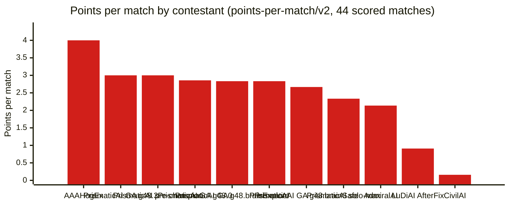
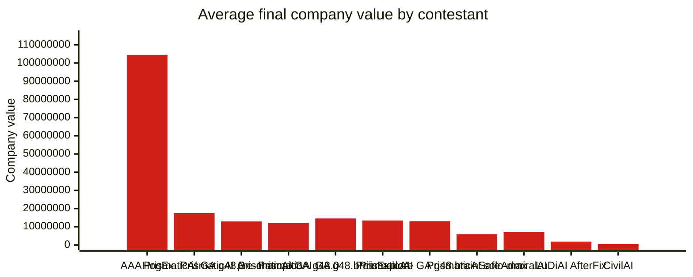
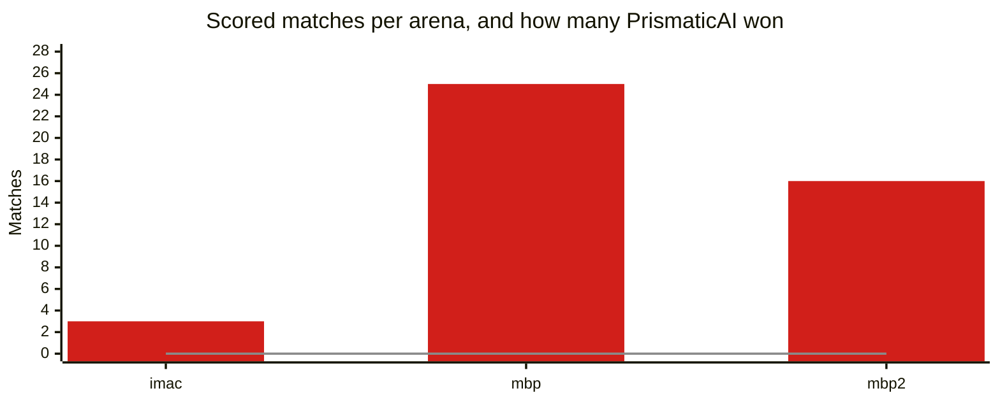

# battle-20261119T185918-db0e363d

Derived from `battle-20261119T185918-db0e363d.json` by `tools/research/ai-battle/battle.py report`; do not edit.

- Edition `db0e363d71f8bcfc`: PrismaticAI and referee at `ebf7516b54d7130fa0908c68ff298075c517fb41`, base set `opengfx-8.0.tar`
- 20-year free-for-all from 1960, map 256x256 temperate, breakdowns 1
- 44 scored match(es) on `imac` (20261119-master-gdf1e05e7d8), `mbp` (20261119-master-m356d6e49c0), `mbp2` (20261119-master-gdf1e05e7d8)
- Replays: 1 of 2 identical to their original on another arena

| # | Contestant | Played | Wins | Points | Points/match | Avg rank | Avg final value | Squirrel errors | Matches with anomalies |
|---|---|---|---|---|---|---|---|---|---|
| 1 | AAAHogEx | 44 | 44 | 176 | 4.0 | 1.0 | 104.5 M | 0 | 0 |
| 2 | PrismaticAI GA g48.3 | 6 | 0 | 18 | 3.0 | 2.0 | 17.5 M | 0 | 0 |
| 3 | PrismaticAI pre-champion | 7 | 0 | 21 | 3.0 | 2.0 | 12.9 M | 0 | 0 |
| 4 | PrismaticAI GA g48.0 | 7 | 0 | 20 | 2.857 | 2.14 | 12.2 M | 0 | 0 |
| 5 | PrismaticAI GA g48.brainExplore | 6 | 0 | 17 | 2.833 | 2.17 | 14.6 M | 0 | 0 |
| 6 | PrismaticAI | 6 | 0 | 17 | 2.833 | 2.17 | 13.4 M | 0 | 0 |
| 7 | PrismaticAI GA g48.brainSafe | 6 | 0 | 16 | 2.667 | 2.33 | 13.1 M | 0 | 0 |
| 8 | PrismaticAI solo-max | 6 | 0 | 14 | 2.333 | 2.67 | 5.8 M | 0 | 6 |
| 9 | AdmiralAI | 44 | 0 | 94 | 2.136 | 2.86 | 7.1 M | 0 | 0 |
| 10 | LuDiAI AfterFix | 44 | 0 | 40 | 0.909 | 4.09 | 1.8 M | 0 | 2 |
| 11 | CivilAI | 44 | 0 | 7 | 0.159 | 4.84 | 531.5 k | 0 | 12 |

```mermaid
---
config:
  xyChart:
    width: 900
    height: 360
  themeVariables:
    xyChart:
      plotColorPalette: "#d11f1a, #8a8a8a, #0b0b0b, #ece4d6"
---
xychart-beta
    title "Final company value per scored match: winner vs best PrismaticAI"
    x-axis ["m-0001", "m-0002", "m-0003", "m-0004", "m-0005", "m-0006", "m-0007", "m-0008", "m-0009", "m-0010", "m-0011", "m-0012", "m-0013", "m-0014", "m-0015", "m-0016", "m-0017", "m-0018", "m-0019", "m-0020", "m-0021", "m-0022", "m-0023", "m-0024", "m-0025", "m-0026", "m-0027", "m-0028", "m-0036", "m-0037", "m-0038", "m-0039", "m-0040", "m-0041", "m-0042", "m-0043", "m-0044", "m-0045", "m-0047", "m-0049", "m-0051", "m-0052", "m-0053", "m-0055"]
    %% series: Winner | Best PrismaticAI
    %% links: battle-20261119T185918-db0e363d.md?col=Match&filter=m-0001 | battle-20261119T185918-db0e363d.md?col=Match&filter=m-0002 | battle-20261119T185918-db0e363d.md?col=Match&filter=m-0003 | battle-20261119T185918-db0e363d.md?col=Match&filter=m-0004 | battle-20261119T185918-db0e363d.md?col=Match&filter=m-0005 | battle-20261119T185918-db0e363d.md?col=Match&filter=m-0006 | battle-20261119T185918-db0e363d.md?col=Match&filter=m-0007 | battle-20261119T185918-db0e363d.md?col=Match&filter=m-0008 | battle-20261119T185918-db0e363d.md?col=Match&filter=m-0009 | battle-20261119T185918-db0e363d.md?col=Match&filter=m-0010 | battle-20261119T185918-db0e363d.md?col=Match&filter=m-0011 | battle-20261119T185918-db0e363d.md?col=Match&filter=m-0012 | battle-20261119T185918-db0e363d.md?col=Match&filter=m-0013 | battle-20261119T185918-db0e363d.md?col=Match&filter=m-0014 | battle-20261119T185918-db0e363d.md?col=Match&filter=m-0015 | battle-20261119T185918-db0e363d.md?col=Match&filter=m-0016 | battle-20261119T185918-db0e363d.md?col=Match&filter=m-0017 | battle-20261119T185918-db0e363d.md?col=Match&filter=m-0018 | battle-20261119T185918-db0e363d.md?col=Match&filter=m-0019 | battle-20261119T185918-db0e363d.md?col=Match&filter=m-0020 | battle-20261119T185918-db0e363d.md?col=Match&filter=m-0021 | battle-20261119T185918-db0e363d.md?col=Match&filter=m-0022 | battle-20261119T185918-db0e363d.md?col=Match&filter=m-0023 | battle-20261119T185918-db0e363d.md?col=Match&filter=m-0024 | battle-20261119T185918-db0e363d.md?col=Match&filter=m-0025 | battle-20261119T185918-db0e363d.md?col=Match&filter=m-0026 | battle-20261119T185918-db0e363d.md?col=Match&filter=m-0027 | battle-20261119T185918-db0e363d.md?col=Match&filter=m-0028 | battle-20261119T185918-db0e363d.md?col=Match&filter=m-0036 | battle-20261119T185918-db0e363d.md?col=Match&filter=m-0037 | battle-20261119T185918-db0e363d.md?col=Match&filter=m-0038 | battle-20261119T185918-db0e363d.md?col=Match&filter=m-0039 | battle-20261119T185918-db0e363d.md?col=Match&filter=m-0040 | battle-20261119T185918-db0e363d.md?col=Match&filter=m-0041 | battle-20261119T185918-db0e363d.md?col=Match&filter=m-0042 | battle-20261119T185918-db0e363d.md?col=Match&filter=m-0043 | battle-20261119T185918-db0e363d.md?col=Match&filter=m-0044 | battle-20261119T185918-db0e363d.md?col=Match&filter=m-0045 | battle-20261119T185918-db0e363d.md?col=Match&filter=m-0047 | battle-20261119T185918-db0e363d.md?col=Match&filter=m-0049 | battle-20261119T185918-db0e363d.md?col=Match&filter=m-0051 | battle-20261119T185918-db0e363d.md?col=Match&filter=m-0052 | battle-20261119T185918-db0e363d.md?col=Match&filter=m-0053 | battle-20261119T185918-db0e363d.md?col=Match&filter=m-0055
    y-axis "Company value" 0 --> 162000000
    bar [122109171, 75365645, 119634795, 113250768, 94313268, 76753140, 79387310, 120825738, 98285844, 94376315, 85945302, 104489721, 109204285, 106936298, 87883272, 80232657, 78932437, 94285286, 91042735, 86711262, 108477221, 138684839, 118610015, 137322189, 99493881, 141876367, 105796736, 117186826, 131958484, 111817873, 118923304, 112753977, 107759280, 90222334, 135319814, 128184834, 128955200, 127201147, 147444555, 72245157, 81236222, 65764985, 79662270, 73055719]
    line [7620662, 14229482, 10604897, 11086089, 14683073, 18791504, 13449841, 4834871, 5384814, 11531776, 7280407, 16255085, 14269248, 6143839, 6787510, 10600648, 2360667, 8110693, 6818058, 9203905, 17575504, 3862792, 19724245, 15028079, 22234259, 17787187, 25942871, 13231552, 4824378, 9788130, 13142365, 12364415, 13668290, 23204434, 16480033, 7146324, 16444141, 15926759, 18092177, 13660770, 14138885, 16564684, 17256229, 13842956]
```

<!-- battle-charts:begin -->
<!-- derived from battle-20261119T185918-db0e363d.json by `battle.py render`; `battle.py check` fails when it is stale -->

<!-- battle-charts:end -->

| Seed | Original | Replay | Arenas | Identical |
|---|---|---|---|---|
| 162850152 | m-0015 | m-0048 | mbp2 / mbp | yes |
| 836613037 | m-0011 | m-0056 | imac / mbp | NO |

| Match | Arena | Seed | Winner | Value | Last | Anomalies |
|---|---|---|---|---|---|---|
| m-0001 | mbp | 1662522800 | AAAHogEx | 122.1 M | CivilAI | PrismaticAI solo-max: fleet_drop:43->19 |
| m-0002 | mbp | 1662522800 | AAAHogEx | 75.4 M | LuDiAI AfterFix | LuDiAI AfterFix: fleet_drop:93->48 |
| m-0003 | mbp | 1662522800 | AAAHogEx | 119.6 M | CivilAI | - |
| m-0004 | mbp | 1662522800 | AAAHogEx | 113.3 M | CivilAI | - |
| m-0005 | mbp | 1662522800 | AAAHogEx | 94.3 M | CivilAI | - |
| m-0006 | mbp | 1662522800 | AAAHogEx | 76.8 M | CivilAI | - |
| m-0007 | mbp | 836613037 | AAAHogEx | 79.4 M | CivilAI | CivilAI: fleet_drop:48->21 |
| m-0008 | mbp | 836613037 | AAAHogEx | 120.8 M | CivilAI | PrismaticAI solo-max: fleet_drop:35->14 |
| m-0009 | mbp | 836613037 | AAAHogEx | 98.3 M | CivilAI | CivilAI: fleet_drop:95->65 |
| m-0010 | imac | 836613037 | AAAHogEx | 94.4 M | CivilAI | - |
| m-0011 | imac | 836613037 | AAAHogEx | 85.9 M | CivilAI | - |
| m-0012 | imac | 836613037 | AAAHogEx | 104.5 M | CivilAI | LuDiAI AfterFix: fleet_drop:75->39 |
| m-0013 | mbp2 | 836613037 | AAAHogEx | 109.2 M | AdmiralAI | CivilAI: fleet_drop:79->55 |
| m-0014 | mbp2 | 162850152 | AAAHogEx | 106.9 M | LuDiAI AfterFix | - |
| m-0015 | mbp2 | 162850152 | AAAHogEx | 87.9 M | CivilAI | PrismaticAI solo-max: fleet_drop:38->13; CivilAI: no_vehicles |
| m-0016 | mbp2 | 162850152 | AAAHogEx | 80.2 M | CivilAI | CivilAI: fleet_drop:33->15 |
| m-0017 | mbp2 | 162850152 | AAAHogEx | 78.9 M | LuDiAI AfterFix | CivilAI: fleet_drop:43->27 |
| m-0018 | mbp2 | 162850152 | AAAHogEx | 94.3 M | CivilAI | - |
| m-0019 | mbp2 | 162850152 | AAAHogEx | 91.0 M | CivilAI | - |
| m-0020 | mbp2 | 162850152 | AAAHogEx | 86.7 M | CivilAI | - |
| m-0021 | mbp2 | 1392531152 | AAAHogEx | 108.5 M | CivilAI | - |
| m-0022 | mbp2 | 1392531152 | AAAHogEx | 138.7 M | CivilAI | PrismaticAI solo-max: fleet_drop:38->19; CivilAI: fleet_drop:28->3 |
| m-0023 | mbp2 | 1392531152 | AAAHogEx | 118.6 M | CivilAI | - |
| m-0024 | mbp2 | 1392531152 | AAAHogEx | 137.3 M | CivilAI | CivilAI: fleet_drop:55->33 |
| m-0025 | mbp2 | 1392531152 | AAAHogEx | 99.5 M | CivilAI | - |
| m-0026 | mbp2 | 1392531152 | AAAHogEx | 141.9 M | LuDiAI AfterFix | - |
| m-0027 | mbp2 | 1392531152 | AAAHogEx | 105.8 M | CivilAI | - |
| m-0028 | mbp2 | 1257329559 | AAAHogEx | 117.2 M | CivilAI | - |
| m-0036 | mbp | 1826031044 | AAAHogEx | 132.0 M | CivilAI | PrismaticAI solo-max: fleet_drop:40->21 |
| m-0037 | mbp | 1826031044 | AAAHogEx | 111.8 M | CivilAI | CivilAI: fleet_drop:11->2 |
| m-0038 | mbp | 1826031044 | AAAHogEx | 118.9 M | CivilAI | CivilAI: no_vehicles |
| m-0039 | mbp | 1826031044 | AAAHogEx | 112.8 M | CivilAI | - |
| m-0040 | mbp | 1826031044 | AAAHogEx | 107.8 M | CivilAI | - |
| m-0041 | mbp | 1826031044 | AAAHogEx | 90.2 M | CivilAI | - |
| m-0042 | mbp | 4687267 | AAAHogEx | 135.3 M | LuDiAI AfterFix | CivilAI: fleet_drop:49->24 |
| m-0043 | mbp | 4687267 | AAAHogEx | 128.2 M | CivilAI | PrismaticAI solo-max: fleet_drop:51->19 |
| m-0044 | mbp | 4687267 | AAAHogEx | 129.0 M | CivilAI | - |
| m-0045 | mbp | 4687267 | AAAHogEx | 127.2 M | CivilAI | - |
| m-0047 | mbp | 4687267 | AAAHogEx | 147.4 M | CivilAI | CivilAI: fleet_drop:10->6 |
| m-0048 (replay) | mbp | 162850152 | AAAHogEx | 87.9 M | CivilAI | PrismaticAI solo-max: fleet_drop:38->13; CivilAI: no_vehicles |
| m-0049 | mbp | 30124931 | AAAHogEx | 72.2 M | CivilAI | - |
| m-0051 | mbp | 30124931 | AAAHogEx | 81.2 M | CivilAI | - |
| m-0052 | mbp | 30124931 | AAAHogEx | 65.8 M | CivilAI | - |
| m-0053 | mbp | 30124931 | AAAHogEx | 79.7 M | CivilAI | - |
| m-0055 | mbp | 30124931 | AAAHogEx | 73.1 M | CivilAI | - |
| m-0056 (replay) | mbp | 836613037 | AAAHogEx | 81.0 M | CivilAI | - |
