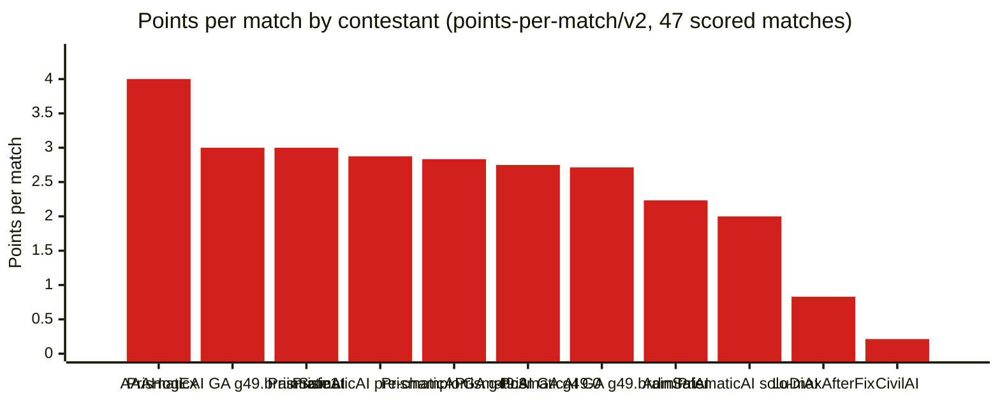
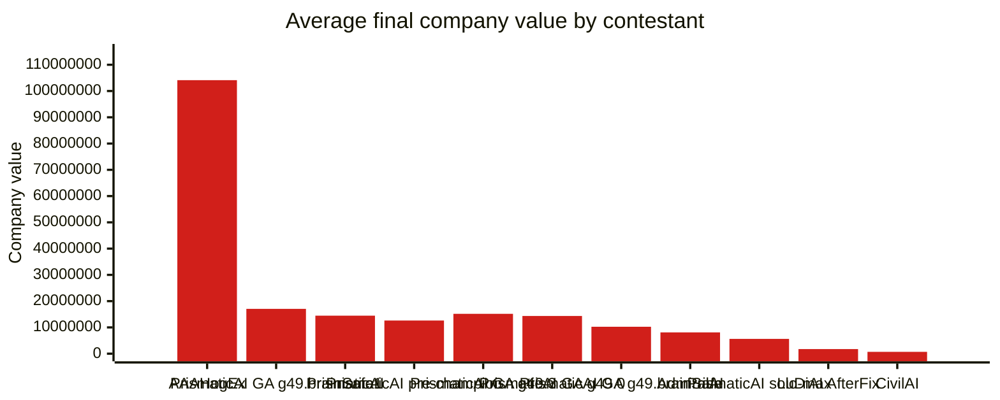
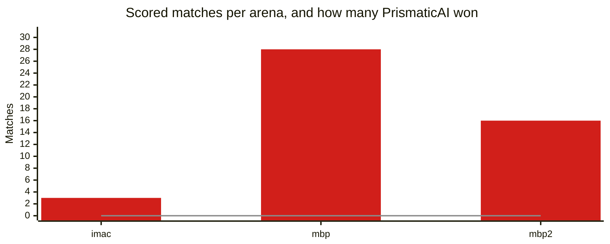

# battle-20261119T191134-4f981b2f

Derived from `battle-20261119T191134-4f981b2f.json` by `tools/research/ai-battle/battle.py report`; do not edit.

- Edition `4f981b2fa5b3d215`: PrismaticAI and referee at `ebf7516b54d7130fa0908c68ff298075c517fb41`, base set `opengfx-8.0.tar`
- 20-year free-for-all from 1960, map 256x256 temperate, breakdowns 1
- 47 scored match(es) on `imac` (20261119-master-gdf1e05e7d8), `mbp` (20261119-master-m356d6e49c0), `mbp2` (20261119-master-gdf1e05e7d8)
- Replays: 0 of 0 identical to their original on another arena

| # | Contestant | Played | Wins | Points | Points/match | Avg rank | Avg final value | Squirrel errors | Matches with anomalies |
|---|---|---|---|---|---|---|---|---|---|
| 1 | AAAHogEx | 47 | 47 | 188 | 4.0 | 1.0 | 104.1 M | 0 | 0 |
| 2 | PrismaticAI GA g49.brainSafe1 | 6 | 0 | 18 | 3.0 | 2.0 | 17.1 M | 0 | 3 |
| 3 | PrismaticAI | 5 | 0 | 15 | 3.0 | 2.0 | 14.5 M | 0 | 0 |
| 4 | PrismaticAI pre-champion | 8 | 0 | 23 | 2.875 | 2.12 | 12.6 M | 0 | 1 |
| 5 | PrismaticAI GA g49.3 | 6 | 0 | 17 | 2.833 | 2.17 | 15.2 M | 0 | 0 |
| 6 | PrismaticAI GA g49.0 | 8 | 0 | 22 | 2.75 | 2.25 | 14.3 M | 0 | 0 |
| 7 | PrismaticAI GA g49.brainSafe | 7 | 0 | 19 | 2.714 | 2.29 | 10.2 M | 0 | 4 |
| 8 | AdmiralAI | 47 | 0 | 105 | 2.234 | 2.77 | 8.1 M | 57 | 3 |
| 9 | PrismaticAI solo-max | 7 | 0 | 14 | 2.0 | 3.0 | 5.6 M | 0 | 7 |
| 10 | LuDiAI AfterFix | 47 | 0 | 39 | 0.83 | 4.17 | 1.7 M | 0 | 2 |
| 11 | CivilAI | 47 | 0 | 10 | 0.213 | 4.79 | 692.9 k | 0 | 8 |

```mermaid
---
config:
  xyChart:
    width: 900
    height: 360
  themeVariables:
    xyChart:
      plotColorPalette: "#d11f1a, #8a8a8a, #0b0b0b, #ece4d6"
---
xychart-beta
    title "Final company value per scored match: winner vs best PrismaticAI"
    x-axis ["m-0001", "m-0002", "m-0003", "m-0004", "m-0005", "m-0006", "m-0007", "m-0008", "m-0009", "m-0010", "m-0011", "m-0012", "m-0013", "m-0014", "m-0015", "m-0016", "m-0017", "m-0018", "m-0019", "m-0020", "m-0021", "m-0022", "m-0023", "m-0024", "m-0025", "m-0026", "m-0027", "m-0028", "m-0036", "m-0037", "m-0038", "m-0039", "m-0040", "m-0041", "m-0042", "m-0043", "m-0044", "m-0045", "m-0046", "m-0047", "m-0050", "m-0051", "m-0052", "m-0058", "m-0059", "m-0060", "m-0069"]
    %% series: Winner | Best PrismaticAI
    %% links: battle-20261119T191134-4f981b2f.md?col=Match&filter=m-0001 | battle-20261119T191134-4f981b2f.md?col=Match&filter=m-0002 | battle-20261119T191134-4f981b2f.md?col=Match&filter=m-0003 | battle-20261119T191134-4f981b2f.md?col=Match&filter=m-0004 | battle-20261119T191134-4f981b2f.md?col=Match&filter=m-0005 | battle-20261119T191134-4f981b2f.md?col=Match&filter=m-0006 | battle-20261119T191134-4f981b2f.md?col=Match&filter=m-0007 | battle-20261119T191134-4f981b2f.md?col=Match&filter=m-0008 | battle-20261119T191134-4f981b2f.md?col=Match&filter=m-0009 | battle-20261119T191134-4f981b2f.md?col=Match&filter=m-0010 | battle-20261119T191134-4f981b2f.md?col=Match&filter=m-0011 | battle-20261119T191134-4f981b2f.md?col=Match&filter=m-0012 | battle-20261119T191134-4f981b2f.md?col=Match&filter=m-0013 | battle-20261119T191134-4f981b2f.md?col=Match&filter=m-0014 | battle-20261119T191134-4f981b2f.md?col=Match&filter=m-0015 | battle-20261119T191134-4f981b2f.md?col=Match&filter=m-0016 | battle-20261119T191134-4f981b2f.md?col=Match&filter=m-0017 | battle-20261119T191134-4f981b2f.md?col=Match&filter=m-0018 | battle-20261119T191134-4f981b2f.md?col=Match&filter=m-0019 | battle-20261119T191134-4f981b2f.md?col=Match&filter=m-0020 | battle-20261119T191134-4f981b2f.md?col=Match&filter=m-0021 | battle-20261119T191134-4f981b2f.md?col=Match&filter=m-0022 | battle-20261119T191134-4f981b2f.md?col=Match&filter=m-0023 | battle-20261119T191134-4f981b2f.md?col=Match&filter=m-0024 | battle-20261119T191134-4f981b2f.md?col=Match&filter=m-0025 | battle-20261119T191134-4f981b2f.md?col=Match&filter=m-0026 | battle-20261119T191134-4f981b2f.md?col=Match&filter=m-0027 | battle-20261119T191134-4f981b2f.md?col=Match&filter=m-0028 | battle-20261119T191134-4f981b2f.md?col=Match&filter=m-0036 | battle-20261119T191134-4f981b2f.md?col=Match&filter=m-0037 | battle-20261119T191134-4f981b2f.md?col=Match&filter=m-0038 | battle-20261119T191134-4f981b2f.md?col=Match&filter=m-0039 | battle-20261119T191134-4f981b2f.md?col=Match&filter=m-0040 | battle-20261119T191134-4f981b2f.md?col=Match&filter=m-0041 | battle-20261119T191134-4f981b2f.md?col=Match&filter=m-0042 | battle-20261119T191134-4f981b2f.md?col=Match&filter=m-0043 | battle-20261119T191134-4f981b2f.md?col=Match&filter=m-0044 | battle-20261119T191134-4f981b2f.md?col=Match&filter=m-0045 | battle-20261119T191134-4f981b2f.md?col=Match&filter=m-0046 | battle-20261119T191134-4f981b2f.md?col=Match&filter=m-0047 | battle-20261119T191134-4f981b2f.md?col=Match&filter=m-0050 | battle-20261119T191134-4f981b2f.md?col=Match&filter=m-0051 | battle-20261119T191134-4f981b2f.md?col=Match&filter=m-0052 | battle-20261119T191134-4f981b2f.md?col=Match&filter=m-0058 | battle-20261119T191134-4f981b2f.md?col=Match&filter=m-0059 | battle-20261119T191134-4f981b2f.md?col=Match&filter=m-0060 | battle-20261119T191134-4f981b2f.md?col=Match&filter=m-0069
    y-axis "Company value" 0 --> 180000000
    bar [114689294, 86031177, 148282641, 116359382, 105834476, 97477361, 93915721, 129254510, 111868360, 121241876, 115450026, 115991227, 96228117, 144206657, 98993998, 126724919, 137093212, 144028048, 112134989, 144760668, 64138016, 85591771, 71392902, 66228709, 71962456, 63350943, 87922714, 85689563, 105898090, 84784421, 74557698, 108324061, 75371392, 80977009, 101019706, 84033084, 80973918, 88513752, 81981646, 100399288, 119532784, 126084978, 126653874, 126346577, 116714438, 91500766, 163621592]
    line [5282538, 4201898, 2865698, 6685894, 13754208, 3800094, 19251478, 4500360, 15191590, 9529967, 10541066, 25393811, 18960768, 18164397, 7309270, 11339256, 14660121, 14834307, 20517912, 20893539, 16707039, 5326104, 14158265, 17603788, 15990238, 16043728, 12403388, 9870420, 7071599, 8218901, 12641505, 5228073, 11868309, 10502499, 8340216, 5492644, 10775949, 13294521, 5271960, 14777392, 4399387, 21050485, 17343741, 15999854, 26843806, 13164433, 24448062]
```

<!-- battle-charts:begin -->
<!-- derived from battle-20261119T191134-4f981b2f.json by `battle.py render`; `battle.py check` fails when it is stale -->

<!-- battle-charts:end -->

| Match | Arena | Seed | Winner | Value | Last | Anomalies |
|---|---|---|---|---|---|---|
| m-0001 | mbp | 882868164 | AAAHogEx | 114.7 M | CivilAI | PrismaticAI solo-max: fleet_drop:33->17 |
| m-0002 | mbp | 882868164 | AAAHogEx | 86.0 M | CivilAI | PrismaticAI pre-champion: fleet_drop:74->47 |
| m-0003 | mbp | 882868164 | AAAHogEx | 148.3 M | CivilAI | - |
| m-0004 | mbp | 882868164 | AAAHogEx | 116.4 M | LuDiAI AfterFix | PrismaticAI GA g49.brainSafe: fleet_drop:118->46 |
| m-0005 | mbp | 882868164 | AAAHogEx | 105.8 M | CivilAI | - |
| m-0006 | mbp | 882868164 | AAAHogEx | 97.5 M | CivilAI | - |
| m-0007 | mbp | 1430769165 | AAAHogEx | 93.9 M | CivilAI | - |
| m-0008 | mbp | 1430769165 | AAAHogEx | 129.3 M | CivilAI | PrismaticAI solo-max: fleet_drop:48->23 |
| m-0009 | mbp | 1430769165 | AAAHogEx | 111.9 M | CivilAI | - |
| m-0010 | imac | 1430769165 | AAAHogEx | 121.2 M | CivilAI | CivilAI: fleet_drop:59->35 |
| m-0011 | imac | 1430769165 | AAAHogEx | 115.5 M | CivilAI | PrismaticAI GA g49.brainSafe: fleet_drop:132->84 |
| m-0012 | imac | 1430769165 | AAAHogEx | 116.0 M | CivilAI | PrismaticAI GA g49.brainSafe1: fleet_drop:102->69 |
| m-0013 | mbp2 | 1430769165 | AAAHogEx | 96.2 M | CivilAI | - |
| m-0014 | mbp2 | 654661473 | AAAHogEx | 144.2 M | CivilAI | CivilAI: fleet_drop:16->11 |
| m-0015 | mbp2 | 654661473 | AAAHogEx | 99.0 M | CivilAI | PrismaticAI solo-max: fleet_drop:45->24 |
| m-0016 | mbp2 | 654661473 | AAAHogEx | 126.7 M | CivilAI | - |
| m-0017 | mbp2 | 654661473 | AAAHogEx | 137.1 M | CivilAI | - |
| m-0018 | mbp2 | 654661473 | AAAHogEx | 144.0 M | CivilAI | - |
| m-0019 | mbp2 | 654661473 | AAAHogEx | 112.1 M | CivilAI | - |
| m-0020 | mbp2 | 654661473 | AAAHogEx | 144.8 M | LuDiAI AfterFix | AdmiralAI: squirrel_errors:57 |
| m-0021 | mbp2 | 1591150931 | AAAHogEx | 64.1 M | CivilAI | CivilAI: fleet_drop:74->34 |
| m-0022 | mbp2 | 1591150931 | AAAHogEx | 85.6 M | CivilAI | PrismaticAI solo-max: fleet_drop:34->18 |
| m-0023 | mbp2 | 1591150931 | AAAHogEx | 71.4 M | CivilAI | CivilAI: fleet_drop:23->7 |
| m-0024 | mbp2 | 1591150931 | AAAHogEx | 66.2 M | CivilAI | CivilAI: fleet_drop:29->20 |
| m-0025 | mbp2 | 1591150931 | AAAHogEx | 72.0 M | CivilAI | PrismaticAI GA g49.brainSafe: fleet_drop:65->42 |
| m-0026 | mbp2 | 1591150931 | AAAHogEx | 63.4 M | CivilAI | PrismaticAI GA g49.brainSafe1: fleet_drop:109->44 |
| m-0027 | mbp2 | 1591150931 | AAAHogEx | 87.9 M | CivilAI | CivilAI: fleet_drop:56->18 |
| m-0028 | mbp2 | 1928929510 | AAAHogEx | 85.7 M | CivilAI | - |
| m-0036 | mbp | 1067777001 | AAAHogEx | 105.9 M | CivilAI | PrismaticAI solo-max: fleet_drop:38->12 |
| m-0037 | mbp | 1067777001 | AAAHogEx | 84.8 M | CivilAI | - |
| m-0038 | mbp | 1067777001 | AAAHogEx | 74.6 M | CivilAI | LuDiAI AfterFix: fleet_drop:113->64 |
| m-0039 | mbp | 1067777001 | AAAHogEx | 108.3 M | LuDiAI AfterFix | - |
| m-0040 | mbp | 1067777001 | AAAHogEx | 75.4 M | CivilAI | PrismaticAI GA g49.brainSafe1: fleet_drop:91->49; CivilAI: fleet_drop:20->13 |
| m-0041 | mbp | 1067777001 | AAAHogEx | 81.0 M | CivilAI | - |
| m-0042 | mbp | 603146711 | AAAHogEx | 101.0 M | LuDiAI AfterFix | CivilAI: fleet_drop:64->42 |
| m-0043 | mbp | 603146711 | AAAHogEx | 84.0 M | CivilAI | PrismaticAI solo-max: fleet_drop:37->19 |
| m-0044 | mbp | 603146711 | AAAHogEx | 81.0 M | LuDiAI AfterFix | - |
| m-0045 | mbp | 603146711 | AAAHogEx | 88.5 M | AdmiralAI | - |
| m-0046 | mbp | 603146711 | AAAHogEx | 82.0 M | LuDiAI AfterFix | - |
| m-0047 | mbp | 603146711 | AAAHogEx | 100.4 M | LuDiAI AfterFix | - |
| m-0050 | mbp | 556214560 | AAAHogEx | 119.5 M | CivilAI | PrismaticAI solo-max: fleet_drop:48->18 |
| m-0051 | mbp | 556214560 | AAAHogEx | 126.1 M | CivilAI | AdmiralAI: fleet_drop:237->130 |
| m-0052 | mbp | 556214560 | AAAHogEx | 126.7 M | LuDiAI AfterFix | AdmiralAI: fleet_drop:122->81 |
| m-0058 | mbp | 588996563 | AAAHogEx | 126.3 M | CivilAI | - |
| m-0059 | mbp | 588996563 | AAAHogEx | 116.7 M | CivilAI | - |
| m-0060 | mbp | 588996563 | AAAHogEx | 91.5 M | CivilAI | PrismaticAI GA g49.brainSafe: fleet_drop:93->40 |
| m-0069 | mbp | 283948379 | AAAHogEx | 163.6 M | CivilAI | LuDiAI AfterFix: fleet_drop:78->53 |
