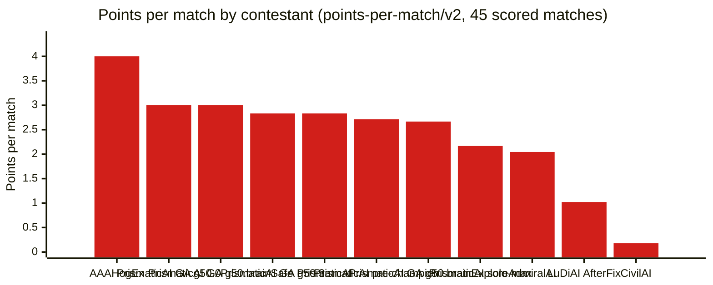
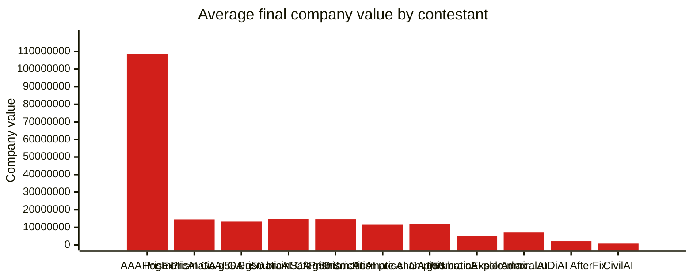
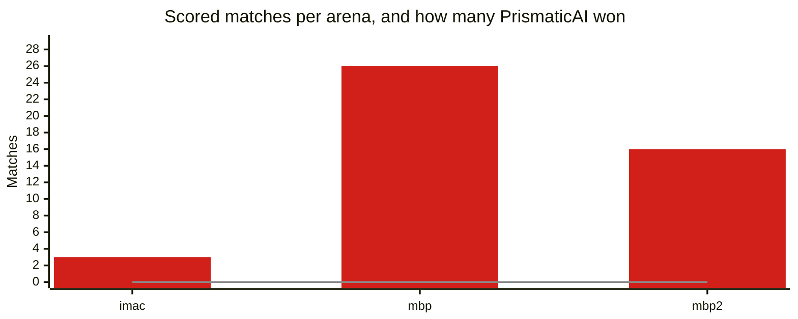

# battle-20261119T192249-f9e25347

Derived from `battle-20261119T192249-f9e25347.json` by `tools/research/ai-battle/battle.py report`; do not edit.

- Edition `f9e2534746a34f19`: PrismaticAI and referee at `ebf7516b54d7130fa0908c68ff298075c517fb41`, base set `opengfx-8.0.tar`
- 20-year free-for-all from 1960, map 256x256 temperate, breakdowns 1
- 45 scored match(es) on `imac` (20261119-master-gdf1e05e7d8), `mbp` (20261119-master-m356d6e49c0), `mbp2` (20261119-master-gdf1e05e7d8)
- Replays: 0 of 1 identical to their original on another arena

| # | Contestant | Played | Wins | Points | Points/match | Avg rank | Avg final value | Squirrel errors | Matches with anomalies |
|---|---|---|---|---|---|---|---|---|---|
| 1 | AAAHogEx | 45 | 45 | 180 | 4.0 | 1.0 | 108.5 M | 0 | 0 |
| 2 | PrismaticAI GA g50.0 | 7 | 0 | 21 | 3.0 | 2.0 | 14.5 M | 0 | 2 |
| 3 | PrismaticAI GA g50.brainSafe | 7 | 0 | 21 | 3.0 | 2.0 | 13.3 M | 0 | 0 |
| 4 | PrismaticAI GA g50.3 | 6 | 0 | 17 | 2.833 | 2.17 | 14.7 M | 0 | 1 |
| 5 | PrismaticAI | 6 | 0 | 17 | 2.833 | 2.17 | 14.6 M | 0 | 1 |
| 6 | PrismaticAI pre-champion | 7 | 0 | 19 | 2.714 | 2.29 | 11.7 M | 0 | 0 |
| 7 | PrismaticAI GA g50.brainExplore | 6 | 0 | 16 | 2.667 | 2.33 | 11.9 M | 0 | 0 |
| 8 | PrismaticAI solo-max | 6 | 0 | 13 | 2.167 | 2.83 | 4.8 M | 0 | 6 |
| 9 | AdmiralAI | 45 | 0 | 92 | 2.044 | 2.96 | 7.0 M | 0 | 1 |
| 10 | LuDiAI AfterFix | 45 | 0 | 46 | 1.022 | 3.98 | 2.1 M | 0 | 0 |
| 11 | CivilAI | 45 | 0 | 8 | 0.178 | 4.82 | 736.0 k | 3785 | 9 |

```mermaid
---
config:
  xyChart:
    width: 900
    height: 360
  themeVariables:
    xyChart:
      plotColorPalette: "#d11f1a, #8a8a8a, #0b0b0b, #ece4d6"
---
xychart-beta
    title "Final company value per scored match: winner vs best PrismaticAI"
    x-axis ["m-0001", "m-0002", "m-0003", "m-0004", "m-0005", "m-0006", "m-0007", "m-0008", "m-0009", "m-0010", "m-0011", "m-0012", "m-0013", "m-0014", "m-0015", "m-0016", "m-0017", "m-0018", "m-0019", "m-0020", "m-0021", "m-0022", "m-0023", "m-0024", "m-0025", "m-0026", "m-0027", "m-0028", "m-0036", "m-0037", "m-0038", "m-0039", "m-0040", "m-0041", "m-0042", "m-0043", "m-0044", "m-0045", "m-0051", "m-0052", "m-0053", "m-0060", "m-0061", "m-0062", "m-0063"]
    %% series: Winner | Best PrismaticAI
    %% links: battle-20261119T192249-f9e25347.md?col=Match&filter=m-0001 | battle-20261119T192249-f9e25347.md?col=Match&filter=m-0002 | battle-20261119T192249-f9e25347.md?col=Match&filter=m-0003 | battle-20261119T192249-f9e25347.md?col=Match&filter=m-0004 | battle-20261119T192249-f9e25347.md?col=Match&filter=m-0005 | battle-20261119T192249-f9e25347.md?col=Match&filter=m-0006 | battle-20261119T192249-f9e25347.md?col=Match&filter=m-0007 | battle-20261119T192249-f9e25347.md?col=Match&filter=m-0008 | battle-20261119T192249-f9e25347.md?col=Match&filter=m-0009 | battle-20261119T192249-f9e25347.md?col=Match&filter=m-0010 | battle-20261119T192249-f9e25347.md?col=Match&filter=m-0011 | battle-20261119T192249-f9e25347.md?col=Match&filter=m-0012 | battle-20261119T192249-f9e25347.md?col=Match&filter=m-0013 | battle-20261119T192249-f9e25347.md?col=Match&filter=m-0014 | battle-20261119T192249-f9e25347.md?col=Match&filter=m-0015 | battle-20261119T192249-f9e25347.md?col=Match&filter=m-0016 | battle-20261119T192249-f9e25347.md?col=Match&filter=m-0017 | battle-20261119T192249-f9e25347.md?col=Match&filter=m-0018 | battle-20261119T192249-f9e25347.md?col=Match&filter=m-0019 | battle-20261119T192249-f9e25347.md?col=Match&filter=m-0020 | battle-20261119T192249-f9e25347.md?col=Match&filter=m-0021 | battle-20261119T192249-f9e25347.md?col=Match&filter=m-0022 | battle-20261119T192249-f9e25347.md?col=Match&filter=m-0023 | battle-20261119T192249-f9e25347.md?col=Match&filter=m-0024 | battle-20261119T192249-f9e25347.md?col=Match&filter=m-0025 | battle-20261119T192249-f9e25347.md?col=Match&filter=m-0026 | battle-20261119T192249-f9e25347.md?col=Match&filter=m-0027 | battle-20261119T192249-f9e25347.md?col=Match&filter=m-0028 | battle-20261119T192249-f9e25347.md?col=Match&filter=m-0036 | battle-20261119T192249-f9e25347.md?col=Match&filter=m-0037 | battle-20261119T192249-f9e25347.md?col=Match&filter=m-0038 | battle-20261119T192249-f9e25347.md?col=Match&filter=m-0039 | battle-20261119T192249-f9e25347.md?col=Match&filter=m-0040 | battle-20261119T192249-f9e25347.md?col=Match&filter=m-0041 | battle-20261119T192249-f9e25347.md?col=Match&filter=m-0042 | battle-20261119T192249-f9e25347.md?col=Match&filter=m-0043 | battle-20261119T192249-f9e25347.md?col=Match&filter=m-0044 | battle-20261119T192249-f9e25347.md?col=Match&filter=m-0045 | battle-20261119T192249-f9e25347.md?col=Match&filter=m-0051 | battle-20261119T192249-f9e25347.md?col=Match&filter=m-0052 | battle-20261119T192249-f9e25347.md?col=Match&filter=m-0053 | battle-20261119T192249-f9e25347.md?col=Match&filter=m-0060 | battle-20261119T192249-f9e25347.md?col=Match&filter=m-0061 | battle-20261119T192249-f9e25347.md?col=Match&filter=m-0062 | battle-20261119T192249-f9e25347.md?col=Match&filter=m-0063
    y-axis "Company value" 0 --> 170000000
    bar [129198151, 109925415, 141434106, 116721357, 120713722, 118525793, 72469986, 76219997, 66064842, 61745539, 87092825, 83802442, 72254017, 94023110, 124067602, 104861956, 90013630, 144527103, 112512835, 106835477, 110765492, 111980652, 89344131, 106823635, 95379048, 101955927, 107461668, 112182408, 144593444, 140580352, 154704914, 131678418, 139627626, 123777878, 77704382, 99394351, 83868890, 93860402, 93690767, 93898104, 104515606, 126596453, 134738619, 149689616, 119820181]
    line [6635132, 9907894, 9070941, 13968875, 8131486, 12264946, 11518105, 1662252, 8896594, 15938442, 8534266, 13271889, 13154173, 19613150, 3444265, 15941195, 15840195, 9516493, 11436663, 15031995, 15122661, 6409057, 17432736, 17460559, 15297771, 16287663, 18916126, 8889188, 6711109, 4364455, 17103608, 15272108, 6034620, 10735671, 14124894, 4184217, 13466725, 9958798, 12031130, 16167430, 13948034, 16250149, 16273949, 17883899, 18345459]
```

<!-- battle-charts:begin -->
<!-- derived from battle-20261119T192249-f9e25347.json by `battle.py render`; `battle.py check` fails when it is stale -->

<!-- battle-charts:end -->

| Seed | Original | Replay | Arenas | Identical |
|---|---|---|---|---|
| 231185225 | m-0011 | m-0064 | imac / mbp | NO |

| Match | Arena | Seed | Winner | Value | Last | Anomalies |
|---|---|---|---|---|---|---|
| m-0001 | mbp | 162943731 | AAAHogEx | 129.2 M | CivilAI | PrismaticAI solo-max: fleet_drop:45->22 |
| m-0002 | mbp | 162943731 | AAAHogEx | 109.9 M | CivilAI | - |
| m-0003 | mbp | 162943731 | AAAHogEx | 141.4 M | CivilAI | PrismaticAI GA g50.0: fleet_drop:103->57 |
| m-0004 | mbp | 162943731 | AAAHogEx | 116.7 M | CivilAI | - |
| m-0005 | mbp | 162943731 | AAAHogEx | 120.7 M | CivilAI | - |
| m-0006 | mbp | 162943731 | AAAHogEx | 118.5 M | LuDiAI AfterFix | - |
| m-0007 | mbp | 231185225 | AAAHogEx | 72.5 M | AdmiralAI | - |
| m-0008 | mbp | 231185225 | AAAHogEx | 76.2 M | CivilAI | PrismaticAI solo-max: fleet_drop:32->16 |
| m-0009 | mbp | 231185225 | AAAHogEx | 66.1 M | CivilAI | CivilAI: fleet_drop:102->41 |
| m-0010 | imac | 231185225 | AAAHogEx | 61.7 M | LuDiAI AfterFix | - |
| m-0011 | imac | 231185225 | AAAHogEx | 87.1 M | AdmiralAI | - |
| m-0012 | imac | 231185225 | AAAHogEx | 83.8 M | CivilAI | - |
| m-0013 | mbp2 | 231185225 | AAAHogEx | 72.3 M | CivilAI | - |
| m-0014 | mbp2 | 699857618 | AAAHogEx | 94.0 M | CivilAI | CivilAI: squirrel_errors:3785 |
| m-0015 | mbp2 | 699857618 | AAAHogEx | 124.1 M | CivilAI | PrismaticAI solo-max: fleet_drop:36->10 |
| m-0016 | mbp2 | 699857618 | AAAHogEx | 104.9 M | CivilAI | - |
| m-0017 | mbp2 | 699857618 | AAAHogEx | 90.0 M | CivilAI | - |
| m-0018 | mbp2 | 699857618 | AAAHogEx | 144.5 M | CivilAI | - |
| m-0019 | mbp2 | 699857618 | AAAHogEx | 112.5 M | CivilAI | - |
| m-0020 | mbp2 | 699857618 | AAAHogEx | 106.8 M | CivilAI | PrismaticAI GA g50.3: fleet_drop:70->45; CivilAI: fleet_drop:74->39 |
| m-0021 | mbp2 | 1026242030 | AAAHogEx | 110.8 M | LuDiAI AfterFix | PrismaticAI: fleet_drop:90->59 |
| m-0022 | mbp2 | 1026242030 | AAAHogEx | 112.0 M | LuDiAI AfterFix | PrismaticAI solo-max: fleet_drop:44->21 |
| m-0023 | mbp2 | 1026242030 | AAAHogEx | 89.3 M | CivilAI | - |
| m-0024 | mbp2 | 1026242030 | AAAHogEx | 106.8 M | LuDiAI AfterFix | - |
| m-0025 | mbp2 | 1026242030 | AAAHogEx | 95.4 M | CivilAI | - |
| m-0026 | mbp2 | 1026242030 | AAAHogEx | 102.0 M | CivilAI | CivilAI: fleet_drop:49->32 |
| m-0027 | mbp2 | 1026242030 | AAAHogEx | 107.5 M | CivilAI | CivilAI: fleet_drop:24->15 |
| m-0028 | mbp2 | 1754247333 | AAAHogEx | 112.2 M | CivilAI | - |
| m-0036 | mbp | 254477230 | AAAHogEx | 144.6 M | CivilAI | PrismaticAI solo-max: fleet_drop:42->18 |
| m-0037 | mbp | 254477230 | AAAHogEx | 140.6 M | CivilAI | - |
| m-0038 | mbp | 254477230 | AAAHogEx | 154.7 M | CivilAI | - |
| m-0039 | mbp | 254477230 | AAAHogEx | 131.7 M | CivilAI | - |
| m-0040 | mbp | 254477230 | AAAHogEx | 139.6 M | CivilAI | - |
| m-0041 | mbp | 254477230 | AAAHogEx | 123.8 M | CivilAI | - |
| m-0042 | mbp | 978717679 | AAAHogEx | 77.7 M | CivilAI | - |
| m-0043 | mbp | 978717679 | AAAHogEx | 99.4 M | CivilAI | PrismaticAI solo-max: fleet_drop:40->21 |
| m-0044 | mbp | 978717679 | AAAHogEx | 83.9 M | CivilAI | - |
| m-0045 | mbp | 978717679 | AAAHogEx | 93.9 M | CivilAI | CivilAI: fleet_drop:36->22 |
| m-0051 | mbp | 1816491296 | AAAHogEx | 93.7 M | CivilAI | - |
| m-0052 | mbp | 1816491296 | AAAHogEx | 93.9 M | CivilAI | PrismaticAI GA g50.0: fleet_drop:87->53; CivilAI: fleet_drop:25->14 |
| m-0053 | mbp | 1816491296 | AAAHogEx | 104.5 M | CivilAI | - |
| m-0060 | mbp | 213196686 | AAAHogEx | 126.6 M | CivilAI | CivilAI: fleet_drop:136->49 |
| m-0061 | mbp | 213196686 | AAAHogEx | 134.7 M | CivilAI | AdmiralAI: fleet_drop:160->96 |
| m-0062 | mbp | 213196686 | AAAHogEx | 149.7 M | AdmiralAI | CivilAI: fleet_drop:13->7 |
| m-0063 | mbp | 791754568 | AAAHogEx | 119.8 M | CivilAI | - |
| m-0064 (replay) | mbp | 231185225 | AAAHogEx | 81.0 M | AdmiralAI | - |
