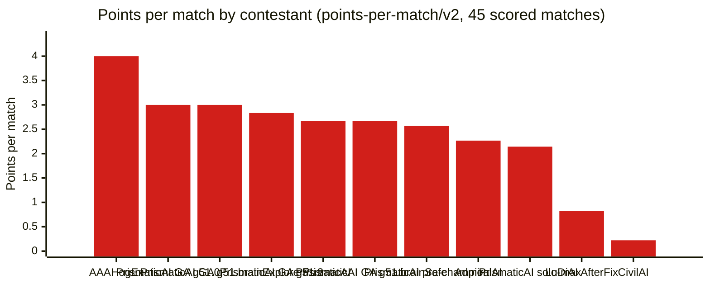
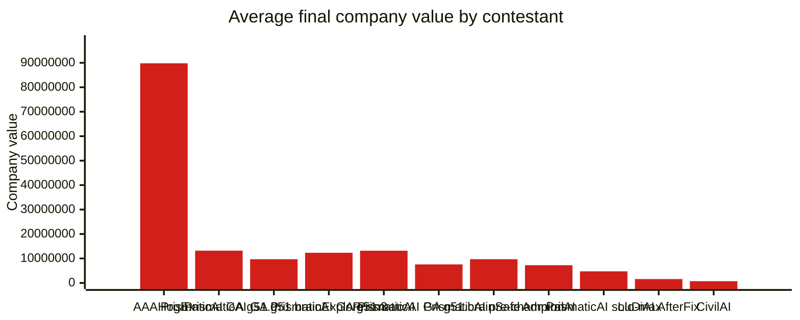
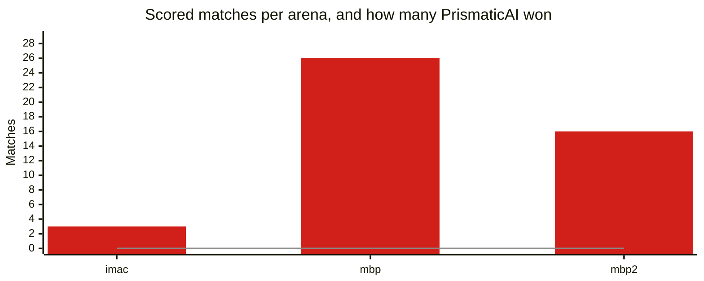

# battle-20261119T193410-021ee6ee

Derived from `battle-20261119T193410-021ee6ee.json` by `tools/research/ai-battle/battle.py report`; do not edit.

- Edition `021ee6eea2f217be`: PrismaticAI and referee at `ebf7516b54d7130fa0908c68ff298075c517fb41`, base set `opengfx-8.0.tar`
- 20-year free-for-all from 1960, map 256x256 temperate, breakdowns 1
- 45 scored match(es) on `imac` (20261119-master-gdf1e05e7d8), `mbp` (20261119-master-m356d6e49c0), `mbp2` (20261119-master-gdf1e05e7d8)
- Replays: 1 of 1 identical to their original on another arena

| # | Contestant | Played | Wins | Points | Points/match | Avg rank | Avg final value | Squirrel errors | Matches with anomalies |
|---|---|---|---|---|---|---|---|---|---|
| 1 | AAAHogEx | 45 | 45 | 180 | 4.0 | 1.0 | 89.8 M | 0 | 0 |
| 2 | PrismaticAI GA g51.0 | 7 | 0 | 21 | 3.0 | 2.0 | 13.2 M | 0 | 3 |
| 3 | PrismaticAI GA g51.brainExplore | 6 | 0 | 18 | 3.0 | 2.0 | 9.7 M | 0 | 0 |
| 4 | PrismaticAI GA g51.3 | 6 | 0 | 17 | 2.833 | 2.17 | 12.3 M | 0 | 0 |
| 5 | PrismaticAI | 6 | 0 | 16 | 2.667 | 2.33 | 13.2 M | 0 | 1 |
| 6 | PrismaticAI GA g51.brainSafe | 6 | 0 | 16 | 2.667 | 2.33 | 7.6 M | 0 | 0 |
| 7 | PrismaticAI pre-champion | 7 | 0 | 18 | 2.571 | 2.43 | 9.7 M | 0 | 0 |
| 8 | AdmiralAI | 45 | 0 | 102 | 2.267 | 2.73 | 7.2 M | 72 | 2 |
| 9 | PrismaticAI solo-max | 7 | 0 | 15 | 2.143 | 2.86 | 4.7 M | 0 | 7 |
| 10 | LuDiAI AfterFix | 45 | 0 | 37 | 0.822 | 4.18 | 1.6 M | 0 | 2 |
| 11 | CivilAI | 45 | 0 | 10 | 0.222 | 4.78 | 714.9 k | 0 | 12 |

```mermaid
---
config:
  xyChart:
    width: 900
    height: 360
  themeVariables:
    xyChart:
      plotColorPalette: "#d11f1a, #8a8a8a, #0b0b0b, #ece4d6"
---
xychart-beta
    title "Final company value per scored match: winner vs best PrismaticAI"
    x-axis ["m-0001", "m-0002", "m-0003", "m-0004", "m-0005", "m-0006", "m-0007", "m-0008", "m-0009", "m-0010", "m-0011", "m-0012", "m-0013", "m-0014", "m-0015", "m-0016", "m-0017", "m-0018", "m-0019", "m-0020", "m-0021", "m-0022", "m-0023", "m-0024", "m-0025", "m-0026", "m-0027", "m-0028", "m-0036", "m-0037", "m-0038", "m-0039", "m-0040", "m-0041", "m-0042", "m-0043", "m-0044", "m-0045", "m-0049", "m-0050", "m-0051", "m-0052", "m-0053", "m-0054", "m-0055"]
    %% series: Winner | Best PrismaticAI
    %% links: battle-20261119T193410-021ee6ee.md?col=Match&filter=m-0001 | battle-20261119T193410-021ee6ee.md?col=Match&filter=m-0002 | battle-20261119T193410-021ee6ee.md?col=Match&filter=m-0003 | battle-20261119T193410-021ee6ee.md?col=Match&filter=m-0004 | battle-20261119T193410-021ee6ee.md?col=Match&filter=m-0005 | battle-20261119T193410-021ee6ee.md?col=Match&filter=m-0006 | battle-20261119T193410-021ee6ee.md?col=Match&filter=m-0007 | battle-20261119T193410-021ee6ee.md?col=Match&filter=m-0008 | battle-20261119T193410-021ee6ee.md?col=Match&filter=m-0009 | battle-20261119T193410-021ee6ee.md?col=Match&filter=m-0010 | battle-20261119T193410-021ee6ee.md?col=Match&filter=m-0011 | battle-20261119T193410-021ee6ee.md?col=Match&filter=m-0012 | battle-20261119T193410-021ee6ee.md?col=Match&filter=m-0013 | battle-20261119T193410-021ee6ee.md?col=Match&filter=m-0014 | battle-20261119T193410-021ee6ee.md?col=Match&filter=m-0015 | battle-20261119T193410-021ee6ee.md?col=Match&filter=m-0016 | battle-20261119T193410-021ee6ee.md?col=Match&filter=m-0017 | battle-20261119T193410-021ee6ee.md?col=Match&filter=m-0018 | battle-20261119T193410-021ee6ee.md?col=Match&filter=m-0019 | battle-20261119T193410-021ee6ee.md?col=Match&filter=m-0020 | battle-20261119T193410-021ee6ee.md?col=Match&filter=m-0021 | battle-20261119T193410-021ee6ee.md?col=Match&filter=m-0022 | battle-20261119T193410-021ee6ee.md?col=Match&filter=m-0023 | battle-20261119T193410-021ee6ee.md?col=Match&filter=m-0024 | battle-20261119T193410-021ee6ee.md?col=Match&filter=m-0025 | battle-20261119T193410-021ee6ee.md?col=Match&filter=m-0026 | battle-20261119T193410-021ee6ee.md?col=Match&filter=m-0027 | battle-20261119T193410-021ee6ee.md?col=Match&filter=m-0028 | battle-20261119T193410-021ee6ee.md?col=Match&filter=m-0036 | battle-20261119T193410-021ee6ee.md?col=Match&filter=m-0037 | battle-20261119T193410-021ee6ee.md?col=Match&filter=m-0038 | battle-20261119T193410-021ee6ee.md?col=Match&filter=m-0039 | battle-20261119T193410-021ee6ee.md?col=Match&filter=m-0040 | battle-20261119T193410-021ee6ee.md?col=Match&filter=m-0041 | battle-20261119T193410-021ee6ee.md?col=Match&filter=m-0042 | battle-20261119T193410-021ee6ee.md?col=Match&filter=m-0043 | battle-20261119T193410-021ee6ee.md?col=Match&filter=m-0044 | battle-20261119T193410-021ee6ee.md?col=Match&filter=m-0045 | battle-20261119T193410-021ee6ee.md?col=Match&filter=m-0049 | battle-20261119T193410-021ee6ee.md?col=Match&filter=m-0050 | battle-20261119T193410-021ee6ee.md?col=Match&filter=m-0051 | battle-20261119T193410-021ee6ee.md?col=Match&filter=m-0052 | battle-20261119T193410-021ee6ee.md?col=Match&filter=m-0053 | battle-20261119T193410-021ee6ee.md?col=Match&filter=m-0054 | battle-20261119T193410-021ee6ee.md?col=Match&filter=m-0055
    y-axis "Company value" 0 --> 142000000
    bar [110507698, 75683576, 120751501, 108750422, 99186257, 99592942, 62482284, 80668072, 86868062, 71408869, 76831686, 89408292, 82016200, 79539080, 107489641, 87127575, 87735073, 78757417, 82149531, 100656401, 83534785, 102303241, 106537018, 97111910, 83935507, 77249961, 74599571, 119041766, 72615680, 59469617, 66021913, 71004724, 57644544, 70095281, 87775727, 105963317, 115215198, 93130908, 108542307, 102498630, 69904903, 128931943, 122366666, 99225416, 78591512]
    line [4729479, 16995591, 15039421, 11608113, 10997699, 11000648, 13677997, 4616764, 8113283, 11367083, 6595816, 9328143, 11730980, 22197396, 5844327, 11327897, 20126041, 13735987, 12761762, 20916021, 8651819, 5249337, 6527484, 8931292, 5506832, 5489976, 6411717, 9755275, 1989529, 6418693, 10425000, 3477419, 6834531, 9387292, 15316738, 4574759, 10451077, 11894611, 9444254, 6195317, 8059873, 14618553, 4528260, 12745602, 14525224]
```

<!-- battle-charts:begin -->
<!-- derived from battle-20261119T193410-021ee6ee.json by `battle.py render`; `battle.py check` fails when it is stale -->

<!-- battle-charts:end -->

| Seed | Original | Replay | Arenas | Identical |
|---|---|---|---|---|
| 261712803 | m-0021 | m-0048 | mbp2 / mbp | yes |

| Match | Arena | Seed | Winner | Value | Last | Anomalies |
|---|---|---|---|---|---|---|
| m-0001 | mbp | 259771372 | AAAHogEx | 110.5 M | CivilAI | PrismaticAI solo-max: fleet_drop:40->15 |
| m-0002 | mbp | 259771372 | AAAHogEx | 75.7 M | CivilAI | - |
| m-0003 | mbp | 259771372 | AAAHogEx | 120.8 M | CivilAI | - |
| m-0004 | mbp | 259771372 | AAAHogEx | 108.8 M | CivilAI | AdmiralAI: fleet_drop:245->157 |
| m-0005 | mbp | 259771372 | AAAHogEx | 99.2 M | CivilAI | - |
| m-0006 | mbp | 259771372 | AAAHogEx | 99.6 M | CivilAI | CivilAI: fleet_drop:62->29 |
| m-0007 | mbp | 65258567 | AAAHogEx | 62.5 M | LuDiAI AfterFix | - |
| m-0008 | mbp | 65258567 | AAAHogEx | 80.7 M | CivilAI | PrismaticAI solo-max: fleet_drop:36->17; CivilAI: fleet_drop:52->30 |
| m-0009 | mbp | 65258567 | AAAHogEx | 86.9 M | CivilAI | CivilAI: fleet_drop:67->31 |
| m-0010 | imac | 65258567 | AAAHogEx | 71.4 M | CivilAI | PrismaticAI GA g51.0: fleet_drop:104->38; AdmiralAI: squirrel_errors:72; CivilAI: fleet_drop:62->31 |
| m-0011 | imac | 65258567 | AAAHogEx | 76.8 M | CivilAI | CivilAI: fleet_drop:72->21 |
| m-0012 | imac | 65258567 | AAAHogEx | 89.4 M | LuDiAI AfterFix | LuDiAI AfterFix: fleet_drop:82->55 |
| m-0013 | mbp2 | 65258567 | AAAHogEx | 82.0 M | LuDiAI AfterFix | LuDiAI AfterFix: fleet_drop:92->28 |
| m-0014 | mbp2 | 1319742688 | AAAHogEx | 79.5 M | CivilAI | - |
| m-0015 | mbp2 | 1319742688 | AAAHogEx | 107.5 M | CivilAI | PrismaticAI solo-max: fleet_drop:49->27 |
| m-0016 | mbp2 | 1319742688 | AAAHogEx | 87.1 M | CivilAI | - |
| m-0017 | mbp2 | 1319742688 | AAAHogEx | 87.7 M | CivilAI | PrismaticAI GA g51.0: fleet_drop:86->55 |
| m-0018 | mbp2 | 1319742688 | AAAHogEx | 78.8 M | CivilAI | - |
| m-0019 | mbp2 | 1319742688 | AAAHogEx | 82.1 M | LuDiAI AfterFix | - |
| m-0020 | mbp2 | 1319742688 | AAAHogEx | 100.7 M | CivilAI | - |
| m-0021 | mbp2 | 261712803 | AAAHogEx | 83.5 M | LuDiAI AfterFix | - |
| m-0022 | mbp2 | 261712803 | AAAHogEx | 102.3 M | CivilAI | PrismaticAI solo-max: fleet_drop:31->13; CivilAI: no_vehicles |
| m-0023 | mbp2 | 261712803 | AAAHogEx | 106.5 M | CivilAI | - |
| m-0024 | mbp2 | 261712803 | AAAHogEx | 97.1 M | LuDiAI AfterFix | CivilAI: fleet_drop:10->5 |
| m-0025 | mbp2 | 261712803 | AAAHogEx | 83.9 M | CivilAI | CivilAI: no_vehicles |
| m-0026 | mbp2 | 261712803 | AAAHogEx | 77.2 M | CivilAI | - |
| m-0027 | mbp2 | 261712803 | AAAHogEx | 74.6 M | CivilAI | CivilAI: fleet_drop:41->22 |
| m-0028 | mbp2 | 575229332 | AAAHogEx | 119.0 M | LuDiAI AfterFix | PrismaticAI: fleet_drop:66->43 |
| m-0036 | mbp | 1699487496 | AAAHogEx | 72.6 M | CivilAI | PrismaticAI solo-max: fleet_drop:28->13 |
| m-0037 | mbp | 1699487496 | AAAHogEx | 59.5 M | CivilAI | CivilAI: fleet_drop:42->8 |
| m-0038 | mbp | 1699487496 | AAAHogEx | 66.0 M | CivilAI | PrismaticAI GA g51.0: fleet_drop:88->29 |
| m-0039 | mbp | 1699487496 | AAAHogEx | 71.0 M | CivilAI | - |
| m-0040 | mbp | 1699487496 | AAAHogEx | 57.6 M | CivilAI | - |
| m-0041 | mbp | 1699487496 | AAAHogEx | 70.1 M | LuDiAI AfterFix | CivilAI: fleet_drop:53->24 |
| m-0042 | mbp | 852989771 | AAAHogEx | 87.8 M | LuDiAI AfterFix | - |
| m-0043 | mbp | 852989771 | AAAHogEx | 106.0 M | CivilAI | PrismaticAI solo-max: fleet_drop:30->18 |
| m-0044 | mbp | 852989771 | AAAHogEx | 115.2 M | CivilAI | - |
| m-0045 | mbp | 852989771 | AAAHogEx | 93.1 M | CivilAI | - |
| m-0048 (replay) | mbp | 261712803 | AAAHogEx | 83.5 M | LuDiAI AfterFix | - |
| m-0049 | mbp | 315573009 | AAAHogEx | 108.5 M | CivilAI | - |
| m-0050 | mbp | 315573009 | AAAHogEx | 102.5 M | CivilAI | PrismaticAI solo-max: fleet_drop:45->23 |
| m-0051 | mbp | 315573009 | AAAHogEx | 69.9 M | LuDiAI AfterFix | CivilAI: fleet_drop:73->50 |
| m-0052 | mbp | 315573009 | AAAHogEx | 128.9 M | CivilAI | - |
| m-0053 | mbp | 315573009 | AAAHogEx | 122.4 M | CivilAI | - |
| m-0054 | mbp | 315573009 | AAAHogEx | 99.2 M | CivilAI | - |
| m-0055 | mbp | 315573009 | AAAHogEx | 78.6 M | CivilAI | - |
