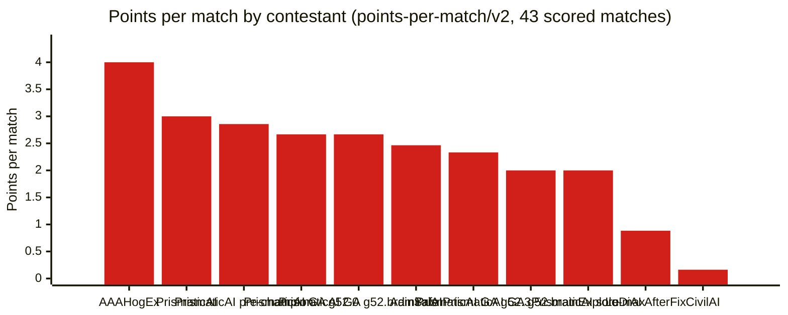
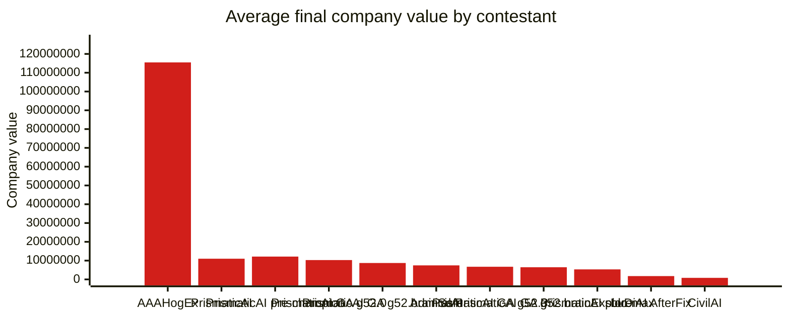
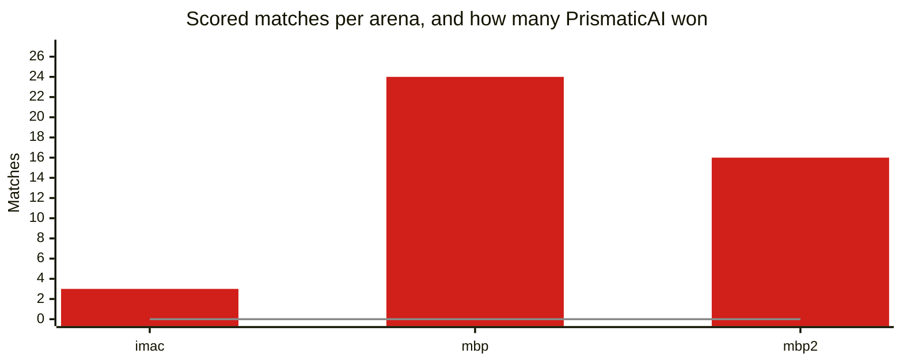

# battle-20261119T194521-89207a9f

Derived from `battle-20261119T194521-89207a9f.json` by `tools/research/ai-battle/battle.py report`; do not edit.

- Edition `89207a9fbdbfd017`: PrismaticAI and referee at `ebf7516b54d7130fa0908c68ff298075c517fb41`, base set `opengfx-8.0.tar`
- 20-year free-for-all from 1960, map 256x256 temperate, breakdowns 1
- 43 scored match(es) on `imac` (20261119-master-gdf1e05e7d8), `mbp` (20261119-master-m356d6e49c0), `mbp2` (20261119-master-gdf1e05e7d8)
- Replays: 1 of 1 identical to their original on another arena

| # | Contestant | Played | Wins | Points | Points/match | Avg rank | Avg final value | Squirrel errors | Matches with anomalies |
|---|---|---|---|---|---|---|---|---|---|
| 1 | AAAHogEx | 43 | 43 | 172 | 4.0 | 1.0 | 115.5 M | 0 | 0 |
| 2 | PrismaticAI | 5 | 0 | 15 | 3.0 | 2.0 | 11.0 M | 0 | 0 |
| 3 | PrismaticAI pre-champion | 7 | 0 | 20 | 2.857 | 2.14 | 12.1 M | 0 | 1 |
| 4 | PrismaticAI GA g52.0 | 6 | 0 | 16 | 2.667 | 2.33 | 10.3 M | 0 | 2 |
| 5 | PrismaticAI GA g52.brainSafe | 6 | 0 | 16 | 2.667 | 2.33 | 8.7 M | 0 | 0 |
| 6 | AdmiralAI | 43 | 0 | 106 | 2.465 | 2.53 | 7.5 M | 70 | 2 |
| 7 | PrismaticAI GA g52.3 | 6 | 0 | 14 | 2.333 | 2.67 | 6.7 M | 0 | 5 |
| 8 | PrismaticAI GA g52.brainExplore | 6 | 0 | 12 | 2.0 | 3.0 | 6.5 M | 0 | 2 |
| 9 | PrismaticAI solo-max | 7 | 0 | 14 | 2.0 | 3.0 | 5.3 M | 0 | 7 |
| 10 | LuDiAI AfterFix | 43 | 0 | 38 | 0.884 | 4.12 | 1.8 M | 0 | 3 |
| 11 | CivilAI | 43 | 0 | 7 | 0.163 | 4.84 | 814.7 k | 0 | 10 |

```mermaid
---
config:
  xyChart:
    width: 900
    height: 360
  themeVariables:
    xyChart:
      plotColorPalette: "#d11f1a, #8a8a8a, #0b0b0b, #ece4d6"
---
xychart-beta
    title "Final company value per scored match: winner vs best PrismaticAI"
    x-axis ["m-0001", "m-0002", "m-0003", "m-0004", "m-0005", "m-0006", "m-0007", "m-0008", "m-0009", "m-0010", "m-0011", "m-0012", "m-0013", "m-0014", "m-0015", "m-0016", "m-0017", "m-0018", "m-0019", "m-0020", "m-0021", "m-0022", "m-0023", "m-0024", "m-0025", "m-0026", "m-0027", "m-0028", "m-0036", "m-0037", "m-0038", "m-0039", "m-0040", "m-0041", "m-0042", "m-0043", "m-0044", "m-0051", "m-0052", "m-0053", "m-0054", "m-0055", "m-0057"]
    %% series: Winner | Best PrismaticAI
    %% links: battle-20261119T194521-89207a9f.md?col=Match&filter=m-0001 | battle-20261119T194521-89207a9f.md?col=Match&filter=m-0002 | battle-20261119T194521-89207a9f.md?col=Match&filter=m-0003 | battle-20261119T194521-89207a9f.md?col=Match&filter=m-0004 | battle-20261119T194521-89207a9f.md?col=Match&filter=m-0005 | battle-20261119T194521-89207a9f.md?col=Match&filter=m-0006 | battle-20261119T194521-89207a9f.md?col=Match&filter=m-0007 | battle-20261119T194521-89207a9f.md?col=Match&filter=m-0008 | battle-20261119T194521-89207a9f.md?col=Match&filter=m-0009 | battle-20261119T194521-89207a9f.md?col=Match&filter=m-0010 | battle-20261119T194521-89207a9f.md?col=Match&filter=m-0011 | battle-20261119T194521-89207a9f.md?col=Match&filter=m-0012 | battle-20261119T194521-89207a9f.md?col=Match&filter=m-0013 | battle-20261119T194521-89207a9f.md?col=Match&filter=m-0014 | battle-20261119T194521-89207a9f.md?col=Match&filter=m-0015 | battle-20261119T194521-89207a9f.md?col=Match&filter=m-0016 | battle-20261119T194521-89207a9f.md?col=Match&filter=m-0017 | battle-20261119T194521-89207a9f.md?col=Match&filter=m-0018 | battle-20261119T194521-89207a9f.md?col=Match&filter=m-0019 | battle-20261119T194521-89207a9f.md?col=Match&filter=m-0020 | battle-20261119T194521-89207a9f.md?col=Match&filter=m-0021 | battle-20261119T194521-89207a9f.md?col=Match&filter=m-0022 | battle-20261119T194521-89207a9f.md?col=Match&filter=m-0023 | battle-20261119T194521-89207a9f.md?col=Match&filter=m-0024 | battle-20261119T194521-89207a9f.md?col=Match&filter=m-0025 | battle-20261119T194521-89207a9f.md?col=Match&filter=m-0026 | battle-20261119T194521-89207a9f.md?col=Match&filter=m-0027 | battle-20261119T194521-89207a9f.md?col=Match&filter=m-0028 | battle-20261119T194521-89207a9f.md?col=Match&filter=m-0036 | battle-20261119T194521-89207a9f.md?col=Match&filter=m-0037 | battle-20261119T194521-89207a9f.md?col=Match&filter=m-0038 | battle-20261119T194521-89207a9f.md?col=Match&filter=m-0039 | battle-20261119T194521-89207a9f.md?col=Match&filter=m-0040 | battle-20261119T194521-89207a9f.md?col=Match&filter=m-0041 | battle-20261119T194521-89207a9f.md?col=Match&filter=m-0042 | battle-20261119T194521-89207a9f.md?col=Match&filter=m-0043 | battle-20261119T194521-89207a9f.md?col=Match&filter=m-0044 | battle-20261119T194521-89207a9f.md?col=Match&filter=m-0051 | battle-20261119T194521-89207a9f.md?col=Match&filter=m-0052 | battle-20261119T194521-89207a9f.md?col=Match&filter=m-0053 | battle-20261119T194521-89207a9f.md?col=Match&filter=m-0054 | battle-20261119T194521-89207a9f.md?col=Match&filter=m-0055 | battle-20261119T194521-89207a9f.md?col=Match&filter=m-0057
    y-axis "Company value" 0 --> 190000000
    bar [122669723, 131103944, 93933227, 108405827, 110730763, 115563961, 150742910, 135477453, 153884749, 123158252, 110860637, 137263323, 128763014, 109833451, 123188663, 145505851, 93506733, 75478291, 105588075, 128546155, 91641826, 86895060, 83302461, 92310977, 91517737, 95971005, 88957037, 93632904, 142420739, 118629629, 114580000, 96625210, 95263888, 120257849, 142167060, 172842086, 171425531, 106753706, 78682738, 101908203, 127610476, 120244794, 128024319]
    line [4427050, 2913101, 11564274, 6429778, 3841003, 6040464, 6043089, 7157028, 13878251, 8631670, 12150742, 9475377, 6693251, 6501329, 6064003, 9472916, 9409576, 4206994, 7144478, 4195573, 14962597, 2869436, 13820013, 13086801, 16501756, 8252056, 8013842, 10646168, 5605474, 6929721, 6622406, 7055441, 8607844, 7067960, 16865266, 4084370, 24299948, 13678384, 12409018, 6017396, 1472368, 8360728, 7129097]
```

<!-- battle-charts:begin -->
<!-- derived from battle-20261119T194521-89207a9f.json by `battle.py render`; `battle.py check` fails when it is stale -->

<!-- battle-charts:end -->

| Seed | Original | Replay | Arenas | Identical |
|---|---|---|---|---|
| 1313170580 | m-0013 | m-0056 | mbp2 / mbp | yes |

| Match | Arena | Seed | Winner | Value | Last | Anomalies |
|---|---|---|---|---|---|---|
| m-0001 | mbp | 138745179 | AAAHogEx | 122.7 M | CivilAI | PrismaticAI solo-max: fleet_drop:35->21 |
| m-0002 | mbp | 138745179 | AAAHogEx | 131.1 M | LuDiAI AfterFix | PrismaticAI pre-champion: fleet_drop:52->36 |
| m-0003 | mbp | 138745179 | AAAHogEx | 93.9 M | CivilAI | - |
| m-0004 | mbp | 138745179 | AAAHogEx | 108.4 M | CivilAI | LuDiAI AfterFix: fleet_drop:101->68 |
| m-0005 | mbp | 138745179 | AAAHogEx | 110.7 M | LuDiAI AfterFix | LuDiAI AfterFix: fleet_drop:153->107 |
| m-0006 | mbp | 138745179 | AAAHogEx | 115.6 M | CivilAI | PrismaticAI GA g52.3: fleet_drop:83->37 |
| m-0007 | mbp | 1313170580 | AAAHogEx | 150.7 M | CivilAI | - |
| m-0008 | mbp | 1313170580 | AAAHogEx | 135.5 M | CivilAI | PrismaticAI solo-max: fleet_drop:44->20 |
| m-0009 | mbp | 1313170580 | AAAHogEx | 153.9 M | CivilAI | - |
| m-0010 | imac | 1313170580 | AAAHogEx | 123.2 M | LuDiAI AfterFix | - |
| m-0011 | imac | 1313170580 | AAAHogEx | 110.9 M | CivilAI | - |
| m-0012 | imac | 1313170580 | AAAHogEx | 137.3 M | CivilAI | AdmiralAI: fleet_drop:270->187; PrismaticAI GA g52.brainExplore: fleet_drop:102->46; CivilAI: fleet_drop:76->46 |
| m-0013 | mbp2 | 1313170580 | AAAHogEx | 128.8 M | CivilAI | PrismaticAI GA g52.3: fleet_drop:186->100 |
| m-0014 | mbp2 | 1891400600 | AAAHogEx | 109.8 M | CivilAI | - |
| m-0015 | mbp2 | 1891400600 | AAAHogEx | 123.2 M | CivilAI | PrismaticAI solo-max: fleet_drop:31->21 |
| m-0016 | mbp2 | 1891400600 | AAAHogEx | 145.5 M | CivilAI | LuDiAI AfterFix: fleet_drop:14->5; CivilAI: fleet_drop:12->7 |
| m-0017 | mbp2 | 1891400600 | AAAHogEx | 93.5 M | LuDiAI AfterFix | - |
| m-0018 | mbp2 | 1891400600 | AAAHogEx | 75.5 M | CivilAI | - |
| m-0019 | mbp2 | 1891400600 | AAAHogEx | 105.6 M | CivilAI | CivilAI: fleet_drop:22->1 |
| m-0020 | mbp2 | 1891400600 | AAAHogEx | 128.5 M | CivilAI | PrismaticAI GA g52.3: fleet_drop:36->24; CivilAI: fleet_drop:33->17 |
| m-0021 | mbp2 | 1489338850 | AAAHogEx | 91.6 M | CivilAI | - |
| m-0022 | mbp2 | 1489338850 | AAAHogEx | 86.9 M | CivilAI | PrismaticAI solo-max: fleet_drop:35->21 |
| m-0023 | mbp2 | 1489338850 | AAAHogEx | 83.3 M | CivilAI | - |
| m-0024 | mbp2 | 1489338850 | AAAHogEx | 92.3 M | CivilAI | PrismaticAI GA g52.0: fleet_drop:79->47 |
| m-0025 | mbp2 | 1489338850 | AAAHogEx | 91.5 M | CivilAI | - |
| m-0026 | mbp2 | 1489338850 | AAAHogEx | 96.0 M | CivilAI | - |
| m-0027 | mbp2 | 1489338850 | AAAHogEx | 89.0 M | CivilAI | PrismaticAI GA g52.3: fleet_drop:127->46 |
| m-0028 | mbp2 | 103714302 | AAAHogEx | 93.6 M | CivilAI | AdmiralAI: squirrel_errors:70; CivilAI: fleet_drop:13->8 |
| m-0036 | mbp | 1158872055 | AAAHogEx | 142.4 M | CivilAI | PrismaticAI solo-max: fleet_drop:45->22 |
| m-0037 | mbp | 1158872055 | AAAHogEx | 118.6 M | CivilAI | - |
| m-0038 | mbp | 1158872055 | AAAHogEx | 114.6 M | CivilAI | PrismaticAI GA g52.0: fleet_drop:108->45 |
| m-0039 | mbp | 1158872055 | AAAHogEx | 96.6 M | CivilAI | CivilAI: fleet_drop:43->30 |
| m-0040 | mbp | 1158872055 | AAAHogEx | 95.3 M | LuDiAI AfterFix | PrismaticAI GA g52.brainExplore: fleet_drop:65->36; CivilAI: fleet_drop:52->20 |
| m-0041 | mbp | 1158872055 | AAAHogEx | 120.3 M | CivilAI | PrismaticAI GA g52.3: fleet_drop:91->45; CivilAI: fleet_drop:64->40 |
| m-0042 | mbp | 1257193989 | AAAHogEx | 142.2 M | LuDiAI AfterFix | - |
| m-0043 | mbp | 1257193989 | AAAHogEx | 172.8 M | CivilAI | PrismaticAI solo-max: fleet_drop:47->23 |
| m-0044 | mbp | 1257193989 | AAAHogEx | 171.4 M | LuDiAI AfterFix | - |
| m-0051 | mbp | 5896552 | AAAHogEx | 106.8 M | CivilAI | - |
| m-0052 | mbp | 5896552 | AAAHogEx | 78.7 M | CivilAI | CivilAI: fleet_drop:42->29 |
| m-0053 | mbp | 5896552 | AAAHogEx | 101.9 M | CivilAI | - |
| m-0054 | mbp | 5896552 | AAAHogEx | 127.6 M | CivilAI | CivilAI: fleet_drop:42->21 |
| m-0055 | mbp | 5896552 | AAAHogEx | 120.2 M | CivilAI | - |
| m-0056 (replay) | mbp | 1313170580 | AAAHogEx | 128.8 M | CivilAI | PrismaticAI GA g52.3: fleet_drop:186->100 |
| m-0057 | mbp | 1191139690 | AAAHogEx | 128.0 M | CivilAI | PrismaticAI solo-max: fleet_drop:44->18 |
