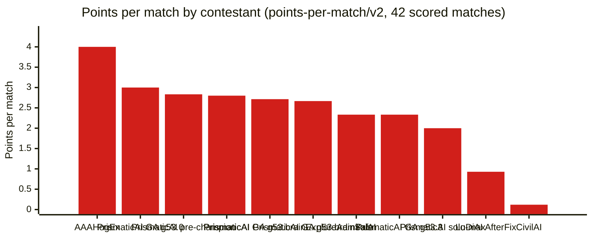
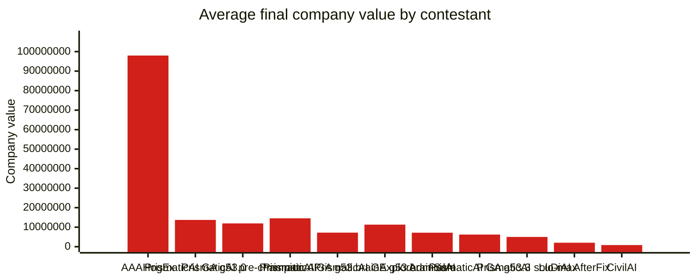
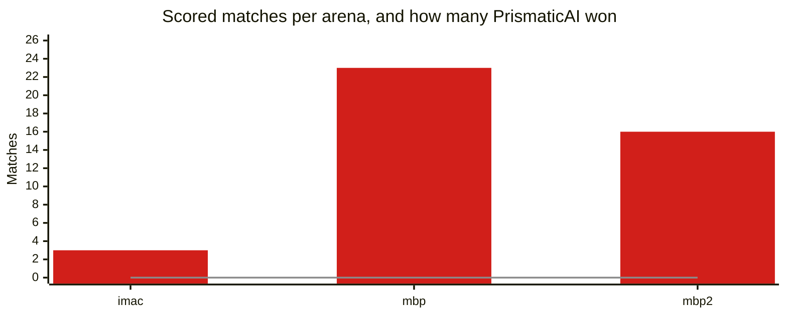

# battle-20261119T195600-f392d270

Derived from `battle-20261119T195600-f392d270.json` by `tools/research/ai-battle/battle.py report`; do not edit.

- Edition `f392d27072b3b5c9`: PrismaticAI and referee at `ebf7516b54d7130fa0908c68ff298075c517fb41`, base set `opengfx-8.0.tar`
- 20-year free-for-all from 1960, map 256x256 temperate, breakdowns 1
- 42 scored match(es) on `imac` (20261119-master-gdf1e05e7d8), `mbp` (20261119-master-m356d6e49c0), `mbp2` (20261119-master-gdf1e05e7d8)
- Replays: 0 of 1 identical to their original on another arena

| # | Contestant | Played | Wins | Points | Points/match | Avg rank | Avg final value | Squirrel errors | Matches with anomalies |
|---|---|---|---|---|---|---|---|---|---|
| 1 | AAAHogEx | 42 | 42 | 168 | 4.0 | 1.0 | 98.0 M | 0 | 0 |
| 2 | PrismaticAI GA g53.0 | 6 | 0 | 18 | 3.0 | 2.0 | 13.7 M | 0 | 1 |
| 3 | PrismaticAI pre-champion | 6 | 0 | 17 | 2.833 | 2.17 | 11.9 M | 0 | 1 |
| 4 | PrismaticAI | 5 | 0 | 14 | 2.8 | 2.2 | 14.5 M | 0 | 1 |
| 5 | PrismaticAI GA g53.brainExplore | 7 | 0 | 19 | 2.714 | 2.29 | 7.2 M | 0 | 2 |
| 6 | PrismaticAI GA g53.brainSafe | 6 | 0 | 16 | 2.667 | 2.33 | 11.3 M | 0 | 1 |
| 7 | AdmiralAI | 42 | 0 | 98 | 2.333 | 2.67 | 7.2 M | 0 | 2 |
| 8 | PrismaticAI GA g53.3 | 6 | 0 | 14 | 2.333 | 2.67 | 6.2 M | 0 | 3 |
| 9 | PrismaticAI solo-max | 6 | 0 | 12 | 2.0 | 3.0 | 5.0 M | 0 | 6 |
| 10 | LuDiAI AfterFix | 42 | 0 | 39 | 0.929 | 4.07 | 2.0 M | 0 | 0 |
| 11 | CivilAI | 42 | 0 | 5 | 0.119 | 4.88 | 828.6 k | 0 | 9 |

```mermaid
---
config:
  xyChart:
    width: 900
    height: 360
  themeVariables:
    xyChart:
      plotColorPalette: "#d11f1a, #8a8a8a, #0b0b0b, #ece4d6"
---
xychart-beta
    title "Final company value per scored match: winner vs best PrismaticAI"
    x-axis ["m-0001", "m-0002", "m-0003", "m-0004", "m-0005", "m-0006", "m-0007", "m-0008", "m-0009", "m-0010", "m-0011", "m-0012", "m-0013", "m-0014", "m-0015", "m-0016", "m-0017", "m-0018", "m-0019", "m-0020", "m-0021", "m-0022", "m-0023", "m-0024", "m-0025", "m-0026", "m-0027", "m-0028", "m-0036", "m-0037", "m-0038", "m-0039", "m-0040", "m-0041", "m-0042", "m-0043", "m-0044", "m-0047", "m-0052", "m-0053", "m-0054", "m-0055"]
    %% series: Winner | Best PrismaticAI
    %% links: battle-20261119T195600-f392d270.md?col=Match&filter=m-0001 | battle-20261119T195600-f392d270.md?col=Match&filter=m-0002 | battle-20261119T195600-f392d270.md?col=Match&filter=m-0003 | battle-20261119T195600-f392d270.md?col=Match&filter=m-0004 | battle-20261119T195600-f392d270.md?col=Match&filter=m-0005 | battle-20261119T195600-f392d270.md?col=Match&filter=m-0006 | battle-20261119T195600-f392d270.md?col=Match&filter=m-0007 | battle-20261119T195600-f392d270.md?col=Match&filter=m-0008 | battle-20261119T195600-f392d270.md?col=Match&filter=m-0009 | battle-20261119T195600-f392d270.md?col=Match&filter=m-0010 | battle-20261119T195600-f392d270.md?col=Match&filter=m-0011 | battle-20261119T195600-f392d270.md?col=Match&filter=m-0012 | battle-20261119T195600-f392d270.md?col=Match&filter=m-0013 | battle-20261119T195600-f392d270.md?col=Match&filter=m-0014 | battle-20261119T195600-f392d270.md?col=Match&filter=m-0015 | battle-20261119T195600-f392d270.md?col=Match&filter=m-0016 | battle-20261119T195600-f392d270.md?col=Match&filter=m-0017 | battle-20261119T195600-f392d270.md?col=Match&filter=m-0018 | battle-20261119T195600-f392d270.md?col=Match&filter=m-0019 | battle-20261119T195600-f392d270.md?col=Match&filter=m-0020 | battle-20261119T195600-f392d270.md?col=Match&filter=m-0021 | battle-20261119T195600-f392d270.md?col=Match&filter=m-0022 | battle-20261119T195600-f392d270.md?col=Match&filter=m-0023 | battle-20261119T195600-f392d270.md?col=Match&filter=m-0024 | battle-20261119T195600-f392d270.md?col=Match&filter=m-0025 | battle-20261119T195600-f392d270.md?col=Match&filter=m-0026 | battle-20261119T195600-f392d270.md?col=Match&filter=m-0027 | battle-20261119T195600-f392d270.md?col=Match&filter=m-0028 | battle-20261119T195600-f392d270.md?col=Match&filter=m-0036 | battle-20261119T195600-f392d270.md?col=Match&filter=m-0037 | battle-20261119T195600-f392d270.md?col=Match&filter=m-0038 | battle-20261119T195600-f392d270.md?col=Match&filter=m-0039 | battle-20261119T195600-f392d270.md?col=Match&filter=m-0040 | battle-20261119T195600-f392d270.md?col=Match&filter=m-0041 | battle-20261119T195600-f392d270.md?col=Match&filter=m-0042 | battle-20261119T195600-f392d270.md?col=Match&filter=m-0043 | battle-20261119T195600-f392d270.md?col=Match&filter=m-0044 | battle-20261119T195600-f392d270.md?col=Match&filter=m-0047 | battle-20261119T195600-f392d270.md?col=Match&filter=m-0052 | battle-20261119T195600-f392d270.md?col=Match&filter=m-0053 | battle-20261119T195600-f392d270.md?col=Match&filter=m-0054 | battle-20261119T195600-f392d270.md?col=Match&filter=m-0055
    y-axis "Company value" 0 --> 175000000
    bar [81551686, 72892923, 84158777, 75332012, 66420528, 85717178, 92588442, 109480467, 85082542, 95137441, 77777628, 86967791, 86422944, 114783128, 138048372, 105612323, 130105176, 121487327, 119140178, 116799871, 113469071, 98267541, 85945587, 102158281, 120694139, 102280948, 109401265, 103160318, 91191032, 71293315, 72461398, 97546628, 75343147, 100390258, 138397718, 158786800, 114355536, 143248597, 62287782, 66171109, 77211981, 65617100]
    line [6222062, 9870295, 16119242, 9013925, 5612290, 7593725, 10212400, 2671548, 6706550, 10527513, 10396665, 9129455, 7537458, 21564534, 7304730, 20748002, 21534101, 21152787, 13508700, 9848289, 8660346, 5247202, 10302071, 13498335, 6268809, 3129329, 7174051, 9374053, 2631832, 14302345, 12253684, 12442098, 5779049, 4415795, 22900844, 5885677, 9674637, 9106947, 8333794, 8505983, 4148024, 665023]
```

<!-- battle-charts:begin -->
<!-- derived from battle-20261119T195600-f392d270.json by `battle.py render`; `battle.py check` fails when it is stale -->

<!-- battle-charts:end -->

| Seed | Original | Replay | Arenas | Identical |
|---|---|---|---|---|
| 965633455 | m-0010 | m-0056 | imac / mbp | NO |

| Match | Arena | Seed | Winner | Value | Last | Anomalies |
|---|---|---|---|---|---|---|
| m-0001 | mbp | 780890012 | AAAHogEx | 81.6 M | LuDiAI AfterFix | PrismaticAI solo-max: fleet_drop:38->16 |
| m-0002 | mbp | 780890012 | AAAHogEx | 72.9 M | CivilAI | CivilAI: fleet_drop:43->27 |
| m-0003 | mbp | 780890012 | AAAHogEx | 84.2 M | CivilAI | - |
| m-0004 | mbp | 780890012 | AAAHogEx | 75.3 M | CivilAI | - |
| m-0005 | mbp | 780890012 | AAAHogEx | 66.4 M | CivilAI | - |
| m-0006 | mbp | 780890012 | AAAHogEx | 85.7 M | LuDiAI AfterFix | - |
| m-0007 | mbp | 965633455 | AAAHogEx | 92.6 M | CivilAI | CivilAI: fleet_drop:53->30 |
| m-0008 | mbp | 965633455 | AAAHogEx | 109.5 M | CivilAI | PrismaticAI solo-max: fleet_drop:33->13; CivilAI: fleet_drop:41->26 |
| m-0009 | mbp | 965633455 | AAAHogEx | 85.1 M | CivilAI | - |
| m-0010 | imac | 965633455 | AAAHogEx | 95.1 M | CivilAI | - |
| m-0011 | imac | 965633455 | AAAHogEx | 77.8 M | CivilAI | CivilAI: fleet_drop:62->25 |
| m-0012 | imac | 965633455 | AAAHogEx | 87.0 M | CivilAI | CivilAI: fleet_drop:43->25 |
| m-0013 | mbp2 | 965633455 | AAAHogEx | 86.4 M | CivilAI | PrismaticAI GA g53.3: fleet_drop:104->57 |
| m-0014 | mbp2 | 1577036395 | AAAHogEx | 114.8 M | CivilAI | - |
| m-0015 | mbp2 | 1577036395 | AAAHogEx | 138.0 M | CivilAI | AdmiralAI: fleet_drop:221->153; PrismaticAI solo-max: fleet_drop:50->24 |
| m-0016 | mbp2 | 1577036395 | AAAHogEx | 105.6 M | CivilAI | - |
| m-0017 | mbp2 | 1577036395 | AAAHogEx | 130.1 M | CivilAI | AdmiralAI: fleet_drop:356->241 |
| m-0018 | mbp2 | 1577036395 | AAAHogEx | 121.5 M | CivilAI | - |
| m-0019 | mbp2 | 1577036395 | AAAHogEx | 119.1 M | CivilAI | - |
| m-0020 | mbp2 | 1577036395 | AAAHogEx | 116.8 M | LuDiAI AfterFix | CivilAI: fleet_drop:45->16 |
| m-0021 | mbp2 | 1366284460 | AAAHogEx | 113.5 M | CivilAI | - |
| m-0022 | mbp2 | 1366284460 | AAAHogEx | 98.3 M | CivilAI | PrismaticAI solo-max: fleet_drop:40->24 |
| m-0023 | mbp2 | 1366284460 | AAAHogEx | 85.9 M | CivilAI | - |
| m-0024 | mbp2 | 1366284460 | AAAHogEx | 102.2 M | CivilAI | - |
| m-0025 | mbp2 | 1366284460 | AAAHogEx | 120.7 M | LuDiAI AfterFix | - |
| m-0026 | mbp2 | 1366284460 | AAAHogEx | 102.3 M | CivilAI | PrismaticAI GA g53.brainExplore: fleet_drop:102->41 |
| m-0027 | mbp2 | 1366284460 | AAAHogEx | 109.4 M | CivilAI | PrismaticAI GA g53.3: fleet_drop:96->59 |
| m-0028 | mbp2 | 164443458 | AAAHogEx | 103.2 M | CivilAI | - |
| m-0036 | mbp | 432313031 | AAAHogEx | 91.2 M | CivilAI | PrismaticAI solo-max: fleet_drop:36->9 |
| m-0037 | mbp | 432313031 | AAAHogEx | 71.3 M | CivilAI | PrismaticAI pre-champion: fleet_drop:95->66 |
| m-0038 | mbp | 432313031 | AAAHogEx | 72.5 M | CivilAI | PrismaticAI GA g53.0: fleet_drop:71->43 |
| m-0039 | mbp | 432313031 | AAAHogEx | 97.5 M | CivilAI | - |
| m-0040 | mbp | 432313031 | AAAHogEx | 75.3 M | LuDiAI AfterFix | PrismaticAI GA g53.brainExplore: fleet_drop:85->48 |
| m-0041 | mbp | 432313031 | AAAHogEx | 100.4 M | CivilAI | - |
| m-0042 | mbp | 1649848233 | AAAHogEx | 138.4 M | CivilAI | PrismaticAI: fleet_drop:106->74 |
| m-0043 | mbp | 1649848233 | AAAHogEx | 158.8 M | CivilAI | PrismaticAI solo-max: fleet_drop:51->30 |
| m-0044 | mbp | 1649848233 | AAAHogEx | 114.4 M | CivilAI | - |
| m-0047 | mbp | 1649848233 | AAAHogEx | 143.2 M | CivilAI | - |
| m-0052 | mbp | 970428556 | AAAHogEx | 62.3 M | CivilAI | CivilAI: fleet_drop:12->4 |
| m-0053 | mbp | 970428556 | AAAHogEx | 66.2 M | CivilAI | PrismaticAI GA g53.brainSafe: fleet_drop:33->23; CivilAI: fleet_drop:14->9 |
| m-0054 | mbp | 970428556 | AAAHogEx | 77.2 M | CivilAI | CivilAI: fleet_drop:32->12 |
| m-0055 | mbp | 970428556 | AAAHogEx | 65.6 M | CivilAI | PrismaticAI GA g53.3: fleet_drop:61->24 |
| m-0056 (replay) | mbp | 965633455 | AAAHogEx | 100.7 M | CivilAI | CivilAI: fleet_drop:25->10 |
