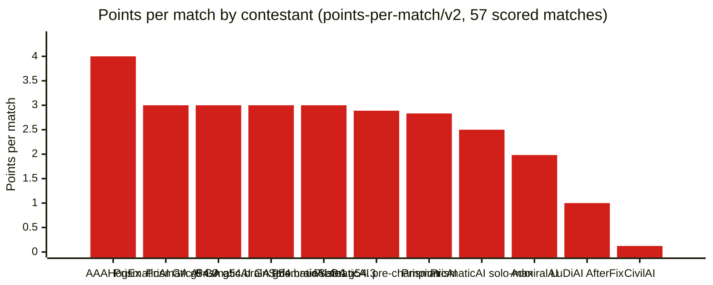
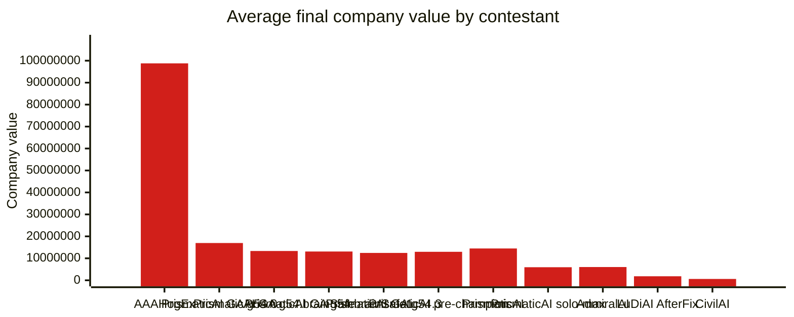
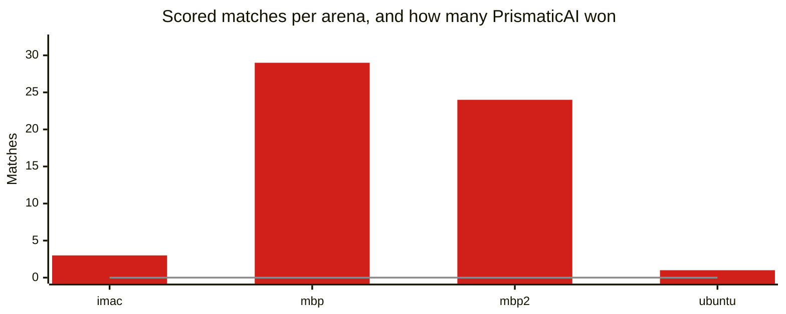

# battle-20261119T200932-6b963171

Derived from `battle-20261119T200932-6b963171.json` by `tools/research/ai-battle/battle.py report`; do not edit.

- Edition `6b963171e0b1e99c`: PrismaticAI and referee at `ebf7516b54d7130fa0908c68ff298075c517fb41`, base set `opengfx-8.0.tar`
- 20-year free-for-all from 1960, map 256x256 temperate, breakdowns 1
- 57 scored match(es) on `imac` (20261119-master-gdf1e05e7d8), `mbp` (20261119-master-m356d6e49c0), `mbp2` (20261119-master-gdf1e05e7d8), `ubuntu` (20261119-master-gdf1e05e7d8)
- Replays: 3 of 3 identical to their original on another arena

| # | Contestant | Played | Wins | Points | Points/match | Avg rank | Avg final value | Squirrel errors | Matches with anomalies |
|---|---|---|---|---|---|---|---|---|---|
| 1 | AAAHogEx | 57 | 57 | 228 | 4.0 | 1.0 | 98.8 M | 0 | 1 |
| 2 | PrismaticAI GA g54.0 | 10 | 0 | 30 | 3.0 | 2.0 | 17.0 M | 0 | 5 |
| 3 | PrismaticAI GA g54.brainSafe | 10 | 0 | 30 | 3.0 | 2.0 | 13.3 M | 0 | 3 |
| 4 | PrismaticAI GA g54.brainSafe1 | 8 | 0 | 24 | 3.0 | 2.0 | 13.1 M | 0 | 0 |
| 5 | PrismaticAI GA g54.3 | 6 | 0 | 18 | 3.0 | 2.0 | 12.5 M | 0 | 2 |
| 6 | PrismaticAI pre-champion | 9 | 0 | 26 | 2.889 | 2.11 | 13.0 M | 0 | 1 |
| 7 | PrismaticAI | 6 | 0 | 17 | 2.833 | 2.17 | 14.5 M | 0 | 0 |
| 8 | PrismaticAI solo-max | 8 | 0 | 20 | 2.5 | 2.5 | 5.9 M | 0 | 7 |
| 9 | AdmiralAI | 57 | 0 | 113 | 1.982 | 3.02 | 6.0 M | 0 | 4 |
| 10 | LuDiAI AfterFix | 57 | 0 | 57 | 1.0 | 4.0 | 1.8 M | 0 | 0 |
| 11 | CivilAI | 57 | 0 | 7 | 0.123 | 4.88 | 603.8 k | 3690 | 13 |

```mermaid
---
config:
  xyChart:
    width: 900
    height: 360
  themeVariables:
    xyChart:
      plotColorPalette: "#d11f1a, #8a8a8a, #0b0b0b, #ece4d6"
---
xychart-beta
    title "Final company value per scored match: winner vs best PrismaticAI"
    x-axis ["m-0001", "m-0002", "m-0003", "m-0004", "m-0005", "m-0006", "m-0007", "m-0008", "m-0009", "m-0010", "m-0011", "m-0012", "m-0013", "m-0014", "m-0015", "m-0016", "m-0017", "m-0018", "m-0019", "m-0020", "m-0021", "m-0022", "m-0023", "m-0024", "m-0025", "m-0026", "m-0027", "m-0028", "m-0030", "m-0036", "m-0037", "m-0038", "m-0039", "m-0040", "m-0041", "m-0042", "m-0043", "m-0044", "m-0045", "m-0046", "m-0047", "m-0049", "m-0050", "m-0051", "m-0052", "m-0053", "m-0054", "m-0055", "m-0057", "m-0058", "m-0059", "m-0060", "m-0061", "m-0066", "m-0067", "m-0073", "m-0074"]
    %% series: Winner | Best PrismaticAI
    %% links: battle-20261119T200932-6b963171.md?col=Match&filter=m-0001 | battle-20261119T200932-6b963171.md?col=Match&filter=m-0002 | battle-20261119T200932-6b963171.md?col=Match&filter=m-0003 | battle-20261119T200932-6b963171.md?col=Match&filter=m-0004 | battle-20261119T200932-6b963171.md?col=Match&filter=m-0005 | battle-20261119T200932-6b963171.md?col=Match&filter=m-0006 | battle-20261119T200932-6b963171.md?col=Match&filter=m-0007 | battle-20261119T200932-6b963171.md?col=Match&filter=m-0008 | battle-20261119T200932-6b963171.md?col=Match&filter=m-0009 | battle-20261119T200932-6b963171.md?col=Match&filter=m-0010 | battle-20261119T200932-6b963171.md?col=Match&filter=m-0011 | battle-20261119T200932-6b963171.md?col=Match&filter=m-0012 | battle-20261119T200932-6b963171.md?col=Match&filter=m-0013 | battle-20261119T200932-6b963171.md?col=Match&filter=m-0014 | battle-20261119T200932-6b963171.md?col=Match&filter=m-0015 | battle-20261119T200932-6b963171.md?col=Match&filter=m-0016 | battle-20261119T200932-6b963171.md?col=Match&filter=m-0017 | battle-20261119T200932-6b963171.md?col=Match&filter=m-0018 | battle-20261119T200932-6b963171.md?col=Match&filter=m-0019 | battle-20261119T200932-6b963171.md?col=Match&filter=m-0020 | battle-20261119T200932-6b963171.md?col=Match&filter=m-0021 | battle-20261119T200932-6b963171.md?col=Match&filter=m-0022 | battle-20261119T200932-6b963171.md?col=Match&filter=m-0023 | battle-20261119T200932-6b963171.md?col=Match&filter=m-0024 | battle-20261119T200932-6b963171.md?col=Match&filter=m-0025 | battle-20261119T200932-6b963171.md?col=Match&filter=m-0026 | battle-20261119T200932-6b963171.md?col=Match&filter=m-0027 | battle-20261119T200932-6b963171.md?col=Match&filter=m-0028 | battle-20261119T200932-6b963171.md?col=Match&filter=m-0030 | battle-20261119T200932-6b963171.md?col=Match&filter=m-0036 | battle-20261119T200932-6b963171.md?col=Match&filter=m-0037 | battle-20261119T200932-6b963171.md?col=Match&filter=m-0038 | battle-20261119T200932-6b963171.md?col=Match&filter=m-0039 | battle-20261119T200932-6b963171.md?col=Match&filter=m-0040 | battle-20261119T200932-6b963171.md?col=Match&filter=m-0041 | battle-20261119T200932-6b963171.md?col=Match&filter=m-0042 | battle-20261119T200932-6b963171.md?col=Match&filter=m-0043 | battle-20261119T200932-6b963171.md?col=Match&filter=m-0044 | battle-20261119T200932-6b963171.md?col=Match&filter=m-0045 | battle-20261119T200932-6b963171.md?col=Match&filter=m-0046 | battle-20261119T200932-6b963171.md?col=Match&filter=m-0047 | battle-20261119T200932-6b963171.md?col=Match&filter=m-0049 | battle-20261119T200932-6b963171.md?col=Match&filter=m-0050 | battle-20261119T200932-6b963171.md?col=Match&filter=m-0051 | battle-20261119T200932-6b963171.md?col=Match&filter=m-0052 | battle-20261119T200932-6b963171.md?col=Match&filter=m-0053 | battle-20261119T200932-6b963171.md?col=Match&filter=m-0054 | battle-20261119T200932-6b963171.md?col=Match&filter=m-0055 | battle-20261119T200932-6b963171.md?col=Match&filter=m-0057 | battle-20261119T200932-6b963171.md?col=Match&filter=m-0058 | battle-20261119T200932-6b963171.md?col=Match&filter=m-0059 | battle-20261119T200932-6b963171.md?col=Match&filter=m-0060 | battle-20261119T200932-6b963171.md?col=Match&filter=m-0061 | battle-20261119T200932-6b963171.md?col=Match&filter=m-0066 | battle-20261119T200932-6b963171.md?col=Match&filter=m-0067 | battle-20261119T200932-6b963171.md?col=Match&filter=m-0073 | battle-20261119T200932-6b963171.md?col=Match&filter=m-0074
    y-axis "Company value" 0 --> 164000000
    bar [104687440, 119687121, 97660982, 110786452, 108612868, 83348212, 104123554, 106465765, 80616668, 104496687, 115367708, 108687097, 92072445, 100133096, 93681762, 87098250, 109238251, 96391455, 95833997, 91687986, 103249887, 126169767, 133679169, 83245490, 132889042, 116888790, 99423718, 117829378, 60729144, 87718756, 96464139, 94792407, 97243140, 71942671, 74053956, 85804195, 120319005, 81956044, 98099039, 105314705, 111444831, 79987709, 81672914, 77617855, 81583088, 83178432, 66977018, 74751582, 149446145, 82908729, 112646241, 121982204, 124885672, 94323234, 95313098, 106263122, 86827085]
    line [8053048, 7390407, 11049943, 6500493, 7220257, 9343658, 16492410, 5107397, 15219500, 25867739, 15380325, 15069006, 15682445, 13794066, 5001007, 12101998, 11081730, 11504135, 11555643, 12094751, 16547438, 4774272, 11428762, 17506674, 14837866, 19432051, 13912838, 8181313, 10457784, 6857658, 18147601, 20928199, 13124615, 12683008, 13790932, 18918796, 7391904, 16554950, 17383084, 20148074, 16459293, 12959681, 6564794, 10861889, 12294343, 7794424, 11223875, 9894163, 3808626, 14553372, 20066466, 16849328, 11147914, 15375108, 9217600, 18112751, 17980351]
```

<!-- battle-charts:begin -->
<!-- derived from battle-20261119T200932-6b963171.json by `battle.py render`; `battle.py check` fails when it is stale -->

<!-- battle-charts:end -->

| Seed | Original | Replay | Arenas | Identical |
|---|---|---|---|---|
| 567589202 | m-0001 | m-0048 | mbp / mbp2 | yes |
| 567589202 | m-0002 | m-0056 | mbp / mbp2 | yes |
| 567589202 | m-0003 | m-0064 | mbp / mbp2 | yes |

| Match | Arena | Seed | Winner | Value | Last | Anomalies |
|---|---|---|---|---|---|---|
| m-0001 | mbp | 567589202 | AAAHogEx | 104.7 M | CivilAI | PrismaticAI solo-max: fleet_drop:41->15; AdmiralAI: fleet_drop:184->117 |
| m-0002 | mbp | 567589202 | AAAHogEx | 119.7 M | AdmiralAI | PrismaticAI pre-champion: fleet_drop:52->30 |
| m-0003 | mbp | 567589202 | AAAHogEx | 97.7 M | CivilAI | PrismaticAI GA g54.0: fleet_drop:65->38 |
| m-0004 | mbp | 567589202 | AAAHogEx | 110.8 M | LuDiAI AfterFix | - |
| m-0005 | mbp | 567589202 | AAAHogEx | 108.6 M | CivilAI | - |
| m-0006 | mbp | 567589202 | AAAHogEx | 83.3 M | CivilAI | PrismaticAI GA g54.3: fleet_drop:99->57; AdmiralAI: fleet_drop:183->124; CivilAI: fleet_drop:22->13 |
| m-0007 | mbp | 581391249 | AAAHogEx | 104.1 M | LuDiAI AfterFix | - |
| m-0008 | mbp | 581391249 | AAAHogEx | 106.5 M | CivilAI | CivilAI: squirrel_errors:3690 |
| m-0009 | mbp | 581391249 | AAAHogEx | 80.6 M | CivilAI | - |
| m-0010 | imac | 581391249 | AAAHogEx | 104.5 M | CivilAI | PrismaticAI GA g54.0: fleet_drop:82->53 |
| m-0011 | imac | 581391249 | AAAHogEx | 115.4 M | CivilAI | - |
| m-0012 | imac | 581391249 | AAAHogEx | 108.7 M | CivilAI | CivilAI: fleet_drop:41->17 |
| m-0013 | mbp2 | 581391249 | AAAHogEx | 92.1 M | CivilAI | PrismaticAI GA g54.3: fleet_drop:90->53; CivilAI: fleet_drop:36->25 |
| m-0014 | mbp2 | 23266876 | AAAHogEx | 100.1 M | CivilAI | - |
| m-0015 | mbp2 | 23266876 | AAAHogEx | 93.7 M | CivilAI | PrismaticAI solo-max: fleet_drop:30->16 |
| m-0016 | mbp2 | 23266876 | AAAHogEx | 87.1 M | CivilAI | CivilAI: fleet_drop:10->6 |
| m-0017 | mbp2 | 23266876 | AAAHogEx | 109.2 M | CivilAI | - |
| m-0018 | mbp2 | 23266876 | AAAHogEx | 96.4 M | CivilAI | AAAHogEx: fleet_drop:582->402; CivilAI: fleet_drop:13->3 |
| m-0019 | mbp2 | 23266876 | AAAHogEx | 95.8 M | CivilAI | - |
| m-0020 | mbp2 | 23266876 | AAAHogEx | 91.7 M | CivilAI | AdmiralAI: fleet_drop:44->23; CivilAI: fleet_drop:36->16 |
| m-0021 | mbp2 | 78157761 | AAAHogEx | 103.2 M | CivilAI | - |
| m-0022 | mbp2 | 78157761 | AAAHogEx | 126.2 M | CivilAI | PrismaticAI solo-max: fleet_drop:52->17 |
| m-0023 | mbp2 | 78157761 | AAAHogEx | 133.7 M | CivilAI | - |
| m-0024 | mbp2 | 78157761 | AAAHogEx | 83.2 M | CivilAI | PrismaticAI GA g54.0: fleet_drop:116->70 |
| m-0025 | mbp2 | 78157761 | AAAHogEx | 132.9 M | CivilAI | - |
| m-0026 | mbp2 | 78157761 | AAAHogEx | 116.9 M | CivilAI | - |
| m-0027 | mbp2 | 78157761 | AAAHogEx | 99.4 M | CivilAI | - |
| m-0028 | mbp2 | 1309123416 | AAAHogEx | 117.8 M | CivilAI | - |
| m-0030 | ubuntu | 1309123416 | AAAHogEx | 60.7 M | CivilAI | - |
| m-0036 | mbp | 1267560955 | AAAHogEx | 87.7 M | CivilAI | PrismaticAI solo-max: fleet_drop:47->21 |
| m-0037 | mbp | 1267560955 | AAAHogEx | 96.5 M | CivilAI | - |
| m-0038 | mbp | 1267560955 | AAAHogEx | 94.8 M | CivilAI | PrismaticAI GA g54.0: fleet_drop:128->63 |
| m-0039 | mbp | 1267560955 | AAAHogEx | 97.2 M | CivilAI | PrismaticAI GA g54.brainSafe: fleet_drop:102->69 |
| m-0040 | mbp | 1267560955 | AAAHogEx | 71.9 M | CivilAI | - |
| m-0041 | mbp | 1267560955 | AAAHogEx | 74.1 M | CivilAI | - |
| m-0042 | mbp | 423739861 | AAAHogEx | 85.8 M | CivilAI | - |
| m-0043 | mbp | 423739861 | AAAHogEx | 120.3 M | CivilAI | PrismaticAI solo-max: fleet_drop:39->19; CivilAI: fleet_drop:48->27 |
| m-0044 | mbp | 423739861 | AAAHogEx | 82.0 M | CivilAI | CivilAI: fleet_drop:12->8 |
| m-0045 | mbp2 | 423739861 | AAAHogEx | 98.1 M | LuDiAI AfterFix | CivilAI: fleet_drop:49->32 |
| m-0046 | mbp2 | 423739861 | AAAHogEx | 105.3 M | CivilAI | PrismaticAI GA g54.brainSafe: fleet_drop:164->71 |
| m-0047 | mbp2 | 423739861 | AAAHogEx | 111.4 M | CivilAI | - |
| m-0048 (replay) | mbp2 | 567589202 | AAAHogEx | 104.7 M | CivilAI | PrismaticAI solo-max: fleet_drop:41->15; AdmiralAI: fleet_drop:184->117 |
| m-0049 | mbp2 | 1083588264 | AAAHogEx | 80.0 M | CivilAI | CivilAI: fleet_drop:48->30 |
| m-0050 | mbp2 | 1083588264 | AAAHogEx | 81.7 M | CivilAI | PrismaticAI solo-max: fleet_drop:43->18 |
| m-0051 | mbp | 1083588264 | AAAHogEx | 77.6 M | CivilAI | - |
| m-0052 | mbp | 1083588264 | AAAHogEx | 81.6 M | CivilAI | - |
| m-0053 | mbp | 1083588264 | AAAHogEx | 83.2 M | CivilAI | CivilAI: fleet_drop:58->38 |
| m-0054 | mbp | 1083588264 | AAAHogEx | 67.0 M | LuDiAI AfterFix | - |
| m-0055 | mbp2 | 1083588264 | AAAHogEx | 74.8 M | CivilAI | - |
| m-0056 (replay) | mbp2 | 567589202 | AAAHogEx | 119.7 M | AdmiralAI | PrismaticAI pre-champion: fleet_drop:52->30 |
| m-0057 | mbp | 9840851 | AAAHogEx | 149.4 M | CivilAI | PrismaticAI solo-max: fleet_drop:44->14 |
| m-0058 | mbp | 9840851 | AAAHogEx | 82.9 M | CivilAI | CivilAI: fleet_drop:30->13 |
| m-0059 | mbp | 9840851 | AAAHogEx | 112.6 M | CivilAI | PrismaticAI GA g54.0: fleet_drop:120->77 |
| m-0060 | mbp | 9840851 | AAAHogEx | 122.0 M | CivilAI | PrismaticAI GA g54.brainSafe: fleet_drop:121->40 |
| m-0061 | mbp | 9840851 | AAAHogEx | 124.9 M | CivilAI | - |
| m-0064 (replay) | mbp2 | 567589202 | AAAHogEx | 97.7 M | CivilAI | PrismaticAI GA g54.0: fleet_drop:65->38 |
| m-0066 | mbp2 | 1112386641 | AAAHogEx | 94.3 M | CivilAI | - |
| m-0067 | mbp2 | 1112386641 | AAAHogEx | 95.3 M | AdmiralAI | AdmiralAI: fleet_drop:152->64 |
| m-0073 | mbp | 1823411804 | AAAHogEx | 106.3 M | CivilAI | - |
| m-0074 | mbp | 1823411804 | AAAHogEx | 86.8 M | CivilAI | - |
