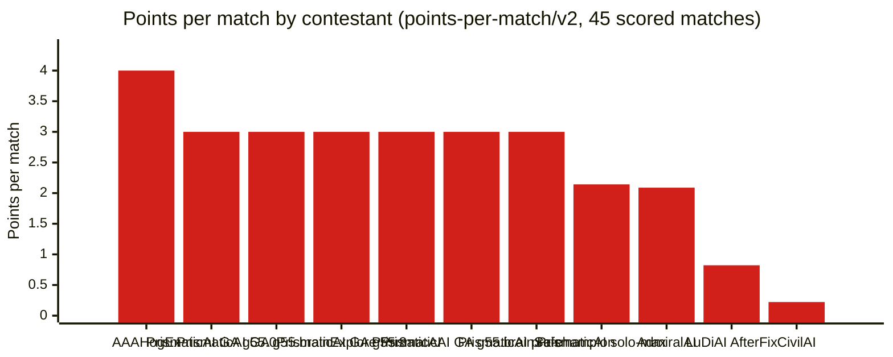
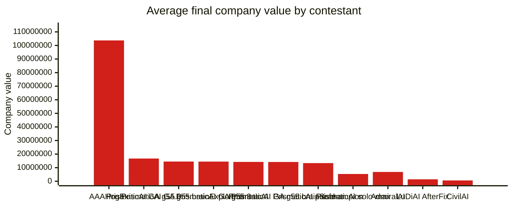
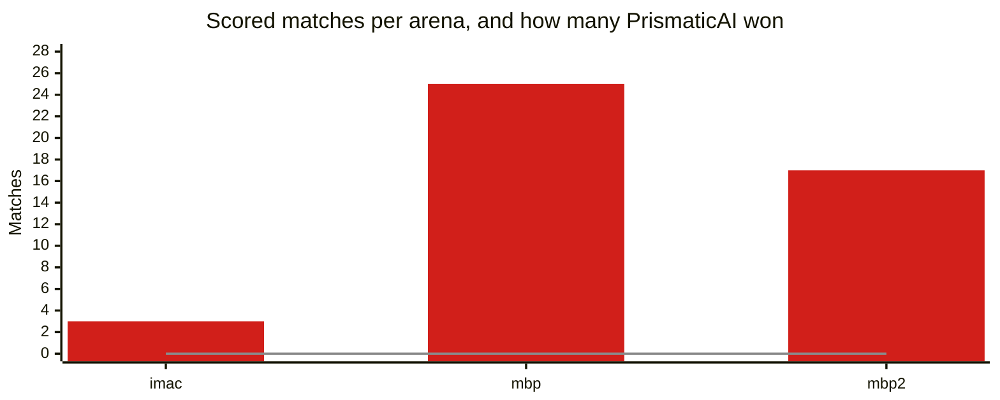

# battle-20261119T202025-51b71ed5

Derived from `battle-20261119T202025-51b71ed5.json` by `tools/research/ai-battle/battle.py report`; do not edit.

- Edition `51b71ed564db3167`: PrismaticAI and referee at `ebf7516b54d7130fa0908c68ff298075c517fb41`, base set `opengfx-8.0.tar`
- 20-year free-for-all from 1960, map 256x256 temperate, breakdowns 1
- 45 scored match(es) on `imac` (20261119-master-gdf1e05e7d8), `mbp` (20261119-master-m356d6e49c0), `mbp2` (20261119-master-gdf1e05e7d8)
- Replays: 0 of 1 identical to their original on another arena

| # | Contestant | Played | Wins | Points | Points/match | Avg rank | Avg final value | Squirrel errors | Matches with anomalies |
|---|---|---|---|---|---|---|---|---|---|
| 1 | AAAHogEx | 45 | 45 | 180 | 4.0 | 1.0 | 103.7 M | 0 | 0 |
| 2 | PrismaticAI GA g55.0 | 7 | 0 | 21 | 3.0 | 2.0 | 16.7 M | 0 | 4 |
| 3 | PrismaticAI GA g55.brainExplore | 6 | 0 | 18 | 3.0 | 2.0 | 14.5 M | 0 | 1 |
| 4 | PrismaticAI GA g55.3 | 7 | 0 | 21 | 3.0 | 2.0 | 14.5 M | 0 | 1 |
| 5 | PrismaticAI | 5 | 0 | 15 | 3.0 | 2.0 | 14.2 M | 0 | 1 |
| 6 | PrismaticAI GA g55.brainSafe | 6 | 0 | 18 | 3.0 | 2.0 | 14.2 M | 0 | 4 |
| 7 | PrismaticAI pre-champion | 7 | 0 | 21 | 3.0 | 2.0 | 13.4 M | 0 | 1 |
| 8 | PrismaticAI solo-max | 7 | 0 | 15 | 2.143 | 2.86 | 5.4 M | 0 | 7 |
| 9 | AdmiralAI | 45 | 0 | 94 | 2.089 | 2.91 | 6.9 M | 0 | 3 |
| 10 | LuDiAI AfterFix | 45 | 0 | 37 | 0.822 | 4.18 | 1.4 M | 0 | 4 |
| 11 | CivilAI | 45 | 0 | 10 | 0.222 | 4.78 | 597.9 k | 3665 | 9 |

```mermaid
---
config:
  xyChart:
    width: 900
    height: 360
  themeVariables:
    xyChart:
      plotColorPalette: "#d11f1a, #8a8a8a, #0b0b0b, #ece4d6"
---
xychart-beta
    title "Final company value per scored match: winner vs best PrismaticAI"
    x-axis ["m-0001", "m-0002", "m-0003", "m-0004", "m-0005", "m-0006", "m-0007", "m-0008", "m-0009", "m-0010", "m-0011", "m-0012", "m-0013", "m-0014", "m-0015", "m-0016", "m-0017", "m-0018", "m-0019", "m-0020", "m-0021", "m-0022", "m-0023", "m-0024", "m-0025", "m-0026", "m-0027", "m-0028", "m-0036", "m-0037", "m-0038", "m-0039", "m-0040", "m-0041", "m-0042", "m-0043", "m-0044", "m-0045", "m-0053", "m-0054", "m-0055", "m-0057", "m-0058", "m-0059", "m-0069"]
    %% series: Winner | Best PrismaticAI
    %% links: battle-20261119T202025-51b71ed5.md?col=Match&filter=m-0001 | battle-20261119T202025-51b71ed5.md?col=Match&filter=m-0002 | battle-20261119T202025-51b71ed5.md?col=Match&filter=m-0003 | battle-20261119T202025-51b71ed5.md?col=Match&filter=m-0004 | battle-20261119T202025-51b71ed5.md?col=Match&filter=m-0005 | battle-20261119T202025-51b71ed5.md?col=Match&filter=m-0006 | battle-20261119T202025-51b71ed5.md?col=Match&filter=m-0007 | battle-20261119T202025-51b71ed5.md?col=Match&filter=m-0008 | battle-20261119T202025-51b71ed5.md?col=Match&filter=m-0009 | battle-20261119T202025-51b71ed5.md?col=Match&filter=m-0010 | battle-20261119T202025-51b71ed5.md?col=Match&filter=m-0011 | battle-20261119T202025-51b71ed5.md?col=Match&filter=m-0012 | battle-20261119T202025-51b71ed5.md?col=Match&filter=m-0013 | battle-20261119T202025-51b71ed5.md?col=Match&filter=m-0014 | battle-20261119T202025-51b71ed5.md?col=Match&filter=m-0015 | battle-20261119T202025-51b71ed5.md?col=Match&filter=m-0016 | battle-20261119T202025-51b71ed5.md?col=Match&filter=m-0017 | battle-20261119T202025-51b71ed5.md?col=Match&filter=m-0018 | battle-20261119T202025-51b71ed5.md?col=Match&filter=m-0019 | battle-20261119T202025-51b71ed5.md?col=Match&filter=m-0020 | battle-20261119T202025-51b71ed5.md?col=Match&filter=m-0021 | battle-20261119T202025-51b71ed5.md?col=Match&filter=m-0022 | battle-20261119T202025-51b71ed5.md?col=Match&filter=m-0023 | battle-20261119T202025-51b71ed5.md?col=Match&filter=m-0024 | battle-20261119T202025-51b71ed5.md?col=Match&filter=m-0025 | battle-20261119T202025-51b71ed5.md?col=Match&filter=m-0026 | battle-20261119T202025-51b71ed5.md?col=Match&filter=m-0027 | battle-20261119T202025-51b71ed5.md?col=Match&filter=m-0028 | battle-20261119T202025-51b71ed5.md?col=Match&filter=m-0036 | battle-20261119T202025-51b71ed5.md?col=Match&filter=m-0037 | battle-20261119T202025-51b71ed5.md?col=Match&filter=m-0038 | battle-20261119T202025-51b71ed5.md?col=Match&filter=m-0039 | battle-20261119T202025-51b71ed5.md?col=Match&filter=m-0040 | battle-20261119T202025-51b71ed5.md?col=Match&filter=m-0041 | battle-20261119T202025-51b71ed5.md?col=Match&filter=m-0042 | battle-20261119T202025-51b71ed5.md?col=Match&filter=m-0043 | battle-20261119T202025-51b71ed5.md?col=Match&filter=m-0044 | battle-20261119T202025-51b71ed5.md?col=Match&filter=m-0045 | battle-20261119T202025-51b71ed5.md?col=Match&filter=m-0053 | battle-20261119T202025-51b71ed5.md?col=Match&filter=m-0054 | battle-20261119T202025-51b71ed5.md?col=Match&filter=m-0055 | battle-20261119T202025-51b71ed5.md?col=Match&filter=m-0057 | battle-20261119T202025-51b71ed5.md?col=Match&filter=m-0058 | battle-20261119T202025-51b71ed5.md?col=Match&filter=m-0059 | battle-20261119T202025-51b71ed5.md?col=Match&filter=m-0069
    y-axis "Company value" 0 --> 197000000
    bar [124347494, 124765369, 85313432, 108373968, 98041092, 113461285, 109823061, 126087672, 131300560, 108266036, 108034438, 97575413, 102854372, 82900607, 85225032, 105608881, 96926000, 80654857, 96237222, 115985167, 85522033, 91251059, 111710901, 74723929, 67810020, 64126304, 67839058, 94552635, 102270917, 119519116, 115638942, 113537975, 110025230, 121820948, 94499347, 119384195, 111708448, 82941767, 85537638, 92875841, 106065175, 179089116, 107477494, 148150730, 97014588]
    line [4556255, 15179809, 13051326, 15084024, 13588735, 14169235, 18627558, 6887915, 10065753, 15172073, 14106931, 14589833, 15350453, 12565899, 7453694, 15904450, 21207608, 9464298, 17643843, 19597819, 15409148, 6098036, 14509422, 16052048, 19731799, 12390644, 17596433, 13136938, 4726565, 9348972, 19365953, 12067184, 11261377, 12565103, 11482685, 6294396, 14914113, 13815211, 14712435, 17617781, 12438934, 1488091, 13678474, 18476473, 9584786]
```

<!-- battle-charts:begin -->
<!-- derived from battle-20261119T202025-51b71ed5.json by `battle.py render`; `battle.py check` fails when it is stale -->

<!-- battle-charts:end -->

| Seed | Original | Replay | Arenas | Identical |
|---|---|---|---|---|
| 974278415 | m-0010 | m-0056 | imac / mbp | NO |

| Match | Arena | Seed | Winner | Value | Last | Anomalies |
|---|---|---|---|---|---|---|
| m-0001 | mbp | 852435539 | AAAHogEx | 124.3 M | CivilAI | PrismaticAI solo-max: fleet_drop:39->16; LuDiAI AfterFix: fleet_drop:165->101 |
| m-0002 | mbp | 852435539 | AAAHogEx | 124.8 M | CivilAI | - |
| m-0003 | mbp | 852435539 | AAAHogEx | 85.3 M | LuDiAI AfterFix | PrismaticAI GA g55.0: fleet_drop:116->53; CivilAI: fleet_drop:62->42 |
| m-0004 | mbp | 852435539 | AAAHogEx | 108.4 M | LuDiAI AfterFix | - |
| m-0005 | mbp | 852435539 | AAAHogEx | 98.0 M | CivilAI | - |
| m-0006 | mbp | 852435539 | AAAHogEx | 113.5 M | LuDiAI AfterFix | CivilAI: fleet_drop:43->23 |
| m-0007 | mbp | 974278415 | AAAHogEx | 109.8 M | CivilAI | LuDiAI AfterFix: fleet_drop:50->31 |
| m-0008 | mbp | 974278415 | AAAHogEx | 126.1 M | CivilAI | PrismaticAI solo-max: fleet_drop:38->15 |
| m-0009 | mbp | 974278415 | AAAHogEx | 131.3 M | CivilAI | - |
| m-0010 | imac | 974278415 | AAAHogEx | 108.3 M | CivilAI | CivilAI: fleet_drop:50->23 |
| m-0011 | imac | 974278415 | AAAHogEx | 108.0 M | CivilAI | PrismaticAI GA g55.brainSafe: fleet_drop:84->56; CivilAI: fleet_drop:23->10 |
| m-0012 | imac | 974278415 | AAAHogEx | 97.6 M | CivilAI | - |
| m-0013 | mbp2 | 974278415 | AAAHogEx | 102.9 M | CivilAI | - |
| m-0014 | mbp2 | 267756483 | AAAHogEx | 82.9 M | CivilAI | CivilAI: fleet_drop:25->12 |
| m-0015 | mbp2 | 267756483 | AAAHogEx | 85.2 M | CivilAI | PrismaticAI solo-max: fleet_drop:45->20; CivilAI: fleet_drop:14->6 |
| m-0016 | mbp2 | 267756483 | AAAHogEx | 105.6 M | CivilAI | AdmiralAI: fleet_drop:284->154 |
| m-0017 | mbp2 | 267756483 | AAAHogEx | 96.9 M | CivilAI | PrismaticAI GA g55.0: fleet_drop:81->55 |
| m-0018 | mbp2 | 267756483 | AAAHogEx | 80.7 M | CivilAI | PrismaticAI GA g55.brainSafe: fleet_drop:106->61 |
| m-0019 | mbp2 | 267756483 | AAAHogEx | 96.2 M | CivilAI | PrismaticAI GA g55.brainExplore: fleet_drop:51->35 |
| m-0020 | mbp2 | 267756483 | AAAHogEx | 116.0 M | CivilAI | - |
| m-0021 | mbp2 | 1080248183 | AAAHogEx | 85.5 M | CivilAI | - |
| m-0022 | mbp2 | 1080248183 | AAAHogEx | 91.3 M | CivilAI | PrismaticAI solo-max: fleet_drop:41->13 |
| m-0023 | mbp2 | 1080248183 | AAAHogEx | 111.7 M | LuDiAI AfterFix | - |
| m-0024 | mbp2 | 1080248183 | AAAHogEx | 74.7 M | CivilAI | CivilAI: squirrel_errors:3665 |
| m-0025 | mbp2 | 1080248183 | AAAHogEx | 67.8 M | LuDiAI AfterFix | PrismaticAI GA g55.brainSafe: fleet_drop:148->68 |
| m-0026 | mbp2 | 1080248183 | AAAHogEx | 64.1 M | CivilAI | - |
| m-0027 | mbp2 | 1080248183 | AAAHogEx | 67.8 M | AdmiralAI | - |
| m-0028 | mbp2 | 260608941 | AAAHogEx | 94.6 M | CivilAI | PrismaticAI: fleet_drop:73->51 |
| m-0036 | mbp | 543825794 | AAAHogEx | 102.3 M | CivilAI | PrismaticAI solo-max: fleet_drop:36->19 |
| m-0037 | mbp | 543825794 | AAAHogEx | 119.5 M | CivilAI | PrismaticAI pre-champion: fleet_drop:83->56; CivilAI: fleet_drop:30->9 |
| m-0038 | mbp | 543825794 | AAAHogEx | 115.6 M | CivilAI | AdmiralAI: fleet_drop:215->149 |
| m-0039 | mbp | 543825794 | AAAHogEx | 113.5 M | CivilAI | - |
| m-0040 | mbp | 543825794 | AAAHogEx | 110.0 M | LuDiAI AfterFix | - |
| m-0041 | mbp | 543825794 | AAAHogEx | 121.8 M | LuDiAI AfterFix | - |
| m-0042 | mbp | 1731778346 | AAAHogEx | 94.5 M | CivilAI | - |
| m-0043 | mbp | 1731778346 | AAAHogEx | 119.4 M | CivilAI | PrismaticAI solo-max: fleet_drop:49->19 |
| m-0044 | mbp | 1731778346 | AAAHogEx | 111.7 M | LuDiAI AfterFix | LuDiAI AfterFix: fleet_drop:21->14 |
| m-0045 | mbp2 | 1731778346 | AAAHogEx | 82.9 M | LuDiAI AfterFix | PrismaticAI GA g55.0: fleet_drop:101->63; LuDiAI AfterFix: fleet_drop:25->10 |
| m-0053 | mbp | 1486785095 | AAAHogEx | 85.5 M | CivilAI | PrismaticAI GA g55.brainSafe: fleet_drop:149->56 |
| m-0054 | mbp | 1486785095 | AAAHogEx | 92.9 M | CivilAI | - |
| m-0055 | mbp | 1486785095 | AAAHogEx | 106.1 M | CivilAI | - |
| m-0056 (replay) | mbp | 974278415 | AAAHogEx | 110.5 M | CivilAI | CivilAI: fleet_drop:44->27 |
| m-0057 | mbp | 1147601135 | AAAHogEx | 179.1 M | CivilAI | PrismaticAI solo-max: fleet_drop:41->22; CivilAI: fleet_drop:21->13 |
| m-0058 | mbp | 1147601135 | AAAHogEx | 107.5 M | CivilAI | AdmiralAI: fleet_drop:108->67 |
| m-0059 | mbp | 1147601135 | AAAHogEx | 148.2 M | CivilAI | PrismaticAI GA g55.0: fleet_drop:120->83 |
| m-0069 | mbp | 1529977073 | AAAHogEx | 97.0 M | CivilAI | PrismaticAI GA g55.3: fleet_drop:92->63 |
