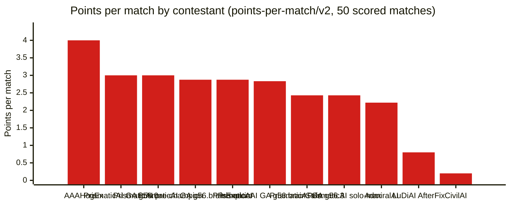
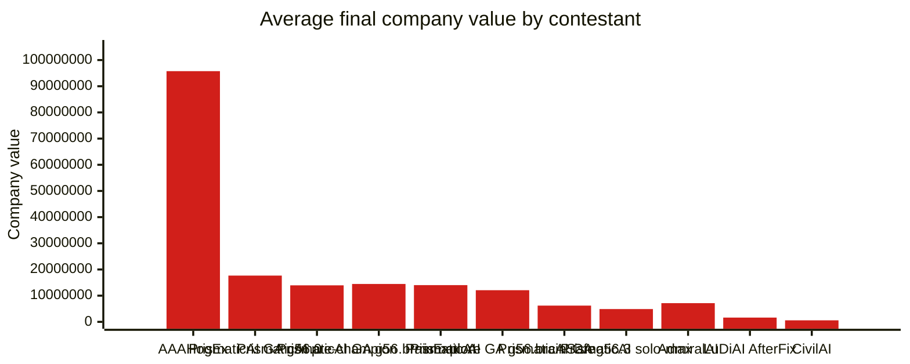
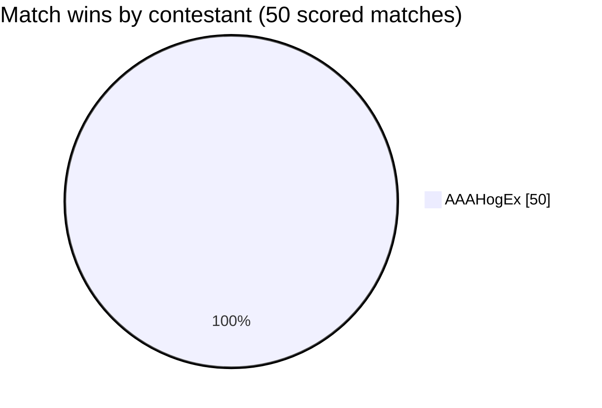
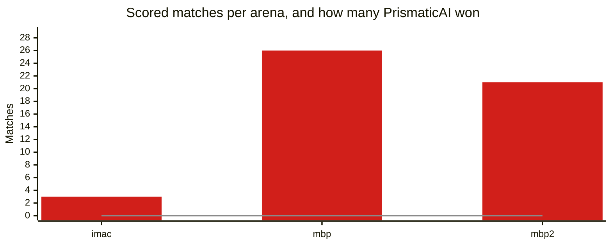

# battle-20261119T203211-e6638a2b

Derived from `battle-20261119T203211-e6638a2b.json` by `tools/research/ai-battle/battle.py report`; do not edit.

- Edition `e6638a2ba4589ddf`: PrismaticAI and referee at `ebf7516b54d7130fa0908c68ff298075c517fb41`, base set `opengfx-8.0.tar`
- 20-year free-for-all from 1960, map 256x256 temperate, breakdowns 1
- 50 scored match(es) on `imac` (20261119-master-gdf1e05e7d8), `mbp` (20261119-master-m356d6e49c0), `mbp2` (20261119-master-gdf1e05e7d8)
- Replays: 1 of 2 identical to their original on another arena

| # | Contestant | Played | Wins | Points | Points/match | Avg rank | Avg final value | Squirrel errors | Matches with anomalies |
|---|---|---|---|---|---|---|---|---|---|
| 1 | AAAHogEx | 50 | 50 | 200 | 4.0 | 1.0 | 95.8 M | 0 | 0 |
| 2 | PrismaticAI GA g56.0 | 6 | 0 | 18 | 3.0 | 2.0 | 17.7 M | 0 | 0 |
| 3 | PrismaticAI pre-champion | 8 | 0 | 24 | 3.0 | 2.0 | 13.9 M | 0 | 0 |
| 4 | PrismaticAI GA g56.brainExplore | 8 | 0 | 23 | 2.875 | 2.12 | 14.5 M | 0 | 0 |
| 5 | PrismaticAI | 8 | 0 | 23 | 2.875 | 2.12 | 14.0 M | 0 | 0 |
| 6 | PrismaticAI GA g56.brainSafe | 6 | 0 | 17 | 2.833 | 2.17 | 12.1 M | 0 | 1 |
| 7 | PrismaticAI GA g56.3 | 7 | 0 | 17 | 2.429 | 2.57 | 6.2 M | 0 | 1 |
| 8 | PrismaticAI solo-max | 7 | 0 | 17 | 2.429 | 2.57 | 4.9 M | 0 | 7 |
| 9 | AdmiralAI | 50 | 0 | 111 | 2.22 | 2.78 | 7.1 M | 47 | 2 |
| 10 | LuDiAI AfterFix | 50 | 0 | 40 | 0.8 | 4.2 | 1.6 M | 0 | 0 |
| 11 | CivilAI | 50 | 0 | 10 | 0.2 | 4.8 | 578.2 k | 0 | 15 |

```mermaid
---
config:
  xyChart:
    width: 900
    height: 360
  themeVariables:
    xyChart:
      plotColorPalette: "#d11f1a, #8a8a8a, #0b0b0b, #ece4d6"
---
xychart-beta
    title "Final company value per scored match: winner vs best PrismaticAI"
    x-axis ["m-0001", "m-0002", "m-0003", "m-0004", "m-0005", "m-0006", "m-0007", "m-0008", "m-0009", "m-0010", "m-0011", "m-0012", "m-0013", "m-0014", "m-0015", "m-0016", "m-0017", "m-0018", "m-0019", "m-0020", "m-0021", "m-0022", "m-0023", "m-0024", "m-0025", "m-0026", "m-0027", "m-0028", "m-0036", "m-0037", "m-0038", "m-0039", "m-0040", "m-0041", "m-0042", "m-0043", "m-0044", "m-0045", "m-0049", "m-0050", "m-0051", "m-0054", "m-0055", "m-0061", "m-0063", "m-0065", "m-0067", "m-0068", "m-0069", "m-0070"]
    %% series: Winner | Best PrismaticAI
    %% links: battle-20261119T203211-e6638a2b.md?col=Match&filter=m-0001 | battle-20261119T203211-e6638a2b.md?col=Match&filter=m-0002 | battle-20261119T203211-e6638a2b.md?col=Match&filter=m-0003 | battle-20261119T203211-e6638a2b.md?col=Match&filter=m-0004 | battle-20261119T203211-e6638a2b.md?col=Match&filter=m-0005 | battle-20261119T203211-e6638a2b.md?col=Match&filter=m-0006 | battle-20261119T203211-e6638a2b.md?col=Match&filter=m-0007 | battle-20261119T203211-e6638a2b.md?col=Match&filter=m-0008 | battle-20261119T203211-e6638a2b.md?col=Match&filter=m-0009 | battle-20261119T203211-e6638a2b.md?col=Match&filter=m-0010 | battle-20261119T203211-e6638a2b.md?col=Match&filter=m-0011 | battle-20261119T203211-e6638a2b.md?col=Match&filter=m-0012 | battle-20261119T203211-e6638a2b.md?col=Match&filter=m-0013 | battle-20261119T203211-e6638a2b.md?col=Match&filter=m-0014 | battle-20261119T203211-e6638a2b.md?col=Match&filter=m-0015 | battle-20261119T203211-e6638a2b.md?col=Match&filter=m-0016 | battle-20261119T203211-e6638a2b.md?col=Match&filter=m-0017 | battle-20261119T203211-e6638a2b.md?col=Match&filter=m-0018 | battle-20261119T203211-e6638a2b.md?col=Match&filter=m-0019 | battle-20261119T203211-e6638a2b.md?col=Match&filter=m-0020 | battle-20261119T203211-e6638a2b.md?col=Match&filter=m-0021 | battle-20261119T203211-e6638a2b.md?col=Match&filter=m-0022 | battle-20261119T203211-e6638a2b.md?col=Match&filter=m-0023 | battle-20261119T203211-e6638a2b.md?col=Match&filter=m-0024 | battle-20261119T203211-e6638a2b.md?col=Match&filter=m-0025 | battle-20261119T203211-e6638a2b.md?col=Match&filter=m-0026 | battle-20261119T203211-e6638a2b.md?col=Match&filter=m-0027 | battle-20261119T203211-e6638a2b.md?col=Match&filter=m-0028 | battle-20261119T203211-e6638a2b.md?col=Match&filter=m-0036 | battle-20261119T203211-e6638a2b.md?col=Match&filter=m-0037 | battle-20261119T203211-e6638a2b.md?col=Match&filter=m-0038 | battle-20261119T203211-e6638a2b.md?col=Match&filter=m-0039 | battle-20261119T203211-e6638a2b.md?col=Match&filter=m-0040 | battle-20261119T203211-e6638a2b.md?col=Match&filter=m-0041 | battle-20261119T203211-e6638a2b.md?col=Match&filter=m-0042 | battle-20261119T203211-e6638a2b.md?col=Match&filter=m-0043 | battle-20261119T203211-e6638a2b.md?col=Match&filter=m-0044 | battle-20261119T203211-e6638a2b.md?col=Match&filter=m-0045 | battle-20261119T203211-e6638a2b.md?col=Match&filter=m-0049 | battle-20261119T203211-e6638a2b.md?col=Match&filter=m-0050 | battle-20261119T203211-e6638a2b.md?col=Match&filter=m-0051 | battle-20261119T203211-e6638a2b.md?col=Match&filter=m-0054 | battle-20261119T203211-e6638a2b.md?col=Match&filter=m-0055 | battle-20261119T203211-e6638a2b.md?col=Match&filter=m-0061 | battle-20261119T203211-e6638a2b.md?col=Match&filter=m-0063 | battle-20261119T203211-e6638a2b.md?col=Match&filter=m-0065 | battle-20261119T203211-e6638a2b.md?col=Match&filter=m-0067 | battle-20261119T203211-e6638a2b.md?col=Match&filter=m-0068 | battle-20261119T203211-e6638a2b.md?col=Match&filter=m-0069 | battle-20261119T203211-e6638a2b.md?col=Match&filter=m-0070
    y-axis "Company value" 0 --> 181000000
    bar [125075259, 146084094, 115458994, 85127805, 105712110, 127930413, 83063726, 102789950, 74347507, 84029843, 85197955, 79079543, 93523372, 93753800, 107581017, 96855164, 87542362, 104188478, 96112673, 95914146, 55606803, 76595589, 73390590, 81414337, 53447883, 70827292, 101848256, 88356618, 88079696, 61939442, 66520588, 82684535, 82752341, 87741082, 141171295, 164806617, 160691857, 139149009, 87863768, 80411578, 98221150, 88966202, 81921284, 136535372, 89536604, 83553586, 108210094, 77349170, 87913894, 101341983]
    line [4922021, 15545853, 12072608, 15094167, 18719459, 3154861, 14681143, 4667284, 13259974, 16352518, 6911718, 14441470, 7142446, 16144983, 4311797, 15043398, 17928156, 13688256, 11752429, 5310831, 12718813, 4269595, 8152357, 17791667, 15106308, 15109319, 3407162, 15333910, 6332190, 20104362, 20479334, 17232812, 21322701, 9429502, 16166290, 4063593, 15708221, 21381885, 10565491, 5590489, 13020359, 10126531, 10157317, 11264227, 14209095, 10688257, 4473345, 13005401, 4777798, 12377932]
```

<!-- battle-charts:begin -->
<!-- derived from battle-20261119T203211-e6638a2b.json by `battle.py render`; `battle.py check` fails when it is stale -->

<!-- battle-charts:end -->

| Seed | Original | Replay | Arenas | Identical |
|---|---|---|---|---|
| 1855427073 | m-0001 | m-0048 | mbp / mbp2 | yes |
| 1252760853 | m-0011 | m-0064 | imac / mbp | NO |

| Match | Arena | Seed | Winner | Value | Last | Anomalies |
|---|---|---|---|---|---|---|
| m-0001 | mbp | 1855427073 | AAAHogEx | 125.1 M | CivilAI | PrismaticAI solo-max: fleet_drop:44->17 |
| m-0002 | mbp | 1855427073 | AAAHogEx | 146.1 M | CivilAI | - |
| m-0003 | mbp | 1855427073 | AAAHogEx | 115.5 M | CivilAI | - |
| m-0004 | mbp | 1855427073 | AAAHogEx | 85.1 M | CivilAI | - |
| m-0005 | mbp | 1855427073 | AAAHogEx | 105.7 M | CivilAI | CivilAI: fleet_drop:78->28 |
| m-0006 | mbp | 1855427073 | AAAHogEx | 127.9 M | CivilAI | PrismaticAI GA g56.3: fleet_drop:82->56 |
| m-0007 | mbp | 1252760853 | AAAHogEx | 83.1 M | CivilAI | CivilAI: fleet_drop:51->15 |
| m-0008 | mbp | 1252760853 | AAAHogEx | 102.8 M | CivilAI | PrismaticAI solo-max: fleet_drop:34->17 |
| m-0009 | mbp | 1252760853 | AAAHogEx | 74.3 M | CivilAI | CivilAI: fleet_drop:37->22 |
| m-0010 | imac | 1252760853 | AAAHogEx | 84.0 M | CivilAI | - |
| m-0011 | imac | 1252760853 | AAAHogEx | 85.2 M | CivilAI | PrismaticAI GA g56.brainSafe: fleet_drop:102->66; CivilAI: fleet_drop:40->16 |
| m-0012 | imac | 1252760853 | AAAHogEx | 79.1 M | CivilAI | - |
| m-0013 | mbp2 | 1252760853 | AAAHogEx | 93.5 M | CivilAI | AdmiralAI: squirrel_errors:47 |
| m-0014 | mbp2 | 666648481 | AAAHogEx | 93.8 M | LuDiAI AfterFix | - |
| m-0015 | mbp2 | 666648481 | AAAHogEx | 107.6 M | LuDiAI AfterFix | PrismaticAI solo-max: fleet_drop:42->20; CivilAI: fleet_drop:73->13 |
| m-0016 | mbp2 | 666648481 | AAAHogEx | 96.9 M | LuDiAI AfterFix | - |
| m-0017 | mbp2 | 666648481 | AAAHogEx | 87.5 M | CivilAI | - |
| m-0018 | mbp2 | 666648481 | AAAHogEx | 104.2 M | LuDiAI AfterFix | CivilAI: fleet_drop:37->22 |
| m-0019 | mbp2 | 666648481 | AAAHogEx | 96.1 M | LuDiAI AfterFix | - |
| m-0020 | mbp2 | 666648481 | AAAHogEx | 95.9 M | CivilAI | - |
| m-0021 | mbp2 | 1618505669 | AAAHogEx | 55.6 M | LuDiAI AfterFix | - |
| m-0022 | mbp2 | 1618505669 | AAAHogEx | 76.6 M | CivilAI | PrismaticAI solo-max: fleet_drop:36->19 |
| m-0023 | mbp2 | 1618505669 | AAAHogEx | 73.4 M | CivilAI | - |
| m-0024 | mbp2 | 1618505669 | AAAHogEx | 81.4 M | LuDiAI AfterFix | - |
| m-0025 | mbp2 | 1618505669 | AAAHogEx | 53.4 M | CivilAI | - |
| m-0026 | mbp2 | 1618505669 | AAAHogEx | 70.8 M | LuDiAI AfterFix | - |
| m-0027 | mbp2 | 1618505669 | AAAHogEx | 101.8 M | CivilAI | CivilAI: fleet_drop:16->11 |
| m-0028 | mbp2 | 1852013446 | AAAHogEx | 88.4 M | CivilAI | - |
| m-0036 | mbp | 946089584 | AAAHogEx | 88.1 M | CivilAI | PrismaticAI solo-max: fleet_drop:44->20 |
| m-0037 | mbp | 946089584 | AAAHogEx | 61.9 M | LuDiAI AfterFix | CivilAI: fleet_drop:70->34 |
| m-0038 | mbp | 946089584 | AAAHogEx | 66.5 M | CivilAI | CivilAI: no_vehicles |
| m-0039 | mbp | 946089584 | AAAHogEx | 82.7 M | CivilAI | - |
| m-0040 | mbp | 946089584 | AAAHogEx | 82.8 M | CivilAI | AdmiralAI: fleet_drop:164->113 |
| m-0041 | mbp | 946089584 | AAAHogEx | 87.7 M | CivilAI | CivilAI: fleet_drop:81->49 |
| m-0042 | mbp | 673045383 | AAAHogEx | 141.2 M | CivilAI | - |
| m-0043 | mbp | 673045383 | AAAHogEx | 164.8 M | CivilAI | PrismaticAI solo-max: fleet_drop:52->23 |
| m-0044 | mbp | 673045383 | AAAHogEx | 160.7 M | CivilAI | - |
| m-0045 | mbp2 | 673045383 | AAAHogEx | 139.1 M | CivilAI | - |
| m-0048 (replay) | mbp2 | 1855427073 | AAAHogEx | 125.1 M | CivilAI | PrismaticAI solo-max: fleet_drop:44->17 |
| m-0049 | mbp2 | 1283407206 | AAAHogEx | 87.9 M | CivilAI | - |
| m-0050 | mbp2 | 1283407206 | AAAHogEx | 80.4 M | CivilAI | PrismaticAI solo-max: fleet_drop:29->17; CivilAI: fleet_drop:51->17 |
| m-0051 | mbp2 | 1283407206 | AAAHogEx | 98.2 M | CivilAI | - |
| m-0054 | mbp2 | 1283407206 | AAAHogEx | 89.0 M | CivilAI | CivilAI: fleet_drop:27->10 |
| m-0055 | mbp | 1283407206 | AAAHogEx | 81.9 M | CivilAI | - |
| m-0061 | mbp | 522489024 | AAAHogEx | 136.5 M | CivilAI | CivilAI: fleet_drop:25->11 |
| m-0063 | mbp | 1755798039 | AAAHogEx | 89.5 M | CivilAI | CivilAI: no_vehicles |
| m-0064 (replay) | mbp | 1252760853 | AAAHogEx | 74.0 M | CivilAI | - |
| m-0065 | mbp | 1755798039 | AAAHogEx | 83.6 M | CivilAI | CivilAI: no_vehicles |
| m-0067 | mbp | 1755798039 | AAAHogEx | 108.2 M | CivilAI | - |
| m-0068 | mbp | 1755798039 | AAAHogEx | 77.3 M | LuDiAI AfterFix | - |
| m-0069 | mbp | 1755798039 | AAAHogEx | 87.9 M | CivilAI | - |
| m-0070 | mbp | 58749486 | AAAHogEx | 101.3 M | CivilAI | - |
